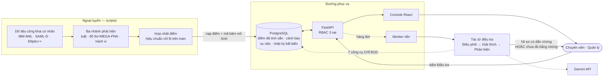
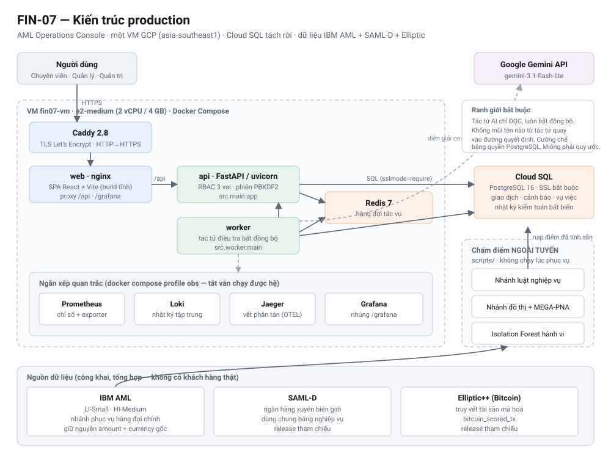

# FIN-07 — AML Operations Console

Hệ thống giám sát và điều tra phòng, chống rửa tiền (AML) Level 1, có tác tử AI
điều tra kèm hàng rào chống bịa đặt và quy trình phê duyệt bắt buộc có con người.

- **Bản triển khai:** <https://amlmonitoring.site/>
- **Console cục bộ:** <http://localhost:5173>
- **Tài liệu API:** <http://localhost:8000/docs>

---

## 1. Tóm tắt

**Vấn đề.** Một tổ chức báo cáo phải rà hàng chục nghìn cảnh báo AML mỗi tháng.
Phần lớn cảnh báo đến từ ngưỡng cứng, nên vừa bỏ sót hành vi tinh vi vừa tạo ra
khối lượng báo động giả khổng lồ. Mỗi cảnh báo được điều tra thủ công: chuyên
viên tự truy vấn dữ liệu, tự dựng quan hệ, tự viết tường thuật. Kết quả là điều
tra luôn chậm hơn dòng tiền, chất lượng hồ sơ phụ thuộc từng người, và không ai
tái dựng được vì sao một kết luận được đưa ra.

**Vì sao AI chưa giải được bài này.** Đưa mô hình ngôn ngữ vào quy trình AML tạo
ra một rủi ro mới nghiêm trọng hơn: mô hình **bịa số và bịa dẫn chứng**. Một hồ
sơ nghi vấn sai gửi tới cơ quan quản lý còn tốn kém hơn một hồ sơ không gửi.

**Giải pháp.** FIN-07 tách bạch ba việc:

1. **Phát hiện** do mô hình tất định làm — luật nghiệp vụ, đồ thị, và một mạng
   nơ-ron đồ thị chấm điểm từng giao dịch. Điểm được tính **ngoại tuyến**, nạp sẵn
   vào cơ sở dữ liệu, có mã băm truy nguyên tới đúng file mô hình sinh ra nó.
2. **Điều tra** do tác tử AI làm, nhưng **mọi con số phải đến từ một cổng công cụ
   chỉ-đọc có allow-list**. Mô hình không phát được câu SQL nào và không tự tính
   số. Một tác tử phản biện tất định đối chiếu **từng con số** với bằng chứng được
   viện dẫn; thiếu một dẫn chứng là cả hồ sơ không qua.
3. **Quyết định** do con người làm. Không có đường nào trong mã nguồn cho phép
   tác tử tự đóng một vụ việc.

**Người dùng.** Chuyên viên phân tích AML (điều tra, lập hồ sơ), Quản lý tuân thủ
(chốt hồ sơ, điều phối), Quản trị hệ thống (vận hành kỹ thuật, không có thẩm
quyền nghiệp vụ).

**Giá trị cốt lõi.** Rút ngắn thời gian từ cảnh báo tới hồ sơ **có dẫn chứng kiểm
chứng được** — mà không đánh đổi bằng nguy cơ hệ thống bịa ra bằng chứng.

---

## 2. Tính năng đã hiện thực

> Mục này chỉ liệt kê tính năng **đang chạy được**. Phần chưa làm nằm ở mục 8.

### Phát hiện

- **Nhánh luật nghiệp vụ** — ngưỡng và kịch bản cấu hình được; mỗi cảnh báo kèm
  **tối thiểu ba yếu tố đóng góp**, không phải một con số trần trụi.
- **Nhánh đồ thị** — FAN_IN / FAN_OUT phân biệt bùng phát đáng ngờ với hub bậc
  cao lành tính; GATHER_SCATTER; CYCLE độ dài 2–6 **có nhân chứng nhất quán thời gian**.
- **MEGA-PNA** — mạng nơ-ron đồ thị chấm điểm **từng cạnh giao dịch**, là nhánh
  phục vụ hàng đợi chính.
- **Isolation Forest hành vi** — 20 đặc trưng cấp tài khoản trên cửa sổ 7 ngày,
  học không giám sát.
- **Hợp nhất điểm** — hiệu chuẩn phân vị **chỉ fit trên tập train**, đóng gói các
  bộ ước lượng đã đóng băng thành một artifact phát hành duy nhất.

### Điều tra bằng tác tử

- Ba vai chạy nối tiếp: **Điều phối → Giải thích → Phản biện**, trần **5 vòng** và
  **16 lượt gọi công cụ**.
- **Bảy công cụ chỉ-đọc** trong allow-list cứng. Mô hình chọn được tên công cụ và
  tham số có ràng buộc — không phát SQL, không chạy mã tuỳ ý, không tự tính số.
- Tác tử phản biện **tất định**: đối chiếu từng con số và từng mã bằng chứng.
  Không đạt thì trả về `INSUFFICIENT_EVIDENCE` **kèm danh sách chỗ còn hổng**.
- Tác tử **chỉ đọc**, cưỡng chế bằng **quyền PostgreSQL** — không phải bằng quy ước.
- Dấu vết đầy đủ: từng lượt gọi công cụ, từng gói bằng chứng, từng khẳng định,
  từng phản bác.

### Quy trình nghiệp vụ

- **Sáu trạng thái vụ việc**, hai vai: Chuyên viên lập và trình — Quản lý chốt.
  Quản lý **cố ý không có quyền soạn SAR** để nguyên tắc bốn mắt chặn được ở cấp
  *vai trò*, không chỉ cấp cá nhân.
- Hai loại đề xuất tới hàng đợi phê duyệt: nộp hồ sơ nghi vấn, hoặc **đóng không
  báo cáo** — vì phần lớn cảnh báo là báo động giả và cần một lối kết thúc hợp lệ.
- Phân công và theo dõi tải công việc của nhóm.
- Soạn SAR bằng AI và **kết xuất PDF có đồ thị**, hiển thị đúng tiếng Việt.
- **Nhật ký kiểm toán chỉ-ghi-thêm**, cưỡng chế bằng trigger cơ sở dữ liệu.

### Console

- Ba vai trò, phân quyền **cưỡng chế ở tầng API** — menu chỉ phản chiếu.
- Bảng điều khiển theo vai, hàng đợi cảnh báo, tra cứu giao dịch, đồ thị mạng lưới
  tương tác (tách từng thành phần liên thông), giám sát địa lý, truy vết tài sản
  mã hoá.
- **Trợ lý AI điều phối**: mô hình chỉ *soạn đề xuất*; người dùng xác nhận rồi máy
  chủ mới thực thi bằng mã tất định.
- Ngăn xếp quan trắc nhúng ngay trong console (Prometheus / Loki / Jaeger / Grafana).

---

## 3. Tổng quan hệ thống



Ba ranh giới quan trọng nhất trong sơ đồ:

1. **Mô hình không chạy lúc phục vụ.** API chỉ đọc điểm đã tính sẵn. Không có
   `joblib.load` hay `torch.load` nào trong đường phục vụ.
2. **Tác tử luôn bất đồng bộ và luôn chỉ đọc.** Không mũi tên nào từ tác tử quay
   ngược vào đường quyết định.
3. **Đường ra của tác tử luôn kết thúc ở con người.** Không có nhánh thứ ba.

---

## 4. Kiến trúc



Kiến trúc đầy đủ — sơ đồ triển khai, luồng một request, ba nhánh mô hình, bảo mật,
CI/CD, sức chứa: **[`docs/architecture/architecture.md`](docs/architecture/architecture.md)**.

### Ngăn xếp công nghệ

| Tầng | Công nghệ |
|---|---|
| Giao diện | React 18 · TypeScript (strict) · Vite · TailwindCSS · MapLibre GL · Cytoscape |
| API | FastAPI 0.141 · uvicorn · Python 3.11 · SQLAlchemy 2.0 · psycopg 3 |
| Cơ sở dữ liệu | PostgreSQL 16 (Cloud SQL trên production) · Redis 7 |
| ML | scikit-learn · PyTorch Geometric · NetworkX · DuckDB |
| Tác tử AI | Google Gen AI SDK · Gemini `gemini-3.1-flash-lite` |
| Nạp dữ liệu luồng | Kafka · Flink (Java) · HDFS |
| Hạ tầng | Docker Compose · Caddy 2.8 (TLS tự động) · GCP VM · Terraform |
| CI/CD | GitHub Actions · Jenkins · tự động triển khai theo cơ chế máy chủ kéo |
| Quan trắc | OpenTelemetry · Prometheus · Loki · Jaeger · Grafana |

---

## 5. Chạy hệ thống

### 5.1 Yêu cầu máy

- Git · Docker Desktop hoặc Docker Engine có Compose v2
- ≥ 12 GB đĩa trống · khuyến nghị ≥ 8 GB RAM
- Cổng chưa bị chiếm: `5173`, `8000`, `5432`, `6379`

Không cần cài Python hoặc Node nếu chỉ chạy bằng Docker. `.env` không bắt buộc
trong môi trường phát triển — mọi biến đều có mặc định.

### 5.2 Cách nhanh nhất — không cần dữ liệu

```bash
git clone https://github.com/AI20K-Build-Phase-Cohort-3/P-022.git
cd P-022
docker compose up -d --build --wait
docker compose ps
```

Các dịch vụ `postgres`, `redis`, `api`, `worker`, `web` phải `healthy`; dịch vụ
`migrate` chạy xong rồi `Exited (0)` là bình thường. Lược đồ được áp đầy đủ nhưng
**chưa có dữ liệu nghiệp vụ** — đủ để xem cấu trúc, chưa đủ để xem console có số.

### 5.3 Chạy đầy đủ với dữ liệu

`git clone` chỉ tải mã nguồn, mô hình nhỏ và báo cáo. Dump PostgreSQL chứa hàng
triệu giao dịch **không nằm trong Git**.

**Bước 1 — tải dump.** Mở
[thư mục handoff trên Google Drive](https://drive.google.com/drive/folders/1UEPEPSYW7ytWu0V8ke7vx1K5lP41lVPh?hl=vi),
tải đúng hai file vào `artifacts/db/`:

```text
fin07_REL-EDGE-039b4b0fd5fb669a_20260815.dump
fin07_REL-EDGE-039b4b0fd5fb669a_20260815.dump.sha256
```

**Bước 2 — kiểm checksum.** Dump nặng `436.514.448` bytes, SHA-256
`5e2de5b536fd9e1f61974ae1d9227d74eb369ce2c32f2ef752cd36a6bb788c96`.

```bash
cd artifacts/db
shasum -a 256 -c fin07_REL-EDGE-039b4b0fd5fb669a_20260815.dump.sha256   # macOS
sha256sum -c  fin07_REL-EDGE-039b4b0fd5fb669a_20260815.dump.sha256      # Linux
cd ../..
```

Kết quả bắt buộc là `OK`. Checksum sai thì **không restore** — xoá bản tải lỗi và
tải lại.

**Bước 3 — restore.**

> `pg_restore --clean` **thay toàn bộ** dữ liệu nghiệp vụ đang có trong database
> `fin07`. Có dữ liệu cần giữ thì backup trước.

```bash
docker compose stop api worker web
docker compose up -d --wait postgres

docker compose exec -T postgres pg_restore \
  -U fin07 -d fin07 --clean --if-exists --exit-on-error \
  --no-owner --no-privileges \
  < artifacts/db/fin07_REL-EDGE-039b4b0fd5fb669a_20260815.dump

docker compose up -d --build --wait
```

Lệnh restore không in tiến độ. Chờ tới khi terminal trả prompt và mã thoát bằng `0`.
Dump loại trừ bảng `app_session`, nên không mang token đăng nhập sang máy khác.

**Bước 4 — kiểm tra.**

```bash
docker compose exec -T postgres psql -U fin07 -d fin07 -Atc "
SELECT 'transactions=' || count(*) FROM transaction;
SELECT 'scores='       || count(*) FROM transaction_model_score;
SELECT 'alerts='       || count(*) FROM alert;
SELECT 'release='      || release_id FROM edge_model_release WHERE status='active';
"

curl -fsS http://localhost:8000/health/ready
```

Kết quả chuẩn: `transactions=5866610` · `scores=5866610` · `alerts=6541` ·
`release=REL-EDGE-039b4b0fd5fb669a`.

Mở <http://localhost:5173> và đăng nhập.

### 5.4 Tài khoản demo

Mật khẩu đều là `demo-password`.

| Email | Vai trò | Thấy gì |
|---|---|---|
| `tuan.la@velrix.vn` | Chuyên viên | Cảnh báo, vụ việc, đồ thị, giao dịch, soạn và trình SAR |
| `hung.nq@velrix.vn` | Quản lý | Phê duyệt SAR, điều phối công việc, nhật ký kiểm toán |
| `manh.dh@velrix.vn` | Quản trị hệ thống | Người dùng, cấu hình, tab kỹ thuật. **Không** thấy dữ liệu AML |

> **Bản dựng cục bộ và bản đang chạy dùng hai release khác nhau.** Hướng dẫn
> trên dựng release edge currency-native `REL-EDGE-039b4b0fd5fb669a`
> (5.866.610 giao dịch, 6.541 cảnh báo). Bản phục vụ tại
> <https://amlmonitoring.site> chạy release MEGA-PNA `REL-MP-6707e0cfbc33679f`
> trên **IBM AML HI-Medium** (6.754.950 giao dịch chấm, 14.267 cảnh báo đang mở).
> Con số hai môi trường không khớp nhau là bình thường; cấu trúc, quy trình và
> mọi màn hình thì giống hệt. Số liệu production đo ngày 01/09/2026 qua
> `/api/v1/fc/edge-model/release`.

### 5.5 Luồng chính để xem thử

Trên console: **Vụ việc** → mở một cảnh báo rủi ro cao → **Điều tra bằng tác tử**
→ xem tab *Bằng chứng* và *Dấu vết* (khoảng 40–90 giây).

Cùng luồng ấy qua API:

```bash
BASE=http://localhost:8000
TOKEN=$(curl -s -X POST "$BASE/api/v1/auth/login" \
  -H 'Content-Type: application/json' \
  -d '{"email":"tuan.la@velrix.vn","password":"demo-password"}' | jq -r .token)

# Ba cảnh báo rủi ro cao nhất đang mở
curl -s -H "Authorization: Bearer $TOKEN" "$BASE/api/v1/alerts?limit=3" \
  | jq -r '.[] | "\(.alert_id)  \(.risk_score)  \(.typology_code)"'

# Giao cho tác tử điều tra, rồi theo dõi tới khi có kết luận
ALERT=<mã cảnh báo ở trên>
curl -s -X POST -H "Authorization: Bearer $TOKEN" "$BASE/api/v1/alerts/$ALERT/investigate" | jq
curl -s -H "Authorization: Bearer $TOKEN" "$BASE/api/v1/alerts/$ALERT/investigation" \
  | jq '{status, workflow_state, iteration, tool_call_count, failure_reason}'
```

Mọi endpoint đều đòi phiên đăng nhập — phân quyền cưỡng chế ở tầng API, không
phải chỉ ẩn menu.

### 5.6 Lệnh vận hành

```bash
docker compose ps                     # trạng thái
docker compose logs -f api worker     # log
docker compose up -d --build --wait   # build lại sau khi pull
docker compose down                   # dừng, GIỮ dữ liệu
make help                             # toàn bộ lệnh
```

> Không chạy `docker compose down -v` và không xoá volume `fin07_postgres_data`
> nếu chưa có backup — hai thao tác đó xoá database đã restore.

Xử lý sự cố, phát triển ngoài Docker, và triển khai lên VM:
[`docs/operations/README.md`](docs/operations/README.md).

---

## 6. Kiểm thử

```bash
make check            # ruff + 679 ca pytest
make contracts-check  # xác thực mọi hợp đồng dữ liệu
cd web && npm run typecheck && npm test -- --run && npm run build
```

| Tầng | Quy mô |
|---|---|
| Python (đơn vị + tích hợp) | 94 file · **679 ca** |
| Giao diện (Vitest) | 15 file |
| Hợp đồng dữ liệu | JSON Schema, kiểm cả ví dụ hợp lệ **và** không hợp lệ |
| Khói đầu–cuối | `docker compose up` trên máy sạch |

Cổng CI (GitHub Actions, tất cả phải xanh mới merge được): `lint` · `test` ·
`web` · `images` · `compose-smoke`.

- **[Kế hoạch kiểm thử](docs/testing/test-plan.md)** — kiểm cái gì, ở tầng nào, cổng nào chặn merge
- **[Danh mục ca kiểm thử](docs/testing/test-cases.md)** — ca kiểm thử ánh xạ tới yêu cầu
- **[Báo cáo kiểm thử](docs/testing/test-report.md)** — kết quả thật, lỗi tìm được, và giới hạn

---

## 7. Tài liệu

| Tài liệu | Nội dung |
|---|---|
| **[Kiến trúc](docs/architecture/architecture.md)** | Kiến trúc production, sơ đồ triển khai, luồng request, bảo mật, sức chứa |
| **[Đặc tả hệ thống](docs/specification/system-specification.md)** | Phân tích nghiệp vụ, tuyên bố vấn đề, phạm vi, và đối chiếu với phần đã hiện thực |
| **[Yêu cầu chức năng](docs/specification/functional-requirements.md)** | Vai trò, ma trận quyền, màn hình, quy trình vụ việc, yêu cầu phi chức năng |
| **[Thiết kế kỹ thuật](docs/specification/technical-design.md)** | Nhánh phát hiện, thuật toán, tầng tác tử, quyết định thiết kế và lý do |
| **[Mô hình dữ liệu](docs/specification/data-model.md)** | Nguồn dữ liệu, lược đồ CSDL, đặc trưng mô hình, hợp đồng dữ liệu, lineage mô hình |
| **[Kế hoạch](docs/testing/test-plan.md)** · **[Ca](docs/testing/test-cases.md)** · **[Báo cáo kiểm thử](docs/testing/test-report.md)** | Chiến lược, danh mục và kết quả kiểm thử |
| [Hồ sơ mô hình](docs/ml/README.md) | EDA, thiết kế đặc trưng, các lượt huấn luyện, benchmark |
| [Vận hành](docs/operations/README.md) | Runbook máy cá nhân, dựng GCP, triển khai VM, CI/CD, giám sát |
| [Quan trắc](docs/observability/README.md) | Chỉ số, SLO, và runbook cho từng cảnh báo |
| [Nhánh Bitcoin và SAML-D](docs/nhanh_bitcoin_samld.md) | Hai nhánh dữ liệu ngoài IBM AML |
| [Hợp đồng dữ liệu](contracts/README.md) | Nguồn sự thật duy nhất về hình dạng dữ liệu |
| [Bảo mật](SECURITY.md) | Chính sách bảo mật và phạm vi dữ liệu |

### Hạng mục nộp theo yêu cầu ban tổ chức

| # | Hạng mục | Vị trí |
|---|---|---|
| 1 | Source Code | [`src/`](src/), [`web/`](web/) |
| 2 | README | tài liệu này |
| 3 | Architecture Diagram | [`docs/architecture_diagram.md`](docs/architecture_diagram.md) |
| 4 | AI Logs | [`.ai-log/`](.ai-log/) — tự động qua pre-push hook |
| 5 | Live URL | <https://amlmonitoring.site> |
| 6 | Video Demo | *(nộp ngoài repo)* |
| 7 | Pitch Deck | [`presentation/`](presentation/) |
| 8 | Weekly Journal | [`JOURNAL.md`](JOURNAL.md) |
| 9 | Worklog | [`WORKLOG.md`](WORKLOG.md) |
| 10 | Evaluation Evidence | [`eval/results/report.md`](eval/results/report.md) |

---

## 8. Trạng thái và giới hạn đã biết

Nói thẳng, không tô hồng:

- **Chưa ca điều tra nào đi trọn đường tới bản luận giải được duyệt tự động.**
  Hàng rào phản biện chặn đúng — mô hình có bịa số và bị bắt. Cải thiện phải đến
  từ việc giảm ảo giác ở tác tử giải thích, không phải nới hàng rào.
- **Isolation Forest có trọng số 0 trong bước hợp nhất** — vẫn sinh cảnh báo riêng
  nhưng không cải thiện chỉ số trên tập kiểm thử.
- **Cảnh báo là hàng đợi dùng chung** — bảng `alert` chưa có cột người-được-giao,
  nên phạm vi dữ liệu cấp bản ghi chưa áp được cho cảnh báo (vụ việc thì có).
- **Ba bảng phân quyền song song** phải đồng bộ tay; nợ kỹ thuật là dẫn xuất cả ba
  từ `permissions.py`.
- **Nạp dữ liệu luồng chưa lên production** — đã chạy end-to-end ở local-dev.
- **Không có so khớp danh sách trừng phạt / PEP** — bộ dữ liệu công khai không có
  tên, không có hồ sơ khách hàng. Xây so khớp tên trên dữ liệu không có tên là xây
  một tính năng trình diễn.
- **Chưa làm:** kiểm thử tải, kiểm thử xâm nhập của bên thứ ba, đo trải nghiệm
  người dùng có người thật, quét thiết kế đáp ứng ở màn hình nhỏ.

Chi tiết đầy đủ: [báo cáo kiểm thử §7](docs/testing/test-report.md#7-giới-hạn-của-đợt-kiểm-thử-nói-thẳng)
và [đặc tả hệ thống §9](docs/specification/system-specification.md#9-đối-chiếu-phạm-vi-cam-kết-với-phần-đã-hiện-thực).

---

## 9. Cấu trúc kho mã

```text
src/                  Mã nguồn Python
  api/                FastAPI routes, phân quyền, copilot, SAR
  investigation/      Tầng tác tử điều tra (3 vai, 7 công cụ)
  detection/          Luật nghiệp vụ và detector
  behavior/           Isolation Forest hành vi
  mega_pna/           Mạng đồ thị chấm cạnh
  fusion/             Hợp nhất điểm
  data/               ETL, đặc trưng đồ thị, detector chu trình
  streaming/          Nạp dữ liệu luồng
  worker/             Worker nền
  observability/      OpenTelemetry
web/                  Console React + Vite
tests/                94 file · 679 ca kiểm thử
db/init/              51 migration PostgreSQL
contracts/            Hợp đồng dữ liệu, sự kiện và công cụ (JSON Schema)
scripts/              Huấn luyện, chấm điểm, nạp release, vận hành
models/               File mô hình được version hoá
reports/              Báo cáo benchmark và manifest
flink/                Job nạp dữ liệu Flink (Java)
deploy/ ci/ jenkins/  Triển khai và CI/CD
infra/terraform/      Hạ tầng GCP
monitoring/           Prometheus, Grafana, Loki, OTel collector
docs/                 Kiến trúc, đặc tả, kiểm thử, vận hành, mô hình
```

---

## 10. Quy tắc dữ liệu và mô hình

- Không commit `.env`, thông tin xác thực, dữ liệu IBM AML thô, DuckDB, parquet
  điểm số hay dump PostgreSQL.
- `Amount Paid` / `Amount Received` và `Payment` / `Receiving Currency` **giữ nguyên**.
- Chuẩn hoá theo loại tiền **chỉ fit trên tập train**; không dùng tỷ giá tĩnh
  trong mô hình.
- Điểm mô hình dùng để **xếp hàng ưu tiên**, không phải xác suất rửa tiền và
  không phải kết luận pháp lý.
- Tác tử **không được đọc nhãn ground truth**; mọi kết luận cần bằng chứng và cần
  người rà soát.

---

## 11. Giấy phép

Mã nguồn dùng giấy phép [MIT](LICENSE). Bộ dữ liệu IBM AML là dữ liệu tổng hợp và
tiếp tục tuân theo CDLA-Sharing-1.0.
