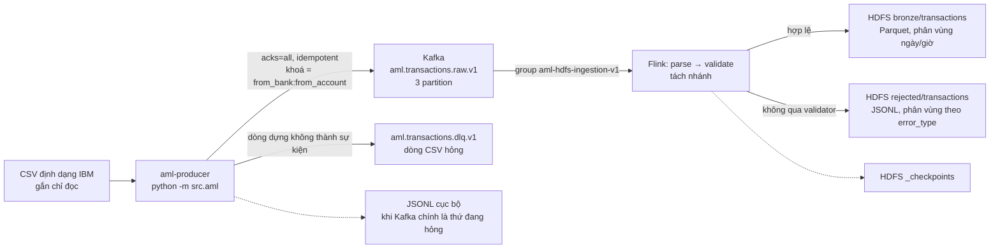

# Ingestion contracts — IBM AML → Kafka → Flink → HDFS

Đây là phần **đang chạy thật** của nền tảng, khác với các contract còn lại trong `contracts/` vốn mô
tả mô hình đích. Tài liệu vận hành chi tiết trước đây nằm ở `docs/AML_INGESTION.md`; phần kiến thức
không suy ra được từ mã nguồn đã được gom về đây, cạnh chính cái contract mà nó mô tả.

Luồng duy nhất hiện nay là IBM CSV → Kafka → Flink → HDFS. Đường CloudEvent
`bank.transaction.posted.v1` từ tầng ABM-BANK đã bị gỡ cùng bộ dữ liệu đó (08/2026).

Cơ sở kiến trúc: mục 6.1 (vùng RAW/BRONZE), mục 5.3 (quy tắc xử lý sự kiện).



---

## 1. Contract

| File | Nội dung |
|---|---|
| `aml-transaction-v1.schema.json` | Hợp đồng của topic `aml.transactions.raw.v1`. JSON Schema draft 2020-12, `additionalProperties: false`, 18 trường bắt buộc, `schema_version` const `"1.0"`. |
| `examples/aml-transaction-valid.json` | Một sự kiện hợp lệ. |
| `examples/aml-transaction-invalid.json` | Cố ý sai bốn chỗ cùng lúc — dùng để chứng minh contract thật sự từ chối dữ liệu xấu. |

Contract này được cưỡng chế ở **ba** nơi, và ba nơi đó phải sửa cùng lúc:

| Nơi | Vai trò |
|---|---|
| `src/aml/schema.py` (`AmlTransactionEvent`) | Producer sinh sự kiện |
| `flink/.../serde/TransactionJsonParser.java` (`KNOWN_FIELDS`) | Flink parse, từ chối trường lạ |
| `flink/.../validation/TransactionValidator.java` | Flink kiểm tính hợp lệ nghiệp vụ |

`tests/test_aml/test_schema.py` giữ contract khớp với `src/aml/schema.py`. **Không có test nào giữ
phía Java khớp** — đây là khoảng trống đã biết, sửa Java mà quên contract sẽ không làm CI đỏ.

---

## 2. Topic

| | Giá trị |
|---|---|
| Topic dữ liệu | `aml.transactions.raw.v1` — 3 partition, replication 1 (một broker) |
| Topic DLQ | `aml.transactions.dlq.v1` — 1 partition |
| Khoá | `from_bank:from_account` — gom mọi giao dịch của một tài khoản vào cùng partition |
| Khoá DLQ | `source_file:source_line_number` |
| Retention | 7 ngày (`AML_TOPIC_RETENTION_MS`) |
| Header | `schema-version`, `source-dataset`, `source-file`, `content-type` |

Tạo topic bằng `make aml-topics` (idempotent, `--if-not-exists`).

---

## 3. Vùng dữ liệu trên HDFS

```
hdfs://namenode:8020/data/aml/
├── bronze/transactions/     source_dataset=…/event_date=…/event_hour=…   (Parquet, mặc định)
├── rejected/transactions/   event_date=…/error_type=…                    (luôn JSON Lines)
├── reference/patterns/      *_Patterns.txt chép nguyên trạng, không phân tích
└── _checkpoints/            state của Flink
```

Phân vùng theo UTC, luôn luôn. **Cố ý không phân vùng theo account** — hàng triệu thư mục nhỏ sẽ
làm nổ bộ nhớ NameNode.

Phân vùng của `rejected/` dùng **ngày xử lý**, không phải event time: bản ghi bị từ chối thường
chính vì nó không có event time hợp lệ.

---

## 4. Ngữ nghĩa giao hàng — điều dễ hiểu sai nhất

**Producer → Kafka là at-least-once.** Producer bật `enable.idempotence` và `acks=all`, nhưng
checkpoint chỉ tiến sau khi Kafka **đã xác nhận**; một lần crash giữa hai checkpoint sẽ phát lại
những dòng đã gửi.

Đó là lý do `transaction_id` **tất định**: 128 bit đầu của SHA-256 băm từ tên file, số dòng,
timestamp thô, hai cặp ngân hàng/tài khoản và hai cột số tiền — tất cả lấy nguyên trạng từ dòng CSV.
Chạy lại cùng một file cho ra cùng một mã, nên tầng dưới khử trùng lặp được. **Không phải UUID.**

**Flink → HDFS là exactly-once ở mức file đã chốt.** File chỉ chuyển từ `.inprogress` sang hoàn tất
sau một checkpoint thành công, nên không reader nào thấy file dở.

**Tầng bronze CÓ THỂ chứa bản trùng.** Flink không khử trùng lặp. Việc đó thuộc tầng silver, chưa
xây. Ai đọc bronze phải tự khử theo `transaction_id`.

---

## 5. Hai lớp xử lý lỗi khác nhau

Đừng nhầm hai thứ này:

| | Kafka DLQ topic | HDFS `rejected/` |
|---|---|---|
| Ai ghi | Producer | Flink |
| Bắt cái gì | Dòng CSV hỏng, không dựng được sự kiện | Sự kiện parse được nhưng không qua validator |
| Loại lỗi | `field_count`, `timestamp_unparsable`, `amount_negative`, `label_invalid`… | `unexpected_field`, `type_mismatch`, `empty_payload`, schema version sai… |

Producer còn ghi song song một file JSONL cục bộ (`AML_ERROR_LOG_PATH`) — cố ý, vì khi Kafka chính
là thứ đang hỏng thì DLQ cũng hỏng theo.

---

## 6. Hai cái bẫy của bộ dữ liệu IBM

1. **File CSV có HAI cột cùng tên `Account`.** `csvsource.py` đọc theo **vị trí cột** (index 2 và 4),
   không theo tên. Dùng `pandas` hay `csv.DictReader` sẽ im lặng nuốt mất một cột.
2. **Mã ngân hàng có số 0 đứng đầu.** `015768` parse thành số sẽ thành `15768` và không bao giờ khớp
   lại được. Parser Java từ chối tường minh nếu trường định danh đến dưới dạng JSON number.

Ngoài ra: cột `Timestamp` **không có múi giờ**. `DATASET_TIMEZONE` là một giả định được khai báo,
không phải suy đoán — đổi nó là đổi phân vùng ngày/giờ trên HDFS, nên không đổi giữa chừng một lần nạp.

---

## 7. Lệnh

```bash
make aml-up                 # Kafka + Kafka UI + HDFS + Flink, tạo topic
make aml-submit             # nộp job Flink
make aml-producer-sample    # phát 1.000 giao dịch đầu
make aml-inspect-kafka      # topic, offset, vài message
make aml-inspect-hdfs       # phân vùng và số file
make aml-smoke              # kiểm tra khói đầu–cuối bằng fixture có sẵn, không cần Kaggle
make aml-cancel             # dừng job Flink
make aml-down               # dừng hạ tầng, giữ dữ liệu
```

`make aml-smoke` là cách nhanh nhất để biết chuỗi có thông không: nó dùng fixture 204 dòng
(200 hợp lệ + 4 hỏng), tạo topic và thư mục HDFS riêng cho mỗi lần chạy, tiêm thêm một message hỏng
thẳng vào topic để chứng minh đường reject của Flink cũng hoạt động, rồi kiểm chứng đúng 200 bản ghi
với 200 `transaction_id` khác nhau.

Bộ dữ liệu đặt ở `data/raw/ibm-aml/` (không commit — xem README ở đó).

### Ba giao diện

| | Địa chỉ | Nhìn thấy gì |
|---|---|---|
| Kafka UI | <http://localhost:8082> | Topic, offset từng partition, **độ trễ consumer group**, nội dung message kèm header |
| Flink UI | <http://localhost:8081> | DAG kèm số bản ghi thật, **tab Checkpoints**, backpressure, watermark |
| HDFS UI | <http://localhost:9870> | Cây phân vùng, file `.inprogress` chưa chốt |

Hai tab đáng mở nhất khi nghi có trục trặc: **Consumers** trên Kafka UI (lag tăng đơn điệu = Flink
không theo kịp) và **Checkpoints** trên Flink UI (không có checkpoint mới = HDFS sẽ không có file
mới, vì file chỉ chốt sau checkpoint thành công).

Trên HDFS UI, bấm vào một file để xem nội dung sẽ treo: trình duyệt bị chuyển sang `datanode:9864`,
một hostname chỉ phân giải được bên trong mạng compose. Duyệt thư mục thì bình thường; muốn đọc nội
dung thì dùng `make aml-inspect-hdfs`.

Kafka UI đặt `DYNAMIC_CONFIG_ENABLED=false` — đây là công cụ để nhìn, không phải để một cú bấm nhầm
xoá mất topic đang có dữ liệu.

### Cổng và điều kiện xanh

| Dịch vụ | Cổng ra máy chủ | Xanh khi |
|---|---:|---|
| `kafka` | 29092 | trả lời được lệnh metadata của client |
| `kafka-ui` | 8082 | `/actuator/health` trả 200 |
| `namenode` | 9870 | **`dfsadmin -safemode get` trả `OFF`** |
| `datanode` | — | giao diện DataNode trong container trả lời |
| `flink-jobmanager` | 8081 | `/overview` trả 200 |
| `flink-taskmanager` | — | không có healthcheck riêng |

---

## 8. Ba cái bẫy khi chạy ở máy cá nhân

Cả ba đều đã làm hỏng một lượt chạy thật, không phải phòng xa.

**`AML_DATASET_FILE` mặc định trỏ tới file bạn có thể không có.** Mặc định trong mã là
`HI-Small_Trans.csv`. Ai tải file khác từ Kaggle sẽ thấy producer chạy vào một đường dẫn không tồn
tại. Đặt trong `.env`:

```dotenv
AML_DATASET_FILE=LI-Small_Trans.csv
AML_CSV_PATH=data/raw/ibm-aml/LI-Small_Trans.csv   # cho lần chạy ngoài Docker
```

**`make aml-up` có cờ `--build`, nên nó cần mạng tới Docker Hub mỗi lần.** Kể cả khi image đã dựng
xong từ trước, BuildKit vẫn hỏi lại metadata của `maven:3.9-eclipse-temurin-11` và
`apache/hadoop:3.3.6`. Mạng chậm là hỏng với `DeadlineExceeded`. Khi đó bỏ `--build`:

```bash
docker compose --profile aml up -d --wait \
    kafka kafka-ui namenode datanode flink-jobmanager flink-taskmanager
```

Chỉ cần `--build` khi vừa sửa mã Java trong `flink/aml-ingestion/`.

**Mạng compose treo sau khi tắt máy hoặc ngắt đột ngột.** Triệu chứng: `failed to set up container
networking: network ... not found`, và — đáng chú ý — lệnh vẫn **thoát với mã 0**. Dọn:

```bash
docker compose --profile aml down --remove-orphans
docker network prune -f
```

---

## 9. Vì sao healthcheck của NameNode hỏi safe mode

Trước đây nó hỏi `curl http://localhost:9870/`. Giao diện HTTP của NameNode trả lời từ rất sớm, kể
cả khi nó còn trong safe mode và **từ chối mọi thao tác ghi**. Hệ quả: `--wait` báo xanh, rồi lệnh
`hdfs dfs -mkdir` đầu tiên chết với *"Name node is in safe mode"* — đúng thứ đã làm hỏng một lượt
`make aml-smoke`.

Nay nó hỏi `hdfs dfsadmin -safemode get` và chờ tới khi nhận `OFF`. Lệnh này mất khoảng 2,5 giây vì
phải khởi động JVM, nên `timeout` để 15 giây.

Đây cùng một bài học đã rút ra ở healthcheck của `postgres`, chép lại vì nó đáng nhớ: **hỏi đúng thứ
client sẽ hỏi.** Kiểm tra cổng có mở không nói lên điều gì về việc dịch vụ đã nhận việc được chưa.

---

## 10. Giới hạn hiện tại, nói rõ ra

- **Chỉ là đường ống dữ liệu.** Không mô hình, không chấm điểm rủi ro, không sinh cảnh báo. Cột
  `is_laundering` được mang theo nguyên trạng như một cột dữ liệu bình thường — nó **không** được
  dùng để định tuyến hay lọc bất cứ thứ gì.
- **Số tiền lưu dưới dạng `double` trong Parquet**, không phải decimal: đường Avro→Parquet của Flink
  không có converter cho decimal. An toàn vì producer đã kiểm chứng mọi giá trị round-trip không mất
  mát qua `double`, nhưng đây là ràng buộc phải biết trước khi mở rộng.
- **Watermark đã nối dây nhưng chưa có cửa sổ nào dùng.** Trục thời gian đúng từ đầu là có chủ đích.
- **Không có schema registry.** Version kiểm bằng validator viết tay ở hai đầu.
