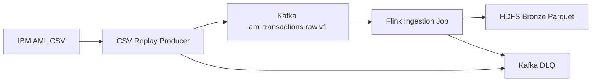
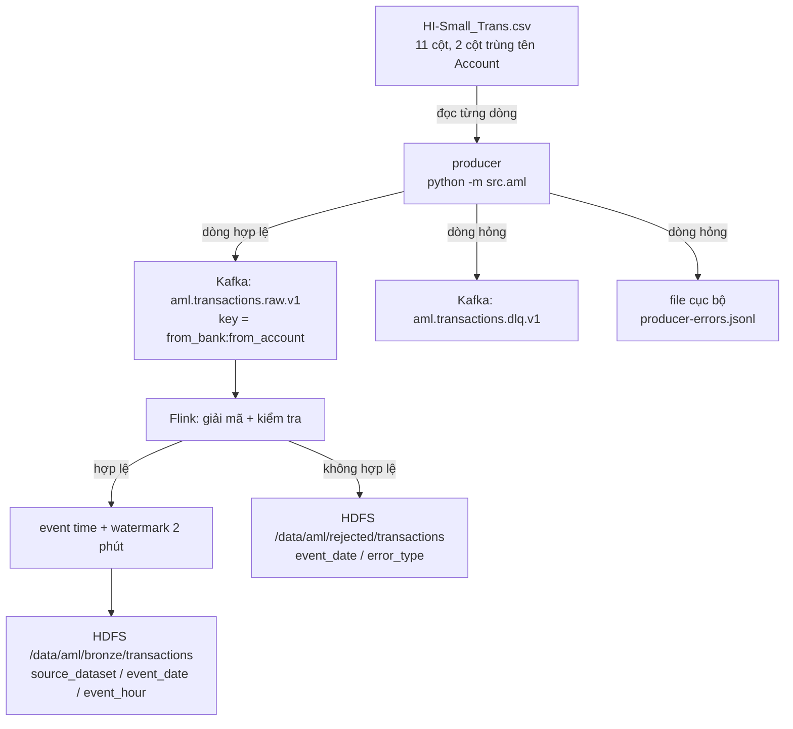

# Luồng nạp dữ liệu AML — CSV IBM → Kafka → Flink → HDFS

Đối tượng: người cần nạp bộ dữ liệu *IBM Transactions for Anti-Money
Laundering* vào hồ dữ liệu của FIN-07 và kiểm chứng được là không mất bản
ghi nào trên đường đi.

> **Phạm vi.** Đây thuần tuý là một đường ống dữ liệu. Không có mô hình học
> máy, không học sâu, không đồ thị, không phát hiện bất thường, không chấm
> điểm rủi ro, không luật AML, không sinh cảnh báo — xem [mục 12](#12-những-gì-cố-ý-chưa-có).
> Cột `is_laundering` của bộ dữ liệu được mang theo **nguyên trạng**, như một
> cột dữ liệu bình thường, và không điều khiển bất kỳ nhánh xử lý nào.

---

## 1. Kiến trúc



Chi tiết hơn một chút, kèm chỗ dữ liệu rẽ nhánh khi có lỗi:



Ba tiến trình, ba trách nhiệm tách bạch:

| Thành phần | Ngôn ngữ | Việc của nó | Việc **không** phải của nó |
|---|---|---|---|
| Producer | Python 3.11 | Đọc CSV theo dòng, chuẩn hoá, gửi Kafka, ghi điểm dừng | Diễn giải dữ liệu |
| Job Flink | Java 11, Flink 1.20 | Kiểm tra lại, gán event time, phân vùng, ghi HDFS | Gộp nhóm, cửa sổ, chấm điểm |
| HDFS | Hadoop 3.3.6 | Lưu tầng bronze, phân vùng theo ngày/giờ | Biến đổi dữ liệu |

---

## 2. Bộ dữ liệu

Nguồn:
<https://www.kaggle.com/datasets/ealtman2019/ibm-transactions-for-anti-money-laundering-aml>

Đặt file vào `data/raw/ibm-aml/` — xem
[data/raw/ibm-aml/README.md](../data/raw/ibm-aml/README.md). Thư mục nằm
trong `.gitignore`; bộ dữ liệu **không** được commit, và khoá Kaggle cũng
không.

Tải bằng Kaggle CLI là **tuỳ chọn**:

```bash
pip install kaggle
./scripts/aml/download_dataset.sh HI-Small_Trans.csv
```

### Lược đồ file nguồn

| # | Cột | Ghi chú |
|---|---|---|
| 1 | `Timestamp` | `2022/09/01 00:20`, **không có múi giờ** |
| 2 | `From Bank` | chuỗi, có số 0 ở đầu (`015768`) |
| 3 | `Account` | tài khoản **gửi** |
| 4 | `To Bank` | chuỗi |
| 5 | `Account` | tài khoản **nhận** — trùng tên với cột 3 |
| 6 | `Amount Received` | |
| 7 | `Receiving Currency` | |
| 8 | `Amount Paid` | khác cột 6 khi có đổi tiền |
| 9 | `Payment Currency` | |
| 10 | `Payment Format` | |
| 11 | `Is Laundering` | `0` hoặc `1` |

Hai cái bẫy của file này, và cách luồng nạp xử lý:

**Hai cột cùng tên `Account`.** `pandas` đổi tên chúng thành `Account` và
`Account.1`; `csv.DictReader` giữ đúng một cột và **vứt cột kia không báo
gì**. Cả hai đều là hành vi của thư viện, có thể đổi giữa các phiên bản.
Luồng này đọc theo **vị trí**: cột 3 là `from_account`, cột 5 là
`to_account` — xem `src/aml/csvsource.py`.

**Số 0 ở đầu định danh.** `015768` ép sang số rồi in lại là `15768`, tức
một ngân hàng khác. Mọi mã ngân hàng và số tài khoản là `String` từ đầu tới
cuối: trong Python, trong JSON, trong Java, trong Parquet.

---

## 3. Lược đồ sự kiện chuẩn hoá

Hợp đồng dữ liệu bản máy đọc được:
[`schemas/aml-transaction-v1.schema.json`](../schemas/aml-transaction-v1.schema.json),
kèm một ví dụ hợp lệ và một ví dụ sai trong `schemas/examples/`.
`tests/test_aml/test_schema.py` giữ file lược đồ khớp với mã sinh ra dữ liệu.

```json
{
  "transaction_id": "9d3f1c0a8b6e4f27a51d0c93e7b4a812",
  "event_time": "2022-09-01T00:03:00",
  "event_time_epoch_ms": 1661990580000,
  "from_bank": "015768",
  "from_account": "8149656B0",
  "to_bank": "015768",
  "to_account": "8149656B0",
  "amount_received": 10.91,
  "receiving_currency": "US Dollar",
  "amount_paid": 10.91,
  "payment_currency": "US Dollar",
  "payment_format": "Reinvestment",
  "is_laundering": 0,
  "source_dataset": "HI-Small",
  "source_file": "HI-Small_Trans.csv",
  "source_line_number": 2,
  "ingested_at": "2026-07-31T08:12:44.512Z",
  "schema_version": "1.0"
}
```

**`transaction_id` là tất định.** 128 bit đầu của SHA-256 băm từ: tên file,
số dòng, timestamp thô, hai cặp ngân hàng/tài khoản, hai cột số tiền — tất
cả lấy nguyên trạng từ dòng CSV. Chạy lại cùng một file cho ra cùng một tập
mã. Không dùng UUID ngẫu nhiên, vì đúng thứ này là cái cho phép downstream
khử trùng lặp sau khi producer khởi động lại (xem [mục 8](#8-ngữ-nghĩa-giao-hàng)).

**Múi giờ là một giả định được khai báo.** Cột `Timestamp` không có múi giờ.
`DATASET_TIMEZONE` (mặc định `UTC`) quyết định `event_time_epoch_ms`, và do
đó quyết định luôn phân vùng ngày/giờ trên HDFS. Không đổi biến này giữa
chừng một lần nạp.

**Khoá message là `from_bank:from_account`.** Mọi giao dịch xuất phát từ
cùng một tài khoản vào cùng một partition, nên thứ tự của chúng được giữ
*trong phạm vi partition đó*. Kafka không bảo đảm thứ tự giữa các partition
và luồng này không dựa vào một bảo đảm như vậy.

Header của message: `schema-version`, `source-dataset`, `source-file`,
`content-type`.

---

## 4. Dựng hạ tầng

Yêu cầu: Docker, khoảng 4 GB RAM trống cho profile `aml` (cộng thêm phần của
stack chính nếu đang chạy).

```bash
make aml-up
```

Lệnh này dựng Kafka, HDFS, Flink, tạo cây thư mục trên HDFS và tạo topic.
Tương đương với:

```bash
docker compose --profile aml up -d --build --wait \
    kafka namenode datanode flink-jobmanager flink-taskmanager
docker compose --profile aml up hdfs-init
docker compose --profile aml run --rm kafka-init
```

| Dịch vụ | Vai trò | Cổng | Xanh khi |
|---|---|---|---|
| `kafka` | Broker + controller (KRaft, một node) | 29092 | trả lời được yêu cầu metadata |
| `namenode` | HDFS NameNode | 9870 | giao diện web trả lời |
| `datanode` | HDFS DataNode | — | giao diện web trả lời |
| `flink-jobmanager` | Điều phối job | 8081 | `/overview` trả 200 |
| `flink-taskmanager` | Chạy tác vụ | — | — |
| `kafka-init` | Tạo topic rồi thoát | — | thoát mã 0 |
| `hdfs-init` | Tạo thư mục rồi thoát | — | thoát mã 0 |
| `aml-producer` | Phát lại CSV, chạy theo yêu cầu | — | — |

- Flink UI — <http://localhost:8081>
- HDFS UI — <http://localhost:9870>

Profile `aml` **không** khởi động cùng `docker compose up`: nó nặng và chỉ
cần khi làm việc với bộ dữ liệu này. Stack chính (`api`, `worker`, `web`)
không đổi.

> Trên máy Apple Silicon: image Hadoop chính thức chỉ có bản amd64 nên hai
> container HDFS chạy qua lớp giả lập — chậm hơn đáng kể nhưng đúng.

### Tạo topic

```bash
make aml-topics
```

Chạy lại bao nhiêu lần cũng an toàn (`--if-not-exists`). Số partition và hệ
số nhân bản lấy từ `AML_TOPIC_PARTITIONS` và
`AML_TOPIC_REPLICATION_FACTOR`; trên máy một broker thì hệ số nhân bản phải
là 1.

---

## 5. Chạy producer

### 1.000 giao dịch đầu tiên

```bash
make aml-producer-sample
# docker compose --profile aml run --rm aml-producer --max-records 1000 --no-resume
```

### Toàn bộ file

```bash
make aml-producer-run
# docker compose --profile aml run --rm aml-producer --max-records 0
```

### Phát lại theo thời gian gốc

```bash
make aml-producer-eventtime
# docker compose --profile aml run --rm aml-producer --mode event-time --speed 100 --max-records 0
```

`--speed 1` là tốc độ thật, `--speed 100` nhanh gấp trăm lần. Nhịp chờ được
neo vào sự kiện đầu tiên chứ không cộng dồn từng cặp, nên sai số không tích
luỹ. Dữ liệu không sắp xếp hoàn toàn theo thời gian sẽ không bao giờ tạo ra
thời gian chờ âm.

### Đổi sang bộ dữ liệu khác

```bash
AML_DATASET_FILE=LI-Medium_Trans.csv make aml-producer-run
```

### Chạy từ máy chủ thay vì trong container

```bash
pip install -r requirements.txt
KAFKA_BOOTSTRAP_SERVERS=localhost:29092 \
    python -m src.aml --csv-path data/raw/ibm-aml/HI-Small_Trans.csv --max-records 1000
```

### Kiểm tra một file mới mà chưa cần Kafka

```bash
python -m src.aml --csv-path <file> --dry-run --max-records 1000 --no-checkpoint
```

### Giới hạn phạm vi

| Tuỳ chọn | Biến môi trường | Ý nghĩa |
|---|---|---|
| `--max-records N` | `MAX_RECORDS` | Dừng sau N sự kiện hợp lệ |
| `--start-line N` | `START_LINE` | Dòng file đầu tiên (tiêu đề là dòng 1) |
| `--end-line N` | `END_LINE` | Dòng file cuối cùng |
| `--from-timestamp T` | `FROM_TIMESTAMP` | Lọc theo event time |
| `--to-timestamp T` | `TO_TIMESTAMP` | Lọc theo event time |

### Nhật ký tiến độ

Producer in một dòng tổng hợp mỗi 10 giây (`AML_PROGRESS_EVERY_SECONDS`),
không log từng giao dịch:

```
tiến độ rows_read=204 events_valid=200 events_invalid=4 events_acked=200
        events_failed=0 dlq_sent=4 dlq_failed=0 rows_per_second=47599.6
        bytes_read=18049 current_line=205 last_event_time=2022-09-01T03:19:00
        send_latency_avg_ms=0.31 send_latency_max_ms=12.44 elapsed_seconds=0.0
```

Hai đẳng thức phải luôn đúng, và producer tự báo lỗi nếu không:

```
rows_read   = events_valid + events_invalid
events_valid = events_acked + events_failed + (đang chờ)
```

---

## 6. Chạy job Flink

```bash
make aml-submit
# ./scripts/aml/submit_job.sh
```

Nộp thêm tham số cho job:

```bash
./scripts/aml/submit_job.sh --aml.hdfs.format json --aml.parallelism 4
```

Dừng job:

```bash
make aml-cancel
```

Job làm đúng bốn việc: giải mã JSON thành kiểu dữ liệu có định nghĩa rõ
ràng, kiểm tra lại, gán event time cùng watermark, và ghi xuống HDFS theo
phân vùng. Bản ghi không dùng được đi ra một nhánh phụ (side output) và
được ghi vào vùng `rejected` — **không có bản ghi nào bị bỏ đi trong im
lặng**.

Vì sao kiểm tra hai lần, khi producer đã kiểm tra rồi: producer và job Flink
là hai tiến trình triển khai độc lập, và topic có thể nhận dữ liệu từ một
producer khác, một phiên bản cũ, hay một lần chạy thử tay. Tầng lưu trữ phải
tự bảo vệ lược đồ của chính nó.

**Event time và watermark** được khai báo dù giai đoạn này chưa có cửa sổ
nào dùng tới. Chúng thuộc về hợp đồng của luồng dữ liệu: gắn đúng từ lúc nạp
thì các phép tính theo thời gian sau này không phải nạp lại toàn bộ dữ liệu
để có một trục thời gian đúng. Mức trễ cho phép mặc định là 2 phút
(`AML_WATERMARK_OUT_OF_ORDER_SECONDS`).

---

## 7. Bố cục dữ liệu trên HDFS

```
/data/aml/bronze/transactions/
    source_dataset=HI-Small/
        event_date=2022-09-01/
            event_hour=00/
                transactions-0-0.parquet
            event_hour=01/
                ...
/data/aml/rejected/transactions/
    event_date=2026-07-31/
        error_type=json_unparsable/
            rejected-0-0.jsonl
/data/aml/reference/patterns/
    HI-Small_Patterns.txt
```

Ba khoá phân vùng — bộ dữ liệu, ngày, giờ — là mức chi tiết vừa đủ: truy vấn
theo khoảng thời gian chỉ đọc phần cần đọc, mà số thư mục vẫn ở mức hàng
nghìn. **Không** phân vùng theo tài khoản: bộ dữ liệu có hàng trăm nghìn tài
khoản, mỗi tài khoản một thư mục sẽ tạo hàng trăm nghìn file rất nhỏ — thứ
NameNode phải giữ toàn bộ trong bộ nhớ, và thứ làm mọi job đọc sau này chậm
đi hàng chục lần.

Đổi gốc bằng `AML_HDFS_BASE_PATH`.

### Định dạng và cách cắt file

| Định dạng | Cắt file khi | Điều khiển bằng |
|---|---|---|
| `parquet` (mặc định) | mỗi checkpoint | `AML_CHECKPOINT_INTERVAL_MS` |
| `json` | hết thời gian, hết khoảng lặng, hoặc đủ kích thước | `AML_ROLLOVER_INTERVAL_MS`, `AML_ROLLOVER_INACTIVITY_MS`, `AML_ROLLOVER_MAX_MB` |

Đây là ràng buộc của Flink, không phải lựa chọn: Parquet là định dạng khối,
một file dở dang không đọc được, nên Flink chỉ cho phép cắt tại checkpoint.
Muốn ít file to hơn thì tăng chu kỳ checkpoint.

Trong cả hai trường hợp, file chỉ chuyển từ trạng thái `.inprogress` sang
hoàn tất **sau khi checkpoint thành công**. Job đọc phía sau vì thế không
bao giờ thấy một file viết dở.

### Về số tiền trong Parquet

Hai cột số tiền được ghi kiểu `double`. Parquet có kiểu DECIMAL, nhưng đường
ghi Avro → Parquet của Flink dùng `GenericData.get()` vốn không đăng ký sẵn
bộ chuyển đổi decimal, nên dùng DECIMAL ở đó sẽ hỏng lúc chạy chứ không phải
lúc biên dịch.

Đổi lại, producer đọc số tiền bằng `Decimal` và **chỉ** ghi ra số JSON khi
giá trị đó quay ngược lại đúng bằng chính nó — đúng với mọi số dưới 15 chữ
số có nghĩa, tức toàn bộ bộ dữ liệu IBM. Phía Flink đọc lại bằng
`BigDecimal`. Vòng `Decimal → JSON → BigDecimal → double` vì vậy không làm
sai con số; thứ mất đi là *số chữ số thập phân được ghi*, không phải giá trị.
Ai cần giữ nguyên cả cách ghi thì đặt `AML_HDFS_FORMAT=json`.

---

## 8. Ngữ nghĩa giao hàng

**Producer → Kafka: at-least-once.**

Điểm dừng chỉ tiến khi Kafka đã **xác nhận**, không phải khi producer đọc
xong dòng — ghi theo lần đọc thì một lần tắt máy đúng lúc sẽ để lại một
khoảng dữ liệu bị đánh dấu là xong nhưng chưa bao giờ tới Kafka. Và điểm
dừng không bao giờ vượt qua một dòng chưa được xác nhận, kể cả khi Kafka xác
nhận các dòng sau nó trước (chuyện bình thường với nhiều partition).

Dù vậy, khởi động lại **vẫn có thể** gửi lại vài message đã tới nơi: khoảng
giữa lần ghi điểm dừng cuối cùng và lúc tiến trình chết sẽ được đọc lại.
`enable.idempotence` của Kafka chỉ khử trùng trong phạm vi một phiên
producer, không khử qua các lần khởi động lại.

Đây chính là lý do `transaction_id` phải tất định: cùng một dòng CSV luôn
sinh ra cùng một mã, nên downstream khử trùng lặp được bằng chính khoá đó.

**Giai đoạn này chưa hiện thực khử trùng lặp trong Flink.** Tầng bronze có
thể chứa bản trùng sau một lần producer khởi động lại giữa chừng. Việc khử
trùng thuộc về bước tạo tầng silver và nằm ngoài phạm vi hiện tại.

**Flink → HDFS: exactly-once đối với file đã chốt.** Offset Kafka chỉ được
commit theo checkpoint, và file chỉ hoàn tất theo checkpoint, nên phần dữ
liệu đã chốt không bị ghi hai lần khi job khởi động lại.

---

## 9. Xử lý dòng lỗi

| Nơi phát hiện | Đi đâu | Nội dung |
|---|---|---|
| Producer (dòng CSV hỏng) | topic `aml.transactions.dlq.v1` **và** `data/aml/rejected/producer-errors.jsonl` | loại lỗi, thông báo, tên file, số dòng, nguyên văn dòng |
| Flink (JSON hỏng, sai lược đồ) | `/data/aml/rejected/transactions/event_date=…/error_type=…/` | loại lỗi, thông báo, nguyên văn payload, topic/partition/offset |

Ghi ra hai nơi ở phía producer là có chủ ý: khi Kafka là thứ đang hỏng thì
DLQ trên Kafka cũng hỏng theo, và file cục bộ là nơi duy nhất còn lại để
biết dòng nào đã rớt.

Các loại lỗi producer nhận biết: `field_count`, `timestamp_missing`,
`timestamp_unparsable`, `identifier_missing`, `amount_missing`,
`amount_unparsable`, `amount_negative`, `currency_missing`,
`payment_format_missing`, `label_invalid`.

Phía Flink: `json_unparsable`, `json_not_an_object`, `missing_field`,
`type_mismatch`, `unexpected_field`, `empty_payload`,
`schema_version_mismatch`, `transaction_id_invalid`,
`event_time_out_of_range`, `identifier_missing`, `amount_negative`,
`currency_missing`, `label_invalid`, `source_reference_invalid`.

### Những gì **không** bị loại

Bốn trường hợp sau đều hợp lệ trong bộ dữ liệu này và đi qua nguyên vẹn:

- gửi và nhận cùng một tài khoản (giao dịch tái đầu tư);
- gửi và nhận cùng một ngân hàng;
- số tiền rất nhỏ hoặc rất lớn;
- `Is Laundering = 1`.

Một bộ kiểm tra âm thầm loại giao dịch "đáng ngờ" sẽ làm hỏng bộ dữ liệu
theo cách không ai phát hiện ra, vì phần bị mất đúng là phần người ta quan
tâm nhất.

---

## 10. Kiểm tra dữ liệu

### Kafka

```bash
make aml-inspect-kafka
./scripts/aml/inspect_kafka.sh dlq 20     # 20 message của topic lỗi
```

In ra: mô tả topic, offset cuối theo partition (tổng chính là số message
trong topic), độ trễ của các consumer group, và vài message đầu tiên kèm
khoá và header.

### HDFS

```bash
make aml-inspect-hdfs
```

Đọc lại nội dung file và đối chiếu số liệu — công cụ này đọc được cả Parquet
lẫn JSON Lines:

```bash
docker compose --profile aml exec -T flink-jobmanager bash -c \
  'java -cp "/opt/flink/usrlib/aml-ingestion.jar:$(cat /opt/hadoop-classpath.txt)" \
   vn.fin07.aml.ingest.tools.OutputInspector hdfs://namenode:8020/data/aml/bronze/transactions 1'
```

Kết quả dạng `khoá=giá trị`: số bản ghi, số `transaction_id` khác nhau, số
bản ghi theo nhãn, số phân vùng, khoảng event time, và một bản ghi mẫu.

### File *_Patterns.txt

```bash
make aml-patterns
```

Chép nguyên trạng lên `/data/aml/reference/patterns/`. Giai đoạn này **không**
phân tích chúng — không parser, không luật, không mô hình.

---

## 11. Chạy tiếp sau khi dừng

Producer ghi điểm dừng vào `data/aml/checkpoints/producer.json` (trong
container là volume `app_data`):

```json
{
  "source_file": "HI-Small_Trans.csv",
  "last_acked_line": 148213,
  "last_transaction_id": "3b7a…",
  "records_acked": 148212,
  "updated_at": "2026-07-31T08:41:03.221Z",
  "schema_version": "1.0"
}
```

Dừng bằng `Ctrl-C` hoặc `docker stop` là dừng gọn: vòng lặp thoát ở ranh
giới một dòng, chờ Kafka xác nhận nốt, rồi ghi điểm dừng.

```bash
make aml-producer-resume      # chạy tiếp từ dòng kế tiếp
```

Chạy lại từ đầu:

```bash
docker compose --profile aml run --rm aml-producer --no-resume --max-records 0
```

Điểm dừng của file này không dùng được cho file khác — đổi bộ dữ liệu thì
producer tự bỏ qua nó và báo trong log, chứ không nhảy vào giữa file mới.

---

## 12. Những gì cố ý chưa có

Giai đoạn này **chỉ** xây luồng dữ liệu. Không có, và không nên có, trong mã
hiện tại:

- mô hình học máy hoặc học sâu, huấn luyện hay suy luận;
- xây dựng đồ thị (GNN) hay bất kỳ cấu trúc đồ thị nào;
- kỹ thuật đặc trưng (feature engineering);
- ngưỡng theo số tiền, gộp nhóm theo tài khoản, cửa sổ trượt;
- dò chu trình, fan-in/fan-out, phát hiện structuring hay smurfing;
- chấm điểm rủi ro, phát hiện bất thường;
- sinh cảnh báo, bộ luật AML;
- phân tích các file `*_Patterns.txt`;
- khử trùng lặp trong Flink (xem [mục 8](#8-ngữ-nghĩa-giao-hàng)).

Cột `is_laundering` tồn tại trong dữ liệu vì nó là một cột của bộ dữ liệu
nguồn, không phải vì luồng này dùng tới nó.

---

## 13. Kiểm thử

```bash
pytest tests/test_aml -q                      # producer, 82 bài
make aml-flink-test                           # job Flink, 48 bài (cần JDK 11 + Maven)
make aml-smoke                                # đầu–cuối, cần hạ tầng đang chạy
```

`ci/test.sh` chạy phần Python cùng phần còn lại của repo, và chạy thêm phần
Java khi máy có Maven — không có thì bỏ qua và nói rõ là đã bỏ qua.

Kiểm tra khói chạy trên file mẫu 204 dòng ở `tests/fixtures/aml/` — không
cần tải gì từ Kaggle. File mẫu cố ý chứa giao dịch hợp lệ, nhãn 0 và 1, giao
dịch tự chuyển cho chính mình, giao dịch khác đơn vị tiền, số tiền rất nhỏ
và rất lớn, mã ngân hàng có số 0 ở đầu, và bốn dòng hỏng thuộc bốn loại lỗi
khác nhau. Sinh lại bằng `make aml-fixture`.

Kiểm tra khói chứng minh tám điều, và trả về mã thoát khác 0 nếu bất kỳ điều
nào sai:

1. producer đọc được file mẫu;
2. sự kiện có mặt trong Kafka;
3. Flink nhận được sự kiện;
4. dữ liệu hợp lệ nằm trên HDFS, phân vùng theo ngày và giờ;
5. dòng hỏng đi vào DLQ, message hỏng đi vào vùng `rejected`;
6. số dòng vào = số hợp lệ + số lỗi, và số hợp lệ = số đã xác nhận;
7. file đầu ra đọc lại được và số bản ghi khớp;
8. giá trị không bị biến đổi: số 0 đầu mã ngân hàng còn nguyên, nhãn `1` còn
   nguyên, `transaction_id` không trùng lặp.

---

## 14. Sự cố thường gặp

| Triệu chứng | Nguyên nhân |
|---|---|
| Producer báo `Không thấy file dữ liệu` | Chưa đặt file CSV vào `data/raw/ibm-aml/`, hoặc `AML_DATASET_FILE` sai tên. |
| Producer treo rồi báo hết thời gian chờ | `KAFKA_BOOTSTRAP_SERVERS` sai: trong container phải là `kafka:9092`, từ máy chủ là `localhost:29092`. |
| `Tiêu đề CSV không khớp lược đồ` | File không phải `*_Trans.csv` của bộ IBM, hoặc đã bị Excel định dạng lại. |
| Job Flink `SCHEDULED` mãi không chạy | Không đủ slot. Giảm `AML_FLINK_PARALLELISM` hoặc tăng `AML_FLINK_TASK_SLOTS`. |
| HDFS không có file nào sau vài phút | Chưa qua checkpoint đầu tiên. File chỉ được chốt tại checkpoint — chờ `AML_CHECKPOINT_INTERVAL_MS`, hoặc xem `.inprogress` trong thư mục phân vùng. |
| Flink báo `UnsupportedFileSystemSchemeException: hdfs` | Container Flink thiếu `HADOOP_CLASSPATH`. Build lại image: `docker compose --profile aml build flink-jobmanager`. |
| Kafka không khởi động lại được sau khi đổi `AML_KAFKA_CLUSTER_ID` | Volume cũ mang mã cụm cũ. `docker compose --profile aml down -v` rồi dựng lại. |
| Job đọc lại từ đầu topic sau khi nộp lại | `AML_FLINK_GROUP_ID` bị đổi. Group mới thì không có offset đã commit. |
| Bản ghi trùng sau khi producer bị giết | Đúng như thiết kế — at-least-once. Khử trùng bằng `transaction_id` ở bước sau. |
