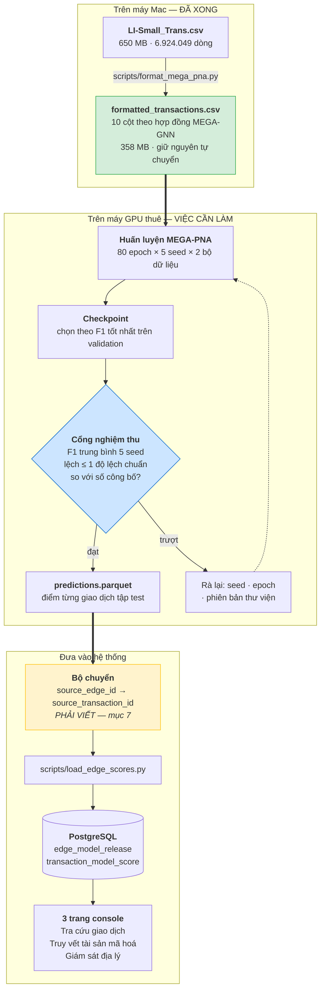
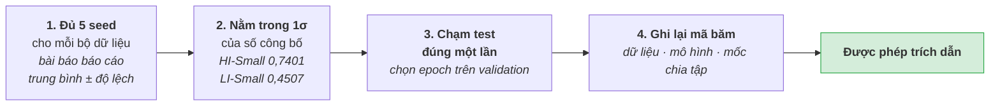
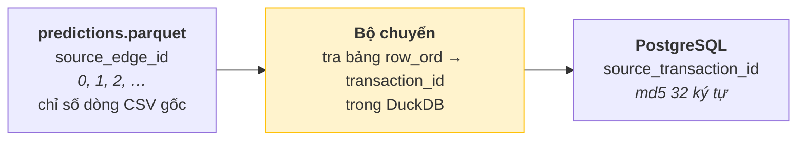
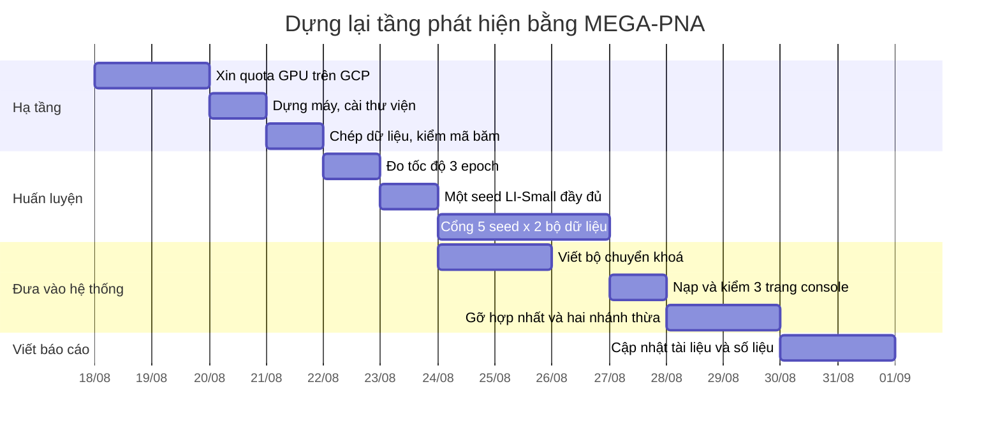

# Hướng dẫn thực hiện: dựng lại tầng phát hiện bằng MEGA-PNA

Tài liệu chị em với [KE_HOACH_LAM_LAI_MODEL.md](KE_HOACH_LAM_LAI_MODEL.md). Bên
kia trả lời **"nên làm gì và vì sao"**. Bên này trả lời **"làm thế nào"**: từng
lệnh, môi trường cần thuê, và cách đưa mô hình vào hệ thống đang chạy.

Nhóm đã chốt: **lấy mô hình tốt nhất.** Tài liệu này viết theo đúng quyết định đó.

Đọc hết mất khoảng 20 phút. Mọi lệnh trong đây đều chạy được với mã hiện tại,
trừ đúng một chỗ phải viết thêm — được đánh dấu rõ ở mục 7.

---

## 0. Ba điều cần biết trước khi đọc tiếp

**Một.** Mô hình tốt nhất trên bộ dữ liệu này tên là **MEGA-PNA**. F1 công bố
trên LI-Small là **45,07%**, cao hơn hẳn mọi thứ trong bảng SOTA của tài liệu kia
(cao nhất ở đó là Multi-PNA+EU 33,07%).

**Hai.** **Repo đã có sẵn bản cài đặt MEGA-PNA đầy đủ.** Không phải viết lại:
`src/mega_pna/` có mô hình, bộ nạp dữ liệu, vòng huấn luyện, bộ đo; `scripts/`
có 5 script điều khiển. Dữ liệu LI-Small cũng đã được chuyển sang đúng định dạng
mà bài báo yêu cầu.

**Ba.** **Nó chưa từng được huấn luyện một lần nào**, vì máy Mac không có GPU
NVIDIA. Đây là toàn bộ khoảng cách giữa hiện tại và mô hình tốt nhất.

Nói gọn: đây không phải dự án viết mã. Đây là dự án **thuê một cái GPU và bấm
chạy**, rồi nối kết quả vào hệ thống.

---

## 1. Vì sao chọn MEGA-PNA

| Mô hình | F1 LI-Small (%) | Nguồn |
|---|---|---|
| GIN | 7,90 | AAAI 2024 |
| PNA | 14,85 | AAAI 2024 |
| GFP + LightGBM | 20,83 | arXiv:2402.08593 |
| Multi-GIN+EU | 26,88 | AAAI 2024 |
| GFP + XGBoost | 27,30 | arXiv:2402.08593 |
| Multi-PNA+EU | 33,07 | AAAI 2024 |
| **MEGA-PNA** | **45,07 ± 2,26** | **arXiv:2412.00241** |

MEGA-PNA (Bilgi và cộng sự, 2024) là bản kế tiếp của Multi-GNN. Nó giữ cả ba cải
tiến của Multi-GNN — **truyền tin ngược chiều**, **đánh số cổng**, **định danh
ego** — rồi thêm **gộp cạnh song song**: khi hai tài khoản chuyển tiền cho nhau
nhiều lần, các cạnh đó được gộp lại thành một khối trước khi truyền tin, thay vì
xử lý rời rạc.

Điều đó quan trọng với rửa tiền vì **mẫu hình rửa tiền chính là các cạnh song
song lặp lại**: chia nhỏ, xoay vòng, gom-toả. Mô hình thấy được cả cụm cùng lúc
thay vì từng cạnh một.

Ba con số công bố mà ta sẽ dùng làm cổng nghiệm thu — chúng nằm sẵn trong
`scripts/benchmark_mega_pna.py`:

| Bộ dữ liệu | F1 công bố |
|---|---|
| HI-Small | 0,7401 ± 0,0155 |
| **LI-Small** | **0,4507 ± 0,0226** |
| HI-Medium | 0,7826 ± 0,0011 |

---

## 2. Kiểm kê: repo đã có gì rồi

Đây là bảng quan trọng nhất tài liệu. **Cột bên phải toàn dấu ✅ trừ một dòng.**

| Thành phần | Trạng thái | Ở đâu |
|---|---|---|
| Mô hình MEGA-PNA (PNA + cập nhật cạnh) | ✅ | `src/mega_pna/model.py` |
| Truyền tin ngược chiều · đánh số cổng · định danh ego · gộp cạnh song song | ✅ bật sẵn | `src/mega_pna/config.py` |
| Siêu tham số đúng bài báo | ✅ | cùng file |
| Bộ chuyển định dạng 10 cột theo hợp đồng MEGA-GNN | ✅ | `src/mega_pna/data.py` |
| **Dữ liệu LI-Small đã chuyển đổi xong** | ✅ 6.924.049 dòng · 3.565 nhãn dương | `data/processed/mega-pna/Small_LI/` |
| Chia tập theo mốc ngày, sát 60-20-20 nhất | ✅ đúng giao thức chính thức | `src/mega_pna/data.py::temporal_split` |
| Vòng huấn luyện, chọn điểm dừng trên validation | ✅ | `src/mega_pna/training.py` |
| Bộ đo giống hệt mã chính thức | ✅ | `src/mega_pna/metrics.py` |
| Cổng tái lập 5 seed, tự so với số công bố | ✅ | `scripts/benchmark_mega_pna.py` |
| Suy luận từ checkpoint, xuất parquet | ✅ | `scripts/infer_mega_pna.py` |
| Kiểm thử đơn vị | ✅ 4 bài đã qua | `reports/mega-pna/preflight.json` |
| Bảng phát hành + điểm từng giao dịch trong PostgreSQL | ✅ | `db/init/013_currency_native_edge_release.sql` |
| **GPU CUDA để chạy** | ❌ **thiếu — đây là toàn bộ vấn đề** | — |
| Bộ chuyển kết quả MEGA-PNA sang định dạng bộ nạp | ❌ phải viết, ~80 dòng | mục 7 |

### Bằng chứng "chỉ thiếu GPU"

Trích nguyên văn từ `reports/mega-pna/preflight.json` — kết quả rà soát ngày
14/08:

```json
"checks": {
  "unit_tests": "4 passed",
  "formatter_contract": "passed",
  "cpu_train_checkpoint_inference_roundtrip": "passed, 20/20 test rows",
  "mps_model_forward_backward": "passed",
  "real_hi_small_load": "passed, 5078345 edges",
  "real_hi_small_neighbor_sample": "passed",
  "real_hi_small_mps_paper_config":
      "stopped after more than 15 minutes before completing epoch 1; no metric retained"
}
```

Dịch: mọi thứ chạy được. Chỉ có bước cuối — chạy thật bằng GPU của Mac (MPS) —
là **quá 15 phút chưa xong nổi epoch đầu tiên**, trong khi cần 80 epoch × 5 seed
× 2 bộ dữ liệu.

Và dòng kế tiếp trong file ghi sẵn lệnh cần chạy khi có máy:

```json
"next_command_on_l4":
  ".venv/bin/python scripts/benchmark_mega_pna.py --suite gate --device cuda --include-ablation"
```

### Món quà kèm theo: dữ liệu MEGA-PNA không dính lỗi đo

Tài liệu kia cảnh báo rằng F1 30,2% của mô hình edge **không so được với bài
báo**, vì lúc nạp ta bỏ mất 804.477 giao dịch tự chuyển.

Đường MEGA-PNA **không dính lỗi đó**. Xem manifest của dữ liệu đã chuyển đổi:

```json
{
  "rows": 6924049,        ← đúng bằng file gốc IBM
  "self_transfers": 804477,   ← giữ lại, không bỏ
  "positives": 3565           ← đúng bằng file gốc IBM
}
```

Bộ chuyển đổi giữ nguyên mọi dòng, đúng như mã chính thức. Nghĩa là **con số
MEGA-PNA cho ra sẽ so được thẳng với 45,07%** mà không cần làm lại giai đoạn 1
của tài liệu kia.

---

## 3. Đường đi tổng thể



---

## 4. Môi trường cần chuẩn bị

### 4.1 Vì sao bắt buộc phải là GPU NVIDIA

Không phải vì mã kén máy, mà vì **bộ lấy mẫu láng giềng**. Mỗi lô huấn luyện lấy
8.192 cạnh, rồi với mỗi cạnh lấy 100 láng giềng ở lớp 1 và 100 ở lớp 2 — tức vài
triệu đỉnh phải gom, sắp và gộp cho **mỗi lô**. Việc đó cần thư viện thưa chạy
trên CUDA. Trên MPS của Apple nó vẫn đúng, nhưng chậm tới mức không dùng được —
đúng như dòng preflight ở trên.

### 4.2 Ba lựa chọn máy

Giá dưới đây là **giá tham khảo**; kiểm lại lúc thuê vì giá GPU thay đổi liên tục.

| | Máy | Ưu | Nhược | Chi phí ước tính cho toàn bộ cổng |
|---|---|---|---|---|
| **A** ⭐ | **GCP `g2-standard-8` + NVIDIA L4** | Cùng nhà cung cấp với Cloud SQL đang chạy; dùng máy Spot rẻ hơn ~3 lần; chạy nền được nhiều ngày | Phải xin quota GPU, thường duyệt trong 1–2 ngày | **~15–35 USD** (Spot ≈ 0,3 USD/giờ) |
| **B** | **RunPod / Vast.ai, L4 hoặc A10** | Thuê được trong 5 phút, không cần quota | Máy có thể bị thu hồi; ổ đĩa tạm, phải tự sao lưu checkpoint | ~20–50 USD |
| **C** | **Google Colab Pro+** | Rẻ nhất, quen thuộc | Phiên bị ngắt sau ~24 giờ — **không chạy nổi 10 lượt seed liên tục**; chỉ hợp để thử 1 seed | ~50 USD/tháng |

**Khuyến nghị: A.** Nếu quota chưa duyệt kịp và cần kết quả gấp, dùng B cho 1
seed LI-Small để có số sớm, rồi chuyển sang A cho cổng đầy đủ.

### 4.3 Cấu hình máy tối thiểu

| Hạng mục | Yêu cầu | Vì sao |
|---|---|---|
| GPU | NVIDIA, **≥ 16 GB VRAM** | lô 8.192 cạnh với láng giềng (100, 100) |
| RAM | **≥ 32 GB** | cả đồ thị nằm trong RAM trước khi lấy mẫu |
| Đĩa | **≥ 100 GB SSD** | dữ liệu đã chuyển đổi + checkpoint + báo cáo |
| CPU | ≥ 8 nhân | bộ lấy mẫu láng giềng chạy trên CPU |
| Hệ điều hành | Ubuntu 22.04, driver CUDA 12.x | có ảnh máy dựng sẵn của GCP |

### 4.4 Cài đặt — chạy đúng thứ tự này

> ⚠️ **Cái bẫy số một của cả tài liệu nằm ở bước 3.** `torch-scatter` và
> `torch-sparse` **phải cài SAU `torch`, và phải có `--no-build-isolation`**.
> Cài sai thứ tự thì pip dựng môi trường sạch, không thấy torch, rồi biên dịch ra
> bản CPU — mã vẫn chạy, chỉ là chậm y hệt trên Mac. Đây là lỗi rất khó nhận ra
> vì không có thông báo lỗi nào cả.

```bash
# ── 1. Hệ thống ────────────────────────────────────────────────────────────
sudo apt update && sudo apt install -y python3.12 python3.12-venv git build-essential
nvidia-smi          # phải in ra tên GPU. Không in ra thì dừng, driver chưa xong.

# ── 2. Lấy mã và dựng môi trường ───────────────────────────────────────────
git clone <URL-repo> P-022 && cd P-022
git checkout develop
python3.12 -m venv .venv && source .venv/bin/activate
pip install --upgrade pip

# ── 3. PyTorch bản CUDA — CÀI TRƯỚC, MỘT MÌNH ──────────────────────────────
pip install torch --index-url https://download.pytorch.org/whl/cu121
python -c "import torch; assert torch.cuda.is_available(); print(torch.__version__, torch.cuda.get_device_name(0))"

# ── 4. Phần mở rộng đồ thị — CÀI SAU, KÈM --no-build-isolation ─────────────
pip install --no-build-isolation torch-scatter torch-sparse
pip install torch-geometric

# ── 5. Phần còn lại của dự án ──────────────────────────────────────────────
pip install -r requirements.txt

# ── 6. Kiểm tra trước khi tốn tiền GPU ─────────────────────────────────────
python -c "import torch_sparse, torch_geometric, torch; print('ok', torch.cuda.is_available())"
python -m pytest tests/test_mega_pna -q      # phải ra 4 bài qua
```

> **Ghi chú về phiên bản Python.** Máy Mac đang chạy Python 3.14. Trên máy GPU
> nên dùng **3.12**: `torch-scatter` / `torch-sparse` có bánh xe dựng sẵn cho
> 3.12, còn 3.14 thì phải biên dịch từ mã nguồn, mất 20–40 phút và dễ hỏng. Mã
> của repo chạy được trên cả hai.

### 4.5 Đưa dữ liệu lên máy GPU

Hai cách, chọn một:

**Cách 1 — chép file đã chuyển đổi lên (nhanh hơn, khuyến nghị).** File chỉ 358
MB và đã kiểm băm rồi:

```bash
# trên Mac
gcloud compute scp \
  data/processed/mega-pna/Small_LI/formatted_transactions.csv \
  data/processed/mega-pna/Small_LI/formatted_transactions.manifest.json \
  data/processed/mega-pna/Small_HI/formatted_transactions.csv \
  data/processed/mega-pna/Small_HI/formatted_transactions.manifest.json \
  <tên-máy>:~/P-022/data/processed/mega-pna/
```

**Cách 2 — chuyển đổi lại trên máy GPU.** Cần chép file CSV gốc lên trước
(650 MB cho LI-Small):

```bash
python scripts/format_mega_pna.py --dataset Small_LI
python scripts/format_mega_pna.py --dataset Small_HI
```

**Dù dùng cách nào, phải xác nhận mã băm khớp** — nếu lệch thì dữ liệu khác đi và
kết quả không so được với gì hết:

```bash
sha256sum data/processed/mega-pna/Small_LI/formatted_transactions.csv
# phải bằng: 450d89e106631e9fabb26819d54833f1d6568a2e9d0948f5e6206a6e766cdddc
```

---

## 5. Chạy — từng bước

### Bước 1 — Đo tốc độ trước, đừng chạy cả cổng ngay (30 phút)

Chạy **một seed, ba epoch** để biết một epoch mất bao lâu. Chưa biết con số này
thì không ước lượng nổi chi phí.

```bash
source .venv/bin/activate
python scripts/train_mega_pna.py \
  --dataset Small_LI --seed 42 --epochs 3 --device cuda \
  --reports-dir reports/mega-pna-thu
```

Màn hình sẽ in mỗi epoch một dòng:

```
seed=42 epoch=001 loss=0.412... train_f1=0.0821 val_f1=0.1104
```

**Bấm giờ dòng đầu tiên.** Rồi nhân lên:

| Một epoch mất | 1 seed (80 epoch) | Cổng đầy đủ (10 lượt seed) | Chi phí ở 0,3 USD/giờ |
|---|---|---|---|
| 2 phút | 2,7 giờ | ~27 giờ | ~8 USD |
| 4 phút | 5,3 giờ | ~53 giờ | ~16 USD |
| 8 phút | 10,7 giờ | ~107 giờ | ~32 USD |

Nếu một epoch quá 15 phút thì **dừng lại** — máy đang chạy CPU chứ không phải
GPU. Quay lại mục 4.4 bước 3 và 4.

> **Xoá `reports/mega-pna-thu` sau khi đo xong.** Nếu để lại, script cổng thấy
> báo cáo có sẵn với cấu hình epoch khác sẽ báo lỗi và dừng.

### Bước 2 — Một seed đầy đủ trên LI-Small (vài giờ)

Đây là lần đầu tiên ta có một con số thật.

```bash
nohup python scripts/train_mega_pna.py \
  --dataset Small_LI --seed 42 --epochs 80 --device cuda \
  > train_li_seed42.log 2>&1 &

tail -f train_li_seed42.log
```

Xong, đọc kết quả:

```bash
python -c "
import json
r = json.load(open('reports/mega-pna/Small_LI/paper/seed_42.json'))
print('epoch tốt nhất:', r['best_epoch'])
print('F1 test       :', round(r['test_paper_protocol']['f1'], 4))
print('precision     :', round(r['test_paper_protocol']['precision'], 4))
print('recall        :', round(r['test_paper_protocol']['recall'], 4))
print('công bố       : 0.4507 ± 0.0226')
print('giây          :', round(r['seconds']))
"
```

**Mong đợi: F1 nằm trong khoảng 0,42 – 0,48.** Một seed lẻ thì dao động rộng hơn
trung bình 5 seed, nên chưa cần lo nếu hơi lệch. Nhưng nếu ra dưới 0,30 thì có gì
đó sai — xem mục 9.

### Bước 3 — Cổng tái lập đầy đủ (1–3 ngày máy chạy)

Lệnh này chạy **5 seed × 2 bộ dữ liệu (HI-Small và LI-Small)**, rồi tự so với số
công bố và tự chấm đạt/trượt.

```bash
nohup python scripts/benchmark_mega_pna.py \
  --suite gate --device cuda --include-ablation \
  > gate.log 2>&1 &
```

Script tự bỏ qua seed nào đã có báo cáo, nên **ngắt giữa chừng rồi chạy lại
không mất công**. Máy Spot bị thu hồi cũng chỉ mất seed đang dở.

`--include-ablation` chạy thêm một nhánh bỏ cột "hình thức thanh toán". Nó trả
lời câu hỏi mà thầy cô hay hỏi: *đặc trưng nào thực sự đóng góp?*

### Bước 4 — Đọc kết quả cổng

```bash
python -c "
import json
r = json.load(open('reports/mega-pna/benchmark.json'))
print('CỔNG TỔNG:', 'ĐẠT' if r['small_reproduction_gate_passed'] else 'TRƯỢT')
for d in r['datasets']:
    if not d.get('aggregate'): continue
    f1, pub = d['aggregate']['f1'], d['published_reference']
    print(f\"  {d['dataset']:10s} {d['arm']:18s} \"
          f\"F1 {f1['mean']:.4f} ± {f1['std'] or 0:.4f}  \"
          f\"(công bố {pub['mean']:.4f} ± {pub['std']:.4f})  \"
          f\"{d['within_published_one_std']}\")
"
```

### Bước 5 — Xuất điểm từng giao dịch

```bash
python scripts/infer_mega_pna.py \
  --dataset Small_LI \
  --checkpoint models/mega-pna/Small_LI/paper/seed_42.pt \
  --output data/processed/mega-pna/Small_LI/predictions.parquet \
  --device cuda
```

File ra có 4 cột:

| Cột | Nghĩa |
|---|---|
| `edge_position` | vị trí cạnh trong đồ thị đã sắp theo thời gian |
| `source_edge_id` | **chỉ số dòng trong file CSV gốc, đếm từ 0** — đây là khoá để nối về PostgreSQL |
| `is_laundering` | nhãn thật |
| `score` | điểm mô hình, 0…1 |

### Bước 6 — Mang kết quả về

```bash
# trên Mac
gcloud compute scp --recurse <tên-máy>:~/P-022/reports/mega-pna ./reports/
gcloud compute scp --recurse <tên-máy>:~/P-022/models/mega-pna ./models/
gcloud compute scp <tên-máy>:~/P-022/data/processed/mega-pna/Small_LI/predictions.parquet \
  data/processed/mega-pna/Small_LI/
```

**Rồi tắt máy GPU ngay.** Nó tính tiền theo giờ kể cả lúc không chạy gì.

```bash
gcloud compute instances stop <tên-máy>
```

---

## 6. Cổng nghiệm thu — khi nào được nói "xong"

Cả bốn điều dưới đây phải đúng. Thiếu một là chưa xong.



Ba trong bốn điều này **mã đã tự bảo đảm**:

- Điều 1: `benchmark_mega_pna.py` báo lỗi ngay nếu đưa vào khác 5 seed.
- Điều 2: `within_published_one_std` được tính tự động.
- Điều 3: `train_one_seed` chỉ chấm tập test **sau khi** vòng lặp kết thúc và đã
  nạp lại trạng thái tốt nhất theo validation. Trong lúc huấn luyện, mỗi epoch
  chỉ chấm train và validation. Không ai chạm được vào test sớm.

Điều 4 là việc của người chạy: chép `sha256` của
`formatted_transactions.csv` và mốc chia tập từ `benchmark.json` vào báo cáo.

---

## 7. Đưa vào hệ thống đang chạy

### 7.1 Nó sẽ làm sống lại cái gì

Điểm mô hình nằm ở bảng `transaction_model_score`. Ba trang console đọc bảng đó:

| Trang | Đường dẫn API |
|---|---|
| Tra cứu giao dịch | `/api/v1/transactions` |
| Truy vết tài sản mã hoá | `/api/v1/fc/crypto` |
| Giám sát địa lý (chế độ vận hành) | `/api/v1/world` |

Một bản phát hành làm sống cả ba cùng lúc. **Không phải sửa truy vấn nào.**

### 7.2 Việc phải viết thêm — bộ chuyển khoá

Đây là **chỗ duy nhất trong toàn bộ tài liệu cần viết mã mới.** Khoảng 80 dòng.

Vấn đề: hai đầu dùng hai cách định danh giao dịch khác nhau.



Cầu nối đã có sẵn, chỉ chưa ai bắc: trong `data/processed/aml.duckdb`,
`transaction_id` được sinh bằng

```
md5(occurred_at | from_account_key | to_account_key | amount_paid | payment_currency | row_ord)
```

với `row_ord = row_number() OVER ()` — tức **chỉ số dòng của file CSV gốc, đếm
từ 1**. Còn `source_edge_id` của MEGA-PNA là **chỉ số dòng cùng file đó, đếm từ 0**.

Vậy quan hệ là: **`row_ord = source_edge_id + 1`**.

Bộ chuyển cần làm ba việc:

1. Nối `source_edge_id + 1` với `row_ord` trong DuckDB để lấy `transaction_id`.
2. Chọn ngưỡng trên tập validation, tính cột `triggered = score >= threshold`.
3. Ghi parquet với đúng các cột mà `scripts/load_edge_scores.py` đọc:
   `transaction_id`, `score`, `threshold`, `triggered`, `target_laundering`,
   `model_version`.

Đồng thời phải viết một file báo cáo JSON có khoá `features` — bộ nạp lấy
`len(report["features"])` để ghi vào `feature_count`.

> ⚠️ **Hai điều phải kiểm khi viết bộ chuyển**
>
> **Một — 804.477 dòng sẽ không nối được, và đó là bình thường.** PostgreSQL
> không có giao dịch tự chuyển, còn MEGA-PNA chấm điểm cả chúng. Chúng sẽ rơi ra
> ở phép nối. Bộ nạp in ra số `unmatched`; con số ấy đúng phải bằng số giao dịch
> tự chuyển **trong tập test**, không phải 0.
>
> Nhắc lại cho rõ: **chỉ được bỏ chúng ở khâu phục vụ, tuyệt đối không bỏ ở khâu
> đo.** Bỏ ở khâu đo chính là lỗi đã làm F1 của mô hình edge bị thổi lên — xem
> mục 3 của [KE_HOACH_LAM_LAI_MODEL.md](KE_HOACH_LAM_LAI_MODEL.md).
>
> **Hai — kiểm `row_ord` có thật sự khớp không.** `row_number() OVER ()` không có
> `ORDER BY`; DuckDB giữ đúng thứ tự đọc khi `preserve_insertion_order` bật (mặc
> định), nhưng đừng tin suông. Lấy 20 dòng bất kỳ, đối chiếu thời điểm và số tiền
> giữa hai bên trước khi nạp cả 1,2 triệu dòng.

### 7.3 Nạp vào PostgreSQL

```bash
# thử trước, không ghi gì
python scripts/load_edge_scores.py \
  --scores data/processed/mega-pna/Small_LI/pg_scores.parquet \
  --report reports/mega-pna/Small_LI/release.json \
  --model models/mega-pna/Small_LI/paper/seed_42.pt \
  --db data/processed/aml.duckdb \
  --dataset "IBM AML LI-Small MEGA-PNA" \
  --dry-run

# nạp thật
python scripts/load_edge_scores.py ... (bỏ --dry-run)
```

Bộ nạp tự làm bốn việc: ghi bản phát hành ở trạng thái `loading`, nạp điểm qua
bảng tạm, **cho bản phát hành cũ về `superseded`**, rồi kích hoạt bản mới. Ràng
buộc `edge_model_one_active_release_idx` bảo đảm **chỉ đúng một bản hoạt động tại
một thời điểm** — không lo trộn hai mô hình.

Cuối cùng, cập nhật siêu dữ liệu hiển thị trên console:

```bash
python scripts/publish_edge_console_metadata.py
```

### 7.4 Sau khi nạp — dọn kiến trúc cũ

Đây là các bước 3 và 4 của tài liệu kia, giờ đã có mô hình thay thế:

| Việc | Chi tiết |
|---|---|
| Bỏ Isolation Forest khỏi hợp nhất | trọng số đã là 0,00 — bỏ không đổi kết quả |
| Bỏ hẳn bước hợp nhất | điểm rủi ro lấy thẳng từ MEGA-PNA |
| Nhánh đồ thị đổi vai | thôi sinh cảnh báo, chỉ sinh chứng cứ để giải thích |
| Luật R01 / R02 đặt `weight = 0` | vẫn chạy, vẫn gắn nhãn "vi phạm quy tắc nào" — nhưng không chấm điểm |

Sau mỗi bước, đếm lại số cảnh báo và F1. Kỳ vọng: **ít cảnh báo hơn, chất lượng
cao hơn.**

---

## 8. Lịch trình và phân công



| Ai | Làm gì | Cần biết gì |
|---|---|---|
| Người 1 | Hạ tầng GPU, cài đặt, chạy huấn luyện | Linux cơ bản, gcloud |
| Người 2 | Viết bộ chuyển khoá (mục 7.2) | Python, SQL, parquet |
| Người 3 | Nạp vào PostgreSQL, kiểm 3 trang console | SQL, đọc log API |
| Người 4 | Gỡ hợp nhất, cập nhật tài liệu và số liệu | mã `src/detection/` |

Người 2 làm được song song ngay sau khi có seed đầu tiên — **không phải chờ hết
cổng**, vì định dạng file kết quả đã cố định.

---

## 9. Bẫy đã biết

| Bẫy | Dấu hiệu | Cách xử lý |
|---|---|---|
| `torch-scatter` biên dịch bản CPU | Mọi thứ chạy, chỉ chậm kinh khủng; `nvidia-smi` báo GPU rảnh | Cài lại đúng thứ tự mục 4.4, có `--no-build-isolation` |
| Hết bộ nhớ GPU | `CUDA out of memory` | Giảm `--batch-size` xuống 4096. **Ghi lại vào báo cáo** — đổi lô là lệch cấu hình bài báo |
| Báo cáo cũ chặn lần chạy mới | `was produced with a different epoch/batch config` | Chuyển thư mục `reports/mega-pna/` cũ đi chỗ khác |
| Máy Spot bị thu hồi giữa chừng | Log dừng đột ngột | Chạy lại đúng lệnh cũ; script bỏ qua seed đã xong |
| Đưa vào khác 5 seed | `Bilgi et al. report mean ± std over exactly five seeds` | Đúng 5 seed. Bài báo báo cáo trung bình ± độ lệch trên 5 seed |
| Nối khoá sai, `unmatched` bằng 0 hoặc bằng tất cả | Bộ nạp in `unmatched` | Kiểm lại `row_ord = source_edge_id + 1` trên 20 dòng mẫu |
| **Lấy F1 của tập validation đem đi khoe** | Số đẹp bất thường | Con số dùng để báo cáo là `test_paper_protocol.f1`, không phải `validation_at_best` |
| **Chạm tập test nhiều lần rồi chọn lần đẹp nhất** | Không có dấu hiệu — đây là lỗi tự lừa mình | Chạm đúng một lần. Muốn thử cấu hình khác thì thử trên validation |

---

## 10. Nếu không thuê được GPU

Kế hoạch B: quay về mô hình edge HistGradientBoosting và **làm cho con số của nó
đo đúng đã** — đó chính là giai đoạn 1 của
[KE_HOACH_LAM_LAI_MODEL.md](KE_HOACH_LAM_LAI_MODEL.md).

| | Kế hoạch A — MEGA-PNA | Kế hoạch B — mô hình edge đo lại |
|---|---|---|
| F1 kỳ vọng | ~0,45 | ~0,28 rồi cải thiện dần |
| Cần GPU | **có** | không |
| Cần viết mã | ~80 dòng (bộ chuyển) | sửa 2 dòng lọc + bổ sung đặc trưng đồ thị |
| Thời gian | 1–2 tuần | 3–4 ngày |
| Chi phí | 15–35 USD | 0 |
| So được với bài báo | **có ngay** | có, sau khi nạp lại dữ liệu |

**Hai kế hoạch không loại trừ nhau.** Kế hoạch B vẫn nên làm dù có GPU: nó cho
một mốc so sánh chạy được trên CPU, và nếu MEGA-PNA có trục trặc thì vẫn còn thứ
để trình bày.

---

## 11. Kiểm lại trước khi bắt đầu

- [ ] `nvidia-smi` in ra tên GPU
- [ ] `torch.cuda.is_available()` trả về `True`
- [ ] `import torch_sparse` không lỗi
- [ ] `pytest tests/test_mega_pna -q` — 4 bài qua
- [ ] `sha256sum` của `formatted_transactions.csv` khớp `450d89e1…`
- [ ] Manifest ghi `rows: 6924049` và `positives: 3565`
- [ ] Ba epoch thử chạy dưới 15 phút mỗi epoch
- [ ] Đã xoá thư mục báo cáo thử
- [ ] Đã đặt hẹn tắt máy GPU khi xong

---

## 12. Tóm lại

Mô hình tốt nhất **đã nằm trong repo**. Dữ liệu **đã chuẩn bị đúng, không dính
lỗi đo** như nhánh edge. Bộ đo và cổng nghiệm thu **đã viết sẵn và tự chấm**.

Thứ duy nhất còn thiếu là **một cái GPU giá vài chục nghìn đồng một giờ**, và
**tám mươi dòng mã** để nối kết quả về cơ sở dữ liệu.

Bắt đầu từ mục 4.2: chọn máy.
