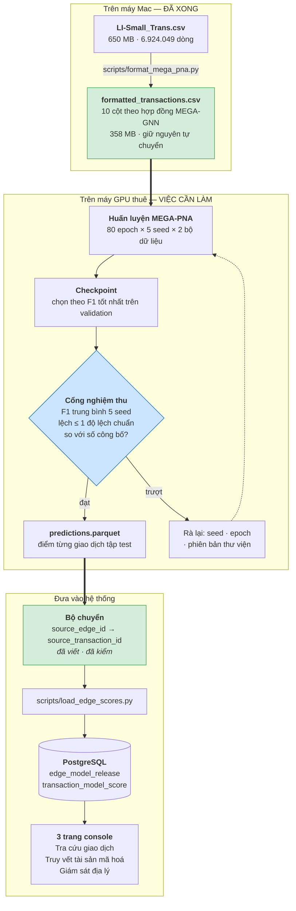
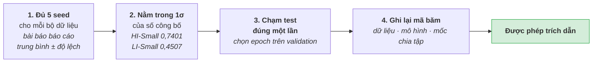
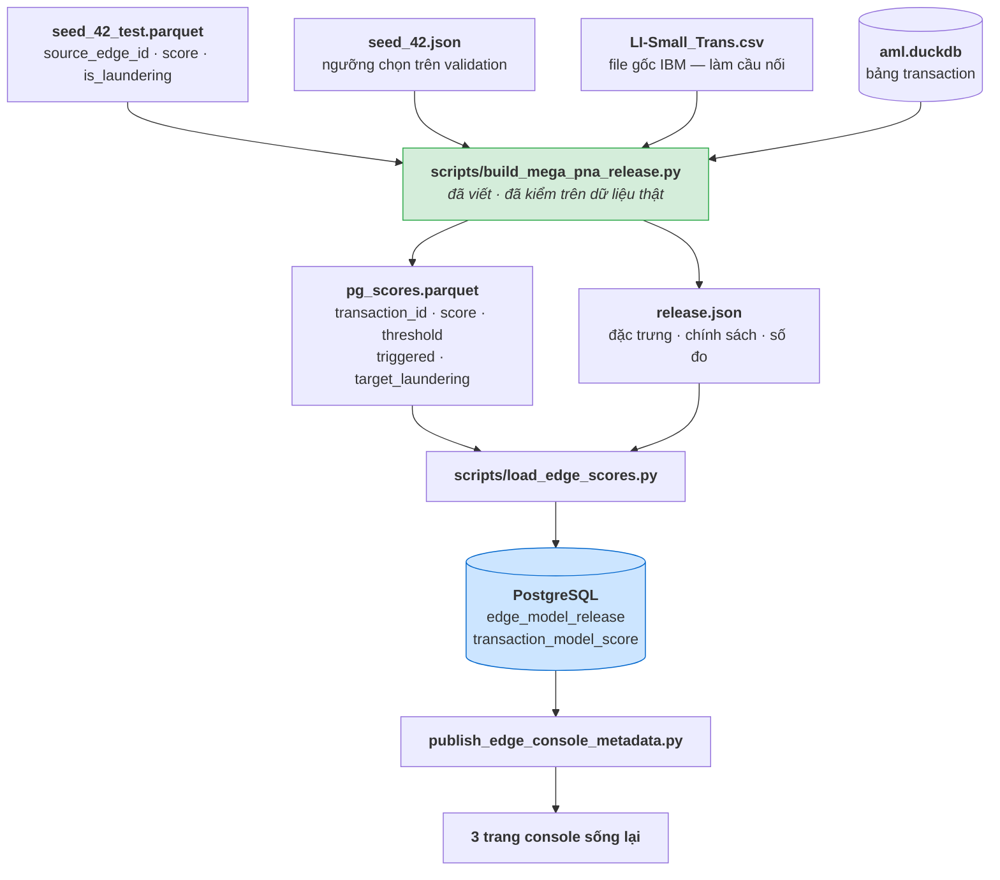
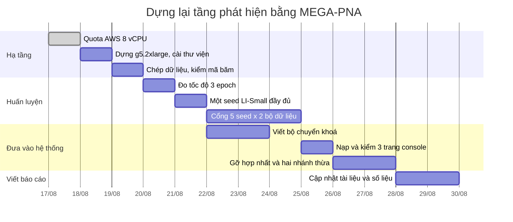

# Hướng dẫn thực hiện: dựng lại tầng phát hiện bằng MEGA-PNA

Tài liệu chị em với [KE_HOACH_LAM_LAI_MODEL.md](KE_HOACH_LAM_LAI_MODEL.md). Bên
kia trả lời **"nên làm gì và vì sao"**. Bên này trả lời **"làm thế nào"**: từng
lệnh, môi trường cần thuê, và cách đưa mô hình vào hệ thống đang chạy.

Nhóm đã chốt: **lấy mô hình tốt nhất.** Tài liệu này viết theo đúng quyết định đó.

Đọc hết mất khoảng 20 phút. **Mọi lệnh trong đây đều chạy được với mã hiện tại** —
kể cả bước nạp kết quả vào hệ thống, vốn là mảnh cuối còn thiếu và nay đã viết
xong, đã kiểm trên dữ liệu thật (mục 7).

---

## 0. Ba điều cần biết trước khi đọc tiếp

**Một.** Mô hình tốt nhất trên bộ dữ liệu này tên là **MEGA-PNA**. F1 công bố
trên LI-Small là **45,07%**, cao hơn hẳn mọi thứ trong bảng SOTA của tài liệu kia
(cao nhất ở đó là Multi-PNA+EU 33,07%).

**Hai.** **Repo đã có sẵn bản cài đặt MEGA-PNA đầy đủ.** Không phải viết lại:
`src/mega_pna/` có mô hình, bộ nạp dữ liệu, vòng huấn luyện, bộ đo; `scripts/`
có 5 script điều khiển. Dữ liệu LI-Small cũng đã được chuyển sang đúng định dạng
mà bài báo yêu cầu.

**Ba.** **Nó chưa từng được huấn luyện một lần nào**, vì máy Mac không có GPU
NVIDIA. Đây là toàn bộ khoảng cách giữa hiện tại và mô hình tốt nhất.

Nói gọn: đây không phải dự án viết mã. Đây là dự án **thuê một cái GPU và bấm
chạy**. Đường nạp kết quả về hệ thống cũng đã thông — xem mục 7.

---

## 1. Vì sao chọn MEGA-PNA

| Mô hình | F1 LI-Small (%) | Nguồn |
|---|---|---|
| GIN | 7,90 | AAAI 2024 |
| PNA | 14,85 | AAAI 2024 |
| GFP + LightGBM | 20,83 | arXiv:2402.08593 |
| Multi-GIN+EU | 26,88 | AAAI 2024 |
| GFP + XGBoost | 27,30 | arXiv:2402.08593 |
| Multi-PNA+EU | 33,07 | AAAI 2024 |
| **MEGA-PNA** | **45,07 ± 2,26** | **arXiv:2412.00241** |

MEGA-PNA (Bilgi và cộng sự, 2024) là bản kế tiếp của Multi-GNN. Nó giữ cả ba cải
tiến của Multi-GNN — **truyền tin ngược chiều**, **đánh số cổng**, **định danh
ego** — rồi thêm **gộp cạnh song song**: khi hai tài khoản chuyển tiền cho nhau
nhiều lần, các cạnh đó được gộp lại thành một khối trước khi truyền tin, thay vì
xử lý rời rạc.

Điều đó quan trọng với rửa tiền vì **mẫu hình rửa tiền chính là các cạnh song
song lặp lại**: chia nhỏ, xoay vòng, gom-toả. Mô hình thấy được cả cụm cùng lúc
thay vì từng cạnh một.

Ba con số công bố mà ta sẽ dùng làm cổng nghiệm thu — chúng nằm sẵn trong
`scripts/benchmark_mega_pna.py`:

| Bộ dữ liệu | F1 công bố |
|---|---|
| HI-Small | 0,7401 ± 0,0155 |
| **LI-Small** | **0,4507 ± 0,0226** |
| HI-Medium | 0,7826 ± 0,0011 |

---

## 2. Kiểm kê: repo đã có gì rồi

Đây là bảng quan trọng nhất tài liệu. **Cột giữa toàn dấu ✅ trừ đúng một dòng —
và dòng đó là cái GPU.**

| Thành phần | Trạng thái | Ở đâu |
|---|---|---|
| Mô hình MEGA-PNA (PNA + cập nhật cạnh) | ✅ | `src/mega_pna/model.py` |
| Truyền tin ngược chiều · đánh số cổng · định danh ego · gộp cạnh song song | ✅ bật sẵn | `src/mega_pna/config.py` |
| Siêu tham số đúng bài báo | ✅ | cùng file |
| Bộ chuyển định dạng 10 cột theo hợp đồng MEGA-GNN | ✅ | `src/mega_pna/data.py` |
| **Dữ liệu LI-Small đã chuyển đổi xong** | ✅ 6.924.049 dòng · 3.565 nhãn dương | `data/processed/mega-pna/Small_LI/` |
| Chia tập theo mốc ngày, sát 60-20-20 nhất | ✅ đúng giao thức chính thức | `src/mega_pna/data.py::temporal_split` |
| Vòng huấn luyện, chọn điểm dừng trên validation | ✅ | `src/mega_pna/training.py` |
| Bộ đo giống hệt mã chính thức | ✅ | `src/mega_pna/metrics.py` |
| Cổng tái lập 5 seed, tự so với số công bố | ✅ | `scripts/benchmark_mega_pna.py` |
| Suy luận từ checkpoint, xuất parquet | ✅ | `scripts/infer_mega_pna.py` |
| Kiểm thử đơn vị | ✅ 4 bài đã qua | `reports/mega-pna/preflight.json` |
| Bảng phát hành + điểm từng giao dịch trong PostgreSQL | ✅ | `db/init/013_currency_native_edge_release.sql` |
| **GPU CUDA để chạy** | ❌ **thiếu — đây là toàn bộ vấn đề** | — |
| Bộ chuyển kết quả MEGA-PNA sang định dạng bộ nạp | ✅ đã viết, đã kiểm | `scripts/build_mega_pna_release.py` |

### Bằng chứng "chỉ thiếu GPU"

Trích nguyên văn từ `reports/mega-pna/preflight.json` — kết quả rà soát ngày
14/08:

```json
"checks": {
  "unit_tests": "4 passed",
  "formatter_contract": "passed",
  "cpu_train_checkpoint_inference_roundtrip": "passed, 20/20 test rows",
  "mps_model_forward_backward": "passed",
  "real_hi_small_load": "passed, 5078345 edges",
  "real_hi_small_neighbor_sample": "passed",
  "real_hi_small_mps_paper_config":
      "stopped after more than 15 minutes before completing epoch 1; no metric retained"
}
```

Dịch: mọi thứ chạy được. Chỉ có bước cuối — chạy thật bằng GPU của Mac (MPS) —
là **quá 15 phút chưa xong nổi epoch đầu tiên**, trong khi cần 80 epoch × 5 seed
× 2 bộ dữ liệu.

Và dòng kế tiếp trong file ghi sẵn lệnh cần chạy khi có máy:

```json
"next_command_on_l4":
  ".venv/bin/python scripts/benchmark_mega_pna.py --suite gate --device cuda --include-ablation"
```

### Món quà kèm theo: dữ liệu MEGA-PNA không dính lỗi đo

Tài liệu kia cảnh báo rằng F1 30,2% của mô hình edge **không so được với bài
báo**, vì lúc nạp ta bỏ mất 804.477 giao dịch tự chuyển.

Đường MEGA-PNA **không dính lỗi đó**. Xem manifest của dữ liệu đã chuyển đổi:

```json
{
  "rows": 6924049,        ← đúng bằng file gốc IBM
  "self_transfers": 804477,   ← giữ lại, không bỏ
  "positives": 3565           ← đúng bằng file gốc IBM
}
```

Bộ chuyển đổi giữ nguyên mọi dòng, đúng như mã chính thức. Nghĩa là **con số
MEGA-PNA cho ra sẽ so được thẳng với 45,07%** mà không cần làm lại giai đoạn 1
của tài liệu kia.

---

## 3. Đường đi tổng thể



---

## 4. Môi trường cần chuẩn bị

### 4.1 Vì sao bắt buộc phải là GPU NVIDIA

Không phải vì mã kén máy, mà vì **bộ lấy mẫu láng giềng**. Mỗi lô huấn luyện lấy
8.192 cạnh, rồi với mỗi cạnh lấy 100 láng giềng ở lớp 1 và 100 ở lớp 2 — tức vài
triệu đỉnh phải gom, sắp và gộp cho **mỗi lô**. Việc đó cần thư viện thưa chạy
trên CUDA. Trên MPS của Apple nó vẫn đúng, nhưng chậm tới mức không dùng được —
đúng như dòng preflight ở trên.

### 4.2 Đã có quota AWS — đọc cho đúng con số

Ngày 17/08 AWS duyệt cho tài khoản của nhóm ở **US East (N. Virginia)**:

```
EC2 Instances / All G and VT instances — New Limit = 8
```

> ⚠️ **Số 8 này là 8 vCPU, không phải 8 GB VRAM và cũng không phải 8 máy.**
> Hạn mức họ G của AWS luôn tính bằng **tổng số vCPU của các máy đang bật**.
>
> Điều đó nghĩa là: **chạy được đúng một máy GPU cỡ `.2xlarge`** (8 vCPU, 1 GPU).
> Đúng bằng thứ ta cần — MEGA-PNA chỉ dùng một GPU. Không thiếu gì cả.

### 4.3 Chọn máy nào trong hạn mức 8 vCPU

Tất cả các máy dưới đây đều **vừa khít** hạn mức. Giá là **giá tham khảo**
us-east-1 theo giờ, kiểm lại trên trang giá của AWS lúc thuê.

| Máy | GPU | VRAM | RAM | Giá ≈ | Nhận xét |
|---|---|---|---|---|---|
| `g4dn.2xlarge` | T4 | 16 GB | 32 GiB | ~0,75 USD | Rẻ nhất. T4 chậm hơn đáng kể — chỉ chọn nếu tiết kiệm là ưu tiên số một |
| **`g5.2xlarge`** ⭐ | **A10G** | **24 GB** | **32 GiB** | **~1,2 USD** | **Khuyến nghị.** Nhanh, sẵn hàng, VRAM thoải mái |
| `g6.2xlarge` | L4 | 24 GB | 32 GiB | ~0,98 USD | Đúng con GPU mà preflight nhắm tới. Ngang ngửa g5, rẻ hơn chút |
| `g6e.2xlarge` | L40S | 48 GB | **64 GiB** | ~2,2 USD | Chỉ dùng nếu 32 GiB RAM bị tràn ở bước lấy mẫu láng giềng |

**Chọn `g5.2xlarge` hoặc `g6.2xlarge`.** Cả hai đều 8 vCPU nên vừa hạn mức, đều
24 GB VRAM nên chạy được lô 8.192 cạnh của bài báo mà không phải hạ xuống 4096.

> **Điểm cần để ý: RAM 32 GiB là mức sàn, không phải mức thoải mái.** Cả đồ thị
> phải nằm trong RAM trước khi lấy mẫu. Nếu bước nạp dữ liệu bị giết vì hết bộ
> nhớ (`Killed`, không có traceback), đổi sang `g6e.2xlarge` — nó vẫn 8 vCPU nên
> **không cần xin thêm quota**, chỉ đắt hơn.

### 4.4 Hai điều về quota cần xử lý trước

**Một — hạn mức vừa duyệt là cho máy On-Demand, không dùng được cho Spot.**
AWS tính Spot bằng một hạn mức riêng tên
`All G and VT Spot Instance Requests`, và nó **vẫn đang là 0**. Muốn rẻ hơn
khoảng ba lần thì phải xin thêm hạn mức đó (cũng đặt 8). Nếu không xin, cứ chạy
On-Demand — chi phí vẫn nằm trong dự trù, chỉ là không rẻ nhất.

**Hai — chạy tuần tự, một máy một lúc.** Nhóm xin 16 nhưng được 8, nên không bật
song song hai máy được. Cổng đầy đủ là 10 lượt seed chạy nối tiếp nhau.

| | Có 8 vCPU (hiện tại) | Nếu kháng nghị lên 16 |
|---|---|---|
| Số máy chạy cùng lúc | 1 | 2 |
| Thời gian thực tế | 27–107 giờ | **một nửa** |
| Tổng chi phí | không đổi | không đổi |

Kháng nghị **không làm rẻ đi**, chỉ rút ngắn thời gian chờ. Email của AWS có nói
mở lại case được. Nếu lịch gấp thì đáng làm; nếu không thì 8 là đủ.

> **Cách xin thêm:** Service Quotas → EC2 → tìm đúng tên hạn mức → Request
> increase. Nhớ chọn đúng vùng **US East (N. Virginia)** — hạn mức tính theo từng
> vùng, xin ở vùng khác thì máy ở Virginia vẫn không bật được.

### 4.5 Ảnh máy nên dùng

Chọn **Deep Learning AMI GPU PyTorch (Ubuntu 22.04)** khi tạo máy. Nó có sẵn
driver NVIDIA và CUDA, bỏ được toàn bộ phần hay hỏng nhất của việc cài đặt.

| Hạng mục | Đặt là |
|---|---|
| AMI | Deep Learning AMI GPU PyTorch, Ubuntu 22.04 |
| Ổ đĩa gốc | **≥ 100 GB gp3** (mặc định thường chỉ 45 GB — **phải sửa lúc tạo máy**) |
| Vùng | US East (N. Virginia) — nơi có hạn mức |
| Cặp khoá | tạo mới và tải `.pem` về, dùng để `ssh`/`scp` |

### 4.6 Cài đặt — chạy đúng thứ tự này

> ⚠️ **Cái bẫy số một của cả tài liệu nằm ở bước 3.** `torch-scatter` và
> `torch-sparse` **phải cài SAU `torch`, và phải có `--no-build-isolation`**.
> Cài sai thứ tự thì pip dựng môi trường sạch, không thấy torch, rồi biên dịch ra
> bản CPU — mã vẫn chạy, chỉ là chậm y hệt trên Mac. Đây là lỗi rất khó nhận ra
> vì không có thông báo lỗi nào cả.

```bash
# ── 0. Vào máy ─────────────────────────────────────────────────────────────
chmod 400 ~/fin07-gpu.pem
ssh -i ~/fin07-gpu.pem ubuntu@<địa-chỉ-IP-công-cộng>

# ── 1. Hệ thống ────────────────────────────────────────────────────────────
sudo apt update && sudo apt install -y python3.12 python3.12-venv git build-essential
nvidia-smi          # phải in ra "A10G" hoặc "L4". Không in ra thì dừng, driver chưa xong.

# ── 2. Lấy mã và dựng môi trường ───────────────────────────────────────────
git clone <URL-repo> P-022 && cd P-022
git checkout develop
python3.12 -m venv .venv && source .venv/bin/activate
pip install --upgrade pip

# ── 3. PyTorch bản CUDA — CÀI TRƯỚC, MỘT MÌNH ──────────────────────────────
pip install torch --index-url https://download.pytorch.org/whl/cu121
python -c "import torch; assert torch.cuda.is_available(); print(torch.__version__, torch.cuda.get_device_name(0))"

# ── 4. Phần mở rộng đồ thị — CÀI SAU, KÈM --no-build-isolation ─────────────
pip install --no-build-isolation torch-scatter torch-sparse
pip install torch-geometric

# ── 5. Phần còn lại của dự án ──────────────────────────────────────────────
pip install -r requirements.txt

# ── 6. Kiểm tra trước khi tốn tiền GPU ─────────────────────────────────────
python -c "import torch_sparse, torch_geometric, torch; print('ok', torch.cuda.is_available())"
python -m pytest tests/test_mega_pna -q      # phải ra 4 bài qua
```

> **Ghi chú về phiên bản Python.** Máy Mac đang chạy Python 3.14. Trên máy GPU
> nên dùng **3.12**: `torch-scatter` / `torch-sparse` có bánh xe dựng sẵn cho
> 3.12, còn 3.14 thì phải biên dịch từ mã nguồn, mất 20–40 phút và dễ hỏng. Mã
> của repo chạy được trên cả hai.

### 4.7 Đưa dữ liệu lên máy GPU

Hai cách, chọn một:

**Cách 1 — chép file đã chuyển đổi lên (nhanh hơn, khuyến nghị).** Hai bộ dữ
liệu cộng lại khoảng 620 MB và đã kiểm băm rồi:

```bash
# chạy trên Mac
HOST=ubuntu@<địa-chỉ-IP-công-cộng>
KEY=~/fin07-gpu.pem

ssh -i $KEY $HOST 'mkdir -p ~/P-022/data/processed/mega-pna/{Small_LI,Small_HI}'

for DS in Small_LI Small_HI; do
  scp -i $KEY \
    data/processed/mega-pna/$DS/formatted_transactions.csv \
    data/processed/mega-pna/$DS/formatted_transactions.manifest.json \
    $HOST:~/P-022/data/processed/mega-pna/$DS/
done
```

**Cách 2 — chuyển đổi lại trên máy GPU.** Cần chép file CSV gốc lên trước
(650 MB cho LI-Small):

```bash
python scripts/format_mega_pna.py --dataset Small_LI
python scripts/format_mega_pna.py --dataset Small_HI
```

**Dù dùng cách nào, phải xác nhận mã băm khớp** — nếu lệch thì dữ liệu khác đi và
kết quả không so được với gì hết:

```bash
sha256sum data/processed/mega-pna/Small_LI/formatted_transactions.csv
# phải bằng: 450d89e106631e9fabb26819d54833f1d6568a2e9d0948f5e6206a6e766cdddc
```

---

## 5. Chạy — từng bước

### Bước 1 — Đo tốc độ trước, đừng chạy cả cổng ngay (30 phút)

Chạy **một seed, ba epoch** để biết một epoch mất bao lâu. Chưa biết con số này
thì không ước lượng nổi chi phí.

```bash
source .venv/bin/activate
python scripts/train_mega_pna.py \
  --dataset Small_LI --seed 42 --epochs 3 --device cuda \
  --reports-dir reports/mega-pna-thu
```

Màn hình sẽ in mỗi epoch một dòng:

```
seed=42 epoch=001 loss=0.412... train_f1=0.0821 val_f1=0.1104
```

**Bấm giờ dòng đầu tiên.** Rồi nhân lên:

| Một epoch mất | 1 seed (80 epoch) | Cổng đầy đủ (10 lượt seed) | On-Demand ≈1,2 USD/giờ | Spot ≈0,4 USD/giờ |
|---|---|---|---|---|
| 2 phút | 2,7 giờ | ~27 giờ | ~32 USD | ~11 USD |
| 4 phút | 5,3 giờ | ~53 giờ | ~64 USD | ~21 USD |
| 8 phút | 10,7 giờ | ~107 giờ | ~128 USD | ~43 USD |

> **Đọc bảng này rồi hãy quyết.** Nếu epoch rơi vào 6–8 phút thì hoá đơn
> On-Demand lên tới ba chữ số — lúc đó nên bỏ ra 10 phút xin hạn mức Spot (mục
> 4.4) trước khi chạy cổng đầy đủ. Nếu epoch dưới 3 phút thì cứ On-Demand cho
> nhanh gọn.
>
> Muốn cắt đôi chi phí mà không xin gì thêm: chạy cổng **chỉ trên LI-Small** (5
> lượt seed) — đó là bộ dữ liệu hệ thống đang dùng. HI-Small chỉ để đối chứng
> thêm cho chắc.

Nếu một epoch quá 15 phút thì **dừng lại** — máy đang chạy CPU chứ không phải
GPU. Quay lại mục 4.6 bước 3 và 4.

**Trong lúc chờ, mở một cửa sổ khác kiểm GPU có thật sự làm việc không:**

```bash
watch -n 2 nvidia-smi
```

Cột `GPU-Util` phải nhảy lên vài chục phần trăm trở lên. Nếu nó nằm im ở 0% thì
`torch-scatter` đã bị biên dịch bản CPU — đúng cái bẫy ở mục 4.6.

> **Xoá `reports/mega-pna-thu` sau khi đo xong.** Nếu để lại, script cổng thấy
> báo cáo có sẵn với cấu hình epoch khác sẽ báo lỗi và dừng.

### Bước 2 — Một seed đầy đủ trên LI-Small (vài giờ)

Đây là lần đầu tiên ta có một con số thật.

```bash
nohup python scripts/train_mega_pna.py \
  --dataset Small_LI --seed 42 --epochs 80 --device cuda \
  > train_li_seed42.log 2>&1 &

tail -f train_li_seed42.log
```

Xong, đọc kết quả:

```bash
python -c "
import json
r = json.load(open('reports/mega-pna/Small_LI/paper/seed_42.json'))
print('epoch tốt nhất:', r['best_epoch'])
print('F1 test       :', round(r['test_paper_protocol']['f1'], 4))
print('precision     :', round(r['test_paper_protocol']['precision'], 4))
print('recall        :', round(r['test_paper_protocol']['recall'], 4))
print('công bố       : 0.4507 ± 0.0226')
print('giây          :', round(r['seconds']))
"
```

**Mong đợi: F1 nằm trong khoảng 0,42 – 0,48.** Một seed lẻ thì dao động rộng hơn
trung bình 5 seed, nên chưa cần lo nếu hơi lệch. Nhưng nếu ra dưới 0,30 thì có gì
đó sai — xem mục 9.

### Bước 3 — Cổng tái lập đầy đủ (1–3 ngày máy chạy)

Lệnh này chạy **5 seed × 2 bộ dữ liệu (HI-Small và LI-Small)**, rồi tự so với số
công bố và tự chấm đạt/trượt.

```bash
nohup python scripts/benchmark_mega_pna.py \
  --suite gate --device cuda --include-ablation \
  > gate.log 2>&1 &
```

Script tự bỏ qua seed nào đã có báo cáo, nên **ngắt giữa chừng rồi chạy lại
không mất công**. Máy Spot bị thu hồi cũng chỉ mất seed đang dở.

`--include-ablation` chạy thêm một nhánh bỏ cột "hình thức thanh toán". Nó trả
lời câu hỏi mà thầy cô hay hỏi: *đặc trưng nào thực sự đóng góp?*

### Bước 4 — Đọc kết quả cổng

```bash
python -c "
import json
r = json.load(open('reports/mega-pna/benchmark.json'))
print('CỔNG TỔNG:', 'ĐẠT' if r['small_reproduction_gate_passed'] else 'TRƯỢT')
for d in r['datasets']:
    if not d.get('aggregate'): continue
    f1, pub = d['aggregate']['f1'], d['published_reference']
    print(f\"  {d['dataset']:10s} {d['arm']:18s} \"
          f\"F1 {f1['mean']:.4f} ± {f1['std'] or 0:.4f}  \"
          f\"(công bố {pub['mean']:.4f} ± {pub['std']:.4f})  \"
          f\"{d['within_published_one_std']}\")
"
```

### Bước 5 — Xuất điểm từng giao dịch

```bash
python scripts/infer_mega_pna.py \
  --dataset Small_LI \
  --checkpoint models/mega-pna/Small_LI/paper/seed_42.pt \
  --output data/processed/mega-pna/Small_LI/predictions.parquet \
  --device cuda
```

File ra có 4 cột:

| Cột | Nghĩa |
|---|---|
| `edge_position` | vị trí cạnh trong đồ thị đã sắp theo thời gian |
| `source_edge_id` | **chỉ số dòng trong file CSV gốc, đếm từ 0** — đây là khoá để nối về PostgreSQL |
| `is_laundering` | nhãn thật |
| `score` | điểm mô hình, 0…1 |

### Bước 6 — Mang kết quả về

```bash
# chạy trên Mac
scp -i $KEY -r $HOST:~/P-022/reports/mega-pna ./reports/
scp -i $KEY -r $HOST:~/P-022/models/mega-pna  ./models/
scp -i $KEY $HOST:~/P-022/data/processed/mega-pna/Small_LI/predictions.parquet \
  data/processed/mega-pna/Small_LI/
```

**Rồi tắt máy GPU ngay.** `g5.2xlarge` tính khoảng 1,2 USD mỗi giờ **kể cả lúc
không chạy gì** — quên tắt một cuối tuần là mất gần 90 USD.

```bash
aws ec2 stop-instances --instance-ids <i-xxxxxxxx> --region us-east-1
```

> **Tắt (`stop`) chứ đừng huỷ (`terminate`)** nếu còn định chạy tiếp. Máy đã tắt
> không tính tiền giờ máy, chỉ còn tiền ổ đĩa (~8 USD/tháng cho 100 GB gp3), và
> bật lại là mọi thứ đã cài vẫn còn nguyên. Huỷ là mất sạch, phải cài lại từ đầu.
>
> **Nhớ kiểm bằng mắt.** Vào EC2 Console xem trạng thái đã về `stopped` chưa —
> lệnh trả về thành công không có nghĩa là máy đã dừng ngay.

---

## 6. Cổng nghiệm thu — khi nào được nói "xong"

Cả bốn điều dưới đây phải đúng. Thiếu một là chưa xong.



Ba trong bốn điều này **mã đã tự bảo đảm**:

- Điều 1: `benchmark_mega_pna.py` báo lỗi ngay nếu đưa vào khác 5 seed.
- Điều 2: `within_published_one_std` được tính tự động.
- Điều 3: `train_one_seed` chỉ chấm tập test **sau khi** vòng lặp kết thúc và đã
  nạp lại trạng thái tốt nhất theo validation. Trong lúc huấn luyện, mỗi epoch
  chỉ chấm train và validation. Không ai chạm được vào test sớm.

Điều 4 là việc của người chạy: chép `sha256` của
`formatted_transactions.csv` và mốc chia tập từ `benchmark.json` vào báo cáo.

---

## 7. Huấn luyện xong thì có gì, và đưa vào dự án ra sao

Mục này đã được **chốt một hướng duy nhất**. Bộ chuyển khoá không còn là việc phải
viết — nó đã viết xong, đã chạy thử trên dữ liệu thật, và kết quả kiểm ở cuối mục.

### 7.1 Huấn luyện xong sinh ra những file gì

Mỗi lượt seed sinh **ba** file. Với `--dataset Small_LI --seed 42` (nhánh mặc định
là `paper`):

| File | Là gì | Nặng |
|---|---|---|
| `models/mega-pna/Small_LI/paper/seed_42.pt` | **Checkpoint** — trọng số mô hình ở epoch tốt nhất trên validation, kèm cấu hình, tên đặc trưng, mốc chia tập | ~vài MB |
| `models/mega-pna/Small_LI/paper/seed_42_test.parquet` | **Điểm từng giao dịch** trên tập test | ~30 MB |
| `reports/mega-pna/Small_LI/paper/seed_42.json` | **Báo cáo đầy đủ** — F1/precision/recall/PR-AUC, ngưỡng validation, lịch sử từng epoch, thời gian chạy | ~vài MB |

Chạy cả cổng thì có thêm **một** file tổng:

| File | Là gì |
|---|---|
| `reports/mega-pna/benchmark.json` | Trung bình ± độ lệch 5 seed, và cờ `small_reproduction_gate_passed` đạt/trượt |

Cấu trúc thư mục sau khi cổng chạy xong:

```
models/mega-pna/
└── Small_LI/paper/
    ├── seed_42.pt              seed_42_test.parquet
    ├── seed_43.pt              seed_43_test.parquet
    └── …  (tới seed_46)
reports/mega-pna/
├── benchmark.json                        ← cờ đạt/trượt của cả cổng
└── Small_LI/paper/seed_{42..46}.json
```

> **Không cần chạy `infer_mega_pna.py`.** Nó có ích khi muốn chấm điểm lại từ một
> checkpoint cũ. Còn `train_mega_pna.py` đã tự xuất `seed_N_test.parquet` rồi —
> bước 5 ở mục 5 là tuỳ chọn, không phải bắt buộc.

### 7.2 Ba file cần mang về Mac

Trong đống trên, việc nạp vào dự án chỉ cần **ba** file của **một** seed — chọn
seed có F1 tốt nhất trên validation:

```
models/mega-pna/Small_LI/paper/seed_42_test.parquet    ← điểm
reports/mega-pna/Small_LI/paper/seed_42.json           ← ngưỡng + siêu dữ liệu
models/mega-pna/Small_LI/paper/seed_42.pt              ← để lấy mã băm, chống sửa lén
```

Cộng thêm `reports/mega-pna/benchmark.json` nếu muốn bản phát hành ghi luôn con
số trung bình 5 seed (nên có — nó là bằng chứng mô hình ổn định chứ không ăn may).

#### File mô hình rốt cuộc nằm ở đâu

Câu này đáng hỏi, vì trực giác hay sai: **không** có bản mô hình nào nằm trên máy
chủ production, và **không** có tiến trình nào ở đó nạp mô hình lên.

| Nơi | Có gì | Vai trò |
|---|---|---|
| Máy GPU thuê | `seed_42.pt` (bản gốc) | nơi nó sinh ra; **huỷ máy là mất** |
| Máy lập trình / Git | `models/mega-pna/Small_LI/paper/seed_42.pt` | **bản chính thức, nơi cất giữ lâu dài** |
| PostgreSQL | `edge_model_release.model_sha256` — **chỉ mã băm** | chứng minh điểm đang phục vụ do đúng file này sinh ra |
| PostgreSQL | `transaction_model_score` — 1,2 triệu dòng điểm | **thứ mà API thật sự đọc** |
| Máy chủ production | *không có gì* | — |

Console chấm điểm theo lối **tính sẵn**: mô hình chạy một lần ở ngoài, kết quả
nạp vào bảng, API chỉ đọc bảng. Không có PyTorch trên máy chủ, không nạp mô hình
lúc chạy, và một truy vấn không bao giờ phải chờ mô hình suy luận.

Đổi lại: **file `.pt` chính là bản gốc duy nhất.** Mất nó thì mã băm trong
`edge_model_release` không đối chiếu được với gì nữa, và muốn chấm lại điểm phải
thuê GPU huấn luyện từ đầu.

Vì vậy checkpoint **được giữ trong Git**. Nó chỉ 79.197 tham số, **dưới 1 MB** —
nhỏ hơn cả file JSON báo cáo đi kèm:

```bash
git add models/mega-pna/Small_LI/paper/seed_42.pt
git commit -m "model(mega-pna): checkpoint seed 42 của bản phát hành đang chạy"
```

> File `seed_42_test.parquet` (~30 MB) thì **không** vào Git — nó dựng lại được từ
> checkpoint bằng `scripts/infer_mega_pna.py`, còn checkpoint thì không dựng lại
> được nếu không có GPU và vài giờ máy.

### 7.3 Hướng đã chốt



### 7.4 Ba lệnh

**Lệnh 1 — dựng bản phát hành.** Chạy trên Mac, mất khoảng 30 giây:

```bash
.venv/bin/python scripts/build_mega_pna_release.py \
  --predictions models/mega-pna/Small_LI/paper/seed_42_test.parquet \
  --report      reports/mega-pna/Small_LI/paper/seed_42.json \
  --benchmark   reports/mega-pna/benchmark.json
```

Nó in ra một bảng đối soát, và **tự dừng nếu cầu nối sai**:

```
[1/4] Ngưỡng chọn trên validation: 0.612300
[2/4] Dựng cầu nối từ file gốc ...
[3/4] Nối điểm với transaction_id ...
[4/4] Cầu nối     : 6.924.049 dòng file gốc
      Điểm vào    : 1.385.052
      Nối được    : 1.357.502
      Rơi ra      : 27.550  (tự chuyển 27.550, không giải thích được 0)
      Vượt ngưỡng : 525.739
      Nhãn dương  : 924
```

> **Dòng cần nhìn là "không giải thích được".** Nó phải bằng **0**. Giao dịch tự
> chuyển rơi ra là đúng — PostgreSQL không có chúng. Bất kỳ dòng nào rơi ra vì lý
> do khác đều nghĩa là cầu nối sai, và script **thoát với lỗi** thay vì nạp bừa.
>
> Nhắc lại điều quan trọng: **chỉ bỏ giao dịch tự chuyển ở khâu phục vụ, tuyệt đối
> không bỏ ở khâu đo.** F1 vẫn tính trên đủ tập test. Bỏ ở khâu đo chính là lỗi đã
> làm F1 của mô hình edge bị thổi lên.

**Lệnh 2 — nạp vào PostgreSQL.** Thử trước rồi mới nạp thật:

```bash
.venv/bin/python scripts/load_edge_scores.py \
  --scores  data/processed/mega-pna/Small_LI/pg_scores.parquet \
  --report  reports/mega-pna/Small_LI/release.json \
  --model   models/mega-pna/Small_LI/paper/seed_42.pt \
  --db      data/processed/aml.duckdb \
  --dataset "IBM AML LI-Small MEGA-PNA" \
  --dry-run

# xem output ổn thì bỏ --dry-run chạy lại
```

Bộ nạp làm bốn việc trong một giao dịch: ghi bản phát hành ở trạng thái `loading`,
nạp điểm qua bảng tạm, **cho bản phát hành cũ về `superseded`**, rồi kích hoạt bản
mới. Ràng buộc `edge_model_one_active_release_idx` bảo đảm **chỉ đúng một bản hoạt
động tại một thời điểm** — không lo trộn hai mô hình.

**Lệnh 3 — cập nhật siêu dữ liệu hiển thị:**

```bash
.venv/bin/python scripts/publish_edge_console_metadata.py
```

### 7.5 Kiểm sau khi nạp

```sql
-- Chỉ một bản đang hoạt động, và là bản MEGA-PNA
SELECT model_version, dataset, threshold, transaction_rows, triggered_rows, status
  FROM edge_model_release WHERE status = 'active';

-- Điểm đã gắn vào giao dịch
SELECT count(*) FROM transaction_model_score
 WHERE release_id = (SELECT release_id FROM edge_model_release WHERE status='active');
```

Rồi mở ba trang console và xác nhận có dữ liệu:

| Trang | Đường dẫn API |
|---|---|
| Tra cứu giao dịch | `/api/v1/transactions` |
| Truy vết tài sản mã hoá | `/api/v1/fc/crypto` |
| Giám sát địa lý (chế độ vận hành) | `/api/v1/world` |

Cả ba đều đọc `transaction_model_score`, nên **một bản phát hành làm sống cả ba
cùng lúc** — không phải sửa truy vấn nào.

### 7.6 Vì sao cầu nối bắc bằng khoá tự nhiên chứ không phải mã băm

Phần này ghi lại để người sau không đi lại vào bẫy.

Con đường hiển nhiên là dựng lại chính công thức md5 trong
`scripts/load_ibm_dataset_duckdb.py`. **Nó không dùng được**, và đây là kết quả đo
chứ không phải phỏng đoán: dựng lại đúng biểu thức ấy trên cùng máy, cùng file cho
ra **0 dòng khớp trên 6,1 triệu**.

Lý do: công thức băm cả `row_ord`, mà `row_ord` sinh bằng `row_number() OVER ()`
**không có `ORDER BY`**. Script nạp ấy không đặt `preserve_insertion_order`, nên
DuckDB đọc CSV song song và đánh số theo luồng nào đọc xong trước. Số ấy khác nhau
giữa các lần chạy.

Nên cầu bắc bằng **khoá tự nhiên bảy cột**: thời điểm, tài khoản gửi, tài khoản
nhận, số tiền gửi, tiền tệ gửi, số tiền nhận, tiền tệ nhận.

Cả chuỗi đã được kiểm trên dữ liệu thật, không phải lý thuyết:

| Mắt xích | Cách kiểm | Kết quả |
|---|---|---|
| `EdgeID` của file đã chuyển đổi = số thứ tự dòng file gốc | Đối chiếu số tiền và nhãn trên **toàn bộ** 6.924.049 dòng | **0 lệch** |
| Khoá tự nhiên là duy nhất | Đếm khoá khác nhau trong bảng `transaction` | 6.119.558 / 6.119.572 — **chỉ 14 dòng trùng**, script khử bằng `QUALIFY` |
| Khoá tự nhiên phủ hết bảng `transaction` | Nối cầu với bảng `transaction` | **6.119.572 / 6.119.572** |
| Khoá tra được trong PostgreSQL production | Lấy mẫu 2.000 `transaction_id` | **2.000 / 2.000 — 100%** |

Mắt xích đầu tin được vì `format_kaggle_file` **có** đặt
`preserve_insertion_order=true` — đúng cái mà script nạp DuckDB thiếu.

### 7.7 Sau khi nạp — dọn kiến trúc cũ

Đây là các bước 3 và 4 của tài liệu kia, giờ đã có mô hình thay thế:

| Việc | Chi tiết |
|---|---|
| Bỏ Isolation Forest khỏi hợp nhất | trọng số đã là 0,00 — bỏ không đổi kết quả |
| Bỏ hẳn bước hợp nhất | điểm rủi ro lấy thẳng từ MEGA-PNA |
| Nhánh đồ thị đổi vai | thôi sinh cảnh báo, chỉ sinh chứng cứ để giải thích |
| Luật R01 / R02 đặt `weight = 0` | vẫn chạy, vẫn gắn nhãn "vi phạm quy tắc nào" — nhưng không chấm điểm |

Sau mỗi bước, đếm lại số cảnh báo và F1. Kỳ vọng: **ít cảnh báo hơn, chất lượng
cao hơn.**

---

## 8. Lịch trình và phân công



| Ai | Làm gì | Cần biết gì |
|---|---|---|
| Người 1 | Hạ tầng GPU, cài đặt, chạy huấn luyện | Linux cơ bản, EC2 Console, `ssh`/`scp` |
| Người 2 | Chạy ba lệnh nạp và đối soát kết quả (mục 7.4–7.5) | Python, SQL, parquet |
| Người 3 | Nạp vào PostgreSQL, kiểm 3 trang console | SQL, đọc log API |
| Người 4 | Gỡ hợp nhất, cập nhật tài liệu và số liệu | mã `src/detection/` |

Người 2 làm được ngay sau khi có seed đầu tiên — **không phải chờ hết cổng**. Bản
phát hành dựng lại được bất cứ lúc nào; chạy lại lệnh với seed khác là xong.

---

## 9. Bẫy đã biết

| Bẫy | Dấu hiệu | Cách xử lý |
|---|---|---|
| `torch-scatter` biên dịch bản CPU | Mọi thứ chạy, chỉ chậm kinh khủng; `nvidia-smi` báo GPU rảnh | Cài lại đúng thứ tự mục 4.6, có `--no-build-isolation` |
| Hết bộ nhớ GPU | `CUDA out of memory` | Giảm `--batch-size` xuống 4096. **Ghi lại vào báo cáo** — đổi lô là lệch cấu hình bài báo |
| Báo cáo cũ chặn lần chạy mới | `was produced with a different epoch/batch config` | Chuyển thư mục `reports/mega-pna/` cũ đi chỗ khác |
| Máy Spot bị thu hồi giữa chừng | Log dừng đột ngột | Chạy lại đúng lệnh cũ; script bỏ qua seed đã xong |
| Đưa vào khác 5 seed | `Bilgi et al. report mean ± std over exactly five seeds` | Đúng 5 seed. Bài báo báo cáo trung bình ± độ lệch trên 5 seed |
| Nối khoá sai | `build_mega_pna_release.py` in dòng "không giải thích được" khác 0 rồi **tự thoát với lỗi** | Đọc mục 7.6. Đừng sửa script để bỏ qua chốt này |
| **Lấy F1 của tập validation đem đi khoe** | Số đẹp bất thường | Con số dùng để báo cáo là `test_paper_protocol.f1`, không phải `validation_at_best` |
| **Chạm tập test nhiều lần rồi chọn lần đẹp nhất** | Không có dấu hiệu — đây là lỗi tự lừa mình | Chạm đúng một lần. Muốn thử cấu hình khác thì thử trên validation |

---

## 10. Kế hoạch B — vẫn nên làm song song

Quota đã có nên kế hoạch A chạy được. Nhưng kế hoạch B vẫn đáng làm: quay về mô
hình edge HistGradientBoosting và **làm cho con số của nó đo đúng đã** — đó chính
là giai đoạn 1 của [KE_HOACH_LAM_LAI_MODEL.md](KE_HOACH_LAM_LAI_MODEL.md).

| | Kế hoạch A — MEGA-PNA | Kế hoạch B — mô hình edge đo lại |
|---|---|---|
| F1 kỳ vọng | ~0,45 | ~0,28 rồi cải thiện dần |
| Cần GPU | **có** — đã có quota | không |
| Cần viết mã | **không còn** — bộ chuyển đã xong | sửa 2 dòng lọc + bổ sung đặc trưng đồ thị |
| Thời gian | 1–2 tuần | 3–4 ngày |
| Chi phí | 30–130 USD (On-Demand) · 11–43 USD (Spot) | 0 |
| So được với bài báo | **có ngay** | có, sau khi nạp lại dữ liệu |

**Hai kế hoạch không loại trừ nhau, và nên chạy song song.** Kế hoạch B chạy trên
Mac, không tốn tiền, không tranh máy với kế hoạch A. Nó cho một mốc so sánh chạy
được trên CPU, và nếu MEGA-PNA có trục trặc thì vẫn còn thứ để trình bày.

---

## 11. Kiểm lại trước khi bắt đầu

- [x] Máy `g6e.2xlarge` ở **US East (N. Virginia)** — đúng vùng có hạn mức
- [x] Ổ đĩa gp3 mã hóa **200 GB**
- [x] `nvidia-smi` in ra `NVIDIA L40S`, khoảng 46 GiB VRAM
- [x] `torch.cuda.is_available()` trả về `True`
- [x] `import torch_sparse` không lỗi
- [x] `pytest tests/test_mega_pna -q` — 4 bài qua
- [x] `sha256sum` của HI-Medium `formatted_transactions.csv` khớp `bfbd8847…995e`
- [x] Manifest ghi `rows: 31898238` và `positives: 35230`
- [ ] Ba epoch thử chạy dưới 15 phút mỗi epoch
- [ ] `nvidia-smi` trong lúc chạy cho thấy `GPU-Util` **khác 0**
- [ ] Đã xoá thư mục báo cáo thử
- [x] Đã chọn On-Demand vì quota Spot hiện bằng 0
- [x] **Đã đặt alarm tự dừng khi máy idle liên tục 6 giờ**

---

## 12. Tóm lại

Mô hình tốt nhất **đã nằm trong repo**. Dữ liệu **đã chuẩn bị đúng, không dính
lỗi đo** như nhánh edge. Bộ đo và cổng nghiệm thu **đã viết sẵn và tự chấm**.

Quota AWS **đã có**: 8 vCPU họ G ở US East (N. Virginia) — vừa đúng một máy
`g5.2xlarge`, và một máy là tất cả những gì MEGA-PNA cần.

Đường nạp kết quả về cơ sở dữ liệu cũng **đã thông và đã kiểm trên dữ liệu thật**:
6.119.572/6.119.572 dòng nối được, 2.000/2.000 khoá mẫu tra được trong PostgreSQL
production.

Thứ còn lại chỉ là **bấm chạy**.

Bắt đầu từ mục 4.3: chọn máy.
