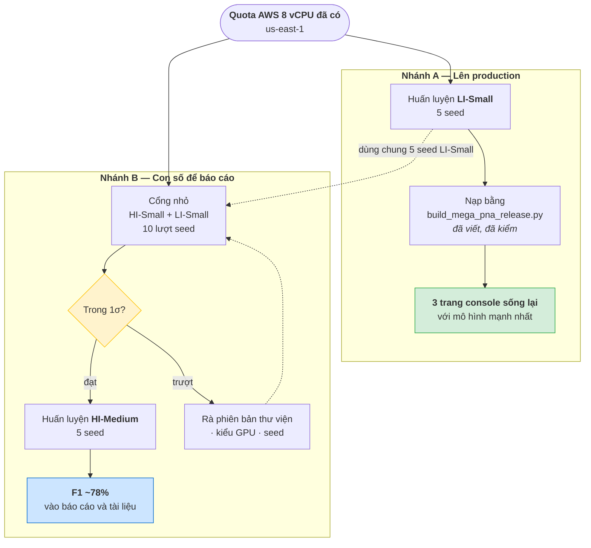
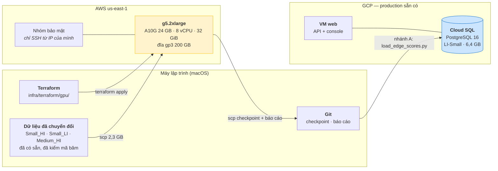
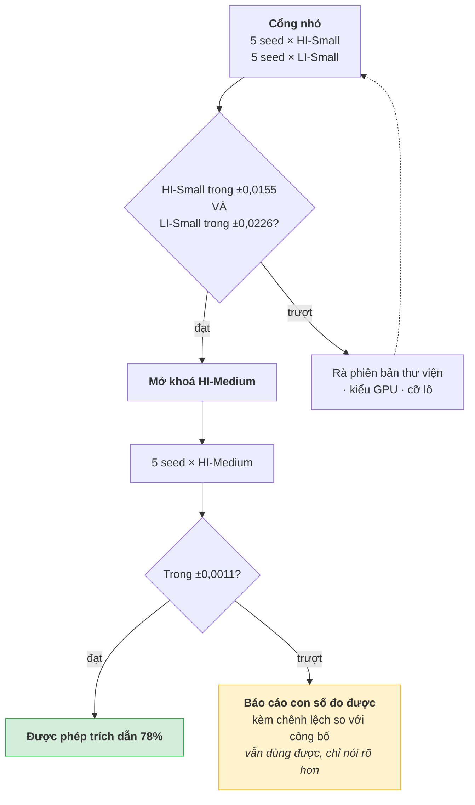
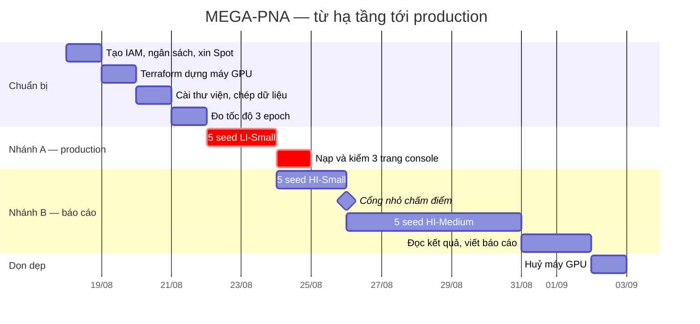

# Kế hoạch đầy đủ: MEGA-PNA trên HI-Medium

Từ hạ tầng dưới dạng mã, qua huấn luyện và nghiệm thu, tới đưa lên production.

Tài liệu này là **kế hoạch thi công**. Phần "vì sao chọn MEGA-PNA" nằm ở
[KE_HOACH_LAM_LAI_MODEL.md](KE_HOACH_LAM_LAI_MODEL.md); phần "cách chạy chi tiết"
nằm ở [HUONG_DAN_DUNG_LAI_MODEL.md](HUONG_DAN_DUNG_LAI_MODEL.md). Bên này ghép
chúng lại thành một đường đi có mốc, có tiền, có rủi ro.

---

## 0. Bốn điều phải biết trước khi duyệt kế hoạch

Nhóm muốn làm HI-Medium để ra con số đẹp. Được — nó là mốc công bố thật, **F1
78,26% ± 0,11%**. Nhưng bốn điều dưới đây đổi hình dạng kế hoạch, nên đọc trước
khi đọc tiếp.

### 0.1 Không nhảy thẳng vào HI-Medium được

`scripts/benchmark_mega_pna.py` **chặn cứng** đường tắt:

```python
if args.suite in ("medium", "all"):
    existing = write_summary(args, small)
    if not existing["small_reproduction_gate_passed"]:
        print("Run and pass --suite gate before Medium_HI.", file=sys.stderr)
        return 2
```

Muốn chạm Medium_HI thì phải **qua cổng nhỏ trước**: 5 seed trên HI-Small **và** 5
seed trên LI-Small, cả hai đều phải nằm trong 1 độ lệch chuẩn của số công bố.

Đây là chốt cố ý, và nó đúng: không ai được khoe con số lớn trước khi chứng minh
mình tái lập nổi con số nhỏ. Hệ quả với kế hoạch: **15 lượt seed chứ không phải
5.**

### 0.2 Con số 78% không "tốt hơn" 45% — nó là bài toán khác

| | LI-Small | HI-Medium |
|---|---|---|
| Giao dịch | 6.924.049 | **31.898.238** |
| Nhãn rửa tiền | 3.565 | **35.230** |
| Tỷ lệ dương | 0,0515% | **0,1104%** — gấp 2,1 lần |
| F1 công bố | 0,4507 ± 0,0226 | **0,7826 ± 0,0011** |

`HI` là *high illicit* — bộ dữ liệu được sinh với tỷ lệ rửa tiền cao hơn hẳn. Bài
toán dễ hơn, nên điểm cao hơn. Cả hai đều là mốc công bố hợp lệ; chỉ **đừng đặt
cạnh nhau rồi bảo mô hình tốt lên**.

### 0.3 HI-Medium có dung sai nghiệm thu ngặt nhất

Cổng chấm bằng `|trung bình 5 seed − số công bố| ≤ 1 độ lệch chuẩn`.

| Bộ dữ liệu | Dung sai cho phép |
|---|---|
| HI-Small | ± 0,0155 |
| LI-Small | ± 0,0226 |
| **HI-Medium** | **± 0,0011** |

HI-Medium ngặt hơn LI-Small **hai mươi lần**. Nói thẳng: **khả năng trượt cổng ở
HI-Medium là có thật**, kể cả khi mọi thứ làm đúng — chỉ cần lệch phiên bản thư
viện hay khác kiểu GPU là ra ngoài dải. Kế hoạch phải chuẩn bị cho việc đó (mục 9).

### 0.4 HI-Medium **không** đưa lên production được như hiện trạng

Đây là điều quan trọng nhất, và nó không hiển nhiên.

Production đang chạy trên **LI-Small**. Mô hình huấn luyện trên HI-Medium chấm
điểm cho **giao dịch HI-Medium**, mà những giao dịch ấy **không có trong cơ sở dữ
liệu**. Nạp vào sẽ không nối được dòng nào.

Số đo thực tế của cơ sở dữ liệu production:

| | Hiện tại | Nếu thay bằng HI-Medium |
|---|---|---|
| Bảng `transaction` | 6.119.572 dòng · 2.796 MB | ~31,9 triệu dòng · **~14,6 GB** |
| Bảng `transaction_model_score` | 6.119.572 dòng · 2.286 MB | ~31,9 triệu dòng · **~11,9 GB** |
| Tổng cơ sở dữ liệu | **6.417 MB** | **~33 GB** |

Máy Cloud SQL đang là **`db-f1-micro`** — bậc chia sẻ CPU, đĩa khởi điểm 10 GB.
Chính chú thích trong `infra/terraform/variables.tf` viết rằng giao dịch thô
*"KHÔNG lưu ở đây"*. Đẩy 33 GB vào đó là chống lại thiết kế.

**Nên kế hoạch tách làm hai nhánh** — chi tiết ở mục 1.

---

## 1. Hai nhánh, chạy song song



**Điểm mấu chốt: hai nhánh dùng chung phần lớn công việc.** Cổng nhỏ đã bao gồm 5
seed LI-Small — chính là thứ nhánh A cần. Chạy cổng nhỏ một lần là có luôn mô
hình để đưa lên production.

| | Nhánh A | Nhánh B |
|---|---|---|
| Mục tiêu | Console chạy bằng mô hình mạnh nhất | Con số đẹp cho báo cáo |
| Bộ dữ liệu | LI-Small | HI-Medium |
| F1 kỳ vọng | ~0,45 | ~0,78 |
| Nạp vào PostgreSQL | **có** | **không** — xem mục 0.4 |
| Mã cần viết thêm | không | không |
| Rủi ro | thấp | trung bình (dung sai ± 0,0011) |

---

## 2. Kiến trúc hạ tầng



Máy GPU **không nối vào production**. Nó chỉ nhận dữ liệu và trả về checkpoint —
không cần mở cổng nào ngoài SSH, không cần quyền vào cơ sở dữ liệu.

---

## 3. Giai đoạn 0 — Việc phải làm trước khi chạm Terraform

### 3.1 ⚠️ Đang dùng khoá của tài khoản gốc

`aws sts get-caller-identity` trả về:

```json
{ "Arn": "arn:aws:iam::120354378781:root" }
```

**Đây là khoá truy cập của tài khoản gốc.** Nó không giới hạn được quyền, không
thu hồi riêng lẻ được, và lộ ra là mất toàn quyền tài khoản kèm hoá đơn. AWS
khuyến cáo không tạo khoá cho tài khoản gốc; nhiều tổ chức chặn thẳng.

Việc cần làm, khoảng 10 phút:

```bash
# 1. Tạo người dùng riêng cho việc này
aws iam create-user --user-name fin07-gpu
aws iam attach-user-policy --user-name fin07-gpu \
  --policy-arn arn:aws:iam::aws:policy/AmazonEC2FullAccess
aws iam create-access-key --user-name fin07-gpu     # lưu lại cặp khoá

# 2. Cấu hình hồ sơ riêng, không đụng vào hồ sơ mặc định
aws configure --profile fin07-gpu

# 3. Kiểm — phải ra .../fin07-gpu, không còn chữ root
aws sts get-caller-identity --profile fin07-gpu

# 4. Xoá khoá của tài khoản gốc trong IAM Console → Security credentials
```

Từ đây mọi lệnh trong tài liệu đều thêm `--profile fin07-gpu`, và Terraform đọc
`AWS_PROFILE=fin07-gpu`.

> Đây không phải thủ tục hình thức. Máy GPU tính tiền theo giờ; khoá tài khoản gốc
> lộ ra nghĩa là người khác bật được máy đắt nhất trong mọi vùng.

### 3.2 Bật cảnh báo chi phí

Trước khi bật bất kỳ máy nào:

```bash
aws budgets create-budget --account-id 120354378781 \
  --budget '{"BudgetName":"fin07-gpu","BudgetLimit":{"Amount":"250","Unit":"USD"},
             "TimeUnit":"MONTHLY","BudgetType":"COST"}' \
  --profile fin07-gpu
```

Rồi vào Billing Console thêm thông báo email ở mốc 50% và 80%. Kế hoạch này ước
tính 100–200 USD (mục 8); ngưỡng 250 để biết khi vượt dự trù.

### 3.3 Xin hạn mức Spot (tuỳ chọn, tiết kiệm ~3 lần)

Hạn mức đã duyệt là cho máy On-Demand. Spot tính riêng:

```
Service Quotas → EC2 → "All G and VT Spot Instance Requests" → xin 8
```

Với quy mô 15 lượt seed, khoản chênh này là **hơn 100 USD**. Nên xin. Nhưng đừng
chờ nó mới bắt đầu — nhánh A chạy được ngay bằng On-Demand.

---

## 4. Giai đoạn 1 — Hạ tầng dưới dạng mã

Terraform hiện có ở `infra/terraform/` quản lý GCP và **không tạo VM** (chú ý ghi
rõ trong README của nó: để Terraform nắm vòng đời VM production là một lần
`destroy` lỡ tay sẽ xoá cả cơ sở dữ liệu).

Máy GPU thì ngược lại — nó **nên** do Terraform nắm trọn vòng đời, vì nó tạm thời
và không giữ dữ liệu gốc nào. Nên đặt vào **thư mục riêng, state riêng**:
`infra/terraform/gpu/`.

### 4.1 `infra/terraform/gpu/versions.tf`

```hcl
terraform {
  required_version = ">= 1.6"
  required_providers {
    aws = {
      source  = "hashicorp/aws"
      version = "~> 5.60"
    }
  }
}

provider "aws" {
  region  = var.region
  profile = var.aws_profile

  default_tags {
    tags = {
      Project     = "FIN-07"
      Purpose     = "mega-pna-training"
      ManagedBy   = "terraform"
      AutoDelete  = "true"
    }
  }
}
```

### 4.2 `infra/terraform/gpu/variables.tf`

```hcl
variable "aws_profile" {
  description = "Hồ sơ AWS CLI. Đừng dùng hồ sơ của tài khoản gốc."
  type        = string
  default     = "fin07-gpu"
}

variable "region" {
  description = "Phải là vùng đã được duyệt hạn mức họ G."
  type        = string
  default     = "us-east-1"
}

variable "instance_type" {
  description = <<-EOT
    Hạn mức là 8 vCPU nên chỉ dùng được cỡ .2xlarge:
      g5.2xlarge   A10G 24 GB VRAM, 32 GiB RAM  — mặc định
      g6.2xlarge   L4   24 GB VRAM, 32 GiB RAM  — rẻ hơn chút
      g6e.2xlarge  L40S 48 GB VRAM, 64 GiB RAM  — khi HI-Medium tràn RAM
    Cỡ .4xlarge trở lên là 16 vCPU, vượt hạn mức, máy sẽ không bật được.
  EOT
  type        = string
  default     = "g5.2xlarge"
}

variable "root_volume_gb" {
  description = <<-EOT
    Deep Learning AMI đã chiếm 50-60 GB. Cộng dữ liệu đã chuyển đổi (2,3 GB),
    CSV gốc HI-Medium (3,0 GB) và các file điểm. 200 GB là mức thoải mái;
    dưới 120 GB là dễ đầy giữa chừng.
  EOT
  type        = number
  default     = 200
}

variable "allowed_ssh_cidr" {
  description = "IP của bạn kèm /32. ĐỪNG để 0.0.0.0/0."
  type        = string
}

variable "public_key_path" {
  description = "Khoá công khai SSH, ví dụ ~/.ssh/fin07-gpu.pub"
  type        = string
}
```

### 4.3 `infra/terraform/gpu/main.tf`

```hcl
# Ảnh máy Deep Learning của AWS đã có sẵn driver NVIDIA và CUDA. Tra động thay vì
# ghim mã AMI: mã AMI khác nhau theo từng vùng và bị thay khi có bản mới.
data "aws_ami" "deep_learning" {
  most_recent = true
  owners      = ["amazon"]

  filter {
    name   = "name"
    values = ["Deep Learning OSS Nvidia Driver AMI GPU PyTorch*Ubuntu 22.04*"]
  }
}

resource "aws_key_pair" "gpu" {
  key_name   = "fin07-gpu"
  public_key = file(var.public_key_path)
}

resource "aws_security_group" "gpu" {
  name        = "fin07-gpu"
  description = "Chỉ SSH từ một địa chỉ. Máy này không phục vụ gì ra ngoài."

  ingress {
    description = "SSH"
    from_port   = 22
    to_port     = 22
    protocol    = "tcp"
    cidr_blocks = [var.allowed_ssh_cidr]
  }

  egress {
    description = "Tải thư viện và mã nguồn"
    from_port   = 0
    to_port     = 0
    protocol    = "-1"
    cidr_blocks = ["0.0.0.0/0"]
  }
}

resource "aws_instance" "gpu" {
  ami                    = data.aws_ami.deep_learning.id
  instance_type          = var.instance_type
  key_name               = aws_key_pair.gpu.key_name
  vpc_security_group_ids = [aws_security_group.gpu.id]

  root_block_device {
    volume_size = var.root_volume_gb
    volume_type = "gp3"
    encrypted   = true
    # Giữ đĩa khi huỷ máy thì sẽ âm thầm tính tiền mãi. Huỷ là huỷ hẳn;
    # thứ đáng giữ (checkpoint, báo cáo) đã nằm trong Git.
    delete_on_termination = true
  }

  # Dừng máy bằng `terraform apply -var stopped=true` thì không mất dữ liệu ổ đĩa.
  # Chỉ `terraform destroy` mới xoá.
  lifecycle {
    ignore_changes = [ami]
  }

  tags = { Name = "fin07-mega-pna" }
}
```

### 4.4 `infra/terraform/gpu/outputs.tf`

```hcl
output "public_ip" {
  value = aws_instance.gpu.public_ip
}

output "instance_id" {
  value = aws_instance.gpu.id
}

output "ssh" {
  value = "ssh -i ~/.ssh/fin07-gpu ubuntu@${aws_instance.gpu.public_ip}"
}

output "stop_command" {
  description = "Dừng máy để ngừng tính tiền giờ mà không mất ổ đĩa."
  value       = "aws ec2 stop-instances --instance-ids ${aws_instance.gpu.id} --region ${var.region} --profile ${var.aws_profile}"
}
```

### 4.5 Chạy

```bash
ssh-keygen -t ed25519 -f ~/.ssh/fin07-gpu -N ''

cat > infra/terraform/gpu/terraform.tfvars <<EOF
allowed_ssh_cidr = "$(curl -s https://checkip.amazonaws.com | tr -d '\n')/32"
public_key_path  = "~/.ssh/fin07-gpu.pub"
EOF

cd infra/terraform/gpu
terraform init
terraform plan      # đọc kỹ: đúng g5.2xlarge, đúng us-east-1, SSH đúng một IP
terraform apply
```

> **Thêm `infra/terraform/gpu/terraform.tfvars` vào `.gitignore`** — nó chứa địa
> chỉ IP nhà bạn. File `.tfvars.example` thì commit được.
>
> **`allowed_ssh_cidr` đổi theo mạng.** Đổi quán cà phê là mất SSH; chạy lại lệnh
> `curl` rồi `terraform apply` là xong.

---

## 5. Giai đoạn 2 — Dữ liệu

Tin tốt: **cả ba bộ dữ liệu đã chuyển đổi xong từ trước**, kèm mã băm.

| Bộ | Dòng | Nhãn dương | Tự chuyển | File |
|---|---|---|---|---|
| Small_HI | 5.078.345 | 5.177 | 591.212 | 261 MB |
| Small_LI | 6.924.049 | 3.565 | 804.477 | 358 MB |
| **Medium_HI** | **31.898.238** | **35.230** | 2.561.860 | **1,7 GB** |

Cả ba đều **giữ nguyên giao dịch tự chuyển**, đúng bằng file gốc IBM — nên không
dính lỗi đo đã làm F1 mô hình edge bị thổi lên.

```bash
HOST=ubuntu@$(cd infra/terraform/gpu && terraform output -raw public_ip)
KEY=~/.ssh/fin07-gpu

ssh -i $KEY $HOST 'mkdir -p ~/P-022/data/processed/mega-pna/{Small_HI,Small_LI,Medium_HI}'

for DS in Small_HI Small_LI Medium_HI; do
  scp -i $KEY \
    data/processed/mega-pna/$DS/formatted_transactions.csv \
    data/processed/mega-pna/$DS/formatted_transactions.manifest.json \
    $HOST:~/P-022/data/processed/mega-pna/$DS/
done
```

Tổng 2,3 GB. Trên máy, xác nhận mã băm — lệch là dữ liệu khác, kết quả vô nghĩa:

```bash
sha256sum data/processed/mega-pna/*/formatted_transactions.csv
# Small_HI  : 907663c35f5c27471a9945a287707736b7f0141c7e784070303e5f05a505e77a
# Small_LI  : 450d89e106631e9fabb26819d54833f1d6568a2e9d0948f5e6206a6e766cdddc
# Medium_HI : bfbd8847a3215826360dad60b9ef930308d5929c1725b846d43dd5547de9995e
```

### Bộ nhớ — chỗ HI-Medium khác hẳn

`load_formatted_data` dựng **ba đồ thị** (train, validation, test) trong RAM,
mỗi cái giữ thêm bản cạnh ngược. Tính theo mã trong `src/mega_pna/data.py`:

| | LI-Small | HI-Medium |
|---|---|---|
| Tensor gốc | ~0,36 GB | ~1,7 GB |
| Ba đồ thị | ~1,1 GB | ~5,2 GB |
| Bảng pandas lúc nạp | ~0,3 GB | ~1,5 GB |
| **Đỉnh ước tính** | **~2 GB** | **~9–14 GB** |

**32 GiB của `g5.2xlarge` đủ**, nhưng không rộng rãi. Dấu hiệu tràn là tiến trình
bị giết với chữ `Killed` và **không có traceback nào** — rất dễ tưởng nhầm là lỗi
mã. Gặp thì đổi `instance_type` sang `g6e.2xlarge` (64 GiB, vẫn 8 vCPU nên không
phải xin thêm hạn mức) rồi `terraform apply`.

---

## 6. Giai đoạn 3 — Huấn luyện

### 6.1 Cài đặt

Xem [HUONG_DAN_DUNG_LAI_MODEL.md](HUONG_DAN_DUNG_LAI_MODEL.md) mục 4.6. Điều duy
nhất phải nhớ: **`torch` cài trước, `torch-scatter`/`torch-sparse` cài sau kèm
`--no-build-isolation`.** Sai thứ tự thì được bản CPU, chạy vẫn ra kết quả, chỉ
chậm gấp hàng chục lần, và **không có thông báo lỗi nào**.

### 6.2 Đo tốc độ trước — bắt buộc

```bash
python scripts/train_mega_pna.py --dataset Small_LI --seed 42 --epochs 3 \
  --device cuda --reports-dir reports/mega-pna-thu
```

Bấm giờ một epoch. Gọi con số đó là **T phút**. Toàn bộ dự trù thời gian và tiền
của kế hoạch này quy về T:

| Bộ dữ liệu | Cạnh | Hệ số so với LI-Small | Một epoch |
|---|---|---|---|
| Small_HI | 5,08 M | 0,73× | 0,73 T |
| Small_LI | 6,92 M | 1,00× | T |
| Medium_HI | 31,90 M | **4,61×** | **4,61 T** |

Tổng khối lượng cả kế hoạch = 5×(0,73 + 1,00 + 4,61) = **31,7 lượt-LI-Small**.

Xoá thư mục thử sau khi đo — để lại thì script cổng thấy báo cáo có cấu hình
epoch khác và dừng với lỗi.

### 6.3 Chạy, đúng thứ tự

```bash
# ── Cổng nhỏ: HI-Small + LI-Small, 10 lượt seed ────────────────────────────
nohup python scripts/benchmark_mega_pna.py --suite gate --device cuda \
  > gate.log 2>&1 &

# Chỉ chạy được sau khi cổng nhỏ ĐẠT — script tự chặn nếu chưa.
nohup python scripts/benchmark_mega_pna.py --suite medium --device cuda \
  > medium.log 2>&1 &
```

> **Không dùng `--include-ablation`.** Nó chạy thêm một nhánh bỏ cột "hình thức
> thanh toán", tức **nhân đôi mọi thứ**: 15 lượt seed thành 30, tiền cũng gấp đôi.
> Nhánh ablation có ích cho câu hỏi "đặc trưng nào đóng góp", nhưng để dành sau
> khi đã có con số chính, và chỉ chạy trên LI-Small cho rẻ.

Script **bỏ qua seed nào đã có báo cáo**, nên ngắt giữa chừng rồi chạy lại không
mất công. Máy Spot bị thu hồi cũng chỉ mất seed đang dở.

### 6.4 Theo dõi

```bash
tail -f gate.log                 # mỗi epoch một dòng
watch -n 5 nvidia-smi            # GPU-Util phải khác 0
```

---

## 7. Giai đoạn 4 — Nghiệm thu



Đọc kết quả:

```bash
python -c "
import json
r = json.load(open('reports/mega-pna/benchmark.json'))
print('CỔNG NHỎ:', 'ĐẠT' if r['small_reproduction_gate_passed'] else 'TRƯỢT')
for d in r['datasets']:
    if not d.get('aggregate'): continue
    f1, pub = d['aggregate']['f1'], d['published_reference']
    print(f\"  {d['dataset']:10s} F1 {f1['mean']:.4f} ± {f1['std'] or 0:.4f}  \"
          f\"(công bố {pub['mean']:.4f} ± {pub['std']:.4f})  {d['within_published_one_std']}\")
"
```

**Bốn quy tắc không được phá:**

1. Đúng 5 seed — script từ chối con số khác.
2. Chạm tập test **đúng một lần**. `train_one_seed` chỉ chấm test sau khi vòng lặp
   kết thúc và đã nạp lại trạng thái tốt nhất theo validation. Đừng sửa chỗ đó.
3. Con số báo cáo là `test_paper_protocol.f1`, **không phải** `validation_at_best`.
4. Ghi mã băm dữ liệu và mốc chia tập vào báo cáo.

---

## 8. Giai đoạn 5 — Lên production (nhánh A)

Chỉ nhánh A lên production. Lý do ở mục 0.4.

Ba lệnh, đã có đủ mã, chi tiết ở
[HUONG_DAN_DUNG_LAI_MODEL.md](HUONG_DAN_DUNG_LAI_MODEL.md) mục 7:

```bash
# 1. Dựng bản phát hành từ seed LI-Small tốt nhất
.venv/bin/python scripts/build_mega_pna_release.py \
  --predictions models/mega-pna/Small_LI/paper/seed_42_test.parquet \
  --report      reports/mega-pna/Small_LI/paper/seed_42.json \
  --benchmark   reports/mega-pna/benchmark.json

# 2. Nạp (thử --dry-run trước)
.venv/bin/python scripts/load_edge_scores.py \
  --scores  data/processed/mega-pna/Small_LI/pg_scores.parquet \
  --report  reports/mega-pna/Small_LI/release.json \
  --model   models/mega-pna/Small_LI/paper/seed_42.pt \
  --db      data/processed/aml.duckdb \
  --dataset "IBM AML LI-Small MEGA-PNA"

# 3. Siêu dữ liệu console
.venv/bin/python scripts/publish_edge_console_metadata.py
```

Rồi commit checkpoint — nó là bản gốc duy nhất, production không giữ file mô hình
nào:

```bash
git add models/mega-pna/Small_LI/paper/seed_42.pt
git commit -m "model(mega-pna): checkpoint bản phát hành đang chạy"
```

### Nếu vẫn muốn đưa HI-Medium lên production

Đây là **một dự án riêng**, không phải một bước của kế hoạch này. Cần:

| Việc | Ghi chú |
|---|---|
| Dựng DuckDB từ HI-Medium | `load_ibm_dataset_duckdb.py --csv HI-Medium_Trans.csv` |
| Nạp 31,9 triệu giao dịch vào PostgreSQL | thay toàn bộ dân số hiện có |
| Nâng cấp Cloud SQL | `db-f1-micro` → bậc có CPU riêng; đĩa 10 GB → 50 GB |
| Chạy lại cả ba nhánh phát hiện | cảnh báo hiện tại sinh từ LI-Small, sẽ vô nghĩa |
| Sinh lại dữ liệu Financial City | lược đồ `fc_gt` gắn với tài khoản LI-Small |

`build_mega_pna_release.py` **đã nhận `--raw` và `--db`** nên phần bắc cầu dùng
lại được ngay. Nhưng bốn việc còn lại là công việc nhiều ngày và đổi hẳn chi phí
vận hành.

**Khuyến nghị: đừng làm trong đợt này.** Báo cáo con số HI-Medium như một kết quả
benchmark, còn console chạy LI-Small. Đó cũng là cách các bài báo trình bày: nhiều
bộ dữ liệu, một bảng kết quả.

---

## 9. Chi phí và thời gian

Quy về **T = số phút một epoch LI-Small**, đo ở mục 6.2.

| T | Cổng nhỏ (10 seed) | HI-Medium (5 seed) | **Tổng giờ máy** | On-Demand ≈1,2 $/h | Spot ≈0,4 $/h |
|---|---|---|---|---|---|
| 2 phút | 23 h | 61 h | **84 h** | ~101 USD | ~34 USD |
| 3 phút | 35 h | 92 h | **127 h** | ~152 USD | ~51 USD |
| 4 phút | 46 h | 123 h | **169 h** | ~203 USD | ~68 USD |

Cộng đĩa gp3 200 GB ≈ 16 USD/tháng, tính cả lúc máy tắt.

**Ba cách cắt chi phí, theo thứ tự nên dùng:**

1. **Xin hạn mức Spot** — tiết kiệm ~2/3. Việc đáng giá nhất trong danh sách.
2. **Bỏ `--include-ablation`** — nếu lỡ bật, nó nhân đôi tất cả.
3. **Dừng ở nhánh A** — chỉ 5 seed LI-Small, khoảng 1/6 chi phí, và production vẫn
   chạy bằng mô hình mạnh nhất.

> **Máy tính tiền kể cả lúc không chạy gì.** Quên tắt một cuối tuần là mất gần 90
> USD. Đặt báo thức, và dùng `terraform output stop_command`.

---

## 10. Rủi ro

| Rủi ro | Khả năng | Hậu quả | Xử lý |
|---|---|---|---|
| **HI-Medium trượt dung sai ±0,0011** | **cao** | không trích dẫn được "đạt chuẩn" | Báo cáo con số đo được kèm chênh lệch. Vẫn là kết quả hợp lệ |
| `torch-scatter` ra bản CPU | trung bình | chậm gấp hàng chục lần, không báo lỗi | `nvidia-smi` lúc chạy: `GPU-Util` phải khác 0 |
| Tràn RAM ở HI-Medium | trung bình | `Killed`, không traceback | Đổi `instance_type` sang `g6e.2xlarge` |
| Cổng nhỏ trượt → HI-Medium bị chặn | trung bình | mất thời gian rà | Rà phiên bản thư viện trước, đó là nguyên nhân hay gặp nhất |
| Quên tắt máy | **cao** | ~90 USD mỗi cuối tuần | Cảnh báo ngân sách ở mục 3.2 |
| Máy Spot bị thu hồi | cao (nếu dùng Spot) | mất seed đang dở | Script tự bỏ qua seed đã xong; chạy lại là tiếp |
| Đổi mạng, mất SSH | trung bình | không vào được máy | Chạy lại `curl checkip` rồi `terraform apply` |
| Khoá tài khoản gốc lộ | thấp | mất toàn quyền tài khoản | Mục 3.1 — làm trước mọi thứ |

---

## 11. Lịch trình



| Ai | Làm gì |
|---|---|
| Người 1 | IAM, ngân sách, Terraform, vận hành máy GPU |
| Người 2 | Chạy huấn luyện, theo dõi log, đọc cổng nghiệm thu |
| Người 3 | Nạp nhánh A vào PostgreSQL, kiểm 3 trang console |
| Người 4 | Viết báo cáo, cập nhật tài liệu và số liệu |

---

## 12. Kiểm trước khi bắt đầu

**Hạ tầng**
- [ ] `aws sts get-caller-identity --profile fin07-gpu` **không** còn chữ `root`
- [ ] Khoá của tài khoản gốc đã xoá trong IAM Console
- [ ] Cảnh báo ngân sách đã bật, có email ở mốc 50% và 80%
- [ ] `terraform plan` cho đúng `g5.2xlarge`, đúng `us-east-1`, SSH đúng một IP
- [ ] `terraform.tfvars` đã vào `.gitignore`

**Máy**
- [ ] `nvidia-smi` in ra `A10G`
- [ ] `torch.cuda.is_available()` trả `True`
- [ ] `import torch_sparse` không lỗi
- [ ] `pytest tests/test_mega_pna -q` — 4 bài qua
- [ ] Đĩa gốc ≥ 200 GB (`df -h /`)

**Dữ liệu**
- [ ] Ba mã băm khớp đúng giá trị ở mục 5
- [ ] Ba manifest ghi đúng số dòng và số nhãn dương

**Trước khi chạy cổng**
- [ ] Đã đo T và tính ra dự trù tiền
- [ ] Đã xoá `reports/mega-pna-thu`
- [ ] **Không** có `--include-ablation` trong lệnh
- [ ] `GPU-Util` khác 0 khi đang chạy
- [ ] Đã đặt báo thức tắt máy

---

## 13. Tóm lại

**Làm HI-Medium được, và nó cho con số đẹp thật — 78%.** Ba điều cần nhớ khi duyệt:

**Một.** Không nhảy thẳng vào được. Phải qua cổng nhỏ trước, nên là **15 lượt seed
chứ không phải 5** — khoảng 100–200 USD On-Demand, hoặc 35–70 USD nếu xin được
Spot.

**Hai.** Dung sai nghiệm thu của HI-Medium là **± 0,0011**, ngặt hơn LI-Small hai
mươi lần. Trượt là chuyện có thể xảy ra dù làm đúng; lúc đó vẫn báo cáo con số đo
được kèm chênh lệch, không phải bỏ đi.

**Ba.** HI-Medium **không lên production được** trong đợt này — production chạy
LI-Small, và đổi sang HI-Medium là 33 GB trên một máy Cloud SQL `db-f1-micro`.
Nhánh A lo phần production bằng LI-Small; nhánh B lo con số báo cáo bằng HI-Medium.
Hai nhánh dùng chung phần lớn công việc, nên làm cả hai gần như không đắt hơn làm
một.

Bắt đầu từ mục 3.1: tạo người dùng IAM.
