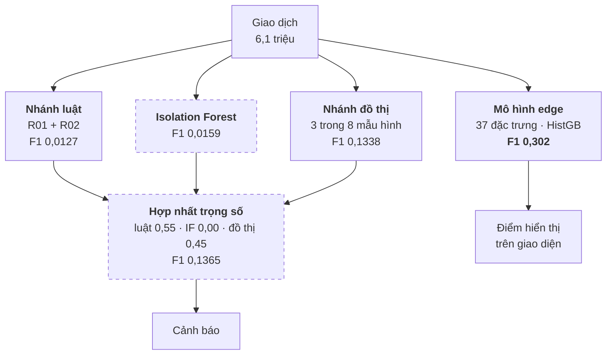
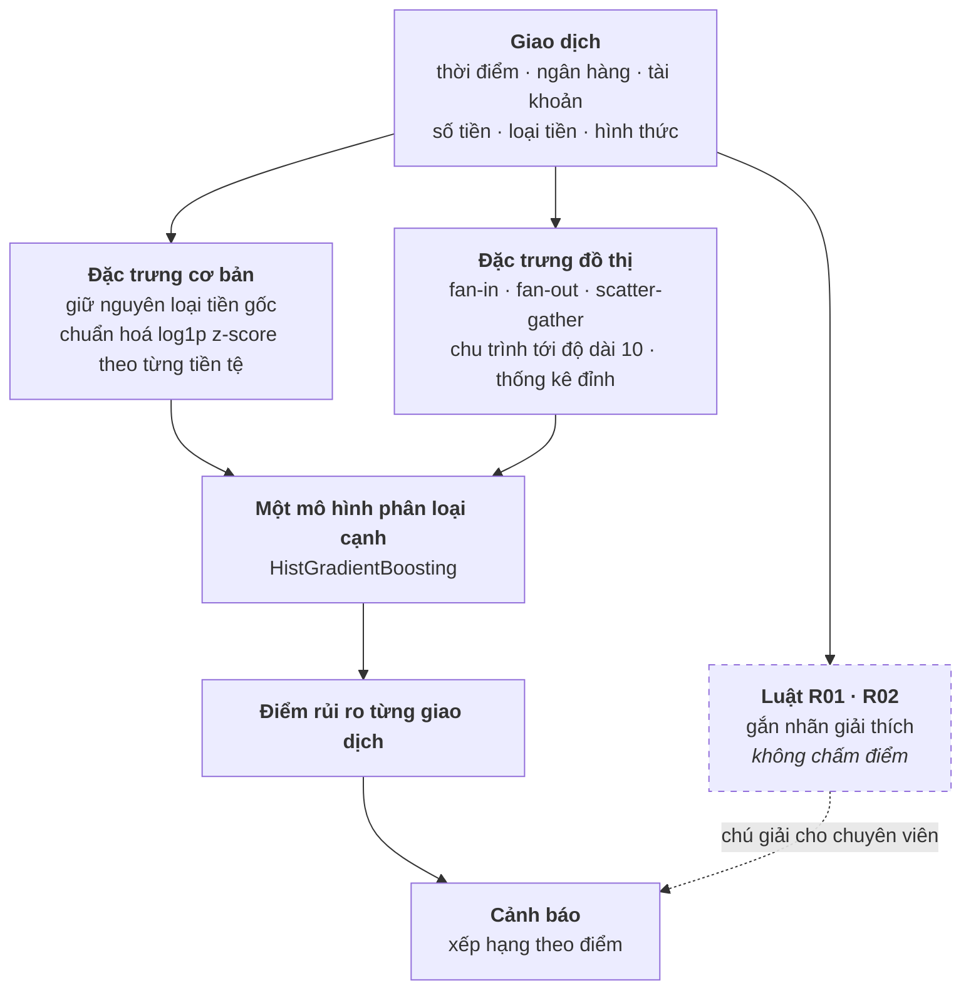
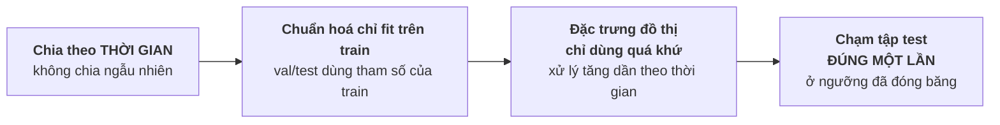
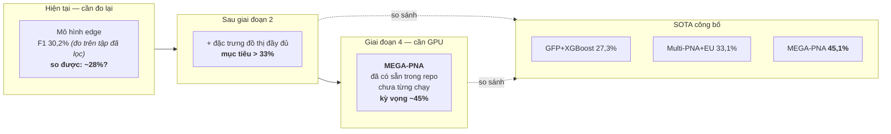

# Làm lại phần model — kế hoạch cho cả nhóm

Tài liệu này trả lời một câu: **nên dựng lại tầng phát hiện như thế nào cho đúng
với cách những nhóm giỏi nhất làm trên chính bộ dữ liệu này.**

Đọc hết mất khoảng 15 phút. Mọi con số đều dẫn nguồn: hoặc từ hai bài báo bên
dưới, hoặc từ chính hệ thống đang chạy.

---

## 1. Kết luận trong hai phút

Kiến trúc hiện tại là **ba nhánh phát hiện rồi cộng điểm có trọng số**. Không
nhóm nghiên cứu nào làm vậy trên bộ dữ liệu này. Cả lĩnh vực dùng **một mô hình
phân loại cạnh duy nhất**, và biến mẫu hình rửa tiền thành **đặc trưng đầu vào**
chứ không phải bộ phát hiện riêng.

Tin tốt: **thứ tốt nhất chúng ta đang có lại đúng hướng đó.** Mô hình
currency-native edge đạt F1 30,2%, ngang tầm SOTA — và nó **đã sẵn** sáu đặc
trưng đồ thị. Việc cần làm không phải viết lại từ đầu, mà là **bỏ hai nhánh vô
giá trị và đổ toàn bộ công sức vào mô hình đang thắng**.

| | Bây giờ | Sau khi làm lại |
|---|---|---|
| Số mô hình chấm điểm | 3 nhánh + 1 bước hợp nhất | **1** |
| Mẫu hình rửa tiền | một nhánh phát hiện riêng | **đặc trưng của mô hình** |
| Luật nghiệp vụ | góp vào điểm rủi ro | **chỉ để giải thích, không chấm điểm** |
| Isolation Forest | có, trọng số 0,00 | **bỏ** |

---

## 2. Nguồn tham khảo

| Bài | Vai trò |
|---|---|
| Altman, Blanuša, von Niederhäusern, Egressy, Anghel, Atasu — *Realistic Synthetic Financial Transactions for AML Models*, **NeurIPS 2023** ([arXiv:2306.16424](https://arxiv.org/abs/2306.16424)) | Bài **tạo ra chính bộ dữ liệu ta đang dùng**. Định nghĩa baseline chuẩn. |
| Egressy, von Niederhäusern, Blanuša, Altman, Wattenhofer, Atasu — *Provably Powerful GNNs for Directed Multigraphs*, **AAAI 2024** ([arXiv:2306.11586](https://arxiv.org/abs/2306.11586), mã nguồn [IBM/Multi-GNN](https://github.com/IBM/Multi-GNN)) | Kết quả tốt nhất hiện nay trên bộ này. |

---

## 3. Bảng chuẩn trên LI-Small

F1 của **lớp thiểu số** — không dùng accuracy, vì tỷ lệ dương chỉ 0,068%.

| Mô hình | F1 (%) | Loại kiến trúc |
|---|---|---|
| GIN | 7,90 | GNN chuẩn |
| PNA | 14,85 | GNN chuẩn |
| GIN+EU | 20,62 | GNN + cập nhật cạnh |
| GFP + LightGBM | 20,83 | **đặc trưng đồ thị + cây** |
| Multi-GIN | 22,12 | GNN đa đồ thị |
| Multi-GIN+EU | 26,88 | GNN đa đồ thị |
| **GFP + XGBoost** | **27,30** | **đặc trưng đồ thị + cây** |
| **Multi-PNA** | **30,65** | GNN đa đồ thị |
| **Multi-PNA+EU** | **33,07** | GNN đa đồ thị |
| **MEGA-PNA** | **45,07 ± 2,26** | GNN đa đồ thị + gộp cạnh song song — **tốt nhất** |

> **MEGA-PNA đã có sẵn trong repo và chưa từng được huấn luyện.** `src/mega_pna/`
> là bản cài đặt đầy đủ, dữ liệu LI-Small đã chuyển đổi xong và **giữ nguyên
> 6.924.049 dòng** — tức không dính lỗi đo nói ở khung dưới. Thứ duy nhất thiếu
> là một GPU NVIDIA. Cách thực hiện từng bước: [HUONG_DAN_DUNG_LAI_MODEL.md](HUONG_DAN_DUNG_LAI_MODEL.md).

**Mô hình edge của chúng ta: 30,2%** (seed chính; trung bình 5 seed 29,7% ± 1,3).

> ## ⚠️ ĐỪNG TRÍCH CON SỐ NÀY ĐỂ SO VỚI BẢNG TRÊN
>
> Nó **không đo trên cùng một bài toán**, và lệch theo hướng **có lợi cho ta**.
>
> | | File gốc IBM | Cơ sở dữ liệu của ta |
> |---|---|---|
> | Giao dịch | **6.924.049** | 6.119.572 |
> | Nhãn rửa tiền | 3.565 | 3.562 |
> | Tỷ lệ dương | 0,0515% | **0,0582%** |
>
> Lúc nạp dữ liệu, ta **bỏ 804.477 giao dịch tự chuyển** (`from_account_key =
> to_account_key`) — xem `scripts/prepare_ibm_behavior_batch.py` dòng 92 và
> `scripts/load_ibm_dataset_duckdb.py`. Trong số bị bỏ có **804.474 âm tính và
> chỉ 3 dương tính**.
>
> Tức là ta đã vứt gần hết mẫu âm dễ và giữ gần hết mẫu dương. Tỷ lệ dương trong
> tập đánh giá cao hơn **1,13 lần** so với bài toán thật. Bỏ mẫu âm khỏi tập test
> chỉ có thể làm precision đẹp lên, nên **F1 0,302 gần như chắc chắn bị thổi lên**.
>
> Ước lượng thô: nếu mô hình gắn cờ self-loop với cùng tỷ lệ như giao dịch khác,
> F1 rơi về khoảng **0,28**. Đây là ước lượng, không phải đo.
>
> Bài báo dùng đúng giao thức **60-20-20 theo thời gian** như ta — phần đó khớp.
> Vấn đề không nằm ở cách chia, mà ở **tập được đưa vào đánh giá**.
>
> Muốn có con số so được, xem **giai đoạn 1** ở mục 8.

---

## 4. Ba sự thật quyết định thiết kế

### 4.1 Không ai dùng luật tay, mô hình bất thường, hay hợp nhất trọng số

Đọc hết bảng baseline: **không một dòng nào** là luật nghiệp vụ viết tay,
Isolation Forest, hay bất kỳ kiểu cộng điểm nhiều nhánh nào. Toàn bộ là *một*
mô hình học từ dữ liệu.

### 4.2 Mẫu hình là ĐẶC TRƯNG, không phải bộ phát hiện

IBM Graph Feature Preprocessor tính sẵn scatter-gather, chu trình thời gian, chu
trình đơn **dài tới 10**, và thống kê đỉnh — rồi **gắn thêm vào chính bảng đặc
trưng của giao dịch** để XGBoost học.

Cấu hình họ dùng, chép lại để làm theo:

| Tham số | Giá trị |
|---|---|
| Cửa sổ scatter-gather | **6 giờ** |
| Cửa sổ cho phần còn lại | **1 ngày** |
| Độ dài chu trình đơn | tới **10** |
| Kích thước lô | 128 |
| Thứ tự xử lý | **tăng dần theo thời gian** — để đặc trưng chỉ dùng dữ liệu quá khứ |

Dòng cuối là chống rò rỉ dữ liệu, không phải chi tiết kỹ thuật vặt.

### 4.3 71% giao dịch rửa tiền trong LI-Small KHÔNG thuộc mẫu hình nào

Trích nguyên văn phụ lục bài AAAI:

> *"...low aggregate minority class F1 scores for Small LI where **71% of the
> laundering transactions are not part of laundering patterns**. The equivalent
> value for Small HI is only 38%."*

Đây là con số quan trọng nhất trong cả tài liệu này. Nó nói rằng:

- Một hệ thống **chỉ** đi tìm 8 mẫu hình có trần cứng khoảng **29%** số giao
  dịch rửa tiền. Không cách nào vượt qua.
- Vì vậy nhánh đồ thị **không thể** là trụ cột. Nó là *một nguồn đặc trưng tốt*.
- Và nó giải thích vì sao mọi mô hình đều chật vật trên LI-Small (tốt nhất 33%)
  trong khi HI-Small lên tới 68%.

---

## 5. Kiến trúc hiện tại — và chỗ sai

Bốn vấn đề, đọc thẳng từ sơ đồ:

1. **Mô hình tốt nhất nằm ngoài luồng hợp nhất.** Edge F1 0,302 chỉ dùng để hiển
   thị; nó không tham gia sinh cảnh báo.
2. **Bước hợp nhất gần như vô ích.** 0,1365 so với 0,1338 của riêng nhánh đồ thị
   — hơn 0,0027, mà PR-AUC lại *tệ hơn* (0,0790 so với 0,0841).
3. **Isolation Forest nhận trọng số 0,00.** Cả 8 tổ hợp trọng số tốt nhất đều
   cho nó bằng 0. Tổ hợp tốt nhất *có* dùng nó kém 0,0095 F1.
4. **Ba nhánh cùng nhìn một dữ liệu bằng ba cách rời rạc,** rồi cộng lại — thay
   vì để một mô hình học cách kết hợp.

---

## 6. Kiến trúc đích

> ## ⚠️ MỤC NÀY ĐÃ BỊ THAY THẾ — ĐỌC [KIEN_TRUC_HUONG_B.md](KIEN_TRUC_HUONG_B.md)
>
> Kiến trúc mô tả bên dưới — **một mô hình cạnh duy nhất, bỏ hợp nhất, bỏ
> Isolation Forest, hạ luật xuống chỉ chú giải** — tối ưu F1 nhưng **cắt mất đầu
> vào của tầng tác tử**.
>
> Dòng `Risk 0.93 = 0.48 (Graph) + 0.22 (Anomaly) + 0.08 (Rule)` chính là thứ
> `GetRiskBreakdown` trả về và **Agent 2** phân rã. Bỏ hợp nhất thì
> `_risk_components` trả `available: false` cho mọi nhánh, Agent 2 mất chức năng
> chính, `Top signal = CYCLE` biến mất, và ràng buộc
> `CHECK (detector IN ('rule','ml','graph'))` chặn thẳng việc nạp.
>
> Đơn vị cũng sai: `alert.account_key` là **bắt buộc**, còn mô hình cạnh chấm
> **giao dịch**.
>
> **Hướng đúng (B):** MEGA-PNA thay chỗ Isolation Forest — nhánh đang mang trọng
> số 0,00 nên bỏ đi không mất gì — và giữ nguyên hợp nhất, luật, đồ thị, ba agent.

Ba thay đổi so với hiện tại:

- **Một mô hình, một điểm.** Không còn bước hợp nhất, không còn trọng số phải
  giải thích.
- **Mẫu hình đi vào làm đặc trưng.** Nhánh đồ thị đổi vai từ *bộ phát hiện* sang
  *bộ sinh đặc trưng*.
- **Luật tách khỏi điểm số.** Chúng vẫn chạy, vẫn gắn nhãn "vi phạm quy tắc nào"
  — thứ mà cây tăng cường không cho được. Nhưng không góp vào điểm.

---

## 7. Chúng ta đã có sẵn những gì

Đây là phần đáng mừng: **phần lớn đã có rồi.**

| Cần gì | Đã có chưa | Ở đâu |
|---|---|---|
| Mô hình phân loại cạnh | ✅ HistGB, 37 đặc trưng, F1 0,302 | `scripts/train_currency_native_edge.py` |
| Chuẩn hoá theo từng loại tiền, chỉ fit trên train | ✅ | cùng file |
| Chia tập theo thời gian, không ngẫu nhiên | ✅ train 3,67M / val 1,22M / test 1,22M | `reports/edge-benchmark/li_small_currency_native_policy_v1.json` |
| fan-in, fan-out | ✅ `fan_in_b`, `fan_out_a` | `scripts/benchmark_edge_level.py` |
| scatter-gather | ✅ `gather_scatter_a`, `gather_scatter_b` | cùng file |
| Chu trình | ⚠️ mới `n_2cycle`, `n_3cycle` | cùng file |
| Chu trình tới độ dài 10 | ❌ **thiếu** | — |
| Chu trình theo thời gian | ❌ **thiếu** | — |
| Cửa sổ 6 giờ cho scatter-gather | ❌ **thiếu** — hiện dùng 24 giờ | — |
| Thống kê đỉnh phong phú | ⚠️ một phần | `src/data/graph_features.py` |
| Chấm điểm toàn bộ 6,1 triệu giao dịch | ✅ | `scripts/score_currency_native_edge.py` |
| Sổ phát hành có mã băm, chống sửa lén | ✅ | bảng `edge_model_release` |

**Nói cách khác: kiến trúc đích đã làm được khoảng 70%.** Việc còn lại chủ yếu là
bổ sung đặc trưng đồ thị còn thiếu và bỏ hai nhánh thừa.

---

## 8. Kế hoạch bốn giai đoạn

### Giai đoạn 1 — Lấy một con số ĐO ĐÚNG (1 ngày)

Đây là việc quan trọng nhất, và phải làm trước mọi thứ khác. Con số 30,2% hiện
tại không so được với bài báo vì tập đánh giá đã bị lọc mất 11,6% dòng — xem
cảnh báo ở mục 3.

**Làm gì**

1. **Nạp lại dữ liệu, giữ nguyên giao dịch tự chuyển.** Bỏ điều kiện lọc ở
   `scripts/prepare_ibm_behavior_batch.py` (dòng 92) và
   `scripts/load_ibm_dataset_duckdb.py`. Đích: 6.924.049 dòng, 3.565 nhãn dương —
   đúng bằng file gốc.

   *Lưu ý:* lược đồ vận hành hiện từ chối self-loop. Nếu không muốn đụng vào cơ
   sở dữ liệu production, làm riêng một DuckDB chỉ để đánh giá — mô hình không
   cần PostgreSQL để huấn luyện.

2. **Huấn luyện và đánh giá lại** trên tập đầy đủ, 5 seed, giữ nguyên giao thức
   60-20-20 theo thời gian.

3. **Ghi vào báo cáo**: số dòng, số nhãn dương, và mốc cắt của từng tập — để lần
   sau ai đọc cũng biết con số đo trên cái gì.

**Xong khi** có một con số **so được trực tiếp** với 27,30% (GFP+XGBoost) và
33,07% (Multi-PNA+EU).

**Dự đoán:** F1 sẽ **giảm** so với 0,302, có thể về khoảng 0,28. Đó là điều tốt —
một con số thấp hơn nhưng đúng thì dùng được, còn con số cao mà không so được thì
không dùng vào việc gì.

### Giai đoạn 2 — Bổ sung đặc trưng đồ thị (2–3 ngày)

Đây là phần mang lại nhiều nhất.

**Làm gì** — thêm vào `scripts/benchmark_edge_level.py`, theo đúng cấu hình mục 4.2:

| Đặc trưng mới | Ghi chú |
|---|---|
| Chu trình đơn độ dài 4–10 | hiện mới có 2 và 3 |
| Chu trình theo thời gian | chu trình mà thứ tự thời gian đi đúng chiều |
| scatter-gather cửa sổ **6 giờ** | hiện dùng 24 giờ |
| Thống kê đỉnh: bậc, tổng, lớn nhất, trung bình theo cửa sổ 1 ngày | mở rộng phần đã có |

**Hai lựa chọn thực hiện**

*Cách A — tự viết SQL trong DuckDB.* Giữ nguyên đường ống hiện tại, không thêm
phụ thuộc. Chu trình dài tới 10 viết bằng SQL đệ quy sẽ nặng, cần giới hạn cửa sổ
thời gian trước khi tìm.

*Cách B — dùng thẳng IBM Graph Feature Preprocessor.* Nó nằm trong thư viện
Snap ML (`pip install snapml`), là đúng công cụ hai bài báo dùng. Đổi lại là thêm
một phụ thuộc và phải khớp định dạng đầu vào.

Khuyến nghị: **thử cách B trước.** Nếu chạy được thì ta so sánh được trực tiếp
với con số 27,30% của GFP+XGBoost.

**Đo bằng gì** — F1 lớp thiểu số trên tập test, so với mốc 0,2969. Mỗi đặc trưng
thêm vào phải trả lời được: nó có nâng F1 không? Không nâng thì bỏ.

### Giai đoạn 3 — Gỡ hai nhánh thừa (1 ngày)

**Làm gì**
- Bỏ Isolation Forest khỏi hợp nhất — trọng số đã là 0,00, nên bỏ không đổi kết quả.
- Bỏ hẳn bước hợp nhất; điểm rủi ro lấy thẳng từ mô hình edge.
- Nhánh đồ thị đổi vai: thôi sinh cảnh báo, chỉ sinh đặc trưng cho mô hình.
- Luật R01/R02 giữ nguyên nhưng `weight = 0` — chú giải, không chấm điểm.

**Đo bằng gì** — số cảnh báo và F1 trước/sau. Kỳ vọng: **ít cảnh báo hơn, chất
lượng cao hơn**, vì mọi cảnh báo giờ đến từ mô hình mạnh nhất.

### Giai đoạn 4 — Chạy MEGA-PNA (1–2 tuần)

Nhóm đã chốt **lấy mô hình tốt nhất**, nên giai đoạn này không còn là tuỳ chọn.

Điều bất ngờ dễ chịu khi rà lại repo: **MEGA-PNA đã được cài đặt xong từ trước và
chưa ai chạy nó lần nào.**

| | Trạng thái |
|---|---|
| Mô hình, vòng huấn luyện, bộ đo | ✅ `src/mega_pna/` |
| Truyền tin ngược chiều · đánh số cổng · định danh ego · gộp cạnh song song | ✅ bật sẵn trong `config.py` |
| Dữ liệu LI-Small đã chuyển đổi | ✅ 6.924.049 dòng · 3.565 nhãn dương — **đúng bằng file gốc** |
| Cổng tái lập 5 seed, tự so với số công bố | ✅ `scripts/benchmark_mega_pna.py` |
| Kiểm thử đơn vị | ✅ 4 bài qua |
| GPU CUDA | ❌ **thiếu — đây là toàn bộ vấn đề** |
| Bộ chuyển khoá để nạp vào PostgreSQL | ❌ phải viết, ~80 dòng |

`reports/mega-pna/preflight.json` ghi lại lần thử trên máy Mac: mọi kiểm tra đều
qua, riêng lần chạy thật bằng MPS **quá 15 phút chưa xong epoch đầu tiên**, trong
khi cần 80 epoch × 5 seed × 2 bộ dữ liệu.

Chi phí thuê GPU ước tính **15–35 USD** cho toàn bộ cổng nghiệm thu — rẻ hơn
nhiều so với con số "1000 giờ V100" mà bài báo Multi-GNN nêu, vì đó là tổng thời
gian cho *mọi* thí nghiệm của họ trên *mọi* bộ dữ liệu, không phải một lần chạy.

**Toàn bộ quy trình, môi trường và cách nạp vào hệ thống:
[HUONG_DAN_DUNG_LAI_MODEL.md](HUONG_DAN_DUNG_LAI_MODEL.md).**

---

## 9. Giao thức đánh giá — để không tự lừa mình

Bốn quy tắc này lấy từ chính hai bài báo. Phá quy tắc nào là kết quả mất giá trị.

1. **Chia theo thời gian.** Chia ngẫu nhiên cho mô hình nhìn thấy tương lai của
   chính tài khoản nó đang chấm. Ta đã làm đúng — giữ nguyên.
2. **Chuẩn hoá chỉ fit trên train.** Ta đã làm đúng.
3. **Đặc trưng đồ thị chỉ dùng dữ liệu quá khứ.** Đây là chỗ dễ sai nhất khi thêm
   chu trình: một chu trình "phát hiện được" bằng cạnh tương lai là rò rỉ.
4. **Chạm tập test đúng một lần.** Chọn trọng số và ngưỡng trên tập validation,
   rồi đóng băng. Đường ống hiện tại đã theo đúng giao thức này.

**Chỉ số báo cáo:** F1 lớp thiểu số và PR-AUC. **Không bao giờ dùng accuracy** —
mô hình trả lời "không có gì bất thường" cho mọi giao dịch vẫn đúng 99,93%.

Kèm theo, luôn báo cáo **bảng điểm vận hành** — chuyên viên rà N cảnh báo đầu thì
bắt được bao nhiêu. Đây mới là con số người dùng cảm nhận được:

| Rà bao nhiêu | Bắt được | Báo nhầm | Độ chính xác |
|---|---|---|---|
| 100 | 98 | 2 | 98% |
| 250 | 160 | 90 | 64% |
| 500 | 201 | 299 | 40% |

---

## 10. Bẫy đã biết

| Bẫy | Vì sao nguy hiểm |
|---|---|
| **Viết luật dựa trên thuộc tính không có trong dữ liệu** | Đã mắc một lần: hai luật dựa trên cờ VASP và quốc gia ngân hàng do dự án tự gán, sinh 10.620 cảnh báo không kiểm chứng được. Kiểm tra: cột đó có trong `LI-Small_Trans.csv` không? |
| **Lệch giữa huấn luyện và phục vụ** | Đã mắc một lần: lưới huấn luyện chạy 2 luật, production chạy 4. Kiểm tra: hai đường có chạy cùng một hàm không? |
| **Rò rỉ thời gian qua đặc trưng đồ thị** | Chu trình và scatter-gather rất dễ vô tình dùng cạnh tương lai. |
| **Nhắm 8 mẫu hình rồi kỳ vọng phủ hết** | Trần cứng ~29% trên LI-Small — mục 4.3. |
| **Dùng accuracy** | 99,93% mà vô dụng. |
| **So F1 với bài báo mà khác tập đánh giá** | Đã mắc: ta lọc bỏ 11,6% số dòng (self-loop), gần như toàn bộ là mẫu âm dễ, khiến F1 bị thổi lên. Kiểm tra: số dòng và số nhãn dương của mình có bằng file gốc không? |

---

## 11. Ta đang đứng ở đâu

**Chưa biết ta đang đứng ở đâu.** Con số 30,2% đo trên tập đã lọc mất 11,6% dòng
nên không so được; ước lượng con số so được nằm quanh 0,28. Giai đoạn 1 tồn tại
để trả lời đúng câu hỏi này trước khi tối ưu bất cứ thứ gì.

Dù vậy, kể cả ở mức 0,28 thì mô hình vẫn nằm trong dải SOTA. Mục tiêu của giai
đoạn 2 là vượt 33,1% — khả thi, vì ta mới dùng 6 đặc trưng đồ thị trong khi GFP
dùng chu trình tới độ dài 10 cộng thống kê đỉnh đầy đủ.

**Điều quan trọng nhất cần nhớ:** thứ đang kéo con số tổng thể xuống không phải
mô hình yếu, mà là **kiến trúc chôn mô hình mạnh dưới ba nhánh yếu**. Gỡ chúng ra
là bước rẻ nhất và hiệu quả nhất.

**Và đường ngắn nhất tới 45% đã nằm sẵn trong repo.** MEGA-PNA được cài đặt đầy
đủ, dữ liệu đã chuyển đổi đúng, kiểm thử đã qua — chỉ chưa ai có GPU để bấm chạy.
Xem [HUONG_DAN_DUNG_LAI_MODEL.md](HUONG_DAN_DUNG_LAI_MODEL.md).

---

## 12. Bắt đầu từ đâu

Người nhận việc đọc theo thứ tự này:

| Bước | File |
|---|---|
| 1. Hiểu mô hình đang có | `scripts/train_currency_native_edge.py` |
| 2. Xem đặc trưng được tính ở đâu | `scripts/benchmark_edge_level.py` |
| 3. Xem kết quả hiện tại | `reports/edge-benchmark/li_small_currency_native_policy_v1.json` |
| 4. Hiểu bối cảnh cả hệ thống | [`docs/TONG_KET_VA_HUONG_PHAT_TRIEN.md`](TONG_KET_VA_HUONG_PHAT_TRIEN.md) |
| 5. Đọc bài báo gốc | [arXiv:2306.16424](https://arxiv.org/abs/2306.16424) mục 4 và phụ lục D |
| 6. **Chạy mô hình tốt nhất** | [`docs/HUONG_DAN_DUNG_LAI_MODEL.md`](HUONG_DAN_DUNG_LAI_MODEL.md) |

Hai việc chạy song song được, vì chúng không đụng nhau:

- **Giai đoạn 1** (không cần GPU) — chốt một mốc so sánh đo đúng cho mô hình
  edge. Không có mốc thì mọi cải tiến sau đều là cảm tính.
- **Giai đoạn 4** (cần GPU) — chạy MEGA-PNA. Đường này **không dính lỗi đo** vì
  dữ liệu đã chuyển đổi giữ nguyên đủ 6.924.049 dòng, nên có số là so được ngay.

Ai lo được GPU thì bắt đầu từ giai đoạn 4; ai không thì bắt đầu từ giai đoạn 1.
