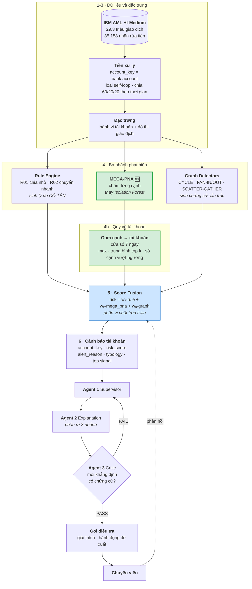
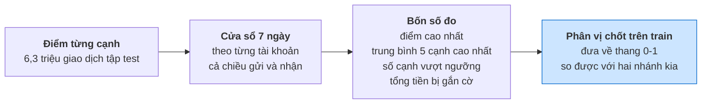
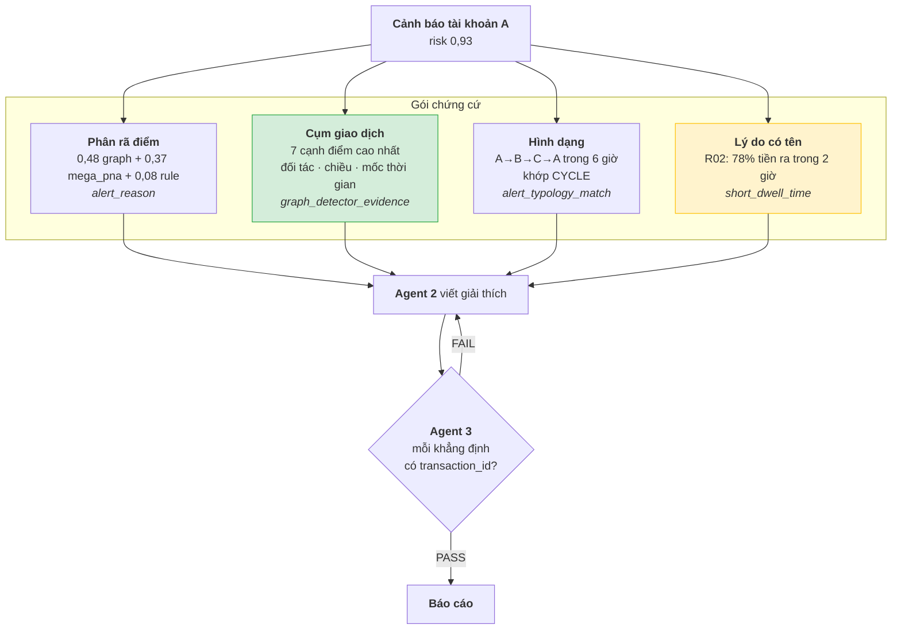

# Kiến trúc hướng B — MEGA-PNA làm một nhánh, không thay cả hệ

Tài liệu này **thay thế** phần kiến trúc trong `KE_HOACH_LAM_LAI_MODEL.md` — bản
kế hoạch cũ, đã gỡ khỏi repo sau khi việc được làm xong.

Kế hoạch cũ đề xuất bỏ hợp nhất, bỏ Isolation Forest, hạ luật xuống chỉ chú giải,
và để một mô hình cạnh duy nhất chấm điểm. Đề xuất ấy **sai ở tầng phục vụ**: nó
tối ưu F1 mà cắt mất đúng những đầu vào mà tầng tác tử phụ thuộc.

---

## 1. Vì sao hướng A sai

Sơ đồ hệ thống có một dòng quyết định mọi thứ:

```
Risk 0.93 = 0.48 (Graph) + 0.22 (Anomaly) + 0.08 (Rule)
```

Dòng này **không phải trang trí**. Nó là:

* thứ `GetRiskBreakdown` trả về,
* thứ **Agent 2** phân rã để trả lời "tại sao rủi ro cao",
* thứ **Agent 3** đối chiếu để chấm PASS/FAIL.

Bỏ hợp nhất là bỏ luôn khả năng giải thích. Cụ thể, đã kiểm trong mã:

| Thành phần | Hỏng thế nào nếu theo hướng A |
|---|---|
| `_risk_components` | trả `available: false` cho **mọi** nhánh, kèm `limitation` |
| Agent 2 | mất chức năng chính — không còn gì để phân rã |
| `GetAnomalyExplanation` | trả `available: false` vĩnh viễn |
| `Top signal = CYCLE` | biến mất — nó đến từ Graph Detectors |
| `alert.detector` | ràng buộc `CHECK IN ('rule','ml','graph')` chặn thẳng |

Đơn vị cũng sai: `alert.account_key` là **bắt buộc**, `transaction_id` chỉ tuỳ
chọn. Toàn bộ hàng đợi, điều tra và hồ sơ vụ việc xoay quanh **tài khoản**.
MEGA-PNA chấm **cạnh**.

---

## 2. Kiến trúc hướng B

MEGA-PNA thay **chỗ của Isolation Forest** — nhánh đang mang trọng số **0,00**,
tức bỏ đi không mất gì. Mọi thứ khác giữ nguyên.



Thay đổi **duy nhất** so với sơ đồ hiện có: hộp Isolation Forest đổi thành
MEGA-PNA, cộng một bước gom cạnh về tài khoản. Ba agent, tám công cụ, mọi bảng
chứng cứ giữ nguyên.

---

## 3. Gom cạnh về tài khoản

MEGA-PNA cho điểm mỗi **giao dịch**. Hợp nhất cần điểm mỗi **tài khoản**.



Bốn số đo, không phải một, vì chúng phân biệt được các tình huống khác nhau:
một cạnh 0,99 lẻ loi **khác** mười cạnh 0,75 liên tiếp. Số đo cũng chính là dữ
kiện đưa vào chứng cứ: *"12 giao dịch vượt ngưỡng, tổng 240.000 USD"*.

Phân vị phải chốt trên tập train — dùng phân vị của tập test là rò rỉ.

---

## 4. Nhánh rule là gì, và nó có giá trị ở đâu

### 4.1 Hai luật còn lại

Trước đây có bốn. `R03_VASP_EXPOSURE` và `R04_CROSS_BORDER_FLOW` đã gỡ vì chúng
đọc thuộc tính **do dự án tự gán** (`bank_country.csv`), không có trong dữ liệu
IBM — tức chúng phát hiện chính thứ dự án tạo ra.

| Mã | Điều kiện | Ý nghĩa |
|---|---|---|
| **R01** chia nhỏ giao dịch | ≥ **3** giao dịch ra nằm trong dải **8.500–10.000** | Né ngưỡng báo cáo. Một giao dịch 9.900 là bình thường; mười giao dịch 9.900 trong hai ngày thì không |
| **R02** chuyển tiền nhanh | ≥ **3** giao dịch ra, và ≥ **60%** tiền ra rời tài khoản trong **2 giờ** sau khi nhận | Tài khoản chỉ làm chỗ trung chuyển |

Ngoài ra mỗi luật phát **tín hiệu có tên** — `repeated_amounts`, `short_window`,
`short_dwell_time` — nối thẳng vào danh mục nhóm hành vi.

### 4.2 Đo trên HI-Medium: luật có giá trị ở mẫu hình nào

Chạy điều kiện của hai luật trên **toàn bộ 1.758.597 tài khoản** của HI-Medium,
rồi đối chiếu với 4.275 tài khoản nằm trong 493 vụ có nhãn.

**Nền chung:** R01 kích hoạt ở 2,02% tài khoản, R02 ở 0,55%, hợp lại 2,54%.

**Tỷ lệ tài khoản trong từng mẫu hình bị luật kích hoạt:**

| Mẫu hình | Tài khoản | R01 | R02 | Tổng | Lift |
|---|---:|---:|---:|---:|---:|
| **CYCLE** | 458 | 5,9% | **4,4%** | **10,0%** | **3,9×** |
| **SCATTER-GATHER** | 455 | **8,1%** | 1,5% | 9,7% | 3,8× |
| RANDOM | 305 | 6,9% | 2,0% | 8,9% | 3,5× |
| GATHER-SCATTER | 583 | 7,2% | 1,4% | 8,4% | 3,3× |
| FAN-OUT | 540 | 6,9% | 1,1% | 7,8% | 3,1× |
| BIPARTITE | 681 | 6,3% | 1,0% | 7,3% | 2,9× |
| STACK | 1.171 | 5,7% | 1,5% | 7,2% | 2,8× |
| **FAN-IN** | 411 | 5,1% | **0,0%** | 5,1% | 2,0× |

**Ba kết luận rút ra được:**

**R02 là dấu hiệu của CYCLE.** 4,4% so với nền 0,55% — **lift 8 lần**, cao nhất
trong mọi cặp luật–mẫu hình. Hợp lý: chu trình là phân lớp, tiền phải đi qua
nhanh. Đây là chỗ nhánh rule có giá trị rõ rệt nhất.

**R02 hoàn toàn vô dụng với FAN-IN — đúng 0,0%.** Cũng hợp lý: tài khoản fan-in
là điểm **nhận**, nó gom tiền chứ không đẩy đi ngay. Một kết quả âm tính có ích:
nó nói cho Agent 2 biết khi nào **không** được viện dẫn R02.

**R01 là dấu hiệu của SCATTER-GATHER và GATHER-SCATTER.** 8,1% và 7,2% so với nền
2,02% — lift 4×. Hợp lý: các mẫu hình này chia tiền thành nhiều khoản nhỏ.

### 4.3 Nhưng luật KHÔNG được tự mở cảnh báo

| Luật | Kích hoạt | Trúng mẫu hình | Độ chính xác | Độ phủ | Lift |
|---|---:|---:|---:|---:|---:|
| R01 | 35.501 | 225 | **0,63%** | 5,3% | 2,6× |
| R02 | 9.600 | 63 | **0,66%** | 1,5% | 2,7× |
| R01 ∪ R02 | 44.665 | 284 | **0,64%** | 6,6% | 2,6× |

Để luật tự sinh cảnh báo thì phải mở **44.665 cảnh báo** để tìm 284 tài khoản.
Không dùng được.

Nhưng lift **2,6×** là tín hiệu thật, không phải nhiễu. Đó chính xác là vai trò
đúng của nhánh rule trong hướng B:

> **Trọng số nhỏ trong hợp nhất, nhưng là nguồn lý do có tên.**

MEGA-PNA xếp hạng; luật giải thích. Không đảo ngược được: luật quá kém để xếp
hạng, còn MEGA-PNA không sinh được dòng `alert_reason` nào.

---

## 5. Chứng cứ cho tác tử

Điều tra viên không kết luận từ một giao dịch. Chứng cứ phải là **cụm**.



Câu mà hệ thống nói được với chuyên viên:

> *7 giao dịch tạo thành chu trình A→B→C→A trong 6 giờ, tổng 240.000 USD, cả 7
> đều được mô hình chấm trên 0,9. Tài khoản A đẩy 78% tiền nhận được đi trong
> vòng 2 giờ (R02). Hình dạng khớp CYCLE.*

Mọi con số trong câu đó **truy ngược được về `transaction_id`** — đó là điều
Agent 3 kiểm.

### Điều tôi nói thẳng về giới hạn

Giải thích **theo trọng số** của GNN — kiểu "đặc trưng X đóng góp Y%" — có công
cụ (GNNExplainer) nhưng nặng và kết quả khó tin. **Không đề xuất.**

Cái làm được là **giải thích theo chứng cứ**: chỉ ra đúng cụm nào, hình dạng gì,
vi phạm quy tắc nào. Trong hợp nhất, mức đóng góp của nhánh MEGA-PNA vẫn hiện ra
được (0,37 trong ví dụ) — nhưng đó là đóng góp **của cả nhánh**, không phải phân
rã bên trong mô hình. Phải nói rõ để không hứa quá.

---

## 6. Việc phải làm

| # | Việc | Trạng thái |
|---|---|---|
| 1 | Huấn luyện MEGA-PNA trên HI-Medium | 🔄 đang chạy |
| 2 | Gom cạnh → tài khoản, chốt phân vị trên train | ❌ viết mới |
| 3 | Migration: `alert.detector` nhận `'mega_pna'` | ❌ viết mới |
| 4 | Hợp nhất ba nhánh, khớp trọng số trên validation | ⚠️ có `train_fusion_tri.py`, cần đổi đầu vào |
| 5 | Sinh cảnh báo tài khoản + `alert_reason` + chứng cứ | ❌ viết mới |
| 6 | Nạp vào Cloud SQL mới từ VM production | ❌ viết mới |
| 7 | Kiểm ba agent chạy đúng trên cảnh báo mới | ❌ |

Bước 3 là ràng buộc lược đồ chặn thẳng — `CHECK (detector IN ('rule','ml','graph'))`.
Có thể dùng lại `'ml'` cho MEGA-PNA để khỏi migration, nhưng như thế mất khả năng
phân biệt trong `GetAnomalyExplanation`. Nên thêm mã mới.

---

## 7. Tóm lại

**MEGA-PNA vào thay Isolation Forest, không thay cả hệ.** Nhánh bị thay đang mang
trọng số 0,00 nên không mất gì; toàn bộ sơ đồ agent, tám công cụ và các bảng
chứng cứ giữ nguyên.

**Đơn vị cảnh báo vẫn là tài khoản.** Điểm cạnh được gom theo cửa sổ 7 ngày bằng
bốn số đo, và chính bốn số đo ấy đi vào chứng cứ.

**Nhánh rule giữ lại có căn cứ đo được**, không phải giữ cho đủ: lift 2,6× tổng
thể, và **8× cho R02 trên CYCLE**. Nhưng độ chính xác 0,64% nghĩa là nó **không
bao giờ được tự mở cảnh báo** — nó xếp hạng kém, nó giải thích tốt.
