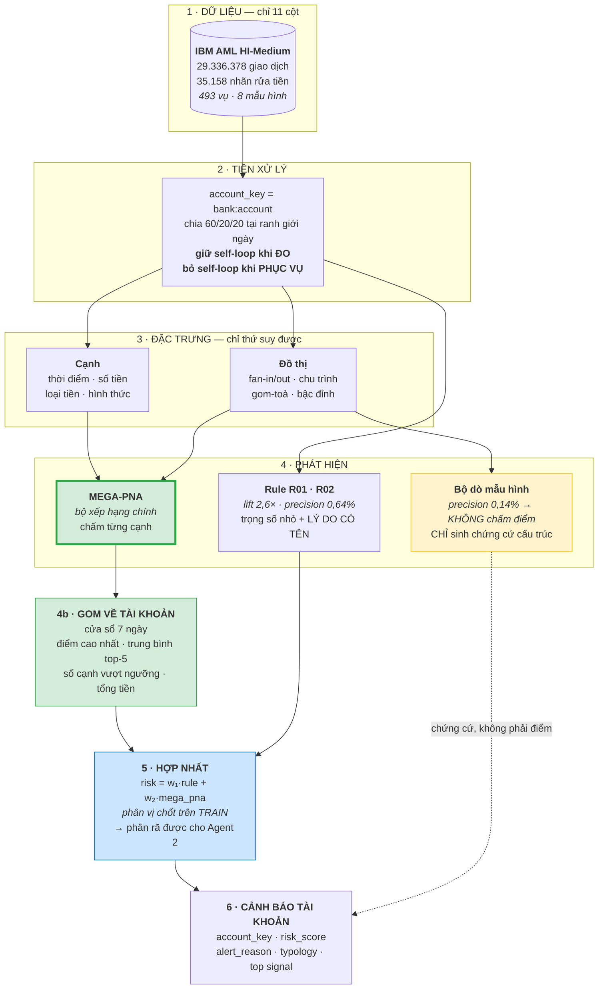
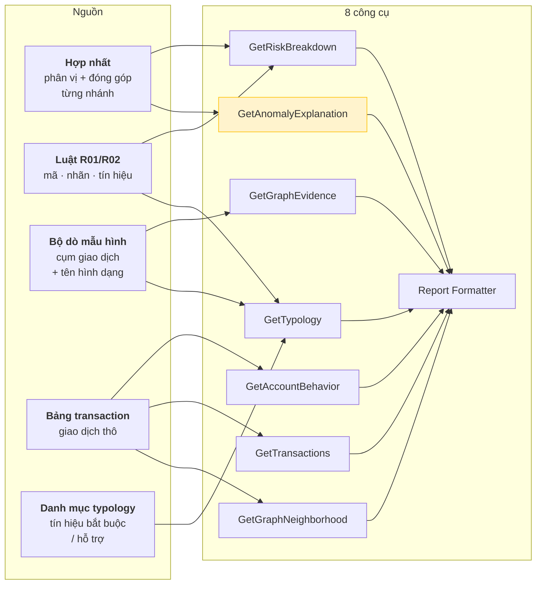
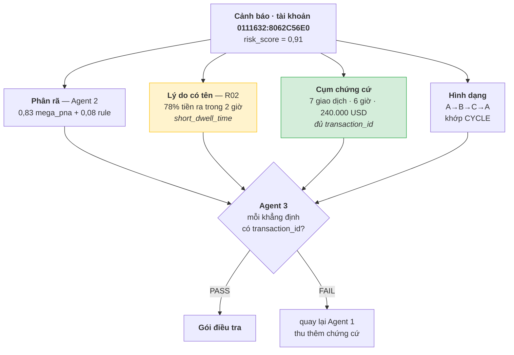

# Kiến trúc FIN-07 vẽ lại theo đúng những gì dữ liệu có

Sơ đồ cũ đúng về **hình dạng** — 3 agent, 8 công cụ, chứng cứ trước giải thích —
nhưng vài hộp phát hiện dựa trên thứ dữ liệu không có, hoặc đã đo được là không
đóng góp gì.

Tài liệu này giữ nguyên hình dạng ấy và thay các hộp bằng thứ **truy được về cột
dữ liệu thật hoặc số đo đã có**. Yêu cầu không đổi: **mọi thứ xuất ra phải được
tác tử giải thích đầy đủ.**

---

## 1. Dữ liệu thật sự có gì

Toàn bộ `HI-Medium_Trans.csv` có **11 cột**, không hơn:

```
Timestamp, From Bank, Account, To Bank, Account,
Amount Received, Receiving Currency, Amount Paid, Payment Currency,
Payment Format, Is Laundering
```

Tệp nhãn `HI-Medium_Patterns.txt` gán **493 vụ** theo **8 mẫu hình đồ thị**:
FAN-IN, FAN-OUT, CYCLE, SCATTER-GATHER, GATHER-SCATTER, STACK, BIPARTITE, RANDOM.

**Không có trong dữ liệu:** quốc gia · cờ VASP · KYC · nghề nghiệp · PEP · ngày mở
tài khoản · hạn mức. Mọi thành phần cần chúng đều là thứ dự án tự bịa ra rồi tự
phát hiện lại.

Đó là lý do `R03_VASP_EXPOSURE` và `R04_CROSS_BORDER_FLOW` đã bị gỡ: chúng đọc
`bank_country.csv` do dự án viết, trong đó `is_vasp` chỉ đánh dấu **một** họ ngân
hàng hư cấu.

---

## 2. Cái gì bị bỏ, và bằng chứng nào

| Thành phần | Số đo | Quyết định |
|---|---|---|
| Isolation Forest | trọng số hợp nhất **0,00**; cả 8 tổ hợp tốt nhất đều loại nó | **Bỏ** |
| Bộ dò mẫu hình đồ thị | precision **0,14%**, recall 58,3% | **Giữ, nhưng chỉ sinh chứng cứ** |
| Luật R01/R02 | precision **0,64%**, phủ 6,6%, lift 2,6× | **Giữ, trọng số nhỏ + lý do có tên** |
| Mô hình đặc trưng đồ thị | trùng nguồn tín hiệu với MEGA-PNA | **Chờ đo tương quan** |
| Hợp nhất 3 nhánh | 0,1365 so với riêng graph 0,1338 | **Giữ, nhưng đổi nhánh** |

Điểm chung: thứ có precision dưới 1% **không được tự mở cảnh báo**, nhưng vẫn có
giá trị làm chứng cứ và lý do.

---

## 3. Sơ đồ mới



Đường **nét đứt** từ bộ dò mẫu hình là thay đổi quan trọng nhất: nó vào cảnh báo
làm **chứng cứ**, không đi qua hợp nhất. Precision 0,14% quá thấp để chấm điểm,
nhưng nó là thứ duy nhất gọi được tên `CYCLE`.

---

## 4. Mỗi công cụ của tác tử lấy dữ liệu từ đâu

Đây là bảng trả lời câu "agent có giải thích được đầy đủ không".



| Công cụ | Nguồn | Còn sống sau khi đổi? |
|---|---|---|
| `GetRiskBreakdown` | hợp nhất | ✅ hai nhánh thay vì ba |
| `GetAccountBehavior` | bảng `transaction` | ✅ không đổi |
| `GetTransactions` | bảng `transaction` | ✅ không đổi |
| `GetGraphEvidence` | `graph_detector_evidence` | ✅ **chính vì giữ bộ dò** |
| `GetGraphNeighborhood` | bảng `transaction` | ✅ không đổi |
| `GetTypology` | danh mục + tín hiệu luật | ✅ không đổi |
| `GetAnomalyExplanation` | ⚠️ Isolation Forest | **đổi nguồn sang MEGA-PNA** |
| `Report Formatter` | tất cả | ✅ không đổi |

Chỉ **một** công cụ phải đổi nguồn. `GetAnomalyExplanation` hiện đọc cảnh báo
`detector='ml'` của Isolation Forest; nó sẽ đọc mức đóng góp của nhánh MEGA-PNA
cùng bốn số đo gom theo tài khoản — tức *"12 giao dịch vượt ngưỡng, tổng 240.000
USD, cạnh cao nhất 0,97"*.

---

## 5. Một cảnh báo trông như thế nào

Ví dụ dựng từ đúng những trường có thật:



Câu hệ thống nói được với chuyên viên:

> *Tài khoản 0111632:8062C56E0, rủi ro 0,91. Bảy giao dịch tạo thành chu trình
> A→B→C→A trong 6 giờ, tổng 240.000 USD; mô hình chấm cả bảy trên 0,9. Tài khoản
> đẩy 78% tiền nhận được đi trong vòng 2 giờ (R02). Hình dạng khớp CYCLE.*

Mọi con số trong câu đó truy ngược được về `transaction_id` — đó là điều Agent 3
kiểm, và là lý do bộ dò mẫu hình được giữ dù precision chỉ 0,14%.

### Vì sao R02 xuất hiện trong ví dụ CYCLE

Không phải ngẫu nhiên. Đo trên 1.758.597 tài khoản HI-Medium:

| | Nền chung | Trong CYCLE | Lift |
|---|---:|---:|---:|
| R02 chuyển tiền nhanh | 0,55% | **4,4%** | **8×** |
| R01 chia nhỏ | 2,02% | 5,9% | 2,9× |

R02 là dấu hiệu mạnh nhất của CYCLE — hợp lý, vì chu trình là phân lớp nên tiền
phải đi qua nhanh. Ngược lại **R02 bằng đúng 0,0% với FAN-IN**, nên Agent 2
**không được** viện dẫn R02 cho cảnh báo FAN-IN.

---

## 6. Điều kiện nghiệm thu

Sơ đồ chỉ đúng khi bốn điều sau đo được:

| # | Điều kiện | Cách đo |
|---|---|---|
| 1 | MEGA-PNA đủ mạnh | báo cáo `fin07.benchmark.v1`, đơn vị `account_window` |
| 2 | Nhánh rule còn đóng góp | trọng số hợp nhất **≠ 0** trên validation |
| 3 | Bỏ mô hình đặc trưng đồ thị không mất gì | thêm nó vào tăng **< 0,005 F1** |
| 4 | Mọi khẳng định có chứng cứ | tỷ lệ PASS của Agent 3 trên mẫu cảnh báo |

Điều kiện 2 quan trọng: nếu trọng số rule về 0 như Isolation Forest, thì nó chỉ
còn là nguồn lý do chứ không còn là nhánh chấm điểm — và sơ đồ phải sửa lại lần
nữa, trung thực với số đo.

Mọi con số phải qua `src/benchmark/standard.py`, đơn vị `account_window`, dãy
ngân sách cố định. Không con số nào ngoài chuẩn được đưa vào tài liệu.
