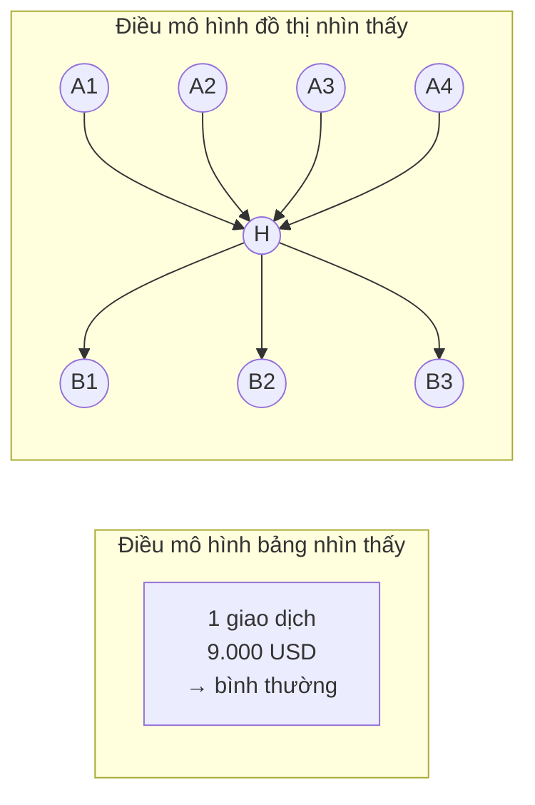
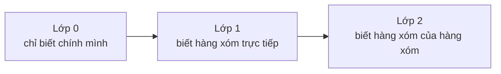
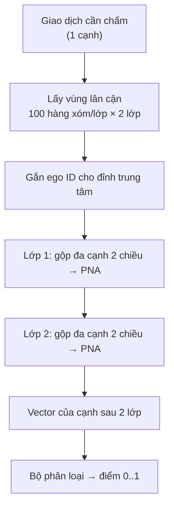
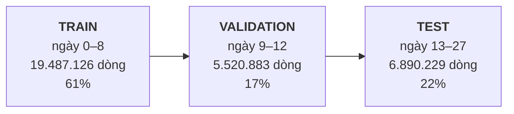
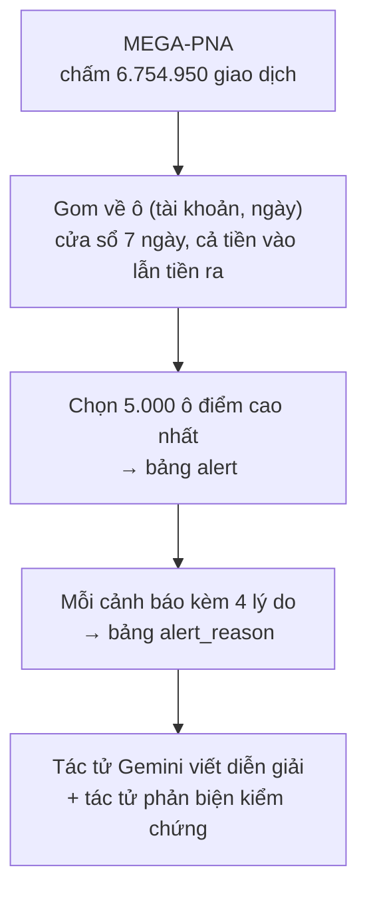

# MEGA-PNA — Mô hình phát hiện rửa tiền của FIN-07

Gói bàn giao cho thành viên nhóm. Đọc file này trước, các thư mục còn lại là bằng
chứng cho từng con số ở đây.

* **Bộ dữ liệu:** IBM AML **HI-Medium** — 31.898.238 giao dịch
* **Trọng số:** `model/seed_42.pt` (1,1 MB) · sha256 `9778452b…3ad7480c`
* **Kết quả chính:** F1 = **0,7801** trên tập test, bài báo gốc công bố 0,7826
* **Con số dùng cho vận hành:** F1 = **0,6893** — xem mục 5, phần này quan trọng

---

## 1. Bài toán là gì

Cho một danh sách chuyển tiền giữa các tài khoản. Mỗi dòng là một giao dịch: ai
gửi, ai nhận, bao nhiêu tiền, lúc nào, bằng hình thức gì. Một số ít giao dịch
được gắn nhãn là rửa tiền.

Việc của mô hình: nhìn một giao dịch mới và nói **giao dịch này có nằm trong một
chuỗi rửa tiền không**.

Điều làm bài toán khó nằm ở tỉ lệ:

| | Số lượng | Tỉ lệ |
|---|---:|---:|
| Tổng giao dịch | 31.898.238 | 100% |
| Giao dịch rửa tiền | 35.230 | **0,11%** |
| Giao dịch tự chuyển (cùng một tài khoản gửi và nhận) | 2.561.860 | 8,03% |

Cứ 1.000 giao dịch mới có hơn 1 giao dịch bẩn. Một mô hình đoán bừa "tất cả đều
sạch" đã đúng 99,89% — nên **độ chính xác (accuracy) là chỉ số vô dụng ở đây**.
Ta dùng F1, tức là trung bình điều hoà của:

* **Precision** — trong số bị mô hình gắn cờ, bao nhiêu phần thật sự bẩn (báo động giả thấp)
* **Recall** — trong số thật sự bẩn, mô hình bắt được bao nhiêu (bỏ sót thấp)

---

## 2. Vì sao phải dùng đồ thị, không dùng mô hình bảng thông thường

Rửa tiền **không lộ ra ở một giao dịch đơn lẻ**. Chuyển 9.000 USD là bình thường.
Nhưng 12 người cùng chuyển 9.000 USD vào một tài khoản trong 2 ngày, rồi tài khoản
đó lập tức chia nhỏ chuyển đi 8 nơi khác — đó là khuôn mẫu, và khuôn mẫu chỉ nhìn
thấy khi ta xem **hàng xóm của giao dịch**, không phải bản thân nó.

Một mô hình bảng (XGBoost, Isolation Forest…) chỉ thấy 4 cột của riêng dòng đó.
Mô hình đồ thị thì thấy cả vùng lân cận.



Ở FIN-07, **giao dịch là cạnh** và **tài khoản là đỉnh**. Ta phân loại **cạnh**,
không phân loại đỉnh — vì nhãn của bộ dữ liệu gắn trên từng giao dịch.

---

## 3. Thuật toán MEGA-PNA

Nguồn: *Bilgi et al., "Multigraph Message Passing with Bi-Directional Multi-Edge
Aggregations"*, [arXiv:2412.00241](https://arxiv.org/abs/2412.00241) —
kho mã gốc `github.com/hcagri/MEGA-GNN`.

### 3.1 Ý tưởng nền: truyền tin trên đồ thị

Mỗi đỉnh giữ một vector mô tả nó. Qua mỗi *lớp*, đỉnh **nhận tin nhắn** từ các
đỉnh kề rồi cập nhật vector của mình. Sau 2 lớp, một đỉnh đã "biết" thông tin của
các đỉnh cách nó 2 bước.



### 3.2 Bốn thành phần khiến MEGA-PNA khác các GNN thường

**a) PNA — gộp tin nhắn bằng nhiều phép cùng lúc**

GNN thường gộp tin nhắn từ hàng xóm bằng *một* phép, thường là trung bình. Trung
bình xoá mất thông tin: 100 giao dịch nhỏ và 1 giao dịch lớn có thể ra cùng một
số. PNA (Principal Neighbourhood Aggregation) gộp bằng **bốn phép song song** —
trung bình, cực đại, cực tiểu, độ lệch chuẩn — rồi nhân với hệ số theo bậc của
đỉnh. Nhờ vậy "nhiều giao dịch nhỏ" và "một giao dịch lớn" không còn lẫn vào nhau.

**b) Gộp đa cạnh hai chiều — phần đóng góp riêng của bài báo**

Giữa hai tài khoản có thể có **hàng chục giao dịch** (đồ thị đa cạnh). MEGA gộp
riêng nhóm cạnh này trước, và gộp **theo cả hai chiều**: tiền A→B và tiền B→A
được xử lý tách bạch rồi mới hợp lại. Tài khoản trung chuyển chỉ lộ ra khi nhìn
đồng thời tiền vào và tiền ra.

**c) Ego ID — đánh dấu "tôi đang hỏi về ai"**

Khi lấy vùng lân cận để chấm một cạnh, đỉnh trung tâm được gắn thêm một cờ đánh
dấu. Không có cờ này, mô hình không phân biệt được đâu là tâm và đâu là ngoại vi
của vùng.

**d) Cập nhật cạnh**

Vector của **cạnh** cũng được cập nhật qua từng lớp, không chỉ vector đỉnh. Vì
nhãn nằm trên cạnh, đây là chỗ quyết định.

### 3.3 Toàn cảnh một lần chấm điểm



### 3.4 Siêu tham số đã dùng

Lấy đúng theo bài báo, không tự chỉnh — để con số so sánh được.

| Tham số | Giá trị | Ghi chú |
|---|---|---|
| `hidden_channels` | 20 | chia hết cho 5 tháp PNA |
| `num_layers` | 2 | nhìn xa 2 bước |
| `num_neighbors` | 100, 100 | số hàng xóm lấy mẫu mỗi lớp |
| `batch_size` | 8.192 | |
| `learning_rate` | 0,0008 | |
| `dropout` | 0,28 | |
| trọng số lớp rửa tiền | 7,0 | bù cho việc lớp dương quá hiếm |
| `edge_updates` | bật | |
| `reverse_message_passing` | bật | |
| `ego_ids` | bật | |

**Đặc trưng đầu vào chỉ có 4 cột:** `Timestamp`, `Amount Received`,
`Received Currency`, `Payment Format`. Toàn bộ sức mạnh còn lại đến từ **cấu trúc
đồ thị**, không từ việc chế thêm đặc trưng.

---

## 4. Cách chia dữ liệu

Chia **theo thời gian**, cắt đúng ranh giới ngày. Không chia ngẫu nhiên — chia
ngẫu nhiên sẽ để mô hình nhìn thấy tương lai và cho ra con số đẹp giả tạo.



Thời gian chạy từ trái sang phải — mô hình học ở quá khứ và được chấm ở tương lai.

* **Train** dùng để học trọng số
* **Validation** dùng để chọn epoch tốt nhất và chọn ngưỡng quyết định
* **Test** chỉ chạm vào đúng một lần, để báo cáo

---

## 5. Kết quả — và một cảnh báo phải đọc

### 5.1 Con số so với bài báo

| | F1 | Precision | Recall |
|---|---:|---:|---:|
| Bài báo công bố (trung bình 5 seed) | 0,7826 ± 0,0011 | — | — |
| **FIN-07 đo được (seed 42)** | **0,7801** | 0,8399 | 0,7282 |
| FIN-07, dùng ngưỡng chốt trên validation | 0,7807 | 0,8457 | 0,7249 |

Lệch 0,0025 so với bài báo. **Tái lập thành công.**

> ⚠️ **Chỉ chạy 1 seed, không phải 5.** Bài báo báo cáo trung bình của 5 lần chạy.
> Ta chạy 1 lần vì chi phí GPU. Vì vậy **không được viết con số này dưới dạng
> "trung bình ± độ lệch"** — ta không có ước lượng dao động giữa các lần chạy.
> Điều này đã ghi sẵn trong `bao_cao/benchmark.json`, trường `comparability_note`.

### 5.2 Cảnh báo: đuôi dữ liệu suy biến

Đây là phần **quan trọng nhất** của tài liệu.

Tập test có 15 ngày. Ba ngày đầu là dữ liệu bình thường. **Từ ngày 16 trở đi, bộ
sinh dữ liệu của IBM cạn giao dịch sạch**, chỉ còn lại phần lớn là giao dịch bẩn:

| Đoạn | Số dòng | Nhãn dương | Tỉ lệ dương |
|---|---:|---:|---:|
| Ngày 13–15 | 6.883.242 | 6.932 | **0,10%** |
| Ngày 16–27 | 6.987 | 4.084 | **58,45%** |

Cái đuôi ấy chỉ chiếm **0,1% số dòng** nhưng chứa **37% toàn bộ nhãn dương**. Bắt
đúng ở đó quá dễ, và nó kéo F1 tổng lên cao.

Tách ra đo riêng, cùng một ngưỡng:

| Đo trên | F1 | Precision | Recall |
|---|---:|---:|---:|
| Toàn bộ test (con số so với bài báo) | 0,7807 | 0,8457 | 0,7249 |
| **Chỉ ngày 13–15, bỏ đuôi** | **0,6893** | 0,8187 | 0,5952 |
| Chỉ đuôi ngày 16–27 | 0,9096 | 0,8767 | 0,9452 |

**Cách dùng hai con số này cho đúng:**

* **0,7807** — dùng khi so với bài báo, vì bài báo cũng đo trên đúng cái đuôi này.
  Bỏ nó đi thì mất cơ sở so sánh.
* **0,6893** — dùng khi nói về năng lực thật trên dữ liệu giống thực tế. Đây là
  con số nên nói với người vận hành.

Nói cách khác: mô hình tái lập đúng bài báo, nhưng **bài báo lạc quan hơn thực tế
vì bộ dữ liệu có khuyết tật ở phần đuôi**. Đây không phải lỗi của ta, và cũng
không phải lý do để giấu. Chi tiết đầy đủ theo từng ngày:
`bao_cao/phan_tich_duoi_suy_bien.json`.

### 5.3 Ngân sách điều tra — câu hỏi vận hành thật sự

Đội điều tra không rà hết 6,9 triệu giao dịch. Họ rà N vụ mỗi kỳ. Bảng dưới trả
lời: *rà N vụ thì bắt được bao nhiêu?*

| Số cảnh báo rà | Bắt đúng | Precision | Recall |
|---:|---:|---:|---:|
| 100 | 100 | 100,0% | 0,9% |
| 500 | 499 | 99,8% | 4,5% |
| 1.000 | 997 | 99,7% | 9,1% |
| **5.000** | **4.971** | **99,4%** | **45,1%** |
| 10.000 | 8.137 | 81,4% | 73,9% |
| 25.000 | 8.803 | 35,2% | 79,9% |

Hệ thống hiện chốt ở **5.000 cảnh báo**: gần như không có báo động giả, bắt được
45% số vụ. Vượt qua 10.000 thì precision sụp — đó là điểm gãy.

### 5.4 Huấn luyện tốn bao nhiêu

| | |
|---|---|
| Phần cứng | 1 GPU NVIDIA trên AWS EC2 |
| Thời gian | 74.622 giây ≈ **20,7 giờ** |
| Epoch đã chạy | 28 / 80 (dừng sớm, kiên nhẫn 10) |
| Epoch tốt nhất | **18** |

Dừng sớm ở epoch 28 vì 10 epoch liên tiếp không cải thiện F1 trên validation.

---

## 6. Từ điểm giao dịch đến hồ sơ điều tra

Mô hình chấm **giao dịch**, nhưng chuyên viên điều tra **tài khoản**. Bốn bước
nối hai đầu đó lại:



**Bước gom về tài khoản** không lấy một con số mà lấy **bốn**, vì một cạnh 0,99 lẻ
loi khác hẳn mười cạnh 0,75 liên tiếp:

| Mã lý do | Ý nghĩa |
|---|---|
| `MP_SCORE_MAX` | điểm cao nhất trong cửa sổ |
| `MP_SCORE_TOP5` | trung bình 5 điểm cao nhất |
| `MP_EDGES_OVER` | số giao dịch vượt ngưỡng |
| `MP_FLAGGED_AMOUNT` | tổng tiền trên các giao dịch bị gắn cờ |

**Hợp nhất với nhánh rule — đã thử và đã bác bỏ.** Nhóm đã dò lưới trọng số giữa
nhánh luật và nhánh MEGA-PNA. Kết quả (`bao_cao/fusion_account_v1.json`):

| Nhánh | F1 mức tài khoản |
|---|---:|
| Chỉ MEGA-PNA | 0,7807 |
| Chỉ luật | 0,0147 |
| Hợp nhất, trọng số tốt nhất | 0,7807 |

Trọng số tối ưu của nhánh luật là **0,00**. Hợp nhất **không** hơn nhánh đơn, nên
kiến trúc chốt là **một bộ chấm điểm duy nhất** cộng lý do có tên gọi, chứ không
phải tổ hợp nhiều mô hình. Điều này giữ lại vì nó là một kết quả âm có giá trị:
đã đo, không phải đoán.

**Kết quả trên hệ thống đang chạy:**

| | |
|---|---:|
| Giao dịch đã chấm điểm | 6.754.950 |
| Giao dịch vượt ngưỡng 0,56933 | 9.092 |
| Cảnh báo tài khoản đã sinh | 5.000 |
| Dòng lý do kèm theo | 20.000 |

Phân bố nhóm hành vi: **T04** gom-vào-toả-ra 3.149 · **T02** trung chuyển 1.366 ·
**T05** 485.

---

## 7. Nội dung gói

```
fin07-mega-pna-v1/
├── README.md                          ← file bạn đang đọc
├── model/
│   ├── seed_42.pt                     trọng số PyTorch (1,1 MB)
│   └── model_card.json                cấu hình, sha256, kết quả tóm tắt
├── bao_cao/
│   ├── seed_42.json                   báo cáo huấn luyện đầy đủ, có lịch sử từng epoch
│   ├── benchmark.json                 đối chiếu bài báo + ghi chú 1-seed
│   ├── phan_tich_duoi_suy_bien.json   phân tích mục 5.2, số liệu từng ngày
│   ├── fusion_account_v1.json         dò trọng số hợp nhất, mục 6
│   ├── preflight.json                 môi trường và kiểm tra trước khi huấn luyện
│   └── du_lieu_nguon.manifest.json    sha256 file dữ liệu gốc
├── du_lieu_dau_ra/
│   ├── canh_bao.csv                   5.000 cảnh báo
│   ├── ly_do_canh_bao.csv             20.000 dòng lý do
│   ├── giao_dich_vuot_nguong.csv      9.092 giao dịch vượt ngưỡng
│   ├── phan_bo_diem.csv               phân bố điểm trên toàn bộ 6.754.950 giao dịch
│   └── vi_du_dieu_tra_day_du.json     một hồ sơ điều tra hoàn chỉnh
└── ma_nguon/
    ├── src_mega_pna/                  mô hình, dữ liệu, huấn luyện, suy luận
    ├── scripts/                       9 script từ định dạng dữ liệu tới sinh cảnh báo
    └── sql/                           lược đồ bảng cho bộ phát hiện
```

### Không có trong gói

Hai file dự đoán thô **không** kèm theo vì quá nặng để gửi:

| File | Kích thước | Nội dung |
|---|---:|---|
| `seed_42_test.parquet` | 88 MB | điểm của 6.890.229 giao dịch tập test |
| `seed_42_validation.parquet` | 71 MB | điểm của 5.520.883 giao dịch tập validation |

Chúng nằm ở `models/mega-pna/Medium_HI/paper/` trong repo. Mọi con số ở mục 5 đều
tính ra từ hai file này, và `phan_tich_duoi_suy_bien.json` đã chứa kết quả.

---

## 8. Chạy lại như thế nào

```bash
# 1. Chuẩn hoá dữ liệu gốc của IBM về định dạng đồ thị
python scripts/format_mega_pna.py --dataset Medium_HI

# 2. Huấn luyện (cần GPU NVIDIA, ~21 giờ)
python scripts/train_mega_pna.py --dataset Medium_HI --seed 42 --epochs 80

# 3. Chấm điểm bằng trọng số đã có (không cần huấn luyện lại)
python scripts/infer_mega_pna.py --checkpoint model/seed_42.pt --dataset Medium_HI

# 4. Gom về tài khoản rồi sinh cảnh báo
python scripts/aggregate_mega_pna_accounts.py --split test
python scripts/build_mega_pna_alerts.py --split test --budget 5000
```

Chỉ cần **bước 3 trở đi** nếu dùng lại trọng số trong gói này — không cần GPU.

---

## 9. Hạn chế đã biết

Liệt kê thẳng, để không ai phát hiện lại từ đầu.

1. **Chỉ 1 seed.** Không có ước lượng dao động. Muốn so ngang bài báo cần 4 lần
   chạy nữa, khoảng 83 giờ GPU.

2. **F1 vận hành là 0,6893, không phải 0,78.** Xem mục 5.2. Khi trình bày, nói cả
   hai con số kèm lý do, đừng chỉ nói con số đẹp.

3. **Cả 5.000 cảnh báo đều có `risk_score` = 100.** Hàng đợi không xếp được thứ tự
   ưu tiên — mọi cảnh báo trông khẩn cấp như nhau, và khi cần chọn ra vài vụ thì
   hệ thống rơi về thứ tự bảng chữ cái. Tín hiệu để phân biệt thì đã có sẵn
   (`MP_SCORE_TOP5` dao động, trung bình 62,47) nhưng chưa được đưa vào
   `risk_score`. **Đây là việc nên sửa trước tiên.**

4. **Bảng `alert_typology_match` rỗng.** Mã nhóm hành vi (T02/T04/T05) có được gán
   vào cảnh báo, nhưng lý do vì sao gán thì không được ghi lại. Hệ quả: tác tử
   phản biện coi mã nhóm là "chưa rõ nguồn gốc" và không dùng nó làm dữ kiện.

5. **`alert.transaction_id` rỗng ở cả 5.000 cảnh báo.** Không mở thẳng được từ
   cảnh báo sang giao dịch điểm cao nhất, dù script có mô tả chức năng này.

6. **Mô hình chấm cạnh, chưa chấm đỉnh.** Rủi ro của *tài khoản* đang được suy ra
   bằng cách gom điểm cạnh trong cửa sổ 7 ngày, không phải học trực tiếp.

---

*Nội dung tài liệu này sinh từ dữ liệu thật trong `bao_cao/` và cơ sở dữ liệu
đang chạy. Không có con số nào được ước lượng bằng tay.*
