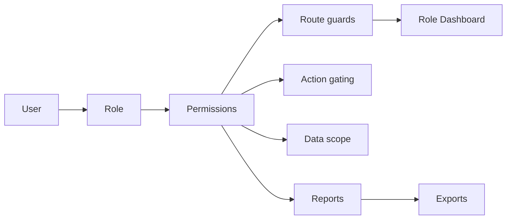

# RBAC — Phân quyền theo vai trò

Kiến trúc phân quyền của FIN-07 AML Console. **Máy chủ là nguồn sự thật**; giao
diện chỉ phản chiếu. Mặc định **TỪ CHỐI**.

## Vai trò

Mã nội bộ ổn định (không dùng nhãn tiếng Việt để phân quyền):

| Mã | Nhãn | Trọng tâm |
|---|---|---|
| `mlro` | MLRO | Thẩm quyền AML cao nhất: duyệt, quyết định SAR, giám sát toàn tổ chức |
| `compliance_officer` | Chuyên viên tuân thủ | Vận hành: triage cảnh báo, vụ việc, EDD, sàng lọc, soạn SAR |
| `analyst` | Chuyên viên phân tích | Điều tra: đồ thị, mẫu hình, giải thích mô hình |
| `auditor` | Kiểm toán viên | **Chỉ đọc**: nhật ký, kiểm soát, quản trị mô hình |
| `admin` | Quản trị viên | **Kỹ thuật**: người dùng, hệ thống, cấu hình (KHÔNG ra quyết định AML) |

## Quyền (Permission)

Định nghĩa TẬP TRUNG ở [`src/api/permissions.py`](../src/api/permissions.py)
(`Permission` enum) và phản chiếu ở [`web/src/rbac/permissions.ts`](../web/src/rbac/permissions.ts).
27 quyền, gắn với năng lực CÓ THẬT (không bịa tính năng).

## Ma trận quyền (rút gọn)

| Năng lực | MLRO | Compliance | Analyst | Auditor | Admin |
|---|---|---|---|---|---|
| Xem cảnh báo/vụ việc/giao dịch | ✓ | ✓ | ✓ (được giao) | ✓ (đọc) | ✗ |
| Điều tra (cảnh báo/vụ việc) | ✓ | ✓ | ✓ | ✗ | ✗ |
| Leo thang vụ việc | ✓ | ✓ | ✓ | ✗ | ✗ |
| Phê duyệt ca rủi ro cao | ✓ | ✗ | ✗ | ✗ | ✗ |
| Soạn SAR | ✓ | ✓ | ✗ | ✗ | ✗ |
| Quyết định/nộp SAR | ✓ | ✗ | ✗ | ✗ | ✗ |
| Giải thích mô hình | ✓ | ✓ | ✓ (đầy đủ) | ✓ (đọc) | ✓ (kỹ thuật) |
| Chất lượng/giám sát mô hình | ✓ | ✓ | ✗ | ✓ | ✓ |
| Nhật ký kiểm toán | ✓ | ✓ | ✗ | ✓ | ✓ (bảo mật) |
| Xuất báo cáo | ✓ | ✓ | ✗ | ✓ | ✗ |
| Quản trị người dùng/vai trò | ✗ | ✗ | ✗ | ✗ | ✓ |
| Cấu hình hệ thống | ✗ | ✗ | ✗ | ✗ | ✓ |

Nguồn thi hành: `ROLE_PERMISSIONS` trong `permissions.py`. Test: `tests/test_api/test_permissions.py`.

## Phạm vi dữ liệu (Data scope)

`DataScope` = `assigned` (analyst) · `all` (compliance/mlro) · `read_only_all`
(auditor) · `system` (admin). Áp ở MÁY CHỦ, KHÔNG nhận từ tham số client:
`/cases` (danh sách), `/cases/{id}` (chi tiết) và `/cases/{id}/network` đều lọc
`assigned_to = user` khi `scope_own_records(role)` (analyst) — qua
`_enforce_case_scope`. Chi tiết trả 404 (không phải 403) để không lộ sự tồn tại
của vụ việc ngoài phạm vi. Gán demo: `scripts/seed_demo_case_assignments.py`.

> Giới hạn đã biết: bảng `alert` chưa có cột người-được-giao, nên CẢNH BÁO vẫn
> là hàng đợi dùng chung (chưa lọc theo người được giao). Bảng điều khiển analyst
> nói đúng điều này ("cảnh báo dùng chung hàng đợi"), không tự nhận là "được
> giao". Thực thi phạm vi cảnh báo ở cấp bản ghi cần một migration thêm cột.

## Ánh xạ Dashboard

Một URL `/dashboard` → `DashboardRouter` chọn theo quyền:
`view_executive_dashboard`→MLRO · `view_audit_dashboard`→Auditor ·
`view_system_dashboard`→Admin · `prepare_sar`→Compliance · còn lại→Analyst.
Component: `web/src/pages/dashboard/`.

## Bảo vệ route

- **Backend**: [`src/api/authz.py`](../src/api/authz.py) — bảng `POLICY` mặc-định-đóng,
  áp bằng dependency `enforce_policy` cấp router. Route thiếu khai báo → 403.
- **Frontend**: có HAI chốt cần khớp nhau:
  1. `AppLayout` gọi `canAccess(path, role)` (bảng `ROUTE_ROLES` trong
     `config/nav.ts`, theo **vai trò**) — nếu trượt thì `Navigate` tới `/403`.
     Đây là chốt chạy TRƯỚC, quyết định việc gõ thẳng URL.
  2. `<RequirePermission permission=...>` bọc route trong `App.tsx` (theo
     **quyền**, đọc `useRbac`) — render `<AccessDenied/>` tại chỗ nếu thiếu quyền.
  Sidebar lọc theo `NAV_PERMISSION`. **Cả ba** (`ROUTE_ROLES`, `NAV_PERMISSION`,
  và `authz.POLICY` phía máy chủ) hiện là ba bảng SONG SONG phải chỉnh tay cho
  khớp — nếu lệch, một vai trò có thể thấy mục menu dẫn tới trang 403 (đã từng
  xảy ra với auditor). Hạng mục nợ kỹ thuật: dẫn xuất cả ba từ `permissions.py`.

## Hành động (Action gating)

`<Can permission=...>` bọc nút/hành động ở giao diện; **backend luôn kiểm độc
lập** (nút ẩn chỉ là tiện dụng). Auditor bị chặn mọi POST/PUT/PATCH/DELETE trên
tài nguyên AML qua `POLICY`.

## Nhật ký kiểm toán

Bảng `audit_log` (đã có), ghi khi tạo/leo thang/quyết định vụ việc, SAR… Mở rộng
cho sự kiện đăng nhập/đổi vai trò/xuất báo cáo/cấu hình là hạng mục đang tiếp tục.

## Thêm quyền mới

1. Thêm vào `Permission` (permissions.py) + `PERMISSIONS` (permissions.ts).
2. Gán vào `ROLE_PERMISSIONS` cho các vai trò phù hợp.
3. Khai báo route trong `authz.POLICY` + bọc `<RequirePermission>` ở `App.tsx`
   (và `NAV_PERMISSION` nếu có mục menu).
4. Thêm test ở `tests/test_api/test_permissions.py` + `test_authz.py`.

## Thêm vai trò mới

Thêm vào `Role` enum + `ROLE_PERMISSIONS` + `ROLE_DATA_SCOPE` (permissions.py) và
`Role` union (web `types/index.ts`). Vai trò tĩnh trong code; kiến trúc cho phép
sau này chuyển vào DB mà không đổi chỗ gọi.
