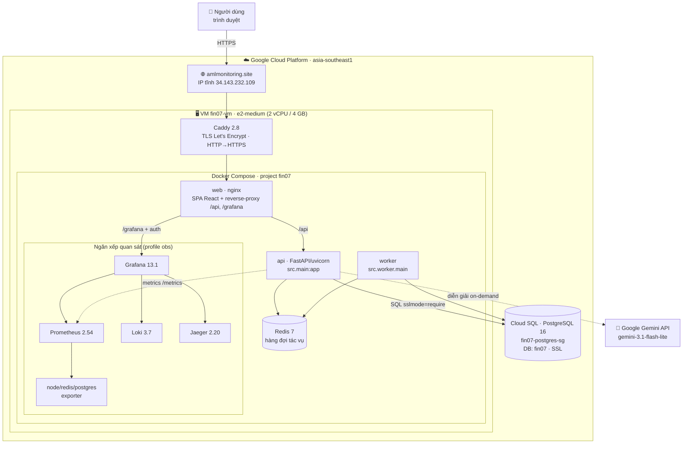
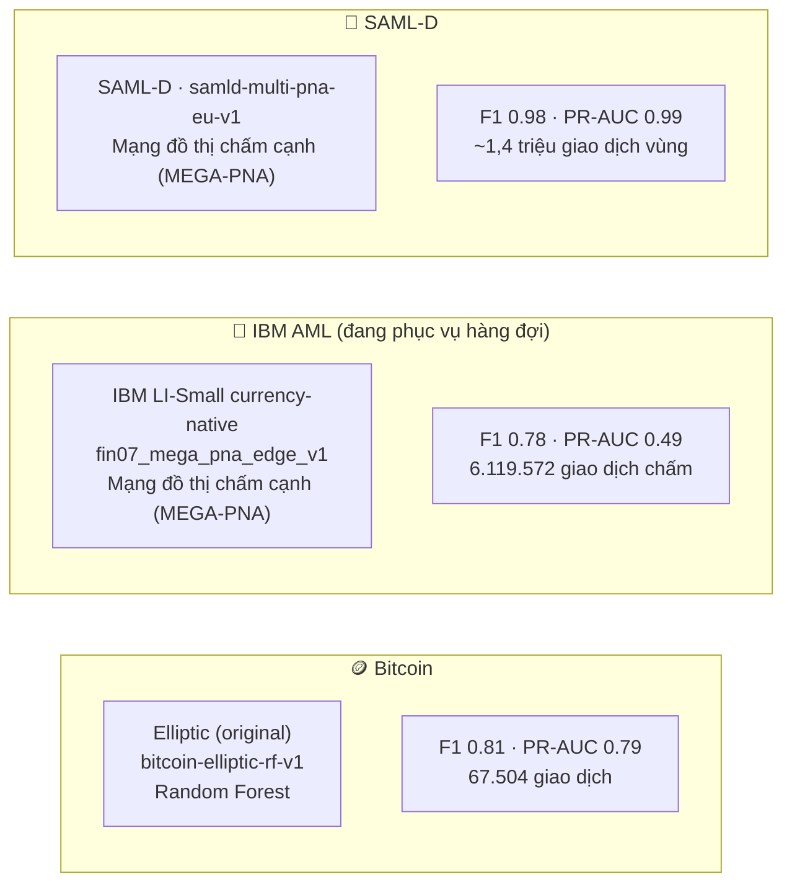
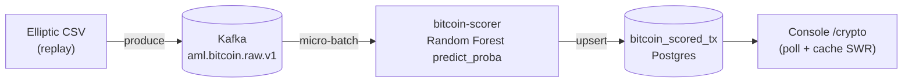
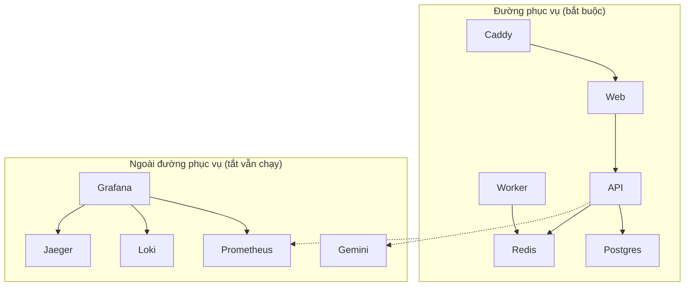

# FIN-07 · Sơ đồ triển khai Production

> Trung tâm điều hành AML (FIN-07). Tài liệu này mô tả **những gì đang thực sự chạy trên
> production** tại `https://amlmonitoring.site` kèm công nghệ và phiên bản. Cập nhật: 22/08/2026.
>
> Nguồn: xác nhận trực tiếp trên VM (`docker ps`), Cloud SQL và cấu hình container tại thời điểm viết.

---

## 1. Tổng quan

FIN-07 là hệ giám sát chống rửa tiền (AML) gồm:

- **Console web** (SPA React) cho 3 vai trò: Chuyên viên (analyst), Quản lý (manager), Quản trị hệ thống (admin).
- **API** (FastAPI) phục vụ dữ liệu cảnh báo / vụ việc / giao dịch / đồ thị + nhúng giám sát vận hành.
- **3 nhánh mô hình ML** chấm điểm trên 3 vùng dữ liệu riêng (Bitcoin, IBM AML, SAML-D).
- **Trợ lý AI** (Gemini) sinh diễn giải điều tra theo yêu cầu.
- **Ngăn xếp quan sát** (Prometheus / Loki / Jaeger / Grafana) nhúng ngay trong console.

Toàn bộ chạy trên **một VM GCP** phía sau **Caddy** (TLS tự động), dữ liệu ở **Cloud SQL PostgreSQL**.

---

## 2. Sơ đồ hạ tầng Production



**Đường vào:** trình duyệt → Caddy (443, tự cấp/gia hạn chứng chỉ) → container `web` (nginx). nginx phục vụ
file tĩnh của SPA, proxy `/api/` sang `api`, và `/grafana/` sang `grafana` (kèm xác thực phiên).

**Đặc điểm vận hành:**
- IP **tĩnh** (`fin07-web-ip`) → tắt/bật VM không đổi IP.
- Container đặt `restart: always`/`unless-stopped` → tự bật lại khi VM reboot.
- Cloud SQL **tách rời** VM → nâng/tắt VM không đụng dữ liệu.

---

## 3. Luồng một request (dữ liệu console)

```mermaid
sequenceDiagram
    autonumber
    participant B as Trình duyệt (SPA)
    participant C as Caddy (TLS)
    participant N as web/nginx
    participant A as api (FastAPI)
    participant P as Cloud SQL (Postgres)
    participant R as Redis

    B->>C: GET /api/v1/dashboard (Bearer token)
    C->>N: chuyển tiếp
    N->>A: proxy /api/
    A->>P: truy vấn (SQLAlchemy, handler def → threadpool)
    P-->>A: kết quả
    A-->>B: JSON
    Note over B: SPA cache SWR (sessionStorage)<br/>→ lần F5 sau vẽ ngay bản cũ, làm mới nền

    B->>C: POST /api/v1/auth/login
    C->>N->>A: đăng nhập
    A->>A: PBKDF2 200k vòng (asyncio.to_thread,<br/>không chặn event loop)
    A->>P: tạo phiên (app_session)
```

**Hai tối ưu độ trễ đã triển khai:**
1. **Handler đọc DB là `def`** (không `async def`) → FastAPI chạy trong threadpool, một truy vấn nặng không đóng băng cả tiến trình 1-worker (không còn treo login khi có người mở trang nặng).
2. **Băm mật khẩu đẩy ra thread** → login đồng thời không xếp hàng tuyến tính.
3. **Cache SWR phía trình duyệt** cho các trang đọc nhiều → reload gần như tức thì.

---

## 4. Ba nhánh mô hình ML (đang phục vụ)

Ba nhánh chấm trên **ba vùng dữ liệu tách biệt**, **không cộng gộp chỉ số** (khác vùng, khác loại model, khác bộ đo).



- **IBM** là nhánh đang phục vụ hàng đợi chính: chấm **từng giao dịch**, ghi bảng `transaction_model_score`
  (release `REL-EDGE-…`, status `active`). Ba trang console (Tổng quan / Tra cứu giao dịch / Cảnh báo) sống nhờ bảng này.
- **Bitcoin** & **SAML-D** là release `reference`, phục vụ trực tiếp qua bảng riêng của nhánh; không chiếm slot `active`.
- **Trợ lý AI (Gemini)** chỉ sinh **diễn giải ngôn ngữ tự nhiên** on-demand từ bằng chứng có cấu trúc — không thay việc chấm điểm của model.

---

## 5. Đường ống chấm điểm real-time (lát A — Bitcoin)

> **Trạng thái: đã dựng & chạy end-to-end ở LOCAL-DEV; CHƯA deploy prod** (VM prod nhỏ, cần quyết định
> hạ tầng streaming). Đưa vào đây để thể hiện kiến trúc mục tiêu.



- RF chấm **độc lập từng giao dịch** → điểm streaming **giống hệt** batch (không trôi theo cửa sổ).
- Consumer commit offset **sau khi** ghi DB (at-least-once).
- Nhánh IBM (đặc trưng tăng dần) và SAML-D (model đồ thị, cần thiết kế cửa sổ) là bước tiếp theo.

---

## 6. Bảng công nghệ đã triển khai (production)

| Thành phần | Công nghệ · phiên bản | Vai trò |
|---|---|---|
| Reverse proxy / TLS | **Caddy 2.8-alpine** | HTTPS tự động (Let's Encrypt), HTTP→HTTPS, security headers |
| Web | **nginx** + **React + Vite** (build tĩnh), **MapLibre GL** | SPA console, proxy `/api` & `/grafana` |
| API | **FastAPI 0.141** · **uvicorn 0.52** · **Python 3.11** | REST API, RBAC 3 vai trò, phiên PBKDF2 |
| ORM/DB driver | **SQLAlchemy 2.0** · **psycopg 3** | truy cập Postgres |
| Worker nền | Python (`src.worker.main`) | tác vụ điều tra qua hàng đợi Redis |
| Hàng đợi / cache | **Redis 7-alpine** | hàng đợi tác vụ, phiên Grafana |
| CSDL | **Cloud SQL PostgreSQL 16** (`fin07-postgres-sg`, tier **db-custom-2-7680** = 2 vCPU / 7,5GB) | dữ liệu nghiệp vụ (SSL bắt buộc) |
| Metrics | **Prometheus 2.54** + node/redis/postgres exporter | thu thập số liệu |
| Logs | **Loki 3.7** | nhật ký tập trung |
| Traces | **Jaeger 2.20** | vết phân tán (tùy chọn) |
| Dashboard | **Grafana 13.1** (nhúng cùng origin `/grafana`, auth-proxy) | trực quan hoá số liệu |
| Trợ lý AI | **Google Gemini** (`gemini-3.1-flash-lite`) | diễn giải điều tra on-demand |
| Streaming (mục tiêu) | **Kafka**, **Flink→HDFS** (archival), consumer RF | ingestion + chấm real-time (đang ở local-dev) |
| Hạ tầng | **GCP VM e2-medium** (2 vCPU/4 GB) + **IP tĩnh** + **Docker Compose** | máy chủ ứng dụng |

---

## 7. Dữ liệu trên production (số liệu thật)

| Bảng | Số dòng | Ghi chú |
|---|---|---|
| `transaction` | ~15,6 triệu | IBM LI-Small ~6,1tr + SAML-D ~9,5tr (cùng bảng) |
| `transaction_model_score` | ~6,1 triệu | điểm nhánh IBM (release active) |
| `account` | ~1,43 triệu | chủ thể tài khoản |
| `alert` | ~26.038 | 21.034 IBM + 5.004 SAML-D |
| `aml_case` | 297 | vụ việc điều tra thật (số thật, cảnh báo >> vụ việc là bình thường) |

---

## 8. Trạng thái & giới hạn đã biết (nói thẳng)

- ✅ **Đang chạy tốt:** console 3 vai trò, 3 nhánh model phục vụ, đăng nhập/hiệu năng ổn định, ngăn xếp quan sát (Grafana đã sửa crash provisioning), cache SWR.
- ✅ **CSDL đã nâng tier:** Cloud SQL `fin07-postgres-sg` từ **db-f1-micro** (~0,6 GB RAM) lên **db-custom-2-7680** (2 vCPU / 7,5 GB) ngày 22/08/2026 — đủ RAM để cache working set (~15,6 triệu dòng), hết tình trạng query nặng làm nghẽn cả instance. IP/DB/dữ liệu giữ nguyên.
- ⚠️ **VM nhỏ:** e2-medium 2 vCPU — băm login + truy vấn nặng dùng chung 2 lõi. Nâng 4 lõi nếu nhiều người đăng nhập/mở trang nặng cùng lúc.
- ⏳ **Streaming chưa lên prod:** đường ống Bitcoin real-time (lát A) mới chạy local-dev; IBM/SAML-D streaming và SSE đẩy UI là bước tiếp theo.
- ⏳ **Traces (Jaeger):** hạ tầng có sẵn nhưng `OTEL_ENABLED` mặc định tắt trên prod.

---

## 9. Quan hệ suy luận (một cái nhìn)



> Nguyên tắc: tắt toàn bộ cụm quan sát và Gemini thì hệ thống lõi **vẫn phục vụ bình thường**.
