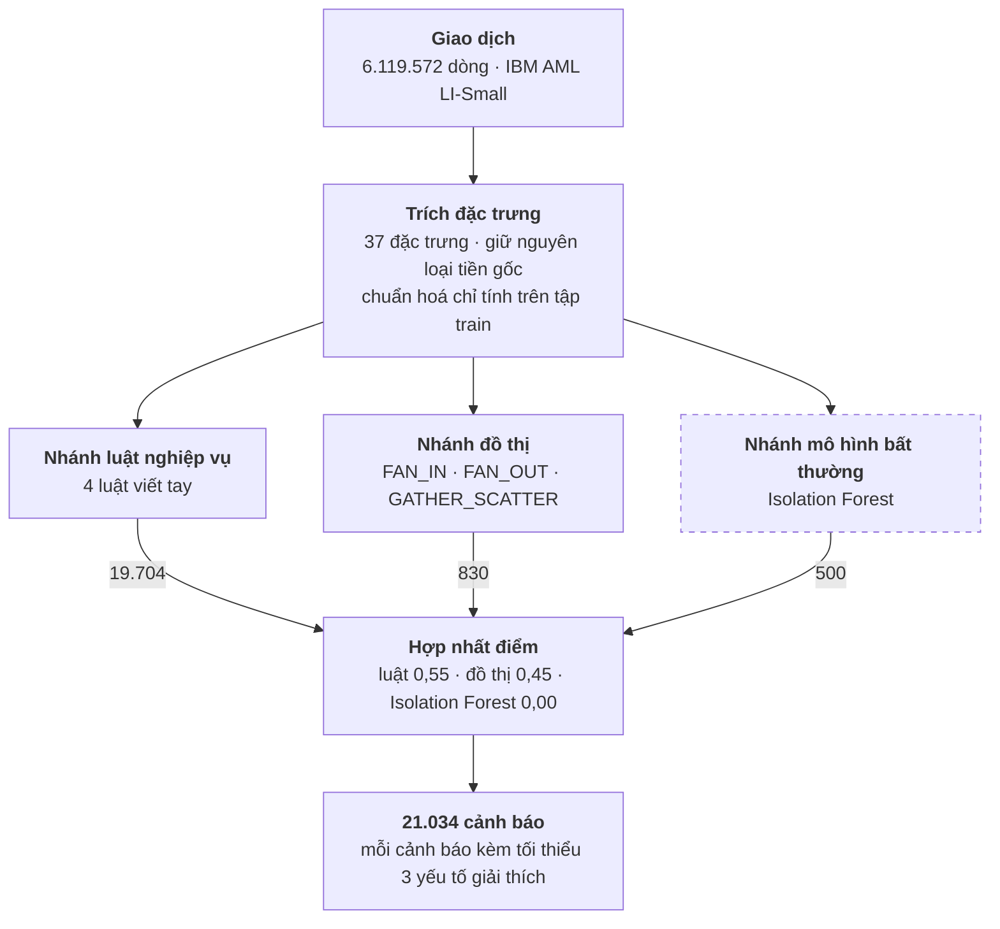
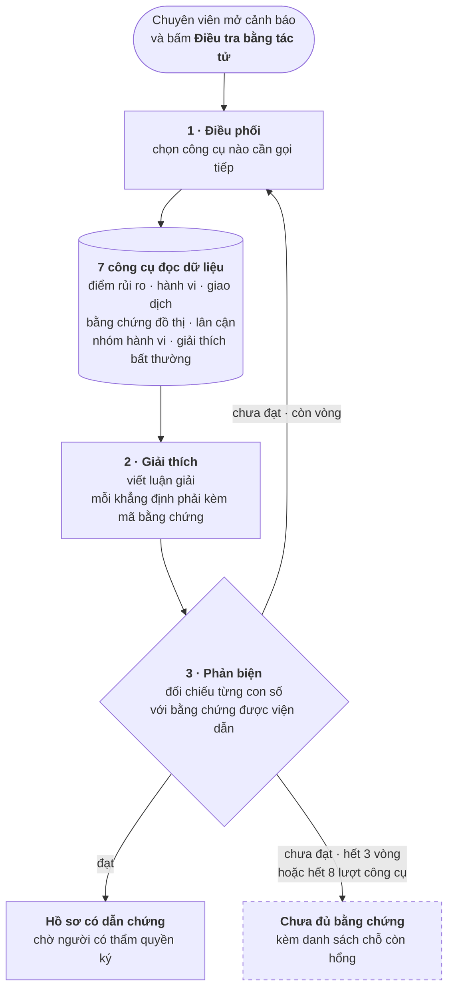

# FIN-07 — Đang có gì, và làm gì tiếp

Tài liệu dành cho thành viên trong nhóm. Đọc hết mất khoảng 10 phút. Mọi con số
ở đây đều lấy từ hệ thống thật đang chạy tại <https://www.amlmonitoring.site>
hoặc từ file báo cáo trong `reports/`, không có số ước lượng.

Cập nhật: 16/08/2026.

---

## 1. Tóm tắt trong một phút

Hệ thống nhận giao dịch ngân hàng, tự tìm ra tài khoản đáng ngờ, rồi cho ba tác
tử AI điều tra và viết bản giải thích có dẫn chứng.

| Thứ | Con số thật |
|---|---|
| Giao dịch đã nạp và chấm điểm | 6.119.572 |
| Tài khoản | 576.781 |
| Cảnh báo đã sinh | 21.034 |
| Phiên điều tra tác tử đã chạy | 110 |
| Lượt gọi Gemini thật | 258 lượt, 4.139.927 token |
| Trạng thái | Đang chạy trên tên miền, có HTTPS, tự động triển khai |

**Ba thứ chạy tốt:** đường ống dữ liệu, phân quyền theo vai trò, và hàng rào
chống bịa đặt của tác tử.

**Ba thứ còn yếu:** chưa phiên điều tra nào được duyệt tự động, mô hình bất
thường không đóng góp gì cho điểm hợp nhất, và nhánh đồ thị báo nhầm rất nhiều.

---

## 2. Hệ thống làm gì, theo đúng thứ tự

### 2.1 Từ giao dịch tới cảnh báo

Ba nhánh phát hiện chạy độc lập trên cùng một bộ đặc trưng, rồi điểm của chúng
được gộp lại. Con số trên mỗi mũi tên là số cảnh báo nhánh đó sinh ra.



Nét đứt ở Isolation Forest là có ý: nó vẫn sinh cảnh báo riêng, nhưng **trọng số
trong bước hợp nhất bằng 0** — xem mục 4.5.

### 2.2 Từ cảnh báo tới hồ sơ có dẫn chứng

Tác tử chỉ chạy khi **chuyên viên bấm nút**, không tự khởi động. Ba tác tử chạy
nối tiếp và có thể lặp lại, nhưng bị chặn cứng ở 3 vòng và 8 lượt gọi công cụ.



Hiện **mọi phiên đều đi vào nhánh nét đứt** — chưa ca nào qua được bước phản
biện. Đó là hàng rào chống bịa đặt hoạt động đúng, và cũng là việc cần làm tiếp
số một (mục 8).

Điểm quan trọng nhất về mặt thiết kế: **tác tử không bao giờ tự kết luận**. Nó
đề xuất, con người ký. Không có đường nào trong mã nguồn để tác tử tự đóng một
vụ việc — kể cả nhánh "đạt" cũng chỉ dừng ở *chờ ký*.

---

## 3. Dữ liệu đang dùng

Bộ **IBM AML LI-Small** — dữ liệu tổng hợp công khai, "LI" nghĩa là tỷ lệ giao
dịch bất hợp pháp *thấp*, gần với thực tế ngân hàng hơn bộ HI.

| | |
|---|---|
| Khoảng thời gian | 01/09/2022 → 17/09/2022 |
| Chia tập theo thời gian | train 3.671.838 dòng · val 1.223.994 · test 1.223.740 |
| Nhãn dương trong tập test | 838 trên 1.223.740 dòng — **0,068%** |

Con số 0,068% là thứ giải thích mọi kết quả bên dưới. Một mô hình trả lời "không
có gì bất thường" cho mọi giao dịch vẫn đúng 99,93%. Vì vậy **không bao giờ dùng
accuracy** để đánh giá ở đây; ta dùng F1, PR-AUC và precision tại từng mức số
cảnh báo mà chuyên viên đủ sức rà.

Chia tập theo **thời gian**, không chia ngẫu nhiên: chia ngẫu nhiên sẽ để mô
hình nhìn thấy tương lai của chính tài khoản nó đang chấm.

---

## 4. Ba nhánh phát hiện — huấn luyện thế nào, ra sao

### 4.1 Nhánh luật nghiệp vụ — không huấn luyện

Bốn luật viết tay trong `src/detection/rules.py`, chạy bằng
`scripts/run_rule_engine.py`.

| Luật | Bắt cái gì |
|---|---|
| `R01_STRUCTURING` | Chia nhỏ tiền quanh ngưỡng báo cáo |
| `R04_CROSS_BORDER_FLOW` | Dòng tiền xuyên biên giới bất thường |
| `CTX_TRANSACTION_COUNT` | Số giao dịch vọt bất thường |
| `CTX_RAPID_MOVEMENT` | Tiền vào rồi ra ngay trong 2 giờ |

Sinh ra **19.704 cảnh báo**. Đây là nhánh ồn nhất nhưng cũng dễ giải thích nhất
cho kiểm toán — luật viết ra giấy được.

Hai chi tiết đã phải sửa và nên nhớ:
- Ban đầu **mọi** luật đều phát tín hiệu `rule_trigger`, khiến nhóm hành vi T01
  luôn thắng. Giờ chỉ `R01` phát tín hiệu đó.
- Riêng `R04` chạy một mình gắn cờ 31,9% số tài khoản. Đã thêm khái niệm "luật
  chính" (`is_primary`) và ngưỡng đóng góp tối thiểu 20 điểm, kéo xuống 6,1%.

### 4.2 Nhánh đồ thị — tìm mẫu hình dòng tiền

Dựng đồ thị tài khoản–giao dịch và tìm ba mẫu hình: **FAN_IN** (nhiều nguồn đổ
về một tài khoản), **FAN_OUT** (một tài khoản toả ra nhiều nơi), và
**GATHER_SCATTER** (gom rồi phát tán).

Sinh ra **830 cảnh báo**. Kết quả đối chiếu với nhãn thật của IBM
(`reports/graph_eval_v2.json`, tập test):

| | |
|---|---|
| Độ bao phủ (recall) | **0,583** — bắt được 14 trên 24 mẫu hình thật |
| Độ chính xác (precision) | **0,0014** — 76 trên 55.702 dự đoán là đúng |

Đọc thẳng: nhánh này **nhìn thấy hơn nửa số vụ thật**, nhưng để đạt được điều đó
nó gắn cờ quá nhiều. Recall cao là có giá trị — nó thấy thứ mà luật và mô hình
bỏ sót; nhưng dùng một mình thì chuyên viên chết ngập.

### 4.3 Nhánh mô hình bất thường — Isolation Forest

Học không giám sát trên đặc trưng hành vi tài khoản trong cửa sổ 7 ngày. Sinh ra
**500 cảnh báo**. Chi tiết ở `docs/isolation_forest_handoff.md`.

### 4.4 Mô hình chính đang phục vụ giao diện — currency-native edge

Đây là mô hình được huấn luyện kỹ nhất, chấm điểm **từng giao dịch**.

**Cách huấn luyện** (`scripts/train_currency_native_edge.py`):

- Thuật toán: HistGradientBoosting — `max_iter=800`, `max_leaf_nodes=127`,
  `learning_rate=0.05`, không dùng `class_weight`.
- 37 đặc trưng, gồm số tiền và các thống kê 7 ngày của tài khoản gửi/nhận.
- **Giữ nguyên loại tiền gốc.** Không quy đổi mọi thứ về USD bằng tỷ giá tĩnh.
  Chuẩn hoá bằng log1p z-score *riêng cho từng loại tiền*, và tham số chuẩn hoá
  chỉ tính trên tập train.
- Chạy 5 seed độc lập để biết mô hình ổn định hay ăn may.

**Kết quả trên tập test** (`reports/edge-benchmark/li_small_currency_native_policy_v1.json`):

| Chỉ số | Seed chính (42) | Trung bình 5 seed |
|---|---|---|
| F1 | 0,3022 | 0,2969 ± 0,0131 |
| PR-AUC | 0,2371 | |
| Precision | 0,4350 | |
| Recall | 0,2315 | |

Ngưỡng chốt 0,0569 → 446 cảnh báo trên 1.223.740 giao dịch (tỷ lệ 0,036%).

**Bảng dễ hiểu nhất cho người vận hành** — nếu chuyên viên rà N cảnh báo xếp đầu:

| Rà bao nhiêu | Bắt được | Báo nhầm | Độ chính xác |
|---|---|---|---|
| 100 | 98 | **2** | 98% |
| 250 | 160 | 90 | 64% |
| 500 | 201 | 299 | 40% |
| 1.000 | 230 | 770 | 23% |

Đây mới là con số đáng mang đi thuyết trình: **rà 100 cảnh báo đầu thì 98 là
thật**. F1 0,30 nghe thấp, nhưng với tỷ lệ dương 0,068% thì nó tương đương gấp
hàng trăm lần chọn ngẫu nhiên.

### 4.5 Hợp nhất ba nhánh — và một kết quả không như mong đợi

`src/fusion/tri.py` tìm bộ trọng số tốt nhất bằng cách quét lưới trên tập
validation. Kết quả (`reports/fusion-tri/li_small_tri_fusion_v1.json`):

```
trọng số:  luật 0,55  ·  đồ thị 0,45  ·  Isolation Forest 0,00
```

| Trên tập test | F1 | PR-AUC |
|---|---|---|
| Hợp nhất ba nhánh | **0,1365** | **0,0789** |
| Chỉ đồ thị | 0,1338 | **0,0841** |
| Chỉ luật | 0,0130 | 0,0051 |
| Chỉ Isolation Forest | 0,0159 | 0,0153 |

**Nói thẳng: việc hợp nhất gần như không mang lại gì.** F1 nhỉnh hơn đồ thị đơn
lẻ đúng 0,0027, còn PR-AUC thì *tệ hơn*. Và Isolation Forest nhận trọng số 0,00
— nghĩa là thuật toán tìm trọng số kết luận nó **không đóng góp gì cả**.

Đây là phát hiện có giá trị, không phải thất bại cần giấu. Nó chỉ ra chính xác
chỗ cần đầu tư tiếp (xem mục 8).

### 4.6 Mô hình nằm ở đâu

Mỗi mô hình có bốn thứ đi kèm: **file trọng số**, **script huấn luyện**, **script
nạp/chấm điểm**, và **báo cáo đánh giá**. Bảng dưới đây tra cứu được cả bốn.

| Mô hình | File trọng số | Huấn luyện bằng | Nạp / chấm điểm | Báo cáo |
|---|---|---|---|---|
| **Currency-native edge** — chấm điểm từng giao dịch, đang phục vụ giao diện | `models/fin07_currency_native_policy_edge_li_small_v1.joblib` (5,1 MB) | `scripts/train_currency_native_edge.py` | `scripts/score_currency_native_edge.py` → `scripts/load_currency_native_edge_release.py` | `reports/edge-benchmark/li_small_currency_native_policy_v1.json` và `.md` |
| **Hợp nhất ba nhánh** | `models/fin07_rule_if_graph_fusion_v1.json` (39 KB) | `scripts/train_fusion_tri.py` | `scripts/load_fusion_tri.py` | `reports/fusion-tri/li_small_tri_fusion_v1.json` |
| **Isolation Forest 7 ngày** | `models/fin07_if_7d_v2.joblib` | — (bàn giao) | `scripts/publish_if_alerts.py` | `docs/isolation_forest_handoff.md` |
| **Graph HistGB 7 ngày** | `models/fin07_graph_7d_v2.joblib` | — (bàn giao) | `scripts/run_graph_detector_eval.py` | `reports/graph_eval_v2.json` |
| **Fusion v2** (bản trước, IF + đồ thị) | `models/fin07_if_graph_fusion_v2.joblib` | `scripts/train_fusion_v2.py` | `scripts/load_fusion_release.py` | `reports/fusion_release_v1.json` |

**Bản nào đang thực sự phục vụ** thì không đọc từ thư mục `models/` mà đọc từ cơ
sở dữ liệu — bảng `edge_model_release`, dòng có `status='active'`:

```
REL-EDGE-5b9f9fc5f8c33e14  ·  fin07_currency_native_policy_edge_v1  ·  sha256 6b31b1644d7a…
```

Dòng đó giữ luôn mã băm của file mô hình và của bảng điểm, nên lúc kiểm toán có
thể chứng minh điểm hiển thị trên màn hình đúng là do đúng file mô hình ấy sinh
ra. Giao diện đọc qua `GET /api/v1/fc/edge-model/release`, hiện ở trang **Giám
sát mô hình**.

> ⚠️ **Hai file trọng số quan trọng nhất hiện KHÔNG nằm trong git.**
> `fin07_currency_native_policy_edge_li_small_v1.joblib` và
> `fin07_rule_if_graph_fusion_v1.json` chỉ có trên máy đã huấn luyện và trong
> image đã dựng. Người mới clone repo sẽ nhận được bốn file `.joblib` cũ, **không
> có hai file này**, nên không tự chấm điểm lại được.
>
> Ba cách xử lý, chọn một và ghi vào tài liệu:
> 1. Đưa lên cùng thư mục Google Drive với PostgreSQL dump, kèm checksum — nhất
>    quán với cách đang làm cho dump.
> 2. Commit thẳng vào git; 5,1 MB là chấp nhận được với một repo đã có sẵn model
>    nhị phân khác.
> 3. Dùng Git LFS, sạch nhất nhưng cả nhóm phải cài thêm.

---

## 5. Tầng tác tử AI

Ba tác tử chạy nối tiếp, tối đa 3 vòng và 8 lượt gọi công cụ mỗi phiên:

1. **Điều phối** (`investigation_supervisor`) — quyết định gọi công cụ nào tiếp.
2. **Giải thích** (`explanation_agent`) — viết bản luận giải, mỗi khẳng định
   phải kèm mã bằng chứng.
3. **Phản biện** (`evidence_critic`) — soát lại và chỉ ra chỗ không đứng vững.

Bảy công cụ tác tử được phép gọi: `GetRiskBreakdown`, `GetAccountBehavior`,
`GetTransactions`, `GetGraphEvidence`, `GetGraphNeighborhood`, `GetTypology`,
`GetAnomalyExplanation`.

**Số liệu thật trên production:**

| | |
|---|---|
| Phiên điều tra | 110 (46 hoàn tất, 64 chưa đủ bằng chứng) |
| Lượt tác tử gọi Gemini thật | 258 lượt, 4.139.927 token |
| Lượt gọi công cụ | 411 thành công · 96 thiếu một phần · 3 lỗi |
| Thời gian một phiên | 42–83 giây |

### Hàng rào chống bịa đặt — phần đáng tự hào nhất

Tác tử phản biện **không phải một lời nhắc gửi cho mô hình**. Nó đối chiếu từng
con số trong bản luận giải với gói bằng chứng được viện dẫn. Con số nào không có
trong bằng chứng thì bị đánh dấu, và một khẳng định bị đánh dấu là đủ để cả bản
luận giải không qua.

Trong 5 ca đánh giá thủ công (`docs/eval/GATE2_EVAL_EVIDENCE.md`), **cả 5 ca đều
bắt được lỗi thật**:

| Ca | Lỗi mô hình mắc phải |
|---|---|
| 1 | Có điểm đồ thị nhưng thiếu bằng chứng cấu trúc tương ứng |
| 2 | Sáu khẳng định trích dẫn nguồn không khớp nội dung |
| 3 | Bịa con số `779944.0` không có trong bằng chứng |
| 4 | Sai mốc thời gian so với giao dịch thật |
| 5 | **Bịa hẳn một mã bằng chứng không tồn tại** |

Mô hình *có* ảo giác. Hàng rào *có* chặn. Với hệ thống AML thì đó đúng là hành
vi cần có — một hồ sơ nghi vấn sai gửi đi tốn kém hơn một hồ sơ không gửi.

**Nhưng đây cũng là giới hạn:** chưa phiên nào đi trọn tới bản luận giải được
duyệt tự động. Muốn cải thiện phải giảm ảo giác ở tác tử giải thích, **không
phải nới hàng rào phản biện**.

---

## 6. Hạ tầng

| Thành phần | Trạng thái |
|---|---|
| Giao diện + API | Chạy trên VM GCP, HTTPS qua Caddy |
| Cơ sở dữ liệu | Cloud SQL PostgreSQL 16 |
| Hàng đợi | Redis, worker xử lý điều tra nền |
| Giám sát | Prometheus + Grafana, 6 nhóm chỉ số, 13 biểu đồ |
| Phân quyền | Cưỡng chế ở tầng API, **mặc định đóng** |
| CI | GitHub Actions — lint, test, typecheck, build |
| CD | Máy chủ tự kéo mỗi 2 phút khi CI xanh, tự quay lui nếu hỏng |

**Năm vai trò** với quyền khác nhau thật sự, không phải chỉ ẩn menu:

| Vai trò | Thấy gì |
|---|---|
| `analyst` | Cảnh báo, vụ việc, đồ thị, giao dịch |
| `compliance_officer` | analyst + SAR + người dùng + chất lượng mô hình |
| `mlro` | Toàn bộ |
| `auditor` | Chỉ đọc dấu vết — **cố ý không thấy hàng đợi cảnh báo** |
| `admin` | Vận hành — **cố ý không thấy dữ liệu điều tra** |

Bảng chính sách ở `src/api/authz.py`. Endpoint nào quên khai báo thì bị từ chối
với mọi vai trò, kể cả admin — thà ồn ào còn hơn lặng lẽ mở toang.

---

## 7. Chất lượng dữ liệu

`scripts/run_data_quality.py` chạy 9 phép kiểm trên toàn bộ dữ liệu. **Cả 9 đều
đạt 100%**: mọi giao dịch truy được về dòng gốc, có nhãn, có điểm mô hình; mọi
cảnh báo có đủ ba yếu tố giải thích, có nhóm hành vi, trỏ tới tài khoản có thật.

Phân bố nhóm hành vi trên 21.034 cảnh báo:

| Nhóm | Số cảnh báo |
|---|---|
| T08 | 10.663 |
| T01 | 7.129 |
| T05 | 2.024 |
| T02 | 1.024 |
| T03 | 192 |
| T04 | 2 |

---

## 8. Làm gì tiếp theo — xếp theo mức đáng làm

### Ưu tiên 1 — Giảm ảo giác của tác tử giải thích

**Vì sao quan trọng nhất:** đây là thứ duy nhất chặn hệ thống khỏi việc chạy
trọn vòng. 5/5 ca đánh giá đều bị phản biện chặn vì mô hình bịa số hoặc bịa mã
bằng chứng.

**Làm gì:**
- Bắt tác tử chỉ được trích số từ một danh sách giá trị đã lấy ra sẵn, thay vì
  để nó tự viết số vào câu.
- Kiểm tra mã bằng chứng **ngay lúc sinh** thay vì đợi tới bước phản biện.
- Thu hẹp lại lời nhắc: hiện nó được tự do kể chuyện quá nhiều.

**Đo bằng gì:** tỷ lệ phiên đạt `PASS` ở bước phản biện. Hiện là **0/5**. Đạt
2/5 đã là bước tiến lớn.

**Ở đâu:** `src/investigation/agents.py`, `src/investigation/prompts/`.

### Ưu tiên 2 — Quyết định số phận của Isolation Forest

**Vì sao:** thuật toán tìm trọng số đã cho nó **0,00**. Nó đang tốn công vận
hành mà không đóng góp gì cho điểm hợp nhất.

**Làm gì — chọn một:**
- *Sửa:* đổi đặc trưng đầu vào, hoặc đổi cửa sổ thời gian, rồi chạy lại
  `scripts/train_fusion_tri.py` xem trọng số có khác 0 không.
- *Bỏ:* chuyển sang hợp nhất hai nhánh, viết rõ lý do vào tài liệu.

**Đo bằng gì:** trọng số Isolation Forest sau khi quét lưới. Khác 0 là có ích.

### Ưu tiên 3 — Kéo độ chính xác nhánh đồ thị lên

**Vì sao:** recall 0,583 là con số tốt và không nhánh nào khác có. Nhưng
precision 0,0014 khiến nó không dùng độc lập được.

**Làm gì:** siết điều kiện nhận diện mẫu hình — số cạnh tối thiểu, giá trị tối
thiểu, cửa sổ thời gian chặt hơn. Chấp nhận đánh đổi recall xuống một chút.

**Đo bằng gì:** chạy lại `scripts/run_graph_detector_eval.py`, mục tiêu
precision lên ít nhất 0,01 mà recall vẫn trên 0,40.

### Ưu tiên 4 — Bổ sung bằng chứng đồ thị

**Vì sao:** trong 510 lượt gọi công cụ, **96 lượt trả về "thiếu một phần"** —
phần lớn là `GetGraphEvidence` không có dữ liệu cho tài khoản đang hỏi. Hiện chỉ
có 613 bản ghi bằng chứng đồ thị cho 830 cảnh báo đồ thị.

**Làm gì:** chạy `scripts/load_graph_evidence.py` cho toàn bộ cảnh báo đồ thị,
không chỉ một phần.

**Đo bằng gì:** số lượt `PARTIAL` giảm. Đây cũng là cách gián tiếp giúp Ưu tiên 1.

### Ưu tiên 5 — Dạy tác tử điều phối nhớ công cụ đã cạn

**Vì sao:** trong ca đánh giá số 1, nó gọi `GetGraphEvidence` **ba lần** dù công
cụ đó chắc chắn không trả thêm gì, và phiên hết trần công cụ vì thế.

**Làm gì:** ghi lại công cụ nào đã trả về rỗng và đưa thông tin đó vào ngữ cảnh
vòng sau.

**Đo bằng gì:** số lượt gọi công cụ trung bình mỗi phiên giảm, tỷ lệ gọi lặp về 0.

### Ưu tiên 6 — Nâng cấu hình Cloud SQL

**Vì sao:** đĩa rất chậm — đo được **7,6 ms cho mỗi khối 8KB**. Một phiên điều
tra lần đầu (bộ đệm nguội) mất 83 giây; lần sau chỉ 42 giây. Truy vấn đã tối ưu
hết mức, phần còn lại là hạ tầng.

**Làm gì:** tăng RAM để bộ đệm giữ được nhiều hơn, hoặc tăng dung lượng đĩa
(IOPS trên Cloud SQL tỷ lệ với dung lượng).

### Việc nhỏ hơn, làm khi rảnh

- **Trang Rủi ro dự án và phần phơi nhiễm crypto vẫn rỗng** — LI-Small không có
  dữ liệu tài sản mã hoá thật. Hoặc tìm nguồn khác, hoặc gỡ trang khỏi menu.
- **Kết quả hợp nhất ba nhánh chưa lên giao diện** — nó nằm ở
  `reports/fusion-tri/`, cần một bảng và một script nạp để hiện lên trang Đánh
  giá chuẩn.
- **Chi phí token đã cache tính sai** — hiện tính giá đầy đủ, đội lên khoảng 10
  lần ở phần đó. Cần đọc `cached_content_token_count` từ phản hồi Gemini.
- **README mô tả bộ dữ liệu khác bản đang chạy** — hướng dẫn restore dựng
  HI-Medium, tên miền chạy LI-Small. Cần xuất dump LI-Small mới lên Drive.
- **Hai file trọng số đang phục vụ chưa nằm trong git** — xem cảnh báo ở mục
  4.6. Người mới clone repo hiện không tự chấm điểm lại được. Nên xử lý sớm vì
  nó chặn người mới tham gia vào phần mô hình.
- **`models/README.md` đã lệch** — nó nhắc tới
  `fin07_currency_native_policy_edge_v1.joblib`, nhưng file thật trên đĩa giờ là
  bản `..._li_small_v1.joblib`.

---

## 9. Người mới bắt đầu từ đâu

```bash
git clone https://github.com/AI20K-Build-Phase-Cohort-3/P-022.git
cd P-022 && git switch develop
# rồi làm theo README.md mục "Chạy lần đầu với dữ liệu đầy đủ"
```

Ba tài liệu nên đọc theo thứ tự:

| Đọc gì | Để hiểu |
|---|---|
| [`README.md`](../README.md) | Dựng máy, biến môi trường, truy vấn mẫu |
| [`docs/eval/GATE2_EVAL_EVIDENCE.md`](eval/GATE2_EVAL_EVIDENCE.md) | Tác tử thực sự làm được gì, kèm output thật |
| [`docs/operations/CICD.md`](operations/CICD.md) | Code đi từ máy bạn lên tên miền thế nào |

Muốn xem hệ thống chạy ngay mà không cần dựng gì: đăng nhập
<https://www.amlmonitoring.site> bằng `tuan.la@velrix.vn` / `demo-password`, mở
**Trung tâm cảnh báo**, chọn một cảnh báo, bấm **Điều tra bằng tác tử**, đợi
khoảng một phút rồi xem tab *Bằng chứng* và *Dấu vết*.

---

## 10. Nguyên tắc đã theo, và nên tiếp tục theo

Bốn điều này đã được cưỡng chế bằng mã và bằng kiểm thử, không phải lời hứa:

1. **Không có số liệu giả.** Màn hình nào chưa có dữ liệu thì để trống và nói rõ
   vì sao, không lấp bằng số bịa.
2. **Điểm rủi ro không bao giờ đứng một mình.** Mỗi cảnh báo luôn có tối thiểu
   ba yếu tố đóng góp — có phép kiểm chất lượng dữ liệu canh điều này.
3. **Tác tử đề xuất, con người quyết định.** Không có đường nào để tác tử tự
   đóng một vụ việc.
4. **Tác tử không được đọc nhãn ground-truth.** Nếu không, mọi đánh giá đều vô
   nghĩa.
