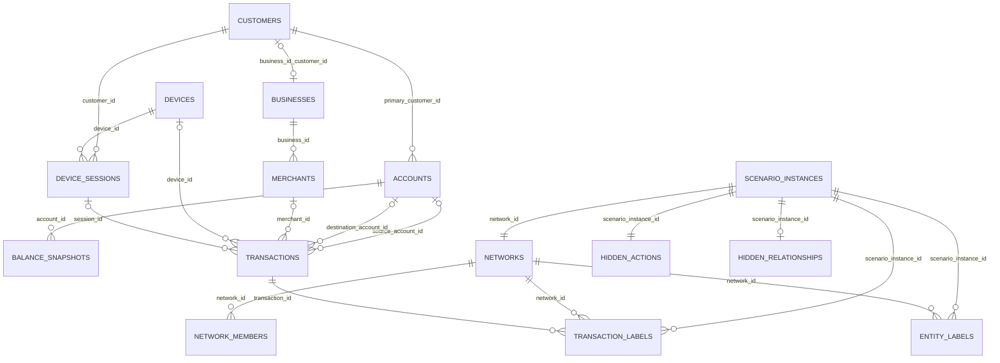

# ABM-BANK v0.2.0 — Data dictionary và mô hình liên kết

## 1. Mục đích và phạm vi

Tài liệu này mô tả release synthetic `ABM-BANK-v0.2.0` đã được materialize tại:

```text
data/generated/ABM-BANK-v0.2.0/
```

Release phục vụ MVP phân tích hành vi giao dịch và đồ thị AML. Dữ liệu mô phỏng hoạt động ngân hàng tại Việt Nam, sử dụng VND, trong khoảng từ `2026-01-01T00:00:00+07:00` đến `2026-03-31T23:59:59+07:00`.

Đây là dữ liệu synthetic dùng để phát triển và đánh giá kỹ thuật. Các quota kịch bản AML là benchmark coverage, không phải ước lượng tỷ lệ AML ngoài thực tế. Dữ liệu không được dùng để ra quyết định đối với khách hàng, tín dụng hoặc thực thi pháp luật.

## 2. Thông số release

| Thuộc tính | Giá trị |
|---|---:|
| Dataset ID | `ABM-BANK` |
| Dataset version | `0.2.0` |
| Dung lượng manifest | 3.143.408.103 byte, khoảng 3,14 GB hoặc 2,93 GiB |
| Số shard | 128 |
| Tổng số dòng trên 18 bảng | 83.405.498 |
| Khách hàng | 1.280.000 |
| Giao dịch | 47.617.992 |
| Tài khoản | 1.638.206 |
| Phiên thiết bị | 20.678.141 |
| Kịch bản AML | 14.080 |
| Hard negative hợp lệ | 16.000 |
| Chất lượng | 1.664/1.664 kiểm tra PASS, 0 lỗi |
| Logical dataset SHA-256 | `cae367ea4814a38eb0de7c5f43febe8e2ecdafcf4a69df96e30ca6e914951479` |
| Định dạng | Apache Parquet, nén Zstandard |
| Múi giờ lưu trữ | UTC, độ chính xác microsecond |
| Tiền tệ | VND, `decimal128(20,2)` |

Nguồn chính xác cho số lượng, fingerprint và danh sách shard là `data/generated/ABM-BANK-v0.2.0/manifest.json`.

## 3. Cấu trúc vật lý

```text
ABM-BANK-v0.2.0/
├── manifest.json
└── shards/
    ├── shard-000/
    │   ├── bank_view/
    │   │   ├── customers.parquet
    │   │   ├── businesses.parquet
    │   │   ├── accounts.parquet
    │   │   ├── devices.parquet
    │   │   ├── merchants.parquet
    │   │   ├── relationships.parquet
    │   │   ├── device_sessions.parquet
    │   │   ├── balance_snapshots.parquet
    │   │   └── transactions/
    │   │       ├── event_month=2026-01/part-00000.parquet
    │   │       ├── event_month=2026-02/part-00000.parquet
    │   │       └── event_month=2026-03/part-00000.parquet
    │   ├── ground_truth/
    │   │   ├── entity_labels.parquet
    │   │   ├── transaction_labels.parquet
    │   │   ├── scenario_instances.parquet
    │   │   ├── networks.parquet
    │   │   ├── network_members.parquet
    │   │   ├── hard_negative_instances.parquet
    │   │   └── split_assignments.parquet
    │   ├── hidden/
    │   │   ├── hidden_actions.parquet
    │   │   └── hidden_relationships.parquet
    │   ├── metadata/
    │   │   ├── config.json
    │   │   ├── parameter_registry.json
    │   │   └── source_registry.json
    │   ├── reports/
    │   │   ├── quality_report.json
    │   │   ├── statistical_summary.json
    │   │   ├── behavioral_suitability_report.json
    │   │   └── graph_suitability_report.json
    │   └── manifest.json
    ├── shard-001/
    └── shard-127/
```

Mỗi shard là một thế giới mô phỏng hoàn chỉnh, có manifest, metadata và quality report riêng. ID có namespace `S000` đến `S127`, vì vậy có thể `UNION ALL` dữ liệu của mọi shard trước khi join mà không phát sinh trùng khóa.

## 4. Phân vùng dữ liệu và quyền sử dụng

| Vùng | Ý nghĩa | Được dùng làm feature? | Quy tắc |
|---|---|---|---|
| `bank_view/` | Dữ liệu ngân hàng có thể quan sát tại thời điểm nghiệp vụ | Có | Nguồn chính cho feature hành vi và graph |
| `ground_truth/` | Nhãn benchmark, network AML, split và hard negative | Không dùng làm input feature | Chỉ dùng tạo target, sampling và đánh giá sau khi feature đã đóng băng |
| `hidden/` | Ý định và quan hệ điều phối thật của simulator | Không | Chỉ dành cho audit simulator và nghiên cứu causal; phải cách ly khỏi pipeline feature |
| `metadata/` | Cấu hình, parameter registry, source registry | Không phải dữ liệu huấn luyện | Dùng tái lập và truy vết provenance |
| `reports/` | Báo cáo chất lượng từng shard | Không phải dữ liệu huấn luyện | Dùng kiểm định release |

Bank View cố ý không chứa `is_laundering`, `scenario_instance_id`, `network_id`, `hidden_intent`, `true_controller_id` hoặc vai trò AML thật.

## 5. Quy ước chung

### 5.1 ID

ID nội bộ có dạng `<PREFIX>-<SHARD>-<SEQUENCE>`, ví dụ:

| Đối tượng | Ví dụ |
|---|---|
| Customer | `CUS-S000-0000000001` |
| Business | `BUS-S000-0000000001` |
| Account | `ACC-S000-0000000001` |
| Device | `DEV-S000-0000000001` |
| Merchant | `MER-S000-0000000001` |
| Relationship | `REL-S000-0000000001` |
| Session | `SES-S000-0000000001` |
| Transaction | `TXN-S000-0000036858` |
| Event | `EVT-S000-0000036858` |
| Scenario | `SCN-S000-0000000001` |
| Network | `NET-S000-0000000001` |
| Hard negative | `HN-S000-0000000001` |
| Hidden action | `HACT-S000-0000000001` |
| Hidden relationship | `HREL-S000-0000000001` |

External counterparties không được giả định là khách hàng đầy đủ. Chúng dùng token ổn định dạng `CPY-<CATEGORY>-<HASH>`, ví dụ `CPY-LOAN-B23AE4EE17465AB4`.

### 5.2 Kiểu dữ liệu

| Kiểu Parquet | Ý nghĩa |
|---|---|
| `string` | ID, enum, code hoặc text |
| `int64` | Số đếm nguyên |
| `double` | Điểm confidence |
| `bool` | Cờ logic |
| `decimal128(20,2)` | Giá trị tiền chính xác hai chữ số thập phân |
| `timestamp[us, tz=UTC]` | Thời gian UTC có timezone, chính xác microsecond |
| `list<string>` | Mảng ID hoặc quality flag |

Trong các bảng chi tiết bên dưới, `Không` tại cột Nullable nghĩa là trường bắt buộc trong schema Parquet hiện tại.

### 5.3 Split chống leakage

| Split | Tỷ trọng cohort mục tiêu | Cửa sổ event time |
|---|---:|---|
| `TRAIN` | 70% entity | 2026-01-01 đến 2026-02-23 |
| `VALIDATION` | 10% entity | 2026-02-24 đến 2026-03-13 |
| `TEST` | 10% entity | 2026-03-14 đến 2026-03-22 |
| `HIDDEN_TEST` | 10% entity | 2026-03-23 đến 2026-03-31 |

Account kế thừa split của customer sở hữu. Giao dịch nội bộ chỉ nối các account cùng split. Scenario, network, label và network member luôn ở cùng split. Quy tắc này ngăn một customer, account hoặc network xuất hiện ở cả train và test.

## 6. Sơ đồ liên kết



`relationships.parquet`, `split_assignments.parquet` và các mảng ID trong hard-negative/hidden tables là quan hệ polymorphic nên không biểu diễn đầy đủ bằng foreign key tĩnh trong sơ đồ trên.

### 6.1 Ma trận khóa ngoại

| Bảng nguồn.cột | Bảng đích.cột | Cardinality/điều kiện |
|---|---|---|
| `customers.business_id` | `businesses.business_id` | 0..1 business cho một customer |
| `businesses.customer_id` | `customers.customer_id` | Business tham gia ngân hàng thông qua một customer record |
| `accounts.primary_customer_id` | `customers.customer_id` | N account thuộc một primary customer |
| `accounts.owner_customer_ids[]` | `customers.customer_id` | Danh sách owner; schema hỗ trợ nhiều owner |
| `merchants.business_id` | `businesses.business_id` | N merchant do một business vận hành |
| `device_sessions.customer_id` | `customers.customer_id` | N session của một customer |
| `device_sessions.device_id` | `devices.device_id` | N session trên một device token |
| `balance_snapshots.account_id` | `accounts.account_id` | Hai snapshot `OPENING` và `CLOSING` cho mỗi account |
| `transactions.source_account_id` | `accounts.account_id` | Nullable; dùng khi nguồn là account nội bộ |
| `transactions.destination_account_id` | `accounts.account_id` | Nullable; dùng khi đích là account nội bộ |
| `transactions.merchant_id` | `merchants.merchant_id` | Nullable; chủ yếu cho merchant purchase |
| `transactions.device_id` | `devices.device_id` | Nullable do channel hoặc masking quan sát |
| `transactions.session_id` | `device_sessions.session_id` | Nullable; null cùng device khi session bị masking |
| `scenario_instances.network_id` | `networks.network_id` | 1:1 |
| `networks.scenario_instance_id` | `scenario_instances.scenario_instance_id` | 1:1 reverse link |
| `entity_labels.scenario_instance_id` | `scenario_instances.scenario_instance_id` | N entity label cho một scenario |
| `entity_labels.network_id` | `networks.network_id` | N entity label cho một network |
| `transaction_labels.transaction_id` | `transactions.transaction_id` | N label row, hiện mỗi scenario transaction có một row |
| `transaction_labels.scenario_instance_id` | `scenario_instances.scenario_instance_id` | N transaction label cho một scenario |
| `transaction_labels.network_id` | `networks.network_id` | N transaction label cho một network |
| `network_members.network_id` | `networks.network_id` | N member cho một network |
| `network_members.entity_id` | `customers.customer_id` hoặc `accounts.account_id` | Chọn bảng theo `entity_type` |
| `hard_negative_instances.entity_ids[]` | `customers.customer_id` | Entity tham gia pattern hợp lệ |
| `hard_negative_instances.transaction_ids[]` | `transactions.transaction_id` | Giao dịch thuộc hard negative |
| `hidden_actions.true_actor_ids[]` | `customers.customer_id` | Actor thật trong simulator |
| `hidden_actions.transaction_ids[]` | `transactions.transaction_id` | Giao dịch causal của scenario |

## 7. Danh mục bảng

| Bảng logic | Vùng/file mỗi shard | Số dòng toàn release | Khóa chính |
|---|---|---:|---|
| `customers` | `bank_view/customers.parquet` | 1.280.000 | `customer_id` |
| `businesses` | `bank_view/businesses.parquet` | 155.478 | `business_id` |
| `accounts` | `bank_view/accounts.parquet` | 1.638.206 | `account_id` |
| `devices` | `bank_view/devices.parquet` | 1.323.990 | `device_id` |
| `merchants` | `bank_view/merchants.parquet` | 153.600 | `merchant_id` |
| `relationships` | `bank_view/relationships.parquet` | 3.988.257 | `relationship_id` |
| `device_sessions` | `bank_view/device_sessions.parquet` | 20.678.141 | `session_id` |
| `transactions` | `bank_view/transactions/event_month=*/part-*.parquet` | 47.617.992 | `transaction_id` |
| `balance_snapshots` | `bank_view/balance_snapshots.parquet` | 3.276.412 | (`account_id`, `snapshot_type`) |
| `entity_labels` | `ground_truth/entity_labels.parquet` | 72.842 | (`entity_id`, `scenario_instance_id`, `role`) |
| `transaction_labels` | `ground_truth/transaction_labels.parquet` | 152.732 | (`transaction_id`, `scenario_instance_id`, `scenario_stage`) |
| `scenario_instances` | `ground_truth/scenario_instances.parquet` | 14.080 | `scenario_instance_id` |
| `networks` | `ground_truth/networks.parquet` | 14.080 | `network_id` |
| `network_members` | `ground_truth/network_members.parquet` | 72.842 | (`network_id`, `entity_id`, `role`) |
| `hard_negative_instances` | `ground_truth/hard_negative_instances.parquet` | 16.000 | `hard_negative_instance_id` |
| `split_assignments` | `ground_truth/split_assignments.parquet` | 2.932.286 | (`entity_type`, `entity_id`) |
| `hidden_actions` | `hidden/hidden_actions.parquet` | 14.080 | `hidden_action_id` |
| `hidden_relationships` | `hidden/hidden_relationships.parquet` | 4.480 | `hidden_relationship_id` |

## 8. Data dictionary: Bank View

### 8.1 `customers`

Grain: một dòng cho một quan hệ khách hàng với ngân hàng. Bảng chỉ chứa thuộc tính phân tích dạng band/code, không chứa PII thật.

| Cột | Kiểu | Nullable | Mô tả |
|---|---|---|---|
| `schema_version` | string | Không | Phiên bản contract customer, hiện là `2.0` |
| `customer_id` | string | Không | Khóa chính `CUS-*` |
| `source_system` | string | Không | Hệ thống nguồn synthetic, `abm-bank` |
| `source_record_id` | string | Không | ID record tại nguồn; bằng customer ID trong release này |
| `customer_type` | string | Không | `INDIVIDUAL`, `SME`, `CORPORATE` |
| `business_id` | string | Có | FK sang business đối với SME/corporate/household business |
| `status` | string | Không | Trạng thái customer, hiện là `ACTIVE` |
| `kyc_state` | string | Không | Trạng thái KYC quan sát được, hiện là `VERIFIED` |
| `risk_rating` | string | Không | Rating ngân hàng quan sát được: `LOW`, `MEDIUM`, `HIGH`; không phải nhãn AML |
| `segment` | string | Không | `STUDENT`, `SALARIED`, `HOUSEHOLD`, `AFFLUENT`, `RETIRED`, `HOUSEHOLD_BUSINESS`, `SME`, `CORPORATE` |
| `age_band` | string | Không | `15_24`, `25_34`, `35_44`, `45_54`, `55_64`, `65_PLUS`, hoặc `NOT_APPLICABLE` |
| `occupation_code` | string | Có | Mã nhóm nghề cho individual; null với business customer |
| `declared_income_band` | string | Không | Band thu nhập hoặc doanh thu khai báo |
| `monthly_scale_vnd` | decimal128(20,2) | Không | Quy mô tiền hàng tháng dùng hiệu chỉnh hành vi |
| `expected_monthly_turnover_vnd` | decimal128(20,2) | Không | Turnover tháng kỳ vọng có thể quan sát/phỏng đoán từ hồ sơ |
| `residency_country` | string | Không | Quốc gia cư trú, hiện là `VN` |
| `region_code` | string | Không | `HCM`, `HN`, `OTHER_URBAN`, `RURAL` |
| `customer_since` | timestamp UTC | Không | Thời điểm bắt đầu quan hệ ngân hàng |
| `created_at` | timestamp UTC | Không | Thời điểm record được tạo trong release |
| `valid_from` | timestamp UTC | Không | Bắt đầu hiệu lực của phiên bản customer |
| `valid_to` | timestamp UTC | Có | Kết thúc hiệu lực; null nghĩa là còn hiệu lực |
| `entity_split` | string | Không | `TRAIN`, `VALIDATION`, `TEST`, `HIDDEN_TEST` |
| `data_class` | string | Không | `C2_CONFIDENTIAL` |

### 8.2 `businesses`

Grain: một dòng cho một pháp nhân hoặc hộ kinh doanh. Trong release v0.2.0, `customer_id` không null và nối business với customer record tương ứng.

| Cột | Kiểu | Nullable | Mô tả |
|---|---|---|---|
| `schema_version` | string | Không | Phiên bản contract, `1.0` |
| `business_id` | string | Không | Khóa chính `BUS-*` |
| `source_system` | string | Không | Hệ thống nguồn, `abm-bank` |
| `source_record_id` | string | Không | ID record tại nguồn |
| `customer_id` | string | Không | FK sang `customers.customer_id` |
| `business_type` | string | Không | `HOUSEHOLD_BUSINESS`, `LIMITED_LIABILITY`, `JOINT_STOCK` |
| `industry_code` | string | Không | Ngành: construction, hospitality, logistics, manufacturing, professional, retail, services hoặc technology |
| `legal_form_code` | string | Không | `HHB`, `LLC`, `JSC` |
| `employee_count_band` | string | Không | `1_9`, `10_199`, `200_PLUS` |
| `monthly_turnover_vnd` | decimal128(20,2) | Không | Quy mô turnover tháng synthetic |
| `annual_turnover_band` | string | Không | `LT_3B`, `3B_50B`, `GE_50B` |
| `registered_country` | string | Không | Quốc gia đăng ký, `VN` |
| `registered_region_code` | string | Không | Vùng đăng ký |
| `established_at` | timestamp UTC | Không | Thời điểm thành lập synthetic |
| `status` | string | Không | Trạng thái, hiện là `ACTIVE` |
| `created_at` | timestamp UTC | Không | Thời điểm tạo record |
| `valid_from` | timestamp UTC | Không | Bắt đầu hiệu lực |
| `valid_to` | timestamp UTC | Có | Kết thúc hiệu lực, hiện thường null |
| `entity_split` | string | Không | Split kế thừa/cohort |
| `data_class` | string | Không | `C2_CONFIDENTIAL` |

### 8.3 `accounts`

Grain: một dòng cho một tài khoản nội bộ. Một customer có thể có nhiều account.

| Cột | Kiểu | Nullable | Mô tả |
|---|---|---|---|
| `schema_version` | string | Không | Phiên bản contract account, `2.0` |
| `account_id` | string | Không | Khóa chính `ACC-*` |
| `source_system` | string | Không | Hệ thống nguồn |
| `source_record_id` | string | Không | ID record tại nguồn |
| `primary_customer_id` | string | Không | FK sang primary owner trong `customers` |
| `owner_customer_ids` | list&lt;string&gt; | Không | Danh sách FK owner customer; hỗ trợ đồng sở hữu |
| `product_type` | string | Không | `CURRENT`, `SAVINGS`, `TERM_DEPOSIT` |
| `currency` | string | Không | `VND` |
| `status` | string | Không | Trạng thái account, hiện là `ACTIVE` |
| `opening_balance` | decimal128(20,2) | Không | Số dư đầu kỳ |
| `opened_at` | timestamp UTC | Không | Thời điểm mở tài khoản |
| `closed_at` | timestamp UTC | Có | Thời điểm đóng, null nếu đang mở |
| `branch_code` | string | Không | Mã chi nhánh tổng hợp từ region |
| `opening_channel` | string | Không | `MOBILE` hoặc `BRANCH` |
| `is_dormant_reactivated` | bool | Không | Cờ tài khoản ngủ đông được kích hoạt lại |
| `created_at` | timestamp UTC | Không | Thời điểm tạo record |
| `valid_from` | timestamp UTC | Không | Bắt đầu hiệu lực |
| `valid_to` | timestamp UTC | Có | Kết thúc hiệu lực |
| `entity_split` | string | Không | Split kế thừa từ primary customer |
| `data_class` | string | Không | `C2_CONFIDENTIAL` |

### 8.4 `devices`

Grain: một token thiết bị đã được ngân hàng quan sát. Device có thể được dùng hợp lệ bởi nhiều customer, vì vậy không có `customer_id` trực tiếp trong master này.

| Cột | Kiểu | Nullable | Mô tả |
|---|---|---|---|
| `schema_version` | string | Không | Phiên bản contract, `1.0` |
| `device_id` | string | Không | Khóa chính `DEV-*` |
| `source_system` | string | Không | `abm-bank-device-tokenizer` |
| `source_record_id` | string | Không | Token record tại nguồn |
| `device_type` | string | Không | `MOBILE_APP` hoặc `BROWSER` |
| `os_family` | string | Không | `ANDROID`, `IOS`, `WINDOWS`, `MACOS`, `LINUX` |
| `first_seen_at` | timestamp UTC | Không | Lần đầu ngân hàng quan sát device |
| `last_seen_at` | timestamp UTC | Không | Lần quan sát cuối trong release |
| `is_rooted_or_emulator` | bool | Không | Tín hiệu rooted/emulator quan sát được |
| `created_at` | timestamp UTC | Không | Thời điểm tạo record |
| `valid_from` | timestamp UTC | Không | Bắt đầu hiệu lực token |
| `valid_to` | timestamp UTC | Có | Kết thúc hiệu lực |
| `entity_split` | string | Không | Split của cohort gốc |
| `data_class` | string | Không | `C3_RESTRICTED` |

### 8.5 `merchants`

Grain: một merchant acceptance entity, được vận hành bởi một business.

| Cột | Kiểu | Nullable | Mô tả |
|---|---|---|---|
| `schema_version` | string | Không | Phiên bản contract, `1.0` |
| `merchant_id` | string | Không | Khóa chính `MER-*` |
| `source_system` | string | Không | `abm-bank-acquiring` |
| `source_record_id` | string | Không | ID merchant tại nguồn |
| `business_id` | string | Không | FK sang `businesses.business_id` |
| `merchant_category_code` | string | Không | MCC: `4111`, `4814`, `5311`, `5411`, `5732`, `5812`, `5999`, `7011`, `7399` |
| `acquiring_bank_code` | string | Không | Acquirer, hiện là `ABMBANK` |
| `country` | string | Không | `VN` |
| `region_code` | string | Không | Region của merchant |
| `status` | string | Không | Trạng thái, hiện là `ACTIVE` |
| `created_at` | timestamp UTC | Không | Thời điểm tạo record |
| `valid_from` | timestamp UTC | Không | Bắt đầu hiệu lực |
| `valid_to` | timestamp UTC | Có | Kết thúc hiệu lực |
| `entity_split` | string | Không | Split của business vận hành |
| `data_class` | string | Không | `C1_INTERNAL` |

### 8.6 `relationships`

Grain: một edge graph có thời gian và provenance. Đây là bảng polymorphic; bảng đích được xác định bởi cặp `*_entity_type` và `*_entity_id`.

| Cột | Kiểu | Nullable | Mô tả |
|---|---|---|---|
| `schema_version` | string | Không | Phiên bản relationship contract, `2.0` |
| `relationship_id` | string | Không | Khóa chính `REL-*` |
| `source_entity_type` | string | Không | Hiện có `CUSTOMER`, `MERCHANT` |
| `source_entity_id` | string | Không | ID source entity |
| `target_entity_type` | string | Không | `ACCOUNT`, `CUSTOMER`, `DEVICE`, `LEGAL_ENTITY` |
| `target_entity_id` | string | Không | ID target; `LEGAL_ENTITY` nối đến `businesses.business_id` |
| `relationship_type` | string | Không | `OWNS_ACCOUNT`, `CO_OWNS_ACCOUNT`, `USES_DEVICE`, `SHARED_DEVICE`, `BENEFICIAL_OWNER`, `EMPLOYED_BY`, `MERCHANT_OPERATED_BY` |
| `direction` | string | Không | `DIRECTED` hoặc `UNDIRECTED` |
| `method` | string | Không | `DETERMINISTIC` hoặc `PROBABILISTIC` |
| `confidence` | double | Không | Độ tin cậy từ 0 đến 1 |
| `is_fact` | bool | Không | True cho quan hệ deterministic/confirmed |
| `inference_logic` | string | Có | Giải thích logic suy luận đối với edge probabilistic |
| `observation_count` | int64 | Không | Số quan sát hỗ trợ edge |
| `created_at` | timestamp UTC | Không | Thời điểm tạo edge |
| `valid_from` | timestamp UTC | Không | Bắt đầu hiệu lực nghiệp vụ |
| `valid_to` | timestamp UTC | Có | Kết thúc hiệu lực |
| `known_from` | timestamp UTC | Không | Thời điểm ngân hàng biết edge; dùng point-in-time graph |
| `source_system` | string | Không | `abm-bank-observation` |
| `dataset_split` | string | Không | Split của edge |
| `data_class` | string | Không | `C2_CONFIDENTIAL` |

### 8.7 `device_sessions`

Grain: một phiên đăng nhập thành công liên kết customer và device tại một thời điểm.

| Cột | Kiểu | Nullable | Mô tả |
|---|---|---|---|
| `schema_version` | string | Không | Phiên bản session event, `1.0` |
| `session_id` | string | Không | Khóa chính `SES-*` |
| `customer_id` | string | Không | FK sang customer |
| `device_id` | string | Không | FK sang device |
| `event_type` | string | Không | Hiện là `LOGIN_SUCCESS` |
| `event_time` | timestamp UTC | Không | Thời gian phiên xảy ra |
| `available_from` | timestamp UTC | Không | Thời điểm phiên khả dụng cho hệ thống phân tích |
| `channel` | string | Không | `MOBILE`, `INTERNET`, `API` |
| `ip_token` | string | Không | Token IP theo shard, không phải địa chỉ IP thật |
| `country` | string | Không | `VN` |
| `region_code` | string | Không | Region quan sát |
| `is_vpn_or_proxy` | bool | Không | Tín hiệu VPN/proxy |
| `is_shared_nat_suspected` | bool | Không | Tín hiệu shared NAT |
| `authentication_method` | string | Không | `OTP_APP`, `BIOMETRIC`, `PASSWORD` |
| `authentication_successful` | bool | Không | Hiện là true |
| `created_at` | timestamp UTC | Không | Thời điểm tạo record |
| `dataset_split` | string | Không | Split của customer/session |
| `data_class` | string | Không | `C3_RESTRICTED` |

### 8.8 `transactions`

Grain: một chuyển động giá trị đã post. Bảng được partition theo `event_month` để giảm lượng file phải scan theo thời gian.

Mỗi transaction có đúng một source endpoint và một destination endpoint. Ở mỗi phía, đúng một trong hai trường account nội bộ hoặc counterparty external phải có giá trị.

| Cột | Kiểu | Nullable | Mô tả |
|---|---|---|---|
| `schema_version` | string | Không | Phiên bản transaction contract, `1.0` |
| `transaction_id` | string | Không | Khóa chính `TXN-*` |
| `event_id` | string | Không | ID sự kiện `EVT-*`, dùng idempotency khi publish |
| `source_system` | string | Không | `abm-bank` |
| `source_record_id` | string | Không | ID record nguồn; bằng transaction ID |
| `event_time` | timestamp UTC | Không | Thời điểm nghiệp vụ xảy ra |
| `posting_time` | timestamp UTC | Không | Thời điểm transaction được post |
| `available_from` | timestamp UTC | Không | Thời điểm record khả dụng cho feature point-in-time |
| `source_account_id` | string | Có | FK account nguồn nội bộ |
| `source_counterparty_ref` | string | Có | Token nguồn bên ngoài; loại trừ lẫn nhau với source account |
| `destination_account_id` | string | Có | FK account đích nội bộ |
| `destination_counterparty_ref` | string | Có | Token đích bên ngoài; loại trừ lẫn nhau với destination account |
| `amount` | decimal128(20,2) | Không | Số tiền dương |
| `currency` | string | Không | `VND` |
| `transaction_type` | string | Không | `BILL_PAYMENT`, `BUSINESS_PAYMENT`, `CASH_DEPOSIT`, `CASH_WITHDRAWAL`, `INTERNATIONAL_PAYMENT`, `LOAN_REPAYMENT`, `MERCHANT_PURCHASE`, `SALARY`, `SAVINGS_TRANSFER`, `SUPPLIER_PAYMENT`, `TRANSFER` |
| `channel` | string | Không | `API`, `ATM`, `BATCH`, `BRANCH`, `CARD`, `INTERNET`, `MOBILE`, `POS`, `SWIFT` |
| `merchant_id` | string | Có | FK merchant nếu giao dịch có merchant |
| `device_id` | string | Có | FK device quan sát; có thể null do channel hoặc masking |
| `session_id` | string | Có | FK session; có thể null do channel hoặc masking |
| `purpose_code` | string | Không | Mã mục đích nghiệp vụ quan sát được |
| `purpose_text` | string | Có | Mô tả mục đích; có thể bị masking |
| `status` | string | Không | Hiện là `POSTED` |
| `created_at` | timestamp UTC | Không | Thời điểm record được materialize; luôn không sớm hơn `available_from` |
| `quality_flags` | list&lt;string&gt; | Không | Cờ chất lượng, ví dụ `FIELD_MASKED`; mảng rỗng nếu không có cờ |
| `dataset_split` | string | Không | Split thời gian/entity |
| `data_class` | string | Không | `C2_CONFIDENTIAL` |

Không có `customer_id` trực tiếp trên transaction. Có thể xác định customer qua owner của source/destination account, hoặc qua `session_id -> device_sessions.customer_id` với giao dịch số. Không nên mặc định external `CPY-*` là customer của ngân hàng.

### 8.9 `balance_snapshots`

Grain: một snapshot số dư cho một account và một loại snapshot. Mỗi account có đúng hai dòng.

| Cột | Kiểu | Nullable | Mô tả |
|---|---|---|---|
| `account_id` | string | Không | FK sang account |
| `snapshot_time` | timestamp UTC | Không | Thời điểm snapshot |
| `balance` | decimal128(20,2) | Không | Số dư không âm |
| `currency` | string | Không | `VND` |
| `snapshot_type` | string | Không | `OPENING` hoặc `CLOSING` |
| `dataset_split` | string | Không | Split của account |

Phương trình được validator kiểm tra cho từng account:

```text
CLOSING = OPENING + tổng credit nội bộ - tổng debit nội bộ
```

## 9. Data dictionary: Ground truth

### 9.1 `scenario_instances`

Grain: một instance kịch bản AML synthetic được chèn có chủ đích.

| Cột | Kiểu | Nullable | Mô tả |
|---|---|---|---|
| `scenario_instance_id` | string | Không | Khóa chính `SCN-*` |
| `scenario_type` | string | Không | Loại typology AML |
| `network_id` | string | Không | FK 1:1 sang network |
| `benchmark_insertion` | bool | Không | Luôn true: instance do benchmark chèn |
| `prevalence_claim` | bool | Không | Luôn false: không đại diện prevalence thật |
| `active_from` | timestamp UTC | Không | Bắt đầu scenario |
| `active_to` | timestamp UTC | Không | Kết thúc scenario |
| `actor_count` | int64 | Không | Số customer actor |
| `transaction_count` | int64 | Không | Số transaction được gắn nhãn trong scenario |
| `dataset_split` | string | Không | Split cô lập của scenario |
| `parameter_registry_version` | string | Không | Phiên bản parameter registry |

### 9.2 `networks`

Grain: một network AML cho một scenario instance.

| Cột | Kiểu | Nullable | Mô tả |
|---|---|---|---|
| `network_id` | string | Không | Khóa chính `NET-*` |
| `scenario_instance_id` | string | Không | FK 1:1 sang scenario |
| `scenario_type` | string | Không | Typology tương ứng |
| `network_type` | string | Không | `SYNTHETIC_AML_TYPOLOGY` |
| `dataset_split` | string | Không | Split của network |

### 9.3 `entity_labels`

Grain: vai trò của một customer hoặc account trong một scenario.

| Cột | Kiểu | Nullable | Mô tả |
|---|---|---|---|
| `entity_id` | string | Không | FK polymorphic sang customer hoặc account |
| `entity_type` | string | Không | `CUSTOMER` hoặc `ACCOUNT` |
| `scenario_instance_id` | string | Không | FK scenario |
| `network_id` | string | Không | FK network |
| `role` | string | Không | `COLLECTION_HUB`, `COLLECTOR`, `COORDINATOR`, `MULE`, `PASS_THROUGH_ACCOUNT`, `RING_MEMBER`, `STRUCTURER` |
| `label_type` | string | Không | `AML_INVOLVEMENT` |
| `label_value` | string | Không | `INVOLVED` |
| `active_from` | timestamp UTC | Không | Bắt đầu vai trò |
| `active_to` | timestamp UTC | Không | Kết thúc vai trò |
| `label_source` | string | Không | `SIMULATOR_GROUND_TRUTH` |
| `dataset_split` | string | Không | Split của entity/network |

### 9.4 `transaction_labels`

Grain: một transaction được gắn vào một stage của scenario AML.

| Cột | Kiểu | Nullable | Mô tả |
|---|---|---|---|
| `transaction_id` | string | Không | FK transaction |
| `scenario_instance_id` | string | Không | FK scenario |
| `network_id` | string | Không | FK network |
| `label_type` | string | Không | `AML_INVOLVEMENT` |
| `label_value` | string | Không | `SYNTHETIC_TYPOLOGY_STEP` |
| `scenario_stage` | string | Không | `ENTRY`, `PLACEMENT`, `COLLECTION`, `CONSOLIDATION`, `FAN_IN`, `FAN_OUT`, `MULE_FORWARD`, `PASS_THROUGH`, `LAYER_1`, `LAYER_2`, `LAYER_3` |
| `label_source` | string | Không | `SIMULATOR_GROUND_TRUTH` |
| `dataset_split` | string | Không | Split của transaction/scenario |

### 9.5 `network_members`

Grain: membership của một customer hoặc account trong một network.

| Cột | Kiểu | Nullable | Mô tả |
|---|---|---|---|
| `network_id` | string | Không | FK network |
| `entity_id` | string | Không | FK customer/account theo `entity_type` |
| `entity_type` | string | Không | `CUSTOMER` hoặc `ACCOUNT` |
| `role` | string | Không | Vai trò giống `entity_labels.role` |
| `active_from` | timestamp UTC | Không | Bắt đầu membership |
| `active_to` | timestamp UTC | Không | Kết thúc membership |
| `dataset_split` | string | Không | Split của network |

### 9.6 `hard_negative_instances`

Grain: một pattern hợp lệ được tạo để cố ý va chạm với tín hiệu/rule AML, giúp đo false positive.

| Cột | Kiểu | Nullable | Mô tả |
|---|---|---|---|
| `hard_negative_instance_id` | string | Không | Khóa chính `HN-*` |
| `scenario_type` | string | Không | Loại hard negative |
| `legitimate_reason` | string | Không | Giải thích nghiệp vụ hợp lệ |
| `observable_pattern` | string | Không | Pattern mà hệ thống AML có thể quan sát |
| `possible_rule_collision` | string | Không | Các loại rule có thể bị kích hoạt nhầm |
| `ground_truth` | string | Không | Luôn `LEGITIMATE` |
| `entity_ids` | list&lt;string&gt; | Không | Customer tham gia pattern |
| `transaction_ids` | list&lt;string&gt; | Không | Transaction thuộc pattern |
| `active_from` | timestamp UTC | Không | Bắt đầu pattern |
| `active_to` | timestamp UTC | Không | Kết thúc pattern |
| `dataset_split` | string | Không | Split cô lập |

### 9.7 `split_assignments`

Grain: một assignment split cho một customer, account hoặc scenario.

| Cột | Kiểu | Nullable | Mô tả |
|---|---|---|---|
| `entity_id` | string | Không | ID entity được gán split |
| `entity_type` | string | Không | `CUSTOMER`, `ACCOUNT`, `SCENARIO_INSTANCE` |
| `dataset_split` | string | Không | Split được gán |
| `assignment_reason` | string | Không | `ENTITY_COHORT_AND_CHRONOLOGICAL_WINDOW`, `INHERITED_FROM_OWNER_CUSTOMER`, hoặc `NETWORK_ISOLATED_BENCHMARK_QUOTA` |

## 10. Data dictionary: Hidden simulator state

### 10.1 `hidden_actions`

Grain: causal action thật của một AML scenario. Bảng này không được join vào feature pipeline.

| Cột | Kiểu | Nullable | Mô tả |
|---|---|---|---|
| `hidden_action_id` | string | Không | Khóa chính `HACT-*` |
| `scenario_instance_id` | string | Không | FK scenario |
| `network_id` | string | Không | FK network |
| `scenario_type` | string | Không | Typology AML |
| `true_actor_ids` | list&lt;string&gt; | Không | Customer actor thật |
| `transaction_ids` | list&lt;string&gt; | Không | Giao dịch causal |
| `hidden_intent` | string | Không | `SYNTHETIC_LAUNDERING_BENCHMARK` |
| `causal_start_time` | timestamp UTC | Không | Bắt đầu causal window |
| `causal_end_time` | timestamp UTC | Không | Kết thúc causal window |
| `dataset_split` | string | Không | Split scenario |

### 10.2 `hidden_relationships`

Grain: một quan hệ điều phối thật mà ngân hàng không quan sát trực tiếp. Chỉ 4.480 scenario có loại quan hệ này.

| Cột | Kiểu | Nullable | Mô tả |
|---|---|---|---|
| `hidden_relationship_id` | string | Không | Khóa chính `HREL-*` |
| `scenario_instance_id` | string | Không | FK scenario |
| `network_id` | string | Không | FK network |
| `source_entity_id` | string | Không | Actor điều phối nguồn |
| `target_entity_ids` | list&lt;string&gt; | Không | Các actor đích được điều phối |
| `relationship_type` | string | Không | `TRUE_COORDINATION` |
| `true_controller_id` | string | Không | Controller thật trong simulator |
| `active_from` | timestamp UTC | Không | Bắt đầu quan hệ |
| `active_to` | timestamp UTC | Không | Kết thúc quan hệ |
| `dataset_split` | string | Không | Split scenario |

## 11. Typology AML và hard negative

### 11.1 Kịch bản AML

| Scenario type | Số instance | Ý nghĩa benchmark |
|---|---:|---|
| `STRUCTURING` | 3.840 | Chia nhỏ dòng tiền thành nhiều giao dịch |
| `RAPID_PASS_THROUGH` | 3.200 | Tiền vào rồi chuyển tiếp nhanh qua account |
| `MULE_FUNNEL` | 2.560 | Nhiều mule thu gom rồi funnel về hub |
| `FAN_IN_FAN_OUT` | 2.560 | Nhiều nguồn vào và nhiều đích ra trong cửa sổ ngắn |
| `CIRCULAR_LAYERING` | 1.920 | Dòng tiền đi qua vòng/ring nhiều lớp |
| **Tổng** | **14.080** | Mỗi instance có scenario, network và hidden action tương ứng |

### 11.2 Hard negative hợp lệ

| Hard-negative type | Số instance | Pattern hợp lệ dễ bị báo nhầm |
|---|---:|---|
| `FAMILY_REMITTANCE_HUB` | 3.200 | Gia đình gom và phân phối tiền hỗ trợ |
| `MARKETPLACE_SELLER` | 3.200 | Seller nhận nhiều khoản nhỏ rồi trả supplier |
| `PROPERTY_OR_INSURANCE_EVENT` | 2.560 | Khoản lớn một lần từ bán tài sản/bảo hiểm |
| `SALARY_DISBURSEMENT` | 2.560 | Employer fan-out lương cho nhiều nhân viên |
| `SEASONAL_BUSINESS` | 2.560 | Doanh thu tăng đột biến theo mùa |
| `TREASURY_MOVEMENT` | 1.920 | Treasury sweep giá trị lớn giữa doanh nghiệp liên quan |
| **Tổng** | **16.000** | `ground_truth = LEGITIMATE` |

## 12. Quy tắc toàn vẹn quan trọng

1. Tất cả 18 bảng phải không rỗng.
2. Khóa chính đơn hoặc composite phải duy nhất trong shard; namespace làm khóa duy nhất toàn release.
3. Mọi foreign key được liệt kê ở mục 6 phải resolve.
4. Mỗi transaction có chính xác một source endpoint và một destination endpoint.
5. `amount > 0`, `currency = VND`, source và destination account nội bộ không được là cùng account.
6. Thứ tự thời gian phải thỏa `event_time <= posting_time <= available_from <= created_at`.
7. Mọi `event_time` phải nằm trong cửa sổ mô phỏng.
8. Số dư closing phải khớp tuyệt đối với opening cộng credit trừ debit; không được âm.
9. Bank View không được chứa nhãn, scenario ID, network thật hoặc hidden intent.
10. Customer/account/network/scenario không được giao nhau giữa các split.
11. Số transaction label và entity label của mỗi scenario phải khớp `transaction_count` và `actor_count`.
12. Quota scenario và hard negative phải đúng cấu hình.
13. Dữ liệu phải đạt calibration thống kê, behavioral suitability và graph suitability.

## 13. Cách đọc và join dữ liệu

### 13.1 Đọc toàn bộ transaction bằng DuckDB

```sql
SELECT *
FROM read_parquet(
  'data/generated/ABM-BANK-v0.2.0/shards/shard-*/bank_view/transactions/event_month=*/part-*.parquet',
  hive_partitioning = true
);
```

### 13.2 Nối giao dịch với owner của account nguồn

```sql
WITH transactions AS (
  SELECT *
  FROM read_parquet(
    'data/generated/ABM-BANK-v0.2.0/shards/shard-*/bank_view/transactions/event_month=*/part-*.parquet',
    hive_partitioning = true
  )
),
accounts AS (
  SELECT *
  FROM read_parquet(
    'data/generated/ABM-BANK-v0.2.0/shards/shard-*/bank_view/accounts.parquet'
  )
),
customers AS (
  SELECT *
  FROM read_parquet(
    'data/generated/ABM-BANK-v0.2.0/shards/shard-*/bank_view/customers.parquet'
  )
)
SELECT
  t.transaction_id,
  t.event_time,
  t.amount,
  t.transaction_type,
  a.primary_customer_id,
  c.segment,
  c.risk_rating
FROM transactions t
JOIN accounts a
  ON t.source_account_id = a.account_id
JOIN customers c
  ON a.primary_customer_id = c.customer_id
WHERE t.source_account_id IS NOT NULL;
```

### 13.3 Tạo target transaction sau khi feature đã đóng băng

```sql
WITH transactions AS (
  SELECT transaction_id, event_time, dataset_split
  FROM read_parquet(
    'data/generated/ABM-BANK-v0.2.0/shards/shard-*/bank_view/transactions/event_month=*/part-*.parquet',
    hive_partitioning = true
  )
),
labels AS (
  SELECT DISTINCT transaction_id
  FROM read_parquet(
    'data/generated/ABM-BANK-v0.2.0/shards/shard-*/ground_truth/transaction_labels.parquet'
  )
)
SELECT
  t.transaction_id,
  t.event_time,
  t.dataset_split,
  CASE WHEN l.transaction_id IS NULL THEN 0 ELSE 1 END AS synthetic_aml_target
FROM transactions t
LEFT JOIN labels l USING (transaction_id);
```

Query target chỉ dành cho bước tạo label/evaluation. Không đưa `scenario_instance_id`, `network_id`, `scenario_stage` hoặc dữ liệu từ `hidden/` vào feature matrix.

### 13.4 Tạo graph dòng tiền quan sát được

Node nguồn và đích của transaction được xác định như sau:

```text
source_node = COALESCE(source_account_id, source_counterparty_ref)
destination_node = COALESCE(destination_account_id, destination_counterparty_ref)
edge_time = event_time
edge_available_from = available_from
edge_weight = amount
```

Khi dựng graph point-in-time tại thời điểm `T`, chỉ dùng transaction có `available_from <= T` và relationship có `known_from <= T`, `valid_from <= T`, đồng thời `valid_to IS NULL OR T < valid_to`.

## 14. Mapping sang pipeline ingest

Publisher đọc Parquet transaction và chuyển sang CloudEvent `bank.transaction.posted.v1`:

| Parquet | CloudEvent/Flink |
|---|---|
| `event_id` | Envelope `id`, idempotency key |
| `transaction_id` | Payload `transaction_id`, Kafka partition key |
| `event_time` | `event_time` |
| `posting_time` | `posting_time` |
| `available_from` | `ingestion_time`, `available_from` |
| Source endpoint | `debtor.account_ref`, `debtor.is_internal` |
| Destination endpoint | `creditor.account_ref`, `creditor.is_internal` |
| `amount`, `currency` | Exact-decimal amount object |
| `transaction_type` | `transaction_type` |
| `channel` | `channel` |
| `merchant_id` | `merchant.merchant_id` khi có |
| `session_id` | `session_ref` khi có |
| `status` | `posting_status` |

CloudEvent và HDFS JSONL là định dạng truyền/nạp. Dataset release gốc vẫn là Parquet. Canonical event không mang nhãn; Flink lưu `is_laundering = null`. Smoke test v0.2.0 đã xác nhận Kafka 1.000/1.000, HDFS 1.000/1.000, ID duy nhất 1.000/1.000 và không lộ hidden field.

## 15. Metadata, kiểm định và tái lập

Mỗi shard chứa:

- `metadata/config.json`: seed dẫn xuất, ID namespace, cửa sổ và kích thước shard;
- `metadata/parameter_registry.json`: toàn bộ parameter card và provenance;
- `metadata/source_registry.json`: registry nguồn/evidence;
- `reports/quality_report.json`: 13 quality gate;
- `reports/statistical_summary.json`: thống kê bảng và giao dịch;
- `reports/behavioral_suitability_report.json`: độ phù hợp cho feature hành vi;
- `reports/graph_suitability_report.json`: độ phù hợp cho graph;
- `manifest.json`: count, checksum SHA-256, runtime, config hash và logical world fingerprint.

Manifest cấp release ghi 128 shard, seed/namespace từng shard, manifest checksum, logical fingerprint, byte count và aggregate table count. Khi trao đổi hoặc archive dataset, phải giữ nguyên toàn bộ cây release; không chỉ copy các file transaction.

## 16. Giới hạn sử dụng

- Dataset là synthetic; không chứa người hoặc doanh nghiệp thật.
- Marginal distribution dựa trên evidence công khai và assumption đã đăng ký, không mô phỏng một ngân hàng cụ thể.
- Scenario/hard-negative quota phục vụ coverage benchmark, không đại diện prevalence thực tế.
- `risk_rating` là thuộc tính ngân hàng quan sát được, không phải ground truth AML.
- External `CPY-*` chỉ là token counterparty; không nên suy diễn thành danh tính khách hàng.
- `ground_truth/` và `hidden/` phải được kiểm soát quyền truy cập và tách khỏi feature computation.
- `HIDDEN_TEST` nên được giữ kín cho đánh giá cuối; không dùng để tuning threshold hoặc hyperparameter.
- Chưa có quá trình huấn luyện model nào được thực hiện trên release này.
