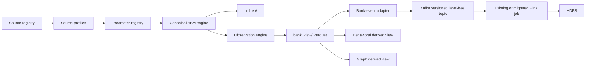

# ABM-BANK repository audit

Status: Phase 0 complete; generator implementation is intentionally blocked pending model review

Audit date: 2026-08-07

Repository commit: `e6370b2` (`develop`)
Scope: Level-1 commercial-bank Bank View and physically separate simulator truth

## Executive finding

P-022 has three data worlds that must not be conflated:

1. `scripts/seed_data.py` creates a deterministic UI/demo fixture in PostgreSQL. It is not an evidence-driven training dataset.
2. `scripts/abm_generate.py` creates one small Financial City case (`VN-CA-03`) with useful observation/hidden-state separation. It is not the canonical multi-customer ABM-BANK release generator.
3. `src/aml/` plus `flink/aml-ingestion/` implements the live IBM-shaped CSV -> Kafka -> Flink -> HDFS path. Its raw contract includes `is_laundering`, so it cannot be used directly as ABM-BANK Bank View.

The repository already has valuable contracts, deterministic-ID patterns, Kafka/HDFS infrastructure, and database permission isolation. The new ABM should reuse those controls, but it needs its own evidence/parameter pipeline and release exporter. No simulator has been implemented in this phase.

## 1. What already exists

### Contracts

`contracts/` is documented as the single source of truth. Existing relevant contracts are:

| Contract | Current role | ABM decision |
|---|---|---|
| `contracts/common/common.v1.schema.json` | Shared timestamp, money, source-reference, provenance, entity-reference, channel, and classification types | Reuse |
| `contracts/canonical/customer.v1.schema.json` | Target GOLD customer, not implemented | Preserve; v2 proposal adds required lifecycle metadata and separate business reference |
| `contracts/canonical/account.v1.schema.json` | Target GOLD account, not implemented | Preserve; v2 proposal adds required ownership, opening balance, and lifecycle metadata |
| `contracts/canonical/relationship.v1.schema.json` | Provenance-aware graph edge, not implemented | Preserve; v2 proposal adds `created_at` and ABM-BANK edge vocabulary |
| `contracts/events/bank.transaction.posted.v1.schema.json` | Label-free target transaction event | Canonical Kafka adapter target |
| `contracts/events/bank.customer.changed.v1.schema.json` | Target bitemporal customer-change event | Later population/event adapter target |
| `contracts/events/bank.device.session.v1.schema.json` | Tokenized device/session event | Reuse for session observations |
| `contracts/events/envelope.v1.schema.json` | CloudEvents 1.0 envelope | Reuse without changing v1 |
| `contracts/ingestion/aml-transaction-v1.schema.json` | Live IBM CSV replay topic contract | Legacy/raw adapter only; never Bank View |

The Phase-1 proposal adds the following versioned contracts under the repository-native `contracts/canonical/` path:

- `customer.v2.schema.json`
- `business.v1.schema.json`
- `account.v2.schema.json`
- `transaction.v1.schema.json`
- `device.v1.schema.json`
- `merchant.v1.schema.json`
- `relationship.v2.schema.json`

The requested `contracts/data/canonical/` path was not created because it would duplicate the existing contract source of truth.

### Existing data generation

#### `scripts/seed_data.py`

Strengths worth reusing:

- local `random.Random(seed)` rather than unseeded global randomness;
- a fixed simulation anchor rather than wall-clock-dependent events;
- deterministic fingerprint tests;
- time-ordered train/validation/test fixture splits;
- primary/foreign-key and no-self-loop checks;
- legitimate profile-mismatch cases and watchlist near misses.

Why it is not ABM-BANK:

- customer proportions, turnover, transaction counts, channels, countries, and scenario amounts are hard-coded in Python;
- background traffic uses independent uniform/Gaussian draws;
- it labels planted transactions directly;
- its PostgreSQL table model is UI-oriented and narrower than the canonical release model;
- its own module documentation correctly says it is a demo fixture, not an evaluation dataset.

#### `scripts/abm_generate.py`

Strengths worth reusing:

- explicit `simulation_id`, seed, generator version, schema version, and parameter-set ID;
- separate `fc` observable schema and `fc_gt` hidden-ground-truth schema;
- observation events with role, `available_from`, acquisition type, confidence, and model visibility;
- hard negatives;
- invariant checks against investigation-only evidence entering a bank case;
- a single scenario with causal hidden and observable timelines.

Why it is not ABM-BANK:

- one small 45-day case, not a 5,000-10,000 customer banking world;
- source cards and parameters are Python constants rather than versioned registries;
- it writes directly to UI/runtime PostgreSQL tables rather than Parquet release artifacts;
- it mixes UI demo metrics, alerts, agent runs, crypto records, and simulated data-quality rows into the generator;
- it does not model normal population and normal behavior before scenario injection;
- it has no reusable profiling or statistical harmonization layer;
- it does not produce the required manifest, checksums, or behavioral/graph release reports.

### PostgreSQL

`db/init/001_schema.sql` contains operational/demo tables:

- `customer(customer_id)`;
- `account(account_key)` where the ID is `<bank_code>:<account_number>`;
- `transaction(transaction_id BIGSERIAL)`;
- physically separate `label.*` tables;
- alerts, cases, evidence, approvals, and immutable audit data.

`db/init/005_financial_city.sql` contains:

- `fc.simulation_run` and `fc.source_registry`;
- observable entities, relationships, observations, and quality/benchmark tables;
- separate `fc_gt.case_ground_truth`, `fc_gt.hidden_role`, `fc_gt.first_observable_signal`, and `fc_gt.hidden_gambling_ledger`.

`db/init/003_agent_readonly_role.sh` exposes only selected operational fields through the `agent` schema. This is a useful defense-in-depth pattern, but the release generator must also enforce physical directory and import boundaries outside PostgreSQL.

### Kafka -> Flink -> HDFS

The live ingestion route is:

```text
IBM-format CSV
  -> Python producer (`python -m src.aml`)
  -> Kafka `aml.transactions.raw.v1`
  -> Flink `FIN-07 AML ingestion (kafka -> hdfs)`
  -> HDFS bronze/rejected
```

Relevant defaults:

| Item | Current value |
|---|---|
| Raw topic | `aml.transactions.raw.v1` |
| DLQ topic | `aml.transactions.dlq.v1` |
| Partitions / replication | 3 / 1 in local development |
| Kafka key | `from_bank:from_account` |
| Consumer group | `aml-hdfs-ingestion-v1` |
| Offset fallback | `earliest` |
| HDFS base | `hdfs://namenode:8020/data/aml` |
| Valid format | Parquet by default; JSON optional |
| Valid partitioning | `bronze/transactions/source_dataset=<...>/event_date=<UTC>/event_hour=<UTC>` |
| Rejected partitioning | `rejected/transactions/event_date=<processing UTC>/error_type=<...>` |
| Checkpoints | `/data/aml/_checkpoints` |

The producer is at-least-once across process restarts; deterministic transaction IDs make duplicates detectable. Flink does not deduplicate bronze records. ABM release validation must therefore treat `transaction_id` as the idempotency key and must not assume bronze uniqueness.

### Tests and fixtures

Relevant existing controls:

- every JSON Schema and example is validated in `tests/test_contracts/`;
- Python and Java independently validate the live ingestion shape;
- deterministic seed fixtures are tested;
- agent-role isolation is tested at the database layer;
- the IBM-format smoke fixture has 200 valid and four malformed rows;
- Java tests cover parsing, validation, partition paths, split routing, and sink construction.

Known test gap: no test proves that the Python/JSON live ingestion contract and Java parser field set remain identical after a change.

### Features, graph, notebooks, and data

- `services/feature-platform/` is a placeholder; no behavioral feature implementation exists.
- `src/agents/graph.py` is a LangGraph orchestration stub, not financial graph analytics.
- graph UI code is visualization-only.
- there are no project notebooks implementing an ABM or source profiler.
- no Parquet release artifacts are tracked.
- `data/raw/ibm-aml/` contains only placement instructions and `.gitkeep`; large raw data is ignored.

## 2. Existing schema and ID compatibility

| Layer | Customer/account/transaction IDs | Compatibility consequence |
|---|---|---|
| Runtime PostgreSQL | `CUS-*`; account `<bank>:<number>`; transaction `BIGSERIAL` | Adapter required; runtime keys are not canonical ABM IDs |
| Existing canonical contracts | arbitrary stable strings up to 128 chars | New prefixed IDs fit |
| Existing bank event | canonical `transaction_id`, party `account_ref` | Direct semantic target for ABM event adapter |
| Live IBM ingestion | deterministic 32-hex transaction ID, raw bank/account strings | Versioned adapter or new topic required |
| Financial City | `SIM-*`, `ENT-*`, `REL-*`-style strings | Useful demo conventions, not the release schema |

Proposed ABM prefixes are `CUS-`, `BUS-`, `ACC-`, `TXN-`, `EVT-`, `DEV-`, `SES-`, `MER-`, `REL-`, and `CPY-`. IDs must be deterministic functions of dataset version, seed namespace, and stable agent/event sequence; raw account numbers and device identifiers must not be emitted.

## 3. Kafka envelope compatibility

`envelope.v1` already supplies:

- `id` as event ID;
- `type` with version suffix;
- `source`;
- emitted `time` distinct from business event time;
- `dataschema`;
- optional subject, idempotency key, source offset, partition key, trace, and data class.

ABM metadata should be carried as source/idempotency context or in a future compatible event field only after contract review. Adding `simulation_run_id` or `dataset_version` as required payload fields to `bank.transaction.posted.v1` would be breaking and must create v2. The Parquet canonical transaction retains its own `event_id`; the v1 event adapter can map that value to envelope `id` without modifying the payload.

## 4. What can be reused

- shared money, time, provenance, source-reference, and channel definitions;
- label-free `bank.transaction.posted.v1` semantics;
- tokenized session/device semantics;
- CloudEvents envelope and deterministic idempotency conventions;
- local Kafka/Flink/HDFS deployment and smoke-test scripts;
- HDFS UTC date/hour partitioning;
- physical database role isolation patterns;
- deterministic RNG/fingerprint testing approach;
- Financial City observation-event concepts;
- contract validation tests and strict `additionalProperties: false` convention.

## 5. Components that are missing

- source profiler and immutable source-profile metadata;
- external Parameter Registry with provenance and assumption cards;
- harmonized conditional population model;
- normal population/account/device/merchant generator;
- stateful legitimate behavior engine with ledger invariants;
- configurable hard-negative library;
- scenario module interface and three-to-five reviewed scenarios;
- physical `hidden/` vs `bank_view/` file separation;
- central non-binary ground-truth label tables;
- configurable observation engine;
- Parquet streaming exporter, manifest, checksums, and reports;
- statistical, graph, behavioral, and leakage validators;
- entity/network/time-safe split assignments;
- ABM-to-bank-event adapter and end-to-end integration proof.

## 6. Material conflicts requiring review

1. The live raw ingestion schema requires `is_laundering`. Bank View is forbidden from containing it. The ABM must publish a new label-free event route or a reviewed adapter/topic version; it must not fill the field with truth or a dummy label.
2. Existing canonical customer, account, and relationship v1 records do not require `created_at`. The Phase-1 proposal uses v2 rather than a breaking v1 edit.
3. Existing `customer.v1` treats SME/CORPORATE/FI as customer types, while the requested ontology requires a distinct BUSINESS entity. The proposal keeps the bank-customer relationship and points business customers to `business_id`.
4. Runtime PostgreSQL assumes one customer per account and integer transaction IDs. Canonical Bank View supports joint owners and stable string IDs. PostgreSQL is therefore a downstream demo projection, not the canonical store.
5. Existing README describes `scripts/abm_generate.py` as a running ABM. That description is accurate for a demo case but must not be interpreted as the canonical ABM-BANK generator.

No generator should be implemented until these five decisions are accepted.

## 7. Proposed integration points



Repository-native locations proposed for later phases:

- `abm/profiling/` for source profilers;
- `abm/parameters/` for parameter cards;
- `abm/harmonization/` for conditional synthesis;
- `abm/generators/`, `abm/scenarios/`, and `abm/observation/` for simulation;
- `abm/validation/`, `abm/exporters/`, and `abm/adapters/` for release/integration;
- `tests/abm/` for deterministic tiny-run gates;
- ignored `artifacts/ABM-BANK-v*/` for generated releases.

## 8. Audit conclusion

The repository is ready for a canonical ABM upstream project, but not ready to generate the requested MVP dataset safely. Phase 0 passes as an inventory. Phase 1 is a review gate because of the live label-bearing ingestion contract and canonical schema version conflicts. Phase 2 supplies an evidence register, but no numeric simulator parameter may be derived until sources are downloaded/profiled with versions and checksums.
