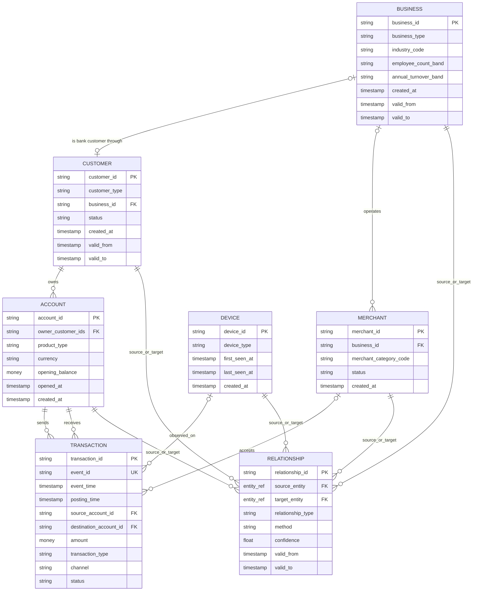

# ABM-BANK canonical data model

Status: proposed for review; no generator consumes this model yet

Model version: 0.1.0

Contract location: `contracts/canonical/`

## Design decision

ABM-BANK uses one canonical, label-free Bank View for both behavioral and graph work. Ground truth will be emitted to a physically separate release subtree in a later phase. The canonical model is not the operational PostgreSQL schema and is not the IBM raw-ingestion schema.

The minimum MVP entities are:

- CUSTOMER: the relationship between a party and the simulated bank;
- BUSINESS: a legal or household-business party when business detail is needed;
- ACCOUNT: an internal bank account and its owners;
- TRANSACTION: a posted/pending/reversed value movement with observable endpoints;
- DEVICE: a bank-tokenized device identity;
- MERCHANT: an acceptance entity referenced by purchases;
- RELATIONSHIP: a time-aware, provenance-aware observable graph edge.

Sessions are event records under `bank.device.session.v1`, not canonical master entities. External beneficiaries/counterparties are stable `CPY-*` tokens in transactions and may become graph nodes without pretending the bank knows a full customer identity.

## Entity relationship diagram



## Entity decisions

| Candidate | MVP decision | Reason |
|---|---|---|
| Customer | Entity | Required for KYC/profile and behavioral peer groups |
| Business | Entity | Required to keep legal entity attributes separate from the bank-customer relationship |
| Account | Entity | Required for balances, ownership, behavior, and flow graph |
| Transaction | Event/entity | Required for temporal behavior and account-account edges |
| Device | Entity | Required for shared-device graph and digital-channel behavior |
| Session | Event only | High-volume authentication activity already has a versioned event contract |
| Beneficiary | Token/reference | The bank may know only a payee token; do not create a false full identity |
| Merchant | Entity | Required for merchant purchases, recurring behavior, and legitimate high-volume hard negatives |
| Channel | Enum | No independent lifecycle or graph identity in MVP |
| Branch | Attribute | Branch code on account/transaction is enough for Level 1 MVP |
| Address/location | Coarse attributes and relationship | Exact addresses increase PII and false entity linkage; coarse region plus `SHARED_ADDRESS` suffices |
| Employment | Relationship | `EMPLOYED_BY` edge with validity interval |
| Ownership | Relationship | `OWNS_ACCOUNT`, `OWNS_BUSINESS`, and `BENEFICIAL_OWNER` edges |
| Relationship | Entity/edge | Required for graph lineage, confidence, and temporal validity |
| Card | Deferred | Purchases can be represented without a card master in MVP |
| Loan | Product type and behavior | Separate loan master is unnecessary for the first behavior set |

## Contract summary

### CUSTOMER v2

`customer_id` is the stable bank-customer ID. Individuals carry only analysis-safe bands/codes. SME, corporate, and FI customers must reference a separate `business_id`. Customer risk rating is an observable bank value at a point in time, never simulator truth.

### BUSINESS v1

BUSINESS describes legal form, industry, size, turnover band, region, and lifecycle. It does not contain `hidden_owner_id`, true controller, shell/criminal truth, or scenario membership. Observable ownership belongs in RELATIONSHIP; simulator-only ownership will live under hidden ground truth.

### ACCOUNT v2

ACCOUNT supports multiple owners and includes an opening balance in the account currency. The release validator must enforce:

```text
closing balance = opening balance + posted credits - posted debits - fees
```

Closing balances can be derived into a quality report or a later balance-snapshot table; they do not need to be duplicated in the account master.

### TRANSACTION v1

A transaction has exactly one source endpoint and one destination endpoint. Each endpoint is either:

- an internal `ACC-*` account; or
- a stable tokenized external `CPY-*` reference.

This represents transfers, cash operations, merchant purchases, fees, and reversals without inventing external customer identity. Money uses the existing exact-decimal object `{amount, currency}`. Transaction data contains no label, score, alert outcome, role, network, or scenario field.

### DEVICE v1 and session events

DEVICE is a tokenized master with type and observation interval. A device-to-customer/account relationship is never assumed merely because a generated world has a true operator. Bank-observable use comes from session events and `USES_DEVICE` relationships. Shared IP alone must remain a lower-confidence relationship because of NAT.

### MERCHANT v1

MERCHANT provides MCC, status, coarse location, acquirer code, and an optional observable BUSINESS link. It enables both normal recurring purchases and hard negatives such as legitimate high-volume sellers.

### RELATIONSHIP v2

Every edge has validity, creation time, method, confidence, and provenance. A probabilistic edge requires `inference_logic`; only deterministic or analyst-confirmed edges may be facts. The allowed vocabulary contains only bank-observable relationships. `TRUE_COORDINATION`, criminal network membership, hidden control, and scenario roles are forbidden.

The existing common v1 `entity_type` vocabulary represents BUSINESS endpoints as `LEGAL_ENTITY`. Adding a distinct `BUSINESS` enum value would be a compatible widening but is left for contract-owner review so this phase does not silently change a shared type used by every contract.

## Common requirements

Every canonical record has:

- a stable prefixed canonical ID;
- an explicit `schema_version`;
- a deterministic `created_at` within the simulated/release clock;
- `valid_from` and optional `valid_to` for master data;
- source references or provenance where applicable;
- strict `additionalProperties: false` validation.

Timestamps use RFC 3339 with timezone. Money uses exact decimal strings. Public-source row IDs must never be repurposed as canonical person IDs.

## Hidden State boundary

The following names, and semantic aliases of them, are forbidden from all Bank View schemas and feature-visible paths:

```text
is_criminal
is_launderer
is_laundering
true_mule_role
true_role
criminal_network_id
scenario_id
scenario_instance_id
scenario_ground_truth
true_controller_id
hidden_owner_id
hidden_intent
future_case_status
future_alert_outcome
```

Future release structure:

```text
ABM-BANK-v0.1.0/
  bank_view/          # these canonical contracts only
  ground_truth/       # label tables, no Bank View import dependency
  hidden/             # simulator internals, access-controlled
  reports/
  manifest.json
```

Ground truth must refer to Bank View IDs, not the reverse. The Bank View package may be copied or mounted without the `hidden/` subtree and remain fully usable for both ML tracks.

## Behavioral suitability

The proposed Bank View can derive point-in-time:

- transaction count and amount windows;
- credit/debit and balance-turnover measures;
- unique counterparties and new-beneficiary rate;
- hour/day/weekend behavior;
- rapid inbound-to-outbound movement;
- channel, merchant, device, and transaction-type mix;
- peer-group deviations from observable customer/business attributes.

No future alert/case outcome is required.

## Graph suitability

The Bank View can construct:

- CUSTOMER -> ACCOUNT ownership edges;
- ACCOUNT -> ACCOUNT internal money flows;
- ACCOUNT -> external CPY token flows;
- CUSTOMER/ACCOUNT -> DEVICE observed-use edges;
- CUSTOMER -> BUSINESS employment/ownership edges;
- BUSINESS -> MERCHANT operator edges;
- temporal shared-device/address/contact edges with confidence and provenance.

Graph construction must use `event_time`, `valid_from`, `valid_to`, and `provenance.known_from`; it must never require hidden network IDs.

## Event-contract mapping

| Canonical transaction | `bank.transaction.posted.v1` |
|---|---|
| `event_id` | CloudEvents envelope `id` |
| `transaction_id` | payload `transaction_id` |
| `event_time` | payload `event_time` |
| `posting_time` | payload `posting_time` |
| source endpoint | payload `debtor` |
| destination endpoint | payload `creditor` |
| `amount` | payload `amount` |
| `transaction_type` | payload `transaction_type` |
| `channel` | payload `channel` |
| `merchant_id` | payload `merchant.merchant_id` |
| `session_id` | payload `session_ref` |
| `status` | payload `posting_status` |

For the current live `aml.transactions.raw.v1` topic there is no safe direct mapping because its contract requires `is_laundering`. A reviewed label-free topic/job migration is required in Phase 19; the Bank View must not synthesize a placeholder ground-truth field merely to pass the old validator.

## Review questions

1. Approve CUSTOMER as the bank relationship and BUSINESS as a separate legal entity, or require a single PARTY supertype?
2. Approve canonical `ACC-*` IDs with raw bank/account numbers retained only in protected source references?
3. Approve external `CPY-*` nodes without full entity profiles for Level-1 boundaries?
4. Should merchant settlement accounts be ordinary ACCOUNT records or a distinct account product subtype only?
5. Approve v2 customer/account/relationship contracts rather than changing v1 in place?
6. Approve a new label-free Kafka route instead of adapting Bank View into the label-bearing IBM raw topic?

Until these decisions are accepted, the model remains proposed and generator work is stopped.
