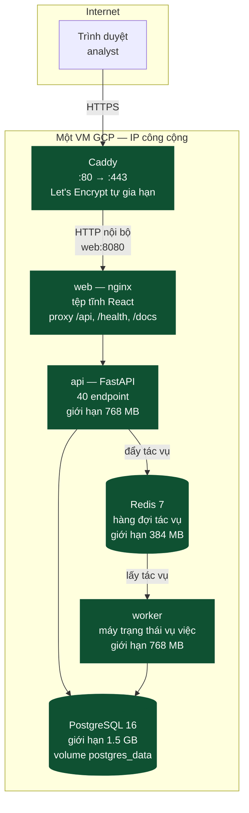
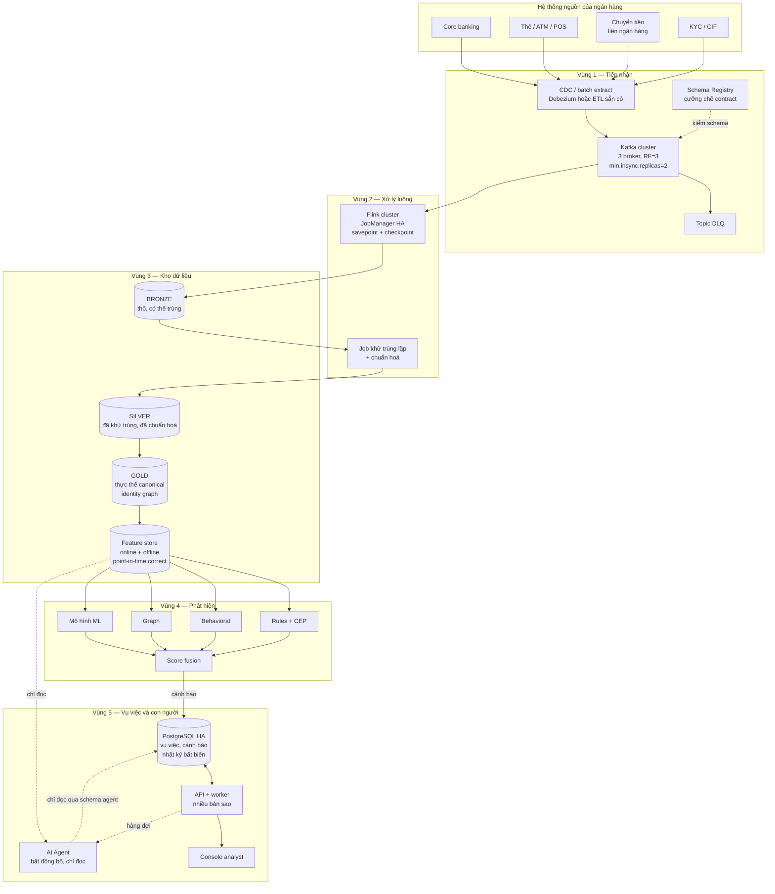
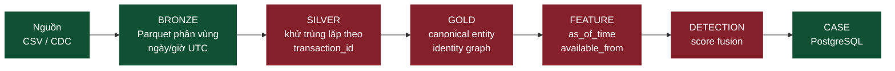
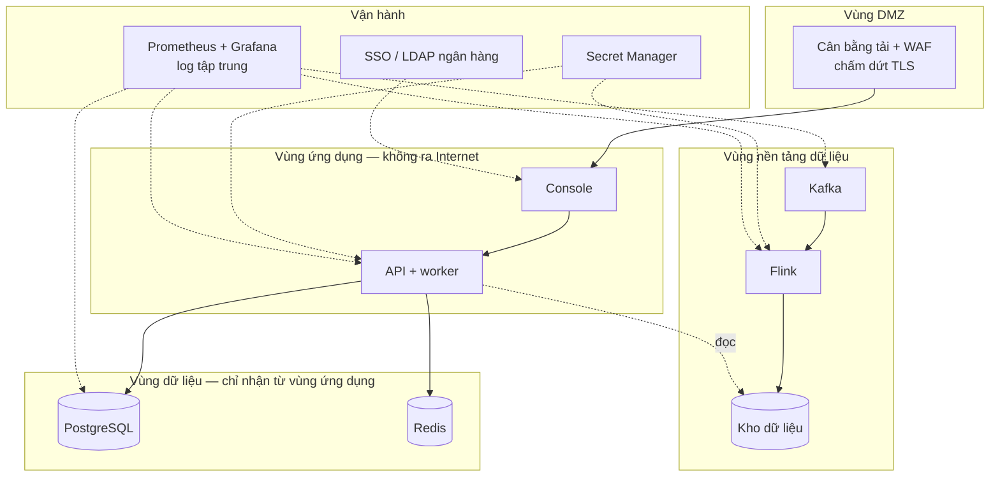
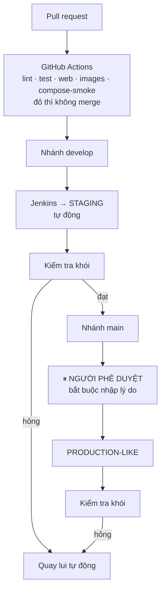

# Kiến trúc production — FIN-07 AML Level 1

Tài liệu này trả lời một câu hỏi: *hệ thống đang chạy trên máy cá nhân, vậy khi đưa vào vận hành
thật ở một ngân hàng thì nó trông như thế nào.*

Cơ sở: *Kiến trúc chi tiết nền tảng AML Level 1 cho ngân hàng* (v1.0, 05/08/2026), mục 4 (sáu mặt
phẳng), mục 6.1 (vùng dữ liệu), mục 16 (lộ trình).

---

## 0. Đọc bảng này trước

Tài liệu có hai loại nội dung, và trộn lẫn chúng là cách nhanh nhất để một bản thiết kế trở thành
lời nói dối. Mọi mục dưới đây đều được gắn nhãn:

| Nhãn | Nghĩa |
|---|---|
| **ĐANG CHẠY** | Có mã nguồn trong repo, chạy được, có thể kiểm chứng bằng lệnh |
| **ĐỀ XUẤT** | Thiết kế đích. Chưa có mã. Đưa vào đây để quyết định sớm, không phải để báo cáo tiến độ |

Ba mức triển khai, đừng nhầm giữa chúng:

| | Máy cá nhân | Demo công khai | Production ngân hàng |
|---|---|---|---|
| Trạng thái | **ĐANG CHẠY** | **ĐANG CHẠY** — <https://amlmonitoring.site> | **ĐỀ XUẤT** |
| Hạ tầng | Docker Desktop | Một VM GCP | Cụm nhiều node trong vùng mạng ngân hàng |
| Dựng bằng | `docker compose up` | `bash deploy/vm-deploy.sh` | Chưa có |
| Có đường ống AML? | Có, profile `aml` | **Không** — thiếu RAM | Có, là trục chính |
| Dữ liệu | Tổng hợp + IBM AML công khai | Tổng hợp | Dữ liệu ngân hàng thật |

Điểm dễ hiểu sai nhất: **bản demo đang chạy KHÔNG có Kafka, Flink, HDFS.** Nó chỉ có console, API,
worker, PostgreSQL, Redis. Đường ống nạp dữ liệu nằm trong profile `aml` và cần khoảng 4 GB RAM
riêng, nên không bật cùng.

---

## 1. Hiện trạng — một VM, mọi thứ trên đó

**ĐANG CHẠY.** Định nghĩa ở [`deploy/docker-compose.vm.yml`](../../deploy/docker-compose.vm.yml),
quy trình ở [`docs/operations/DEPLOY_VM.md`](../operations/DEPLOY_VM.md).

Hai điều đáng chú ý về bản này:

**Chỉ Caddy mở cổng ra ngoài.** PostgreSQL và Redis dùng `ports: !override []` để xoá hẳn phần
publish cổng của bản dev. Dấu `!override` là bắt buộc — không có nó, compose *gộp* danh sách cổng
của hai file và 5432 vẫn hở ra Internet.

**Đường ống AML không có mặt.** Muốn bật trên VM này thì cần thêm khoảng 4 GB RAM, và ngay cả khi
bật thì cấu hình một broker / một DataNode cũng không phải cấu hình production — xem mục 4.

### Giới hạn cứng của mô hình một VM

| Vấn đề | Hệ quả |
|---|---|
| Một máy = một điểm chết | Máy chết là toàn hệ thống chết. Không có failover |
| Không có bản sao PostgreSQL | Hỏng đĩa là mất nhật ký kiểm toán — thứ có giá trị pháp lý |
| Không sao lưu, chưa diễn tập khôi phục | Ghi rõ ở `CICD.md` mục 10. Chuyển sang Cloud SQL là bước gỡ điều này — xem [`infra/terraform/`](../../infra/terraform/) |
| Bí mật nằm trong `.env` trên máy | Ai vào được máy là đọc được mật khẩu cơ sở dữ liệu |
| Hạ tầng dưới dạng mã mới một phần | IP tĩnh, tường lửa và Cloud SQL đã có Terraform. **VM thì chưa** — dựng lại máy từ đầu vẫn không tái lập được từ repo |

Đây là những giới hạn **đã biết và được chấp nhận** cho một bản demo. Chúng là lý do phần còn lại
của tài liệu tồn tại.

---

## 2. Kiến trúc production đích — toàn cảnh

**ĐỀ XUẤT.** Sáu mặt phẳng của kiến trúc gốc, ánh xạ vào hạ tầng thật.

Ranh giới quan trọng nhất trong sơ đồ trên là đường nét đứt đi tới **AI Agent**: nó luôn bất đồng
bộ và luôn chỉ đọc. Không có mũi tên nào từ agent quay ngược vào đường quyết định. Đây là nguyên
tắc số 3 của dự án, và ở bản hiện tại nó đã được cưỡng chế bằng quyền PostgreSQL
([`db/init/003_agent_readonly_role.sh`](../../db/init/003_agent_readonly_role.sh)) chứ không phải
bằng quy ước.

---

## 3. Đường dữ liệu — bốn tầng, và tầng nào đã có

Xanh là **ĐANG CHẠY**, đỏ là **CHƯA CÓ**. Nhìn sơ đồ này là thấy ngay hình dạng thật của dự án: hai
đầu đã xong, khúc giữa còn trống.

| Tầng | Trạng thái | Ghi chú |
|---|---|---|
| BRONZE | **ĐANG CHẠY** | Parquet trên HDFS, phân vùng `source_dataset / event_date / event_hour`. **Có thể chứa bản trùng** — Flink không khử trùng lặp |
| SILVER | **CHƯA CÓ** | Đây là nơi phải khử trùng theo `transaction_id`. Vì chưa có, mọi thứ đọc bronze phải tự khử |
| GOLD | **CHƯA CÓ** | Contract đã định nghĩa ở `contracts/canonical/`, chưa có bên hiện thực |
| FEATURE | **CHƯA CÓ** | `services/feature-platform/` mới chỉ có README |
| DETECTION | **CHƯA CÓ** | `services/detection/` mới chỉ có README |
| CASE | **ĐANG CHẠY** | Đọc cảnh báo từ batch LI-Small hoàn tất gần nhất |

Kafka/Flink ingestion và Behaviour batch vẫn là hai đường riêng: gửi CSV vào Kafka không tự tạo
cảnh báo trên console; dữ liệu phải đi qua batch detection trước.

---

## 4. Từng cụm phải đổi gì khi lên production

### 4.1 Kafka

| | Hiện tại | Production |
|---|---|---|
| Số broker | 1 (KRaft, vừa broker vừa controller) | ≥ 3, tách vai trò controller |
| Replication factor | 1 | 3 |
| `min.insync.replicas` | mặc định | 2 — chịu được mất 1 broker mà không mất dữ liệu |
| Schema | validator viết tay ở hai đầu | Schema Registry, cưỡng chế tập trung |
| Bảo mật | PLAINTEXT | mTLS + SASL, ACL theo topic |
| Retention | 7 ngày | Theo quy định lưu trữ của ngân hàng |
| Phân vùng | 3 | Tính theo thông lượng đỉnh, ≥ số slot Flink |

`RF=1` là lựa chọn bắt buộc khi chỉ có một broker, và nó có nghĩa là **mất broker là mất dữ liệu
chưa được Flink đọc**. Không có cách nào lách điều này ngoài việc thêm broker.

Về Schema Registry: hiện contract được cưỡng chế ở **ba** nơi phải sửa đồng thời — `src/aml/schema.py`,
`TransactionJsonParser.java`, `TransactionValidator.java`. Và có một khoảng trống đã biết: **không có
test nào giữ phía Java khớp với contract JSON.** Sửa Java mà quên contract sẽ không làm CI đỏ.
Schema Registry giải quyết đúng lớp lỗi này.

### 4.2 Flink

| | Hiện tại | Production |
|---|---|---|
| JobManager | 1, không HA | HA qua ZooKeeper hoặc Kubernetes |
| State backend | `hashmap` (trong bộ nhớ) | RocksDB — state lớn hơn RAM |
| Checkpoint | 30 giây, lưu trên HDFS | Giữ nhịp, lưu trên object store |
| Dừng job | `flink cancel` | `stop-with-savepoint`, khôi phục từ savepoint |
| Parallelism | 2 | Theo số phân vùng Kafka |
| Metrics | có counter, **không có exporter** | Prometheus reporter |

Điểm đáng sửa sớm nhất là **cách dừng job**. `scripts/aml/cancel_job.sh` gọi `flink cancel`, và lần
nộp lại chỉ dựa vào offset đã commit của consumer group — không truyền đường dẫn savepoint. Với một
job chỉ ghi bronze thì hệ quả còn nhẹ; với một job có state (cửa sổ, tổng hợp) thì đó là mất state.

### 4.3 HDFS → hay object store

| | Hiện tại | Production |
|---|---|---|
| NameNode | 1, không HA | HA: 2 NameNode + 3 JournalNode + ZKFC |
| DataNode | 1 | ≥ 3 |
| Replication | 1 | 3 |
| Quyền | tắt, `/data/aml` để `777` | Bật, Kerberos, ACL theo vùng dữ liệu |
| Mã hoá | không | Mã hoá khi lưu, mã hoá đường truyền |

**Một lựa chọn đáng cân nhắc: bỏ HDFS, dùng object store** (GCS/S3, hoặc MinIO nếu bắt buộc tự vận
hành trong ngân hàng). Lý do: HDFS HA cần vận hành 5–6 tiến trình trạng thái chỉ để không mất
NameNode, còn Flink FileSink ghi ra object store bằng cùng một API. Đổi lại là mất tính cục bộ dữ
liệu — thứ hầu như không còn quan trọng khi mạng đã 10 Gbps.

Nếu đổi, chỉ cần đổi `AML_HDFS_BASE_PATH` từ `hdfs://` sang `s3a://` hoặc `gs://`. Đường ghi đã
tham số hoá sẵn.

### 4.4 PostgreSQL

| | Hiện tại | Production |
|---|---|---|
| Bản thể | 1 container | Managed HA (Cloud SQL / RDS) hoặc Patroni |
| Bản sao | không | ≥ 1 bản sao đồng bộ, failover tự động |
| Sao lưu | không | Sao lưu tự động + PITR + **diễn tập khôi phục định kỳ** |
| Mã hoá | không | Khi lưu và khi truyền |
| Bí mật | `.env` trên máy | Secret Manager / Vault |
| Trigger bất biến | **ĐANG CHẠY** | Giữ nguyên — đây là thứ đã đúng |
| Cách ly vai trò agent | **ĐANG CHẠY** | Giữ nguyên |

Hai dòng cuối quan trọng. [`db/init/002_audit_immutability.sql`](../../db/init/002_audit_immutability.sql)
và [`db/init/003_agent_readonly_role.sh`](../../db/init/003_agent_readonly_role.sh) đã cưỡng chế ở
tầng dữ liệu đúng những gì production cần — chúng **không** phải thứ tạm bợ cho môi trường dev. Lý
do ghi ngay trong file 002: *"Quy ước trong mã nguồn có thể bị vi phạm do sơ suất; ràng buộc ở tầng
dữ liệu thì không."*

Về sao lưu: `audit_log`, `approval`, `evidence` là bằng chứng pháp lý. Chúng cần chế độ lưu trữ và
sao lưu khác với dữ liệu vận hành thông thường, và cần được kiểm chứng là khôi phục được — không
phải chỉ là được sao lưu.

### 4.5 Redis

Hiện là hàng đợi tác vụ, `appendonly yes`. Production: bản sao + Sentinel hoặc managed. Nếu hàng đợi
trở thành đường quan trọng (mất tác vụ = mất một lượt điều tra) thì cân nhắc chuyển sang một hàng
đợi có đảm bảo giao hàng thật, thay vì tăng cấp Redis.

### 4.6 API và worker

Không có trạng thái cục bộ, nên nhân bản ngang được ngay: nhiều bản sao sau một bộ cân bằng tải.
Ba việc phải làm trước:

1. **Di trú lược đồ** — hiện `db/init/*` chỉ chạy khi volume rỗng; `scripts/migrate.py` áp các file
   còn thiếu. Production cần di trú có phiên bản, chạy được khi hệ thống đang phục vụ.
2. **Nhật ký có cấu trúc** — hiện log dạng người đọc. Cần JSON kèm mã tương quan.
3. **Không sinh dữ liệu demo** — deployment chỉ chạy migration; dữ liệu nghiệp vụ được nạp từ
   IBM AML LI-Small bằng quy trình riêng.

---

## 5. Bảo mật và tuân thủ

**ĐỀ XUẤT**, trừ những dòng ghi ĐANG CHẠY.

| Hạng mục | Trạng thái | Ghi chú |
|---|---|---|
| Nhật ký chỉ ghi thêm | **ĐANG CHẠY** | Trigger PostgreSQL, `db/init/002` |
| Cách ly nhãn khỏi agent | **ĐANG CHẠY** | Quyền PostgreSQL, `db/init/003` |
| Mọi khẳng định của agent có bằng chứng | **ĐANG CHẠY** | JSON Schema, `minItems: 1` |
| Phê duyệt của người, ghi một lần | **ĐANG CHẠY** | `db/init/002`, cổng phê duyệt trong `Jenkinsfile` |
| TLS đầu cuối | Một phần | Caddy lo phía ngoài; nội bộ còn HTTP |
| Bí mật ngoài mã nguồn | **CHƯA** | Còn trong `.env` |
| Mã hoá khi lưu | **CHƯA** | |
| Phân vùng mạng | **CHƯA** | Hiện một mạng compose phẳng |
| SSO của ngân hàng | **CHƯA** | Console dùng tài khoản demo |
| Quét lỗ hổng image | **CHƯA** | Ghi ở `CICD.md` mục 10 |
| Che/giả lập PII ở môi trường thấp | **CHƯA** | Hiện dữ liệu đều là tổng hợp nên chưa gặp |

Một điểm thuộc về Level 1 cần nhắc lại: hệ thống vận hành **trong ranh giới dữ liệu của một ngân
hàng**. Không có luồng dữ liệu xuyên biên giới, không phụ thuộc dữ liệu Nhà nước. Điều đó đơn giản
hoá đáng kể phần tuân thủ, và nó là một ràng buộc thiết kế chứ không phải một giai đoạn.

---

## 6. CI/CD lên production

**ĐANG CHẠY** ở mức staging và production-like. Chi tiết:
[`docs/operations/CICD.md`](../operations/CICD.md).

Cổng phê duyệt bắt người duyệt **nhập lý do**, và lý do vào nhật ký build — cùng tinh thần với việc
hệ thống bắt MLRO nêu lý do khi duyệt hồ sơ nghi vấn. Đây là nguyên tắc NT3 áp cho chính quy trình
giao hàng.

Còn thiếu, nói rõ:

- Chưa bật branch protection trên GitHub — chưa bật thì CI đỏ vẫn merge được
- Chưa quét bảo mật image
- **Hạ tầng dưới dạng mã mới một phần** — `infra/terraform/` lo IP tĩnh, tường lửa và Cloud SQL;
  bản thân VM vẫn dựng bằng tay và pipeline chỉ triển khai lên máy *đã tồn tại*
- Chưa có kênh thông báo khi build hỏng
- Chưa kiểm tra tải, chưa diễn tập khôi phục
- **CI không chạy đường ống AML.** Không job nào trong `ci.yml` hay `Jenkinsfile` chạm tới profile
  `aml`. `make aml-smoke` phải chạy tay

---

## 7. Quan sát hệ thống

| Lớp | Hiện tại | Production |
|---|---|---|
| Log | `docker compose logs`, dạng người đọc | Log tập trung, JSON có cấu trúc, mã tương quan |
| Metrics ứng dụng | không | Prometheus + Grafana |
| Metrics Flink | có counter nhóm `aml`, **không exporter** | Prometheus reporter |
| Metrics Kafka | không | JMX exporter: lag consumer, ISR, dung lượng đĩa |
| Truy vết | không | OpenTelemetry, xuyên API → worker → agent |
| Cảnh báo vận hành | không | Lag Kafka, checkpoint Flink thất bại, độ trễ đầu–cuối, tỉ lệ DLQ |
| Healthcheck | **ĐANG CHẠY** | Giữ nguyên, đưa vào giám sát |

Bốn cảnh báo cần có trước tiên, theo thứ tự giá trị: **checkpoint Flink thất bại** (mất checkpoint là
mất tính exactly-once), **lag consumer tăng đơn điệu**, **tỉ lệ DLQ vượt ngưỡng** (dấu hiệu nguồn đổi
định dạng), và **độ trễ từ lúc giao dịch xảy ra tới lúc có cảnh báo**.

---

## 8. Sức chứa — bậc độ lớn

**ĐỀ XUẤT.** Con số để bắt đầu tính, không phải kết quả đo.

Giả định một ngân hàng cỡ trung: 5 triệu giao dịch/ngày, đỉnh gấp 5 lần trung bình.

| Thành phần | Ước lượng |
|---|---|
| Thông lượng trung bình | ~58 giao dịch/giây |
| Thông lượng đỉnh | ~290 giao dịch/giây |
| Kafka | 3 broker, 12 phân vùng, giữ 7 ngày ≈ vài trăm GB |
| Flink | Parallelism 12, khớp số phân vùng |
| BRONZE mỗi ngày | ~1–2 GB Parquet đã nén |
| BRONZE giữ 7 năm | ~5 TB, nhân 3 bản sao |
| PostgreSQL | Vụ việc và cảnh báo, không phải giao dịch thô — chục GB |

Điểm mấu chốt: **PostgreSQL không giữ giao dịch thô.** Giao dịch nằm ở kho dữ liệu; PostgreSQL giữ
vụ việc, cảnh báo, bằng chứng và nhật ký. Nhầm chỗ này là một sai lầm kiến trúc đắt tiền, vì nó biến
cơ sở dữ liệu giao dịch của quy trình nghiệp vụ thành một kho dữ liệu tồi.

---

## 9. Thứ tự làm

Sắp theo giá trị trên một đơn vị công sức, không phải theo tầng kiến trúc.

| # | Việc | Vì sao trước |
|---|---|---|
| 1 | Tầng SILVER — khử trùng lặp theo `transaction_id` | Mọi thứ đọc bronze đều đang phải tự khử. Làm một lần, dùng chung |
| 2 | Detection Engine tối thiểu — vài luật ngưỡng, ghi vào bảng `alert` | Nối được chuỗi CSV → cảnh báo trên console. Lần đầu tiên hệ thống làm đúng thứ tên nó nói |
| 3 | Prometheus + Grafana | Không đo thì mọi tối ưu về sau là đoán |
| 4 | Sao lưu PostgreSQL + diễn tập khôi phục | Rủi ro mất dữ liệu pháp lý là rủi ro lớn nhất đang mở |
| 5 | Bí mật ra khỏi `.env` | Điều kiện cần trước khi chạm dữ liệu thật |
| 6 | Kafka 3 broker, RF=3 | Bỏ điểm mất dữ liệu ở tầng nạp |
| 7 | Schema Registry | Đóng khoảng trống Java ↔ contract |
| 8 | `stop-with-savepoint` | Trước khi job Flink có state thật |
| 9 | Feature platform, point-in-time correct | Điều kiện cần của mọi mô hình ML nói thật |
| 10 | Hạ tầng dưới dạng mã | Khi cấu hình đã ổn định, không phải trước |

Bước 1 và 2 đáng làm trước tất cả: chúng biến hai nửa rời rạc thành một hệ thống chạy đầu–cuối.
Sau đó mọi thứ khác là gia cố một thứ đã hoạt động, thay vì xây thêm một nửa nữa.

---

## 10. Tài liệu liên quan

| Tài liệu | Nội dung |
|---|---|
| [`docs/operations/DEPLOY_VM.md`](../operations/DEPLOY_VM.md) | Quy trình triển khai bản demo hiện tại |
| [`docs/operations/CICD.md`](../operations/CICD.md) | Cổng chặn merge, ba môi trường, quay lui |
| [`docs/operations/RUNBOOK.md`](../operations/RUNBOOK.md) | Dựng và vận hành trên máy cá nhân |
| [`contracts/ingestion/README.md`](../../contracts/ingestion/README.md) | Topology thật của Kafka–Flink–HDFS, contract, ngữ nghĩa giao hàng, bẫy khi chạy ở local |
| [`services/README.md`](../../services/README.md) | Sáu mặt phẳng và chỗ đặt code |
