# Kiến trúc — FIN-07

Tài liệu kiến trúc của FIN-07 AML Operations Console. Bốn phần, đọc theo thứ tự:

| Phần | Trả lời câu hỏi |
|---|---|
| [Kiến trúc production — FIN-07 AML Level 1](#kiến-trúc-production-fin-07-aml-level-1) | Hệ thống nên trông thế nào khi vận hành thật, và hiện còn thiếu gì |
| [FIN-07 · Sơ đồ triển khai Production](#fin-07-sơ-đồ-triển-khai-production) | Cái gì **đang thực sự chạy** trên VM GCP, số liệu thật, giới hạn thật |
| [Kiến trúc FIN-07 vẽ lại theo đúng những gì dữ liệu có](#kiến-trúc-fin-07-vẽ-lại-theo-đúng-những-gì-dữ-liệu-có) | Vì sao sơ đồ bị vẽ lại sau khi đối chiếu với cột dữ liệu có thật |
| [Kiến trúc hướng B — MEGA-PNA làm một nhánh, không thay cả hệ](#kiến-trúc-hướng-b-mega-pna-làm-một-nhánh-không-thay-cả-hệ) | Vì sao MEGA-PNA vào hệ như một nhánh phát hiện, không thay cả kiến trúc |

Sơ đồ tổng quan dạng ảnh: [`architecture.svg`](architecture.svg).

Tài liệu liên quan: [đặc tả hệ thống](../specification/system-specification.md) ·
[thiết kế kỹ thuật](../specification/technical-design.md) ·
[mô hình dữ liệu](../specification/data-model.md) ·
[vận hành](../operations/README.md) · [quan trắc](../observability/README.md).

## Kiến trúc production — FIN-07 AML Level 1

Tài liệu này trả lời một câu hỏi: *hệ thống đang chạy trên máy cá nhân, vậy khi đưa vào vận hành
thật ở một ngân hàng thì nó trông như thế nào.*

Cơ sở: *Kiến trúc chi tiết nền tảng AML Level 1 cho ngân hàng* (v1.0, 05/08/2026), mục 4 (sáu mặt
phẳng), mục 6.1 (vùng dữ liệu), mục 16 (lộ trình).

---

### 0. Đọc bảng này trước

Tài liệu có hai loại nội dung, và trộn lẫn chúng là cách nhanh nhất để một bản thiết kế trở thành
lời nói dối. Mọi mục dưới đây đều được gắn nhãn:

| Nhãn | Nghĩa |
|---|---|
| **ĐANG CHẠY** | Có mã nguồn trong repo, chạy được, có thể kiểm chứng bằng lệnh |
| **ĐỀ XUẤT** | Thiết kế đích. Chưa có mã. Đưa vào đây để quyết định sớm, không phải để báo cáo tiến độ |

Ba mức triển khai, đừng nhầm giữa chúng:

| | Máy cá nhân | Demo công khai | Production ngân hàng |
|---|---|---|---|
| Trạng thái | **ĐANG CHẠY** | **ĐANG CHẠY** — <https://amlmonitoring.site> | **ĐỀ XUẤT** |
| Hạ tầng | Docker Desktop | Một VM GCP | Cụm nhiều node trong vùng mạng ngân hàng |
| Dựng bằng | `docker compose up` | `bash deploy/vm-deploy.sh` | Chưa có |
| Có đường ống AML? | Có, profile `aml` | **Không** — thiếu RAM | Có, là trục chính |
| Dữ liệu | Tổng hợp + IBM AML công khai | Tổng hợp | Dữ liệu ngân hàng thật |

Điểm dễ hiểu sai nhất: **bản demo đang chạy KHÔNG có Kafka, Flink, HDFS.** Nó chỉ có console, API,
worker, PostgreSQL, Redis. Đường ống nạp dữ liệu nằm trong profile `aml` và cần khoảng 4 GB RAM
riêng, nên không bật cùng.

---

### 1. Hiện trạng — một VM, mọi thứ trên đó

**ĐANG CHẠY.** Định nghĩa ở [`deploy/docker-compose.vm.yml`](../../deploy/docker-compose.vm.yml),
quy trình ở [Triển khai lên VM GCP — https://amlmonitoring.site/](../operations/README.md#triển-khai-lên-vm-gcp-httpsamlmonitoringsite).

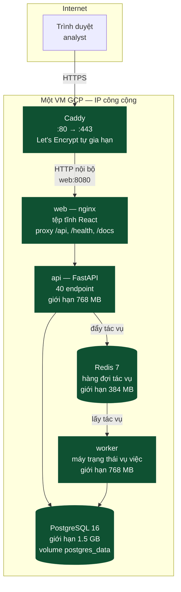

Hai điều đáng chú ý về bản này:

**Chỉ Caddy mở cổng ra ngoài.** PostgreSQL và Redis dùng `ports: !override []` để xoá hẳn phần
publish cổng của bản dev. Dấu `!override` là bắt buộc — không có nó, compose *gộp* danh sách cổng
của hai file và 5432 vẫn hở ra Internet.

**Đường ống AML không có mặt.** Muốn bật trên VM này thì cần thêm khoảng 4 GB RAM, và ngay cả khi
bật thì cấu hình một broker / một DataNode cũng không phải cấu hình production — xem mục 4.

#### Giới hạn cứng của mô hình một VM

| Vấn đề | Hệ quả |
|---|---|
| Một máy = một điểm chết | Máy chết là toàn hệ thống chết. Không có failover |
| Không có bản sao PostgreSQL | Hỏng đĩa là mất nhật ký kiểm toán — thứ có giá trị pháp lý |
| Không sao lưu, chưa diễn tập khôi phục | Ghi rõ ở [CI/CD](../operations/README.md#cicd-cổng-chặn-merge-và-pipeline-giao-hàng) mục 10. Chuyển sang Cloud SQL là bước gỡ điều này — xem [`infra/terraform/`](../../infra/terraform/) |
| Bí mật nằm trong `.env` trên máy | Ai vào được máy là đọc được mật khẩu cơ sở dữ liệu |
| Hạ tầng dưới dạng mã mới một phần | IP tĩnh, tường lửa và Cloud SQL đã có Terraform. **VM thì chưa** — dựng lại máy từ đầu vẫn không tái lập được từ repo |

Đây là những giới hạn **đã biết và được chấp nhận** cho một bản demo. Chúng là lý do phần còn lại
của tài liệu tồn tại.

---

### 2. Kiến trúc production đích — toàn cảnh

**ĐỀ XUẤT.** Sáu mặt phẳng của kiến trúc gốc, ánh xạ vào hạ tầng thật.

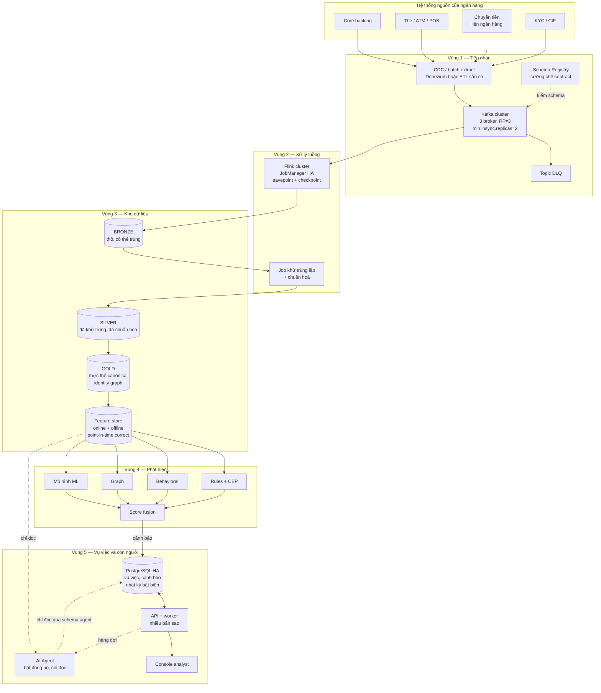

Ranh giới quan trọng nhất trong sơ đồ trên là đường nét đứt đi tới **AI Agent**: nó luôn bất đồng
bộ và luôn chỉ đọc. Không có mũi tên nào từ agent quay ngược vào đường quyết định. Đây là nguyên
tắc số 3 của dự án, và ở bản hiện tại nó đã được cưỡng chế bằng quyền PostgreSQL
([`db/init/003_agent_readonly_role.sh`](../../db/init/003_agent_readonly_role.sh)) chứ không phải
bằng quy ước.

---

### 3. Đường dữ liệu — bốn tầng, và tầng nào đã có

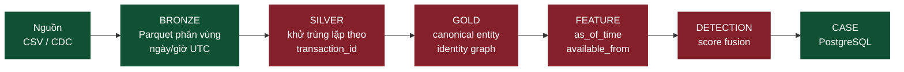

Xanh là **ĐANG CHẠY**, đỏ là **CHƯA CÓ**. Nhìn sơ đồ này là thấy ngay hình dạng thật của dự án: hai
đầu đã xong, khúc giữa còn trống.

| Tầng | Trạng thái | Ghi chú |
|---|---|---|
| BRONZE | **ĐANG CHẠY** | Parquet trên HDFS, phân vùng `source_dataset / event_date / event_hour`. **Có thể chứa bản trùng** — Flink không khử trùng lặp |
| SILVER | **CHƯA CÓ** | Đây là nơi phải khử trùng theo `transaction_id`. Vì chưa có, mọi thứ đọc bronze phải tự khử |
| GOLD | **CHƯA CÓ** | Contract đã định nghĩa ở `contracts/canonical/`, chưa có bên hiện thực |
| FEATURE | **CHƯA CÓ** | Chưa có bên hiện thực; đặc trưng hiện tính theo lô qua `scripts/` |
| DETECTION | **CHƯA CÓ** | Chưa có runtime dạng dịch vụ; phát hiện chạy theo lô qua `scripts/` |
| CASE | **ĐANG CHẠY** | Đọc cảnh báo từ batch IBM AML hoàn tất gần nhất (hiện là HI-Medium) |

Kafka/Flink ingestion và Behaviour batch vẫn là hai đường riêng: gửi CSV vào Kafka không tự tạo
cảnh báo trên console; dữ liệu phải đi qua batch detection trước.

---

### 4. Từng cụm phải đổi gì khi lên production

#### 4.1 Kafka

| | Hiện tại | Production |
|---|---|---|
| Số broker | 1 (KRaft, vừa broker vừa controller) | ≥ 3, tách vai trò controller |
| Replication factor | 1 | 3 |
| `min.insync.replicas` | mặc định | 2 — chịu được mất 1 broker mà không mất dữ liệu |
| Schema | validator viết tay ở hai đầu | Schema Registry, cưỡng chế tập trung |
| Bảo mật | PLAINTEXT | mTLS + SASL, ACL theo topic |
| Retention | 7 ngày | Theo quy định lưu trữ của ngân hàng |
| Phân vùng | 3 | Tính theo thông lượng đỉnh, ≥ số slot Flink |

`RF=1` là lựa chọn bắt buộc khi chỉ có một broker, và nó có nghĩa là **mất broker là mất dữ liệu
chưa được Flink đọc**. Không có cách nào lách điều này ngoài việc thêm broker.

Về Schema Registry: hiện contract được cưỡng chế ở **ba** nơi phải sửa đồng thời — `src/aml/schema.py`,
`TransactionJsonParser.java`, `TransactionValidator.java`. Và có một khoảng trống đã biết: **không có
test nào giữ phía Java khớp với contract JSON.** Sửa Java mà quên contract sẽ không làm CI đỏ.
Schema Registry giải quyết đúng lớp lỗi này.

#### 4.2 Flink

| | Hiện tại | Production |
|---|---|---|
| JobManager | 1, không HA | HA qua ZooKeeper hoặc Kubernetes |
| State backend | `hashmap` (trong bộ nhớ) | RocksDB — state lớn hơn RAM |
| Checkpoint | 30 giây, lưu trên HDFS | Giữ nhịp, lưu trên object store |
| Dừng job | `flink cancel` | `stop-with-savepoint`, khôi phục từ savepoint |
| Parallelism | 2 | Theo số phân vùng Kafka |
| Metrics | có counter, **không có exporter** | Prometheus reporter |

Điểm đáng sửa sớm nhất là **cách dừng job**. `scripts/aml/cancel_job.sh` gọi `flink cancel`, và lần
nộp lại chỉ dựa vào offset đã commit của consumer group — không truyền đường dẫn savepoint. Với một
job chỉ ghi bronze thì hệ quả còn nhẹ; với một job có state (cửa sổ, tổng hợp) thì đó là mất state.

#### 4.3 HDFS → hay object store

| | Hiện tại | Production |
|---|---|---|
| NameNode | 1, không HA | HA: 2 NameNode + 3 JournalNode + ZKFC |
| DataNode | 1 | ≥ 3 |
| Replication | 1 | 3 |
| Quyền | tắt, `/data/aml` để `777` | Bật, Kerberos, ACL theo vùng dữ liệu |
| Mã hoá | không | Mã hoá khi lưu, mã hoá đường truyền |

**Một lựa chọn đáng cân nhắc: bỏ HDFS, dùng object store** (GCS/S3, hoặc MinIO nếu bắt buộc tự vận
hành trong ngân hàng). Lý do: HDFS HA cần vận hành 5–6 tiến trình trạng thái chỉ để không mất
NameNode, còn Flink FileSink ghi ra object store bằng cùng một API. Đổi lại là mất tính cục bộ dữ
liệu — thứ hầu như không còn quan trọng khi mạng đã 10 Gbps.

Nếu đổi, chỉ cần đổi `AML_HDFS_BASE_PATH` từ `hdfs://` sang `s3a://` hoặc `gs://`. Đường ghi đã
tham số hoá sẵn.

#### 4.4 PostgreSQL

| | Hiện tại | Production |
|---|---|---|
| Bản thể | 1 container | Managed HA (Cloud SQL / RDS) hoặc Patroni |
| Bản sao | không | ≥ 1 bản sao đồng bộ, failover tự động |
| Sao lưu | không | Sao lưu tự động + PITR + **diễn tập khôi phục định kỳ** |
| Mã hoá | không | Khi lưu và khi truyền |
| Bí mật | `.env` trên máy | Secret Manager / Vault |
| Trigger bất biến | **ĐANG CHẠY** | Giữ nguyên — đây là thứ đã đúng |
| Cách ly vai trò agent | **ĐANG CHẠY** | Giữ nguyên |

Hai dòng cuối quan trọng. [`db/init/002_audit_immutability.sql`](../../db/init/002_audit_immutability.sql)
và [`db/init/003_agent_readonly_role.sh`](../../db/init/003_agent_readonly_role.sh) đã cưỡng chế ở
tầng dữ liệu đúng những gì production cần — chúng **không** phải thứ tạm bợ cho môi trường dev. Lý
do ghi ngay trong file 002: *"Quy ước trong mã nguồn có thể bị vi phạm do sơ suất; ràng buộc ở tầng
dữ liệu thì không."*

Về sao lưu: `audit_log`, `approval`, `evidence` là bằng chứng pháp lý. Chúng cần chế độ lưu trữ và
sao lưu khác với dữ liệu vận hành thông thường, và cần được kiểm chứng là khôi phục được — không
phải chỉ là được sao lưu.

#### 4.5 Redis

Hiện là hàng đợi tác vụ, `appendonly yes`. Production: bản sao + Sentinel hoặc managed. Nếu hàng đợi
trở thành đường quan trọng (mất tác vụ = mất một lượt điều tra) thì cân nhắc chuyển sang một hàng
đợi có đảm bảo giao hàng thật, thay vì tăng cấp Redis.

#### 4.6 API và worker

Không có trạng thái cục bộ, nên nhân bản ngang được ngay: nhiều bản sao sau một bộ cân bằng tải.
Ba việc phải làm trước:

1. **Di trú lược đồ** — hiện `db/init/*` chỉ chạy khi volume rỗng; `scripts/migrate.py` áp các file
   còn thiếu. Production cần di trú có phiên bản, chạy được khi hệ thống đang phục vụ.
2. **Nhật ký có cấu trúc** — hiện log dạng người đọc. Cần JSON kèm mã tương quan.
3. **Không sinh dữ liệu demo** — deployment chỉ chạy migration; dữ liệu nghiệp vụ được nạp từ
   IBM AML bằng quy trình riêng.

---

### 5. Bảo mật và tuân thủ

**ĐỀ XUẤT**, trừ những dòng ghi ĐANG CHẠY.

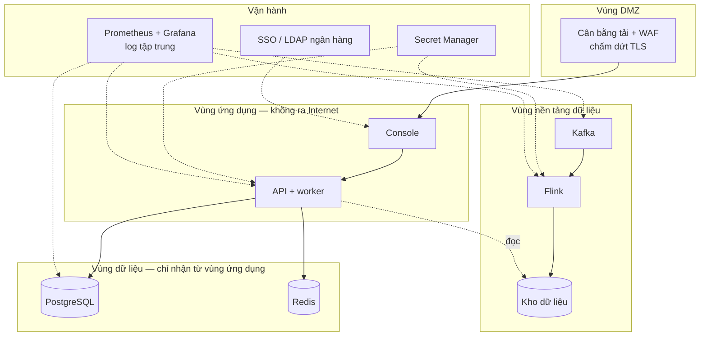

| Hạng mục | Trạng thái | Ghi chú |
|---|---|---|
| Nhật ký chỉ ghi thêm | **ĐANG CHẠY** | Trigger PostgreSQL, `db/init/002` |
| Cách ly nhãn khỏi agent | **ĐANG CHẠY** | Quyền PostgreSQL, `db/init/003` |
| Mọi khẳng định của agent có bằng chứng | **ĐANG CHẠY** | JSON Schema, `minItems: 1` |
| Phê duyệt của người, ghi một lần | **ĐANG CHẠY** | `db/init/002`, cổng phê duyệt trong `Jenkinsfile` |
| TLS đầu cuối | Một phần | Caddy lo phía ngoài; nội bộ còn HTTP |
| Bí mật ngoài mã nguồn | **CHƯA** | Còn trong `.env` |
| Mã hoá khi lưu | **CHƯA** | |
| Phân vùng mạng | **CHƯA** | Hiện một mạng compose phẳng |
| SSO của ngân hàng | **CHƯA** | Console dùng tài khoản demo |
| Quét lỗ hổng image | **CHƯA** | Ghi ở [CI/CD](../operations/README.md#cicd-cổng-chặn-merge-và-pipeline-giao-hàng) mục 10 |
| Che/giả lập PII ở môi trường thấp | **CHƯA** | Hiện dữ liệu đều là tổng hợp nên chưa gặp |

Một điểm thuộc về Level 1 cần nhắc lại: hệ thống vận hành **trong ranh giới dữ liệu của một ngân
hàng**. Không có luồng dữ liệu xuyên biên giới, không phụ thuộc dữ liệu Nhà nước. Điều đó đơn giản
hoá đáng kể phần tuân thủ, và nó là một ràng buộc thiết kế chứ không phải một giai đoạn.

---

### 6. CI/CD lên production

**ĐANG CHẠY** ở mức staging và production-like. Chi tiết:
[CI/CD — cổng chặn merge và pipeline giao hàng](../operations/README.md#cicd-cổng-chặn-merge-và-pipeline-giao-hàng).

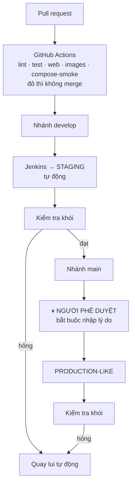

Cổng phê duyệt bắt người duyệt **nhập lý do**, và lý do vào nhật ký build — cùng tinh thần với việc
hệ thống bắt MLRO nêu lý do khi duyệt hồ sơ nghi vấn. Đây là nguyên tắc NT3 áp cho chính quy trình
giao hàng.

Còn thiếu, nói rõ:

- Chưa bật branch protection trên GitHub — chưa bật thì CI đỏ vẫn merge được
- Chưa quét bảo mật image
- **Hạ tầng dưới dạng mã mới một phần** — `infra/terraform/` lo IP tĩnh, tường lửa và Cloud SQL;
  bản thân VM vẫn dựng bằng tay và pipeline chỉ triển khai lên máy *đã tồn tại*
- Chưa có kênh thông báo khi build hỏng
- Chưa kiểm tra tải, chưa diễn tập khôi phục
- **CI không chạy đường ống AML.** Không job nào trong `ci.yml` hay `Jenkinsfile` chạm tới profile
  `aml`. `make aml-smoke` phải chạy tay

---

### 7. Quan sát hệ thống

| Lớp | Hiện tại | Production |
|---|---|---|
| Log | `docker compose logs`, dạng người đọc | Log tập trung, JSON có cấu trúc, mã tương quan |
| Metrics ứng dụng | không | Prometheus + Grafana |
| Metrics Flink | có counter nhóm `aml`, **không exporter** | Prometheus reporter |
| Metrics Kafka | không | JMX exporter: lag consumer, ISR, dung lượng đĩa |
| Truy vết | không | OpenTelemetry, xuyên API → worker → agent |
| Cảnh báo vận hành | không | Lag Kafka, checkpoint Flink thất bại, độ trễ đầu–cuối, tỉ lệ DLQ |
| Healthcheck | **ĐANG CHẠY** | Giữ nguyên, đưa vào giám sát |

Bốn cảnh báo cần có trước tiên, theo thứ tự giá trị: **checkpoint Flink thất bại** (mất checkpoint là
mất tính exactly-once), **lag consumer tăng đơn điệu**, **tỉ lệ DLQ vượt ngưỡng** (dấu hiệu nguồn đổi
định dạng), và **độ trễ từ lúc giao dịch xảy ra tới lúc có cảnh báo**.

---

### 8. Sức chứa — bậc độ lớn

**ĐỀ XUẤT.** Con số để bắt đầu tính, không phải kết quả đo.

Giả định một ngân hàng cỡ trung: 5 triệu giao dịch/ngày, đỉnh gấp 5 lần trung bình.

| Thành phần | Ước lượng |
|---|---|
| Thông lượng trung bình | ~58 giao dịch/giây |
| Thông lượng đỉnh | ~290 giao dịch/giây |
| Kafka | 3 broker, 12 phân vùng, giữ 7 ngày ≈ vài trăm GB |
| Flink | Parallelism 12, khớp số phân vùng |
| BRONZE mỗi ngày | ~1–2 GB Parquet đã nén |
| BRONZE giữ 7 năm | ~5 TB, nhân 3 bản sao |
| PostgreSQL | Vụ việc và cảnh báo, không phải giao dịch thô — chục GB |

Điểm mấu chốt: **PostgreSQL không giữ giao dịch thô.** Giao dịch nằm ở kho dữ liệu; PostgreSQL giữ
vụ việc, cảnh báo, bằng chứng và nhật ký. Nhầm chỗ này là một sai lầm kiến trúc đắt tiền, vì nó biến
cơ sở dữ liệu giao dịch của quy trình nghiệp vụ thành một kho dữ liệu tồi.

---

### 9. Thứ tự làm

Sắp theo giá trị trên một đơn vị công sức, không phải theo tầng kiến trúc.

| # | Việc | Vì sao trước |
|---|---|---|
| 1 | Tầng SILVER — khử trùng lặp theo `transaction_id` | Mọi thứ đọc bronze đều đang phải tự khử. Làm một lần, dùng chung |
| 2 | Detection Engine tối thiểu — vài luật ngưỡng, ghi vào bảng `alert` | Nối được chuỗi CSV → cảnh báo trên console. Lần đầu tiên hệ thống làm đúng thứ tên nó nói |
| 3 | Prometheus + Grafana | Không đo thì mọi tối ưu về sau là đoán |
| 4 | Sao lưu PostgreSQL + diễn tập khôi phục | Rủi ro mất dữ liệu pháp lý là rủi ro lớn nhất đang mở |
| 5 | Bí mật ra khỏi `.env` | Điều kiện cần trước khi chạm dữ liệu thật |
| 6 | Kafka 3 broker, RF=3 | Bỏ điểm mất dữ liệu ở tầng nạp |
| 7 | Schema Registry | Đóng khoảng trống Java ↔ contract |
| 8 | `stop-with-savepoint` | Trước khi job Flink có state thật |
| 9 | Feature platform, point-in-time correct | Điều kiện cần của mọi mô hình ML nói thật |
| 10 | Hạ tầng dưới dạng mã | Khi cấu hình đã ổn định, không phải trước |

Bước 1 và 2 đáng làm trước tất cả: chúng biến hai nửa rời rạc thành một hệ thống chạy đầu–cuối.
Sau đó mọi thứ khác là gia cố một thứ đã hoạt động, thay vì xây thêm một nửa nữa.

---

### 10. Tài liệu liên quan

| Tài liệu | Nội dung |
|---|---|
| [Triển khai lên VM GCP — https://amlmonitoring.site/](../operations/README.md#triển-khai-lên-vm-gcp-httpsamlmonitoringsite) | Quy trình triển khai bản demo hiện tại |
| [CI/CD — cổng chặn merge và pipeline giao hàng](../operations/README.md#cicd-cổng-chặn-merge-và-pipeline-giao-hàng) | Cổng chặn merge, ba môi trường, quay lui |
| [Runbook — dựng và vận hành FIN-07 trên máy cá nhân](../operations/README.md#runbook-dựng-và-vận-hành-fin-07-trên-máy-cá-nhân) | Dựng và vận hành trên máy cá nhân |
| [`contracts/ingestion/README.md`](../../contracts/ingestion/README.md) | Topology thật của Kafka–Flink–HDFS, contract, ngữ nghĩa giao hàng, bẫy khi chạy ở local |
| [Thiết kế kỹ thuật](../specification/technical-design.md) | Các tầng và chỗ đặt code |

---

## FIN-07 · Sơ đồ triển khai Production

> Trung tâm điều hành AML (FIN-07). Tài liệu này mô tả **những gì đang thực sự chạy trên
> production** tại `https://amlmonitoring.site` kèm công nghệ và phiên bản. Cập nhật: 22/08/2026.
>
> Nguồn: xác nhận trực tiếp trên VM (`docker ps`), Cloud SQL và cấu hình container tại thời điểm viết.

---

### 1. Tổng quan

FIN-07 là hệ giám sát chống rửa tiền (AML) gồm:

- **Console web** (SPA React) cho 3 vai trò: Chuyên viên (analyst), Quản lý (manager), Quản trị hệ thống (admin).
- **API** (FastAPI) phục vụ dữ liệu cảnh báo / vụ việc / giao dịch / đồ thị + nhúng giám sát vận hành.
- **3 nhánh mô hình ML** chấm điểm trên 3 vùng dữ liệu riêng (Bitcoin, IBM AML, SAML-D).
- **Trợ lý AI** (Gemini) sinh diễn giải điều tra theo yêu cầu.
- **Ngăn xếp quan sát** (Prometheus / Loki / Jaeger / Grafana) nhúng ngay trong console.

Toàn bộ chạy trên **một VM GCP** phía sau **Caddy** (TLS tự động), dữ liệu ở **Cloud SQL PostgreSQL**.

---

### 2. Sơ đồ hạ tầng Production

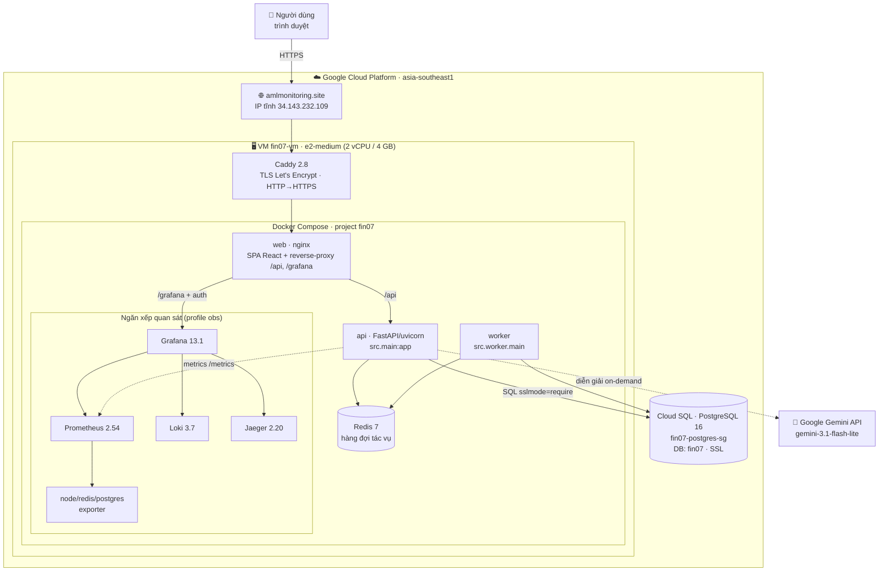

**Đường vào:** trình duyệt → Caddy (443, tự cấp/gia hạn chứng chỉ) → container `web` (nginx). nginx phục vụ
file tĩnh của SPA, proxy `/api/` sang `api`, và `/grafana/` sang `grafana` (kèm xác thực phiên).

**Đặc điểm vận hành:**
- IP **tĩnh** (`fin07-web-ip`) → tắt/bật VM không đổi IP.
- Container đặt `restart: always`/`unless-stopped` → tự bật lại khi VM reboot.
- Cloud SQL **tách rời** VM → nâng/tắt VM không đụng dữ liệu.

---

### 3. Luồng một request (dữ liệu console)

```mermaid
sequenceDiagram
    autonumber
    participant B as Trình duyệt (SPA)
    participant C as Caddy (TLS)
    participant N as web/nginx
    participant A as api (FastAPI)
    participant P as Cloud SQL (Postgres)
    participant R as Redis

    B->>C: GET /api/v1/dashboard (Bearer token)
    C->>N: chuyển tiếp
    N->>A: proxy /api/
    A->>P: truy vấn (SQLAlchemy, handler def → threadpool)
    P-->>A: kết quả
    A-->>B: JSON
    Note over B: SPA cache SWR (sessionStorage)<br/>→ lần F5 sau vẽ ngay bản cũ, làm mới nền

    B->>C: POST /api/v1/auth/login
    C->>N->>A: đăng nhập
    A->>A: PBKDF2 200k vòng (asyncio.to_thread,<br/>không chặn event loop)
    A->>P: tạo phiên (app_session)
```

**Hai tối ưu độ trễ đã triển khai:**
1. **Handler đọc DB là `def`** (không `async def`) → FastAPI chạy trong threadpool, một truy vấn nặng không đóng băng cả tiến trình 1-worker (không còn treo login khi có người mở trang nặng).
2. **Băm mật khẩu đẩy ra thread** → login đồng thời không xếp hàng tuyến tính.
3. **Cache SWR phía trình duyệt** cho các trang đọc nhiều → reload gần như tức thì.

---

### 4. Ba nhánh mô hình ML (đang phục vụ)

Ba nhánh chấm trên **ba vùng dữ liệu tách biệt**, **không cộng gộp chỉ số** (khác vùng, khác loại model, khác bộ đo).

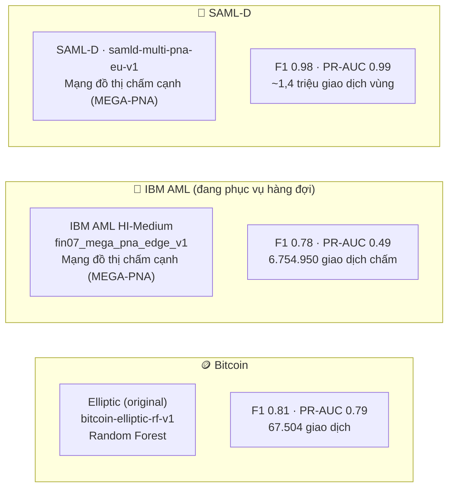

- **IBM** là nhánh đang phục vụ hàng đợi chính: chấm **từng giao dịch**, ghi bảng `transaction_model_score`
  (release `REL-EDGE-…`, status `active`). Ba trang console (Tổng quan / Tra cứu giao dịch / Cảnh báo) sống nhờ bảng này.
- **Bitcoin** & **SAML-D** là release `reference`, phục vụ trực tiếp qua bảng riêng của nhánh; không chiếm slot `active`.
- **Trợ lý AI (Gemini)** chỉ sinh **diễn giải ngôn ngữ tự nhiên** on-demand từ bằng chứng có cấu trúc — không thay việc chấm điểm của model.

---

### 5. Đường ống chấm điểm real-time (lát A — Bitcoin)

> **Trạng thái: đã dựng & chạy end-to-end ở LOCAL-DEV; CHƯA deploy prod** (VM prod nhỏ, cần quyết định
> hạ tầng streaming). Đưa vào đây để thể hiện kiến trúc mục tiêu.

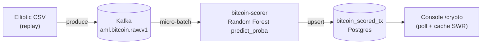

- RF chấm **độc lập từng giao dịch** → điểm streaming **giống hệt** batch (không trôi theo cửa sổ).
- Consumer commit offset **sau khi** ghi DB (at-least-once).
- Nhánh IBM (đặc trưng tăng dần) và SAML-D (model đồ thị, cần thiết kế cửa sổ) là bước tiếp theo.

---

### 6. Bảng công nghệ đã triển khai (production)

| Thành phần | Công nghệ · phiên bản | Vai trò |
|---|---|---|
| Reverse proxy / TLS | **Caddy 2.8-alpine** | HTTPS tự động (Let's Encrypt), HTTP→HTTPS, security headers |
| Web | **nginx** + **React + Vite** (build tĩnh), **MapLibre GL** | SPA console, proxy `/api` & `/grafana` |
| API | **FastAPI 0.141** · **uvicorn 0.52** · **Python 3.11** | REST API, RBAC 3 vai trò, phiên PBKDF2 |
| ORM/DB driver | **SQLAlchemy 2.0** · **psycopg 3** | truy cập Postgres |
| Worker nền | Python (`src.worker.main`) | tác vụ điều tra qua hàng đợi Redis |
| Hàng đợi / cache | **Redis 7-alpine** | hàng đợi tác vụ, phiên Grafana |
| CSDL | **Cloud SQL PostgreSQL 16** (`fin07-postgres-sg`, tier **db-custom-2-7680** = 2 vCPU / 7,5GB) | dữ liệu nghiệp vụ (SSL bắt buộc) |
| Metrics | **Prometheus 2.54** + node/redis/postgres exporter | thu thập số liệu |
| Logs | **Loki 3.7** | nhật ký tập trung |
| Traces | **Jaeger 2.20** | vết phân tán (tùy chọn) |
| Dashboard | **Grafana 13.1** (nhúng cùng origin `/grafana`, auth-proxy) | trực quan hoá số liệu |
| Trợ lý AI | **Google Gemini** (`gemini-3.1-flash-lite`) | diễn giải điều tra on-demand |
| Streaming (mục tiêu) | **Kafka**, **Flink→HDFS** (archival), consumer RF | ingestion + chấm real-time (đang ở local-dev) |
| Hạ tầng | **GCP VM e2-medium** (2 vCPU/4 GB) + **IP tĩnh** + **Docker Compose** | máy chủ ứng dụng |

---

### 7. Dữ liệu trên production (số liệu thật)

Đo trực tiếp trên bản đang phục vụ ngày **01/09/2026** qua
`/api/v1/fc/edge-model/release` và `/api/v1/dashboard`.

| Chỉ số | Giá trị | Ghi chú |
|---|---|---|
| Release đang `active` | `REL-MP-6707e0cfbc33679f` | `fin07_mega_pna_edge_v1` |
| Bộ dữ liệu | **IBM AML HI-Medium MEGA-PNA** | split `test` |
| Giao dịch đã chấm | 6.754.950 | `transaction_model_score` |
| Nhãn dương trong vùng đo | 11.016 | tỷ lệ **0,163%** |
| Giao dịch vượt ngưỡng | 9.092 | ngưỡng `0,56933` |
| Cảnh báo đang mở | 14.267 | trong đó 11.473 rủi ro cao |
| Vụ việc đang điều tra | 14.260 | |
| SAR chờ duyệt | 0 | trung thực, không dựng số |
| Điểm rủi ro trung bình | 91,8 | |

Phân bố nhóm hành vi trên hàng đợi đang mở: T06 5.004 (35,1%) · T00 4.715
(33,0%) · T02 4.254 (29,8%) · T05 157 (1,1%) · T04 137 (1,0%).

---

### 8. Trạng thái & giới hạn đã biết (nói thẳng)

- ✅ **Đang chạy tốt:** console 3 vai trò, 3 nhánh model phục vụ, đăng nhập/hiệu năng ổn định, ngăn xếp quan sát (Grafana đã sửa crash provisioning), cache SWR.
- ✅ **CSDL đã nâng tier:** Cloud SQL `fin07-postgres-sg` từ **db-f1-micro** (~0,6 GB RAM) lên **db-custom-2-7680** (2 vCPU / 7,5 GB) ngày 22/08/2026 — đủ RAM để cache working set (~15,6 triệu dòng), hết tình trạng query nặng làm nghẽn cả instance. IP/DB/dữ liệu giữ nguyên.
- ⚠️ **VM nhỏ:** e2-medium 2 vCPU — băm login + truy vấn nặng dùng chung 2 lõi. Nâng 4 lõi nếu nhiều người đăng nhập/mở trang nặng cùng lúc.
- ⏳ **Streaming chưa lên prod:** đường ống Bitcoin real-time (lát A) mới chạy local-dev; IBM/SAML-D streaming và SSE đẩy UI là bước tiếp theo.
- ⏳ **Traces (Jaeger):** hạ tầng có sẵn nhưng `OTEL_ENABLED` mặc định tắt trên prod.

---

### 9. Quan hệ suy luận (một cái nhìn)

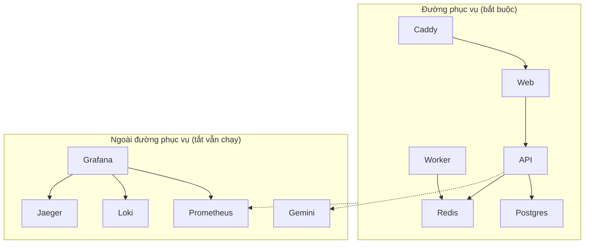

> Nguyên tắc: tắt toàn bộ cụm quan sát và Gemini thì hệ thống lõi **vẫn phục vụ bình thường**.

---

## Kiến trúc FIN-07 vẽ lại theo đúng những gì dữ liệu có

Sơ đồ cũ đúng về **hình dạng** — 3 agent, 8 công cụ, chứng cứ trước giải thích —
nhưng vài hộp phát hiện dựa trên thứ dữ liệu không có, hoặc đã đo được là không
đóng góp gì.

Tài liệu này giữ nguyên hình dạng ấy và thay các hộp bằng thứ **truy được về cột
dữ liệu thật hoặc số đo đã có**. Yêu cầu không đổi: **mọi thứ xuất ra phải được
tác tử giải thích đầy đủ.**

---

### 1. Dữ liệu thật sự có gì

Toàn bộ `HI-Medium_Trans.csv` có **11 cột**, không hơn:

```
Timestamp, From Bank, Account, To Bank, Account,
Amount Received, Receiving Currency, Amount Paid, Payment Currency,
Payment Format, Is Laundering
```

Tệp nhãn `HI-Medium_Patterns.txt` gán **493 vụ** theo **8 mẫu hình đồ thị**:
FAN-IN, FAN-OUT, CYCLE, SCATTER-GATHER, GATHER-SCATTER, STACK, BIPARTITE, RANDOM.

**Không có trong dữ liệu:** quốc gia · cờ VASP · KYC · nghề nghiệp · PEP · ngày mở
tài khoản · hạn mức. Mọi thành phần cần chúng đều là thứ dự án tự bịa ra rồi tự
phát hiện lại.

Đó là lý do `R03_VASP_EXPOSURE` và `R04_CROSS_BORDER_FLOW` đã bị gỡ: chúng đọc
`bank_country.csv` do dự án viết, trong đó `is_vasp` chỉ đánh dấu **một** họ ngân
hàng hư cấu.

---

### 2. Cái gì bị bỏ, và bằng chứng nào

| Thành phần | Số đo | Quyết định |
|---|---|---|
| Isolation Forest | trọng số hợp nhất **0,00**; cả 8 tổ hợp tốt nhất đều loại nó | **Bỏ** |
| Bộ dò mẫu hình đồ thị | precision **0,14%**, recall 58,3% | **Giữ, nhưng chỉ sinh chứng cứ** |
| Luật R01/R02 | precision **0,64%**, phủ 6,6%, lift 2,6× | **Giữ, trọng số nhỏ + lý do có tên** |
| Mô hình đặc trưng đồ thị | trùng nguồn tín hiệu với MEGA-PNA | **Chờ đo tương quan** |
| Hợp nhất 3 nhánh | 0,1365 so với riêng graph 0,1338 | **Giữ, nhưng đổi nhánh** |

Điểm chung: thứ có precision dưới 1% **không được tự mở cảnh báo**, nhưng vẫn có
giá trị làm chứng cứ và lý do.

---

### 3. Sơ đồ mới

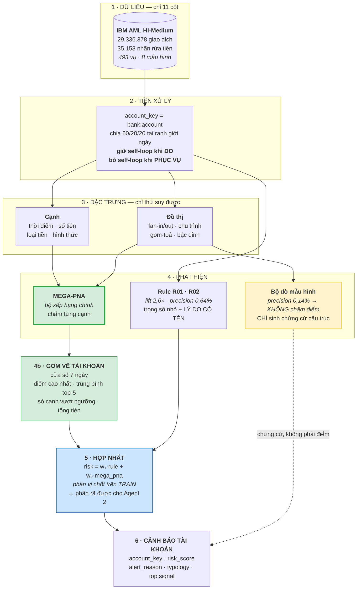

Đường **nét đứt** từ bộ dò mẫu hình là thay đổi quan trọng nhất: nó vào cảnh báo
làm **chứng cứ**, không đi qua hợp nhất. Precision 0,14% quá thấp để chấm điểm,
nhưng nó là thứ duy nhất gọi được tên `CYCLE`.

---

### 4. Mỗi công cụ của tác tử lấy dữ liệu từ đâu

Đây là bảng trả lời câu "agent có giải thích được đầy đủ không".

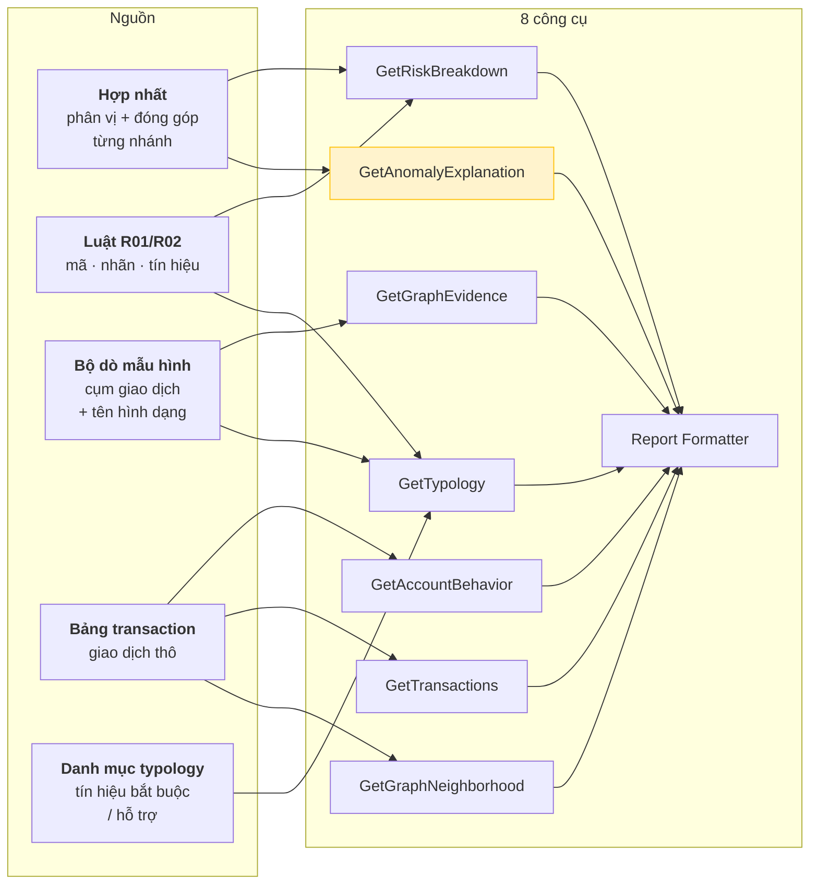

| Công cụ | Nguồn | Còn sống sau khi đổi? |
|---|---|---|
| `GetRiskBreakdown` | hợp nhất | ✅ hai nhánh thay vì ba |
| `GetAccountBehavior` | bảng `transaction` | ✅ không đổi |
| `GetTransactions` | bảng `transaction` | ✅ không đổi |
| `GetGraphEvidence` | `graph_detector_evidence` | ✅ **chính vì giữ bộ dò** |
| `GetGraphNeighborhood` | bảng `transaction` | ✅ không đổi |
| `GetTypology` | danh mục + tín hiệu luật | ✅ không đổi |
| `GetAnomalyExplanation` | ⚠️ Isolation Forest | **đổi nguồn sang MEGA-PNA** |
| `Report Formatter` | tất cả | ✅ không đổi |

Chỉ **một** công cụ phải đổi nguồn. `GetAnomalyExplanation` hiện đọc cảnh báo
`detector='ml'` của Isolation Forest; nó sẽ đọc mức đóng góp của nhánh MEGA-PNA
cùng bốn số đo gom theo tài khoản — tức *"12 giao dịch vượt ngưỡng, tổng 240.000
USD, cạnh cao nhất 0,97"*.

---

### 5. Một cảnh báo trông như thế nào

Ví dụ dựng từ đúng những trường có thật:

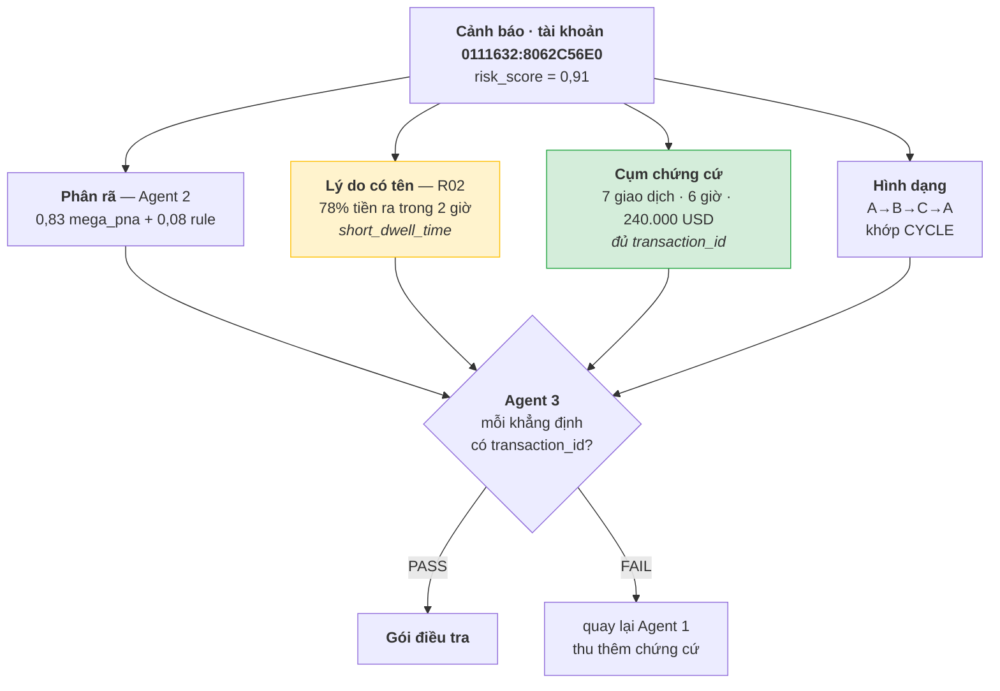

Câu hệ thống nói được với chuyên viên:

> *Tài khoản 0111632:8062C56E0, rủi ro 0,91. Bảy giao dịch tạo thành chu trình
> A→B→C→A trong 6 giờ, tổng 240.000 USD; mô hình chấm cả bảy trên 0,9. Tài khoản
> đẩy 78% tiền nhận được đi trong vòng 2 giờ (R02). Hình dạng khớp CYCLE.*

Mọi con số trong câu đó truy ngược được về `transaction_id` — đó là điều Agent 3
kiểm, và là lý do bộ dò mẫu hình được giữ dù precision chỉ 0,14%.

#### Vì sao R02 xuất hiện trong ví dụ CYCLE

Không phải ngẫu nhiên. Đo trên 1.758.597 tài khoản HI-Medium:

| | Nền chung | Trong CYCLE | Lift |
|---|---:|---:|---:|
| R02 chuyển tiền nhanh | 0,55% | **4,4%** | **8×** |
| R01 chia nhỏ | 2,02% | 5,9% | 2,9× |

R02 là dấu hiệu mạnh nhất của CYCLE — hợp lý, vì chu trình là phân lớp nên tiền
phải đi qua nhanh. Ngược lại **R02 bằng đúng 0,0% với FAN-IN**, nên Agent 2
**không được** viện dẫn R02 cho cảnh báo FAN-IN.

---

### 6. Điều kiện nghiệm thu

Sơ đồ chỉ đúng khi bốn điều sau đo được:

| # | Điều kiện | Cách đo |
|---|---|---|
| 1 | MEGA-PNA đủ mạnh | báo cáo `fin07.benchmark.v1`, đơn vị `account_window` |
| 2 | Nhánh rule còn đóng góp | trọng số hợp nhất **≠ 0** trên validation |
| 3 | Bỏ mô hình đặc trưng đồ thị không mất gì | thêm nó vào tăng **< 0,005 F1** |
| 4 | Mọi khẳng định có chứng cứ | tỷ lệ PASS của Agent 3 trên mẫu cảnh báo |

Điều kiện 2 quan trọng: nếu trọng số rule về 0 như Isolation Forest, thì nó chỉ
còn là nguồn lý do chứ không còn là nhánh chấm điểm — và sơ đồ phải sửa lại lần
nữa, trung thực với số đo.

Mọi con số phải qua `src/benchmark/standard.py`, đơn vị `account_window`, dãy
ngân sách cố định. Không con số nào ngoài chuẩn được đưa vào tài liệu.

---

## Kiến trúc hướng B — MEGA-PNA làm một nhánh, không thay cả hệ

Tài liệu này **thay thế** phần kiến trúc trong `KE_HOACH_LAM_LAI_MODEL.md` — bản
kế hoạch cũ, đã gỡ khỏi repo sau khi việc được làm xong.

Kế hoạch cũ đề xuất bỏ hợp nhất, bỏ Isolation Forest, hạ luật xuống chỉ chú giải,
và để một mô hình cạnh duy nhất chấm điểm. Đề xuất ấy **sai ở tầng phục vụ**: nó
tối ưu F1 mà cắt mất đúng những đầu vào mà tầng tác tử phụ thuộc.

---

### 1. Vì sao hướng A sai

Sơ đồ hệ thống có một dòng quyết định mọi thứ:

```
Risk 0.93 = 0.48 (Graph) + 0.22 (Anomaly) + 0.08 (Rule)
```

Dòng này **không phải trang trí**. Nó là:

* thứ `GetRiskBreakdown` trả về,
* thứ **Agent 2** phân rã để trả lời "tại sao rủi ro cao",
* thứ **Agent 3** đối chiếu để chấm PASS/FAIL.

Bỏ hợp nhất là bỏ luôn khả năng giải thích. Cụ thể, đã kiểm trong mã:

| Thành phần | Hỏng thế nào nếu theo hướng A |
|---|---|
| `_risk_components` | trả `available: false` cho **mọi** nhánh, kèm `limitation` |
| Agent 2 | mất chức năng chính — không còn gì để phân rã |
| `GetAnomalyExplanation` | trả `available: false` vĩnh viễn |
| `Top signal = CYCLE` | biến mất — nó đến từ Graph Detectors |
| `alert.detector` | ràng buộc `CHECK IN ('rule','ml','graph')` chặn thẳng |

Đơn vị cũng sai: `alert.account_key` là **bắt buộc**, `transaction_id` chỉ tuỳ
chọn. Toàn bộ hàng đợi, điều tra và hồ sơ vụ việc xoay quanh **tài khoản**.
MEGA-PNA chấm **cạnh**.

---

### 2. Kiến trúc hướng B

MEGA-PNA thay **chỗ của Isolation Forest** — nhánh đang mang trọng số **0,00**,
tức bỏ đi không mất gì. Mọi thứ khác giữ nguyên.

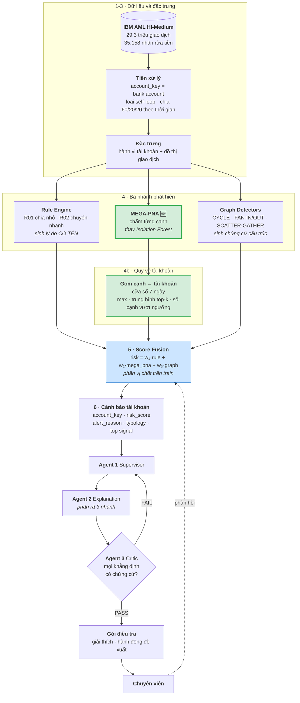

Thay đổi **duy nhất** so với sơ đồ hiện có: hộp Isolation Forest đổi thành
MEGA-PNA, cộng một bước gom cạnh về tài khoản. Ba agent, tám công cụ, mọi bảng
chứng cứ giữ nguyên.

---

### 3. Gom cạnh về tài khoản

MEGA-PNA cho điểm mỗi **giao dịch**. Hợp nhất cần điểm mỗi **tài khoản**.

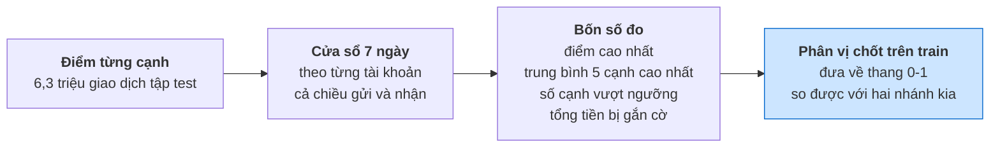

Bốn số đo, không phải một, vì chúng phân biệt được các tình huống khác nhau:
một cạnh 0,99 lẻ loi **khác** mười cạnh 0,75 liên tiếp. Số đo cũng chính là dữ
kiện đưa vào chứng cứ: *"12 giao dịch vượt ngưỡng, tổng 240.000 USD"*.

Phân vị phải chốt trên tập train — dùng phân vị của tập test là rò rỉ.

---

### 4. Nhánh rule là gì, và nó có giá trị ở đâu

#### 4.1 Hai luật còn lại

Trước đây có bốn. `R03_VASP_EXPOSURE` và `R04_CROSS_BORDER_FLOW` đã gỡ vì chúng
đọc thuộc tính **do dự án tự gán** (`bank_country.csv`), không có trong dữ liệu
IBM — tức chúng phát hiện chính thứ dự án tạo ra.

| Mã | Điều kiện | Ý nghĩa |
|---|---|---|
| **R01** chia nhỏ giao dịch | ≥ **3** giao dịch ra nằm trong dải **8.500–10.000** | Né ngưỡng báo cáo. Một giao dịch 9.900 là bình thường; mười giao dịch 9.900 trong hai ngày thì không |
| **R02** chuyển tiền nhanh | ≥ **3** giao dịch ra, và ≥ **60%** tiền ra rời tài khoản trong **2 giờ** sau khi nhận | Tài khoản chỉ làm chỗ trung chuyển |

Ngoài ra mỗi luật phát **tín hiệu có tên** — `repeated_amounts`, `short_window`,
`short_dwell_time` — nối thẳng vào danh mục nhóm hành vi.

#### 4.2 Đo trên HI-Medium: luật có giá trị ở mẫu hình nào

Chạy điều kiện của hai luật trên **toàn bộ 1.758.597 tài khoản** của HI-Medium,
rồi đối chiếu với 4.275 tài khoản nằm trong 493 vụ có nhãn.

**Nền chung:** R01 kích hoạt ở 2,02% tài khoản, R02 ở 0,55%, hợp lại 2,54%.

**Tỷ lệ tài khoản trong từng mẫu hình bị luật kích hoạt:**

| Mẫu hình | Tài khoản | R01 | R02 | Tổng | Lift |
|---|---:|---:|---:|---:|---:|
| **CYCLE** | 458 | 5,9% | **4,4%** | **10,0%** | **3,9×** |
| **SCATTER-GATHER** | 455 | **8,1%** | 1,5% | 9,7% | 3,8× |
| RANDOM | 305 | 6,9% | 2,0% | 8,9% | 3,5× |
| GATHER-SCATTER | 583 | 7,2% | 1,4% | 8,4% | 3,3× |
| FAN-OUT | 540 | 6,9% | 1,1% | 7,8% | 3,1× |
| BIPARTITE | 681 | 6,3% | 1,0% | 7,3% | 2,9× |
| STACK | 1.171 | 5,7% | 1,5% | 7,2% | 2,8× |
| **FAN-IN** | 411 | 5,1% | **0,0%** | 5,1% | 2,0× |

**Ba kết luận rút ra được:**

**R02 là dấu hiệu của CYCLE.** 4,4% so với nền 0,55% — **lift 8 lần**, cao nhất
trong mọi cặp luật–mẫu hình. Hợp lý: chu trình là phân lớp, tiền phải đi qua
nhanh. Đây là chỗ nhánh rule có giá trị rõ rệt nhất.

**R02 hoàn toàn vô dụng với FAN-IN — đúng 0,0%.** Cũng hợp lý: tài khoản fan-in
là điểm **nhận**, nó gom tiền chứ không đẩy đi ngay. Một kết quả âm tính có ích:
nó nói cho Agent 2 biết khi nào **không** được viện dẫn R02.

**R01 là dấu hiệu của SCATTER-GATHER và GATHER-SCATTER.** 8,1% và 7,2% so với nền
2,02% — lift 4×. Hợp lý: các mẫu hình này chia tiền thành nhiều khoản nhỏ.

#### 4.3 Nhưng luật KHÔNG được tự mở cảnh báo

| Luật | Kích hoạt | Trúng mẫu hình | Độ chính xác | Độ phủ | Lift |
|---|---:|---:|---:|---:|---:|
| R01 | 35.501 | 225 | **0,63%** | 5,3% | 2,6× |
| R02 | 9.600 | 63 | **0,66%** | 1,5% | 2,7× |
| R01 ∪ R02 | 44.665 | 284 | **0,64%** | 6,6% | 2,6× |

Để luật tự sinh cảnh báo thì phải mở **44.665 cảnh báo** để tìm 284 tài khoản.
Không dùng được.

Nhưng lift **2,6×** là tín hiệu thật, không phải nhiễu. Đó chính xác là vai trò
đúng của nhánh rule trong hướng B:

> **Trọng số nhỏ trong hợp nhất, nhưng là nguồn lý do có tên.**

MEGA-PNA xếp hạng; luật giải thích. Không đảo ngược được: luật quá kém để xếp
hạng, còn MEGA-PNA không sinh được dòng `alert_reason` nào.

---

### 5. Chứng cứ cho tác tử

Điều tra viên không kết luận từ một giao dịch. Chứng cứ phải là **cụm**.

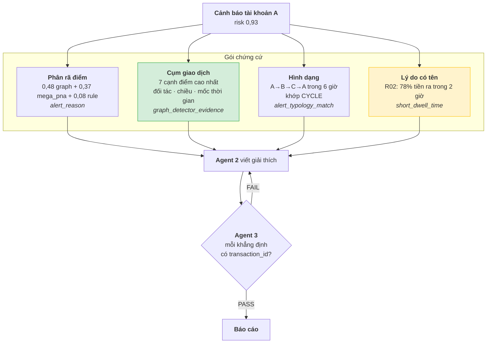

Câu mà hệ thống nói được với chuyên viên:

> *7 giao dịch tạo thành chu trình A→B→C→A trong 6 giờ, tổng 240.000 USD, cả 7
> đều được mô hình chấm trên 0,9. Tài khoản A đẩy 78% tiền nhận được đi trong
> vòng 2 giờ (R02). Hình dạng khớp CYCLE.*

Mọi con số trong câu đó **truy ngược được về `transaction_id`** — đó là điều
Agent 3 kiểm.

#### Điều tôi nói thẳng về giới hạn

Giải thích **theo trọng số** của GNN — kiểu "đặc trưng X đóng góp Y%" — có công
cụ (GNNExplainer) nhưng nặng và kết quả khó tin. **Không đề xuất.**

Cái làm được là **giải thích theo chứng cứ**: chỉ ra đúng cụm nào, hình dạng gì,
vi phạm quy tắc nào. Trong hợp nhất, mức đóng góp của nhánh MEGA-PNA vẫn hiện ra
được (0,37 trong ví dụ) — nhưng đó là đóng góp **của cả nhánh**, không phải phân
rã bên trong mô hình. Phải nói rõ để không hứa quá.

---

### 6. Việc phải làm

| # | Việc | Trạng thái |
|---|---|---|
| 1 | Huấn luyện MEGA-PNA trên HI-Medium | 🔄 đang chạy |
| 2 | Gom cạnh → tài khoản, chốt phân vị trên train | ❌ viết mới |
| 3 | Migration: `alert.detector` nhận `'mega_pna'` | ❌ viết mới |
| 4 | Hợp nhất ba nhánh, khớp trọng số trên validation | ⚠️ có `train_fusion_tri.py`, cần đổi đầu vào |
| 5 | Sinh cảnh báo tài khoản + `alert_reason` + chứng cứ | ❌ viết mới |
| 6 | Nạp vào Cloud SQL mới từ VM production | ❌ viết mới |
| 7 | Kiểm ba agent chạy đúng trên cảnh báo mới | ❌ |

Bước 3 là ràng buộc lược đồ chặn thẳng — `CHECK (detector IN ('rule','ml','graph'))`.
Có thể dùng lại `'ml'` cho MEGA-PNA để khỏi migration, nhưng như thế mất khả năng
phân biệt trong `GetAnomalyExplanation`. Nên thêm mã mới.

---

### 7. Tóm lại

**MEGA-PNA vào thay Isolation Forest, không thay cả hệ.** Nhánh bị thay đang mang
trọng số 0,00 nên không mất gì; toàn bộ sơ đồ agent, tám công cụ và các bảng
chứng cứ giữ nguyên.

**Đơn vị cảnh báo vẫn là tài khoản.** Điểm cạnh được gom theo cửa sổ 7 ngày bằng
bốn số đo, và chính bốn số đo ấy đi vào chứng cứ.

**Nhánh rule giữ lại có căn cứ đo được**, không phải giữ cho đủ: lift 2,6× tổng
thể, và **8× cho R02 trên CYCLE**. Nhưng độ chính xác 0,64% nghĩa là nó **không
bao giờ được tự mở cảnh báo** — nó xếp hạng kém, nó giải thích tốt.
