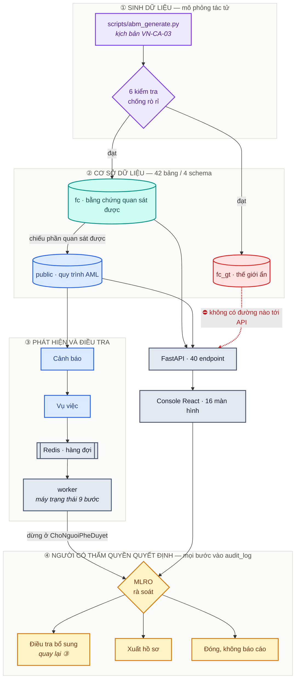
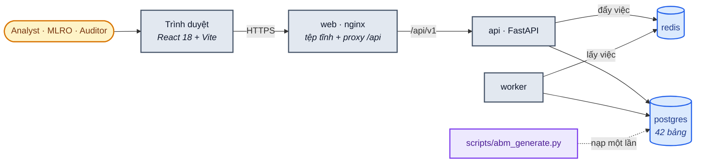
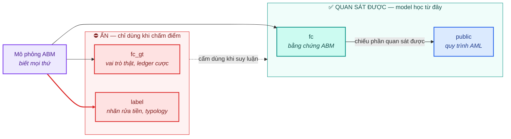
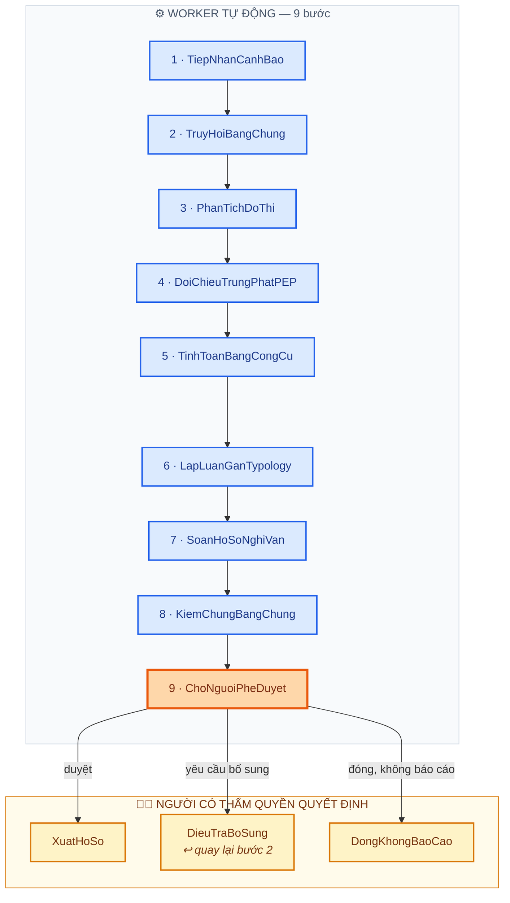
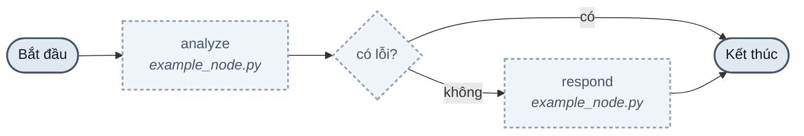
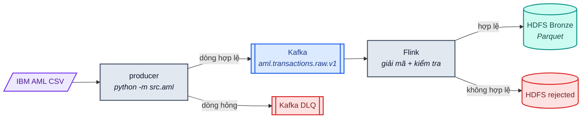
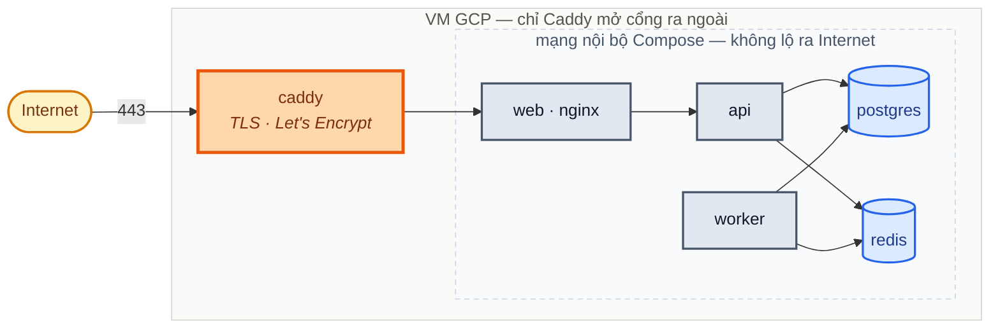

# Kiến trúc hệ thống — FIN-07 · Financial City AML

Tài liệu này mô tả **hệ thống đang chạy thật**, không phải hệ thống dự kiến.
Chỗ nào còn là khung mẫu chưa hiện thực thì ghi rõ như vậy, vì một sơ đồ kiến
trúc vẽ những thứ chưa tồn tại còn tệ hơn không có sơ đồ nào.

Cập nhật lần cuối: 05/08/2026. Gộp từ `ARCHITECTURE.md` ở gốc repo.

---

## 1. Tổng quan

FIN-07 là console giám sát và điều tra rửa tiền, chạy trên bộ dữ liệu tổng hợp
sinh bằng mô phỏng tác tử (ABM) theo đặc tả
[`design/ABM-thanh-pho-tai-chinh-v2.0.pdf`](design/ABM-thanh-pho-tai-chinh-v2.0.pdf).

Hệ thống có ba phần tách bạch:

1. **Sinh dữ liệu** — mô phỏng một thế giới tài chính rồi chiếu nó thành các
   view bằng chứng mà từng vai trò (ngân hàng, FIU, cơ quan điều tra) thực sự
   quan sát được.
2. **Quy trình AML** — cảnh báo → vụ việc → bằng chứng → hồ sơ nghi vấn (SAR)
   → phê duyệt, với nhật ký kiểm toán bất biến ở mọi bước.
3. **Console 16 màn hình** — giám sát, điều tra, truy vết tài sản mã hoá, và
   kiểm định chất lượng mô hình.

### Luồng đầy đủ, từ lúc sinh dữ liệu tới lúc con người ra quyết định

**Quy ước màu dùng thống nhất trong cả tài liệu:**

| | Ý nghĩa |
| --- | --- |
| 🟪 Tím | Sinh dữ liệu mô phỏng |
| 🟥 Đỏ | Dữ liệu ẩn — cấm dùng khi suy luận |
| 🟩 Xanh lá | Bằng chứng quan sát được |
| 🟦 Xanh dương | Quy trình AML đang vận hành |
| 🟧 Cam | Điểm con người quyết định |
| ⬜ Xám | Dịch vụ hạ tầng |

Đường **đỏ đứt nét** ở sơ đồ trên là ranh giới quan trọng nhất của thiết kế:
`fc_gt` chứa đáp án của mô phỏng, và không endpoint nào có đường đọc tới nó.

### Hạ tầng chạy

Giao diện và API **cùng một gốc** — nginx trong container `web` proxy `/api/`
sang container `api`. Trình duyệt không phát sinh request cross-origin nào, nên
không có biến CORS nào phải đặt đúng lúc build.

---

## 2. Tầng dữ liệu

42 bảng chia làm bốn schema. Ranh giới giữa chúng là ranh giới **quyền được
nhìn thấy**, không chỉ là cách sắp xếp cho gọn.

| Schema | Bảng | Nội dung | Ai được đọc |
| --- | ---: | --- | --- |
| `public` | 19 | Khách hàng, tài khoản, giao dịch, cảnh báo, vụ việc, bằng chứng, SAR, phê duyệt, nhật ký kiểm toán | Ứng dụng |
| `label` | 4 | Nhãn rửa tiền, typology, lệch hồ sơ, khớp danh sách | **Chỉ khi đánh giá** |
| `fc` | 15 | Bằng chứng ABM quan sát được: thực thể, quan hệ, hành lang dòng tiền, giao dịch on-chain, nhật ký mở quyền | Ứng dụng và mô hình |
| `fc_gt` | 4 | Ground truth ẩn: vai trò thật, ledger cược, mốc tín hiệu sớm nhất | **Chỉ khi chấm điểm** |

### Vì sao tách bằng schema

Quyền đọc trong PostgreSQL cấp được theo schema. Nhờ vậy "agent không được
thấy đáp án" trở thành **ràng buộc của cơ sở dữ liệu**, không phải một quy ước
đặt tên cột mà ai đó có thể vô tình phá. Vai trò chỉ-đọc của agent được dựng
trong `db/init/003_agent_readonly_role.sh`, và `tests/test_db/test_agent_role_isolation.py`
kiểm chứng rằng nó thật sự không đọc được `label`.

### Ba bảng chỉ ghi thêm

`evidence`, `audit_log` và `approval` bị chặn `UPDATE`/`DELETE`/`TRUNCATE` bằng
trigger ở tầng cơ sở dữ liệu (`db/init/002_audit_immutability.sql`). Đây là
ràng buộc pháp lý: bằng chứng đã ghi thì không được biến mất, kể cả do lỗi lập
trình. `approval` có một ngoại lệ có kiểm soát — chuyển từ `pending` sang quyết
định cuối **đúng một lần**, sau đó khoá.

### Lược đồ được quản lý thế nào

Không dùng Alembic. Lược đồ là các file SQL đánh số trong `db/init/`, chạy tự
động khi volume PostgreSQL còn rỗng. Trên cơ sở dữ liệu đã có dữ liệu,
`scripts/migrate.py` áp tăng dần theo bảng `schema_migration`, mỗi file một
transaction.

---

## 3. Backend

FastAPI, 40 endpoint chia làm hai router theo hai miền nghiệp vụ:

| Router | Endpoint | Phạm vi |
| --- | ---: | --- |
| `src/api/routes.py` | 26 | Đăng nhập, cảnh báo, vụ việc, SAR, phê duyệt, người dùng, cấu hình, nhật ký kiểm toán |
| `src/api/fc_routes.py` | 14 | World Monitor, đồ thị thực thể, crypto, dự án token, agent run, benchmark, giám sát mô hình, chất lượng dữ liệu |

`fc_routes.py` **không có endpoint nào đọc `fc_gt`**. Chỉ số phát hiện sớm được
tính ngoại tuyến rồi ghi vào `fc.benchmark_result`, nên tầng API không có đường
nào chạm tới ground truth.

### Máy trạng thái vụ việc

Vụ việc có **12 trạng thái**, cưỡng chế bằng ràng buộc `CHECK` của cơ sở dữ
liệu. Worker chỉ tự động đi hết **9 bước đầu** rồi dừng lại ở `ChoNguoiPheDuyet`;
ba trạng thái cuối chỉ đến được bằng quyết định của người có thẩm quyền.

`src.domain.next_state` trả về `None` khi vụ việc đã tới `ChoNguoiPheDuyet`, nên
worker không thể tự vượt qua ranh giới đó. Đây là chỗ cưỡng chế
human-in-the-loop, và nó nằm ở tầng miền nghiệp vụ chứ không phải ở giao diện.

Một lượt điều tra chạy hàng phút, không nằm vừa trong vòng đời một HTTP request.
Vì vậy `POST /cases/{id}/investigate` chỉ **đẩy việc vào Redis rồi trả về ngay**;
worker nhận việc, tính bước kế tiếp bằng `src.domain.next_state`, ghi nhật ký
kiểm toán, và giao diện theo dõi tiến độ bằng cách đọc lại trạng thái.

Bước chuyển trạng thái là **tất định**, không do mô hình ngôn ngữ quyết định.

---

## 4. AI Agent — trạng thái thật

> **Đây là phần cần đọc kỹ nhất, vì tài liệu cũ mô tả sai.**

Hệ thống có hai thứ khác nhau, đừng nhầm lẫn:

### 4.1. Đồ thị LangGraph — vẫn là khung mẫu

`src/agents/graph.py` hiện là graph hai node của bộ khởi tạo dự án:

> Nét đứt là có chủ ý: cả ba node đều là khung mẫu chưa hiện thực.

- Node nằm ở `src/agents/nodes/example_node.py` — **tên file nói đúng bản chất**
- Tool nằm ở `src/agents/tools/example_tool.py` — chưa có tool AML nào
- Chỗ duy nhất gọi tới nó là endpoint `POST /chat`

Đây **chưa phải** agent điều tra AML. Nó là điểm neo để cắm agent thật vào.

### 4.2. Nhật ký chạy agent — dữ liệu mô phỏng

Bảng `fc.agent_run` và `fc.agent_step`, cùng màn hình *Agent Run Console*, ghi
lại một lượt chạy 8 bước có viện dẫn bằng chứng. Dữ liệu đó do
`scripts/abm_generate.py` **sinh ra**, không phải do agent ở mục 4.1 thực thi.

Nó có giá trị: nó định nghĩa **hợp đồng** mà agent thật phải tuân theo —

- mỗi bước ghi rõ công cụ, đầu vào, đầu ra, thời lượng và `evidence_refs`;
- bước vượt thẩm quyền bị chặn ở tầng công cụ (`status = 'blocked'`), không phụ
  thuộc vào việc mô hình có "biết điều" hay không;
- lượt chạy kết thúc ở `needs_human`, không phải `succeeded` — agent đề xuất,
  con người quyết định.

Khi hiện thực agent thật, nó phải ghi vào đúng hai bảng này và giữ đúng ba ràng
buộc trên thì màn hình Agent Run Console mới dùng lại được nguyên vẹn.

---

## 5. Frontend

React 18 + Vite + TypeScript + Tailwind. **Không phải Next.js** — không có
server-side rendering, đây là SPA thuần được nginx phục vụ tĩnh.

| Thư viện | Dùng cho |
| --- | --- |
| `react-router-dom` | Định tuyến 16 màn hình |
| `recharts` | Biểu đồ trong các trang quy trình AML |
| `@xyflow/react` | Đồ thị gọn theo một vụ việc |
| `lucide-react` | Bộ biểu tượng |

### Engine đồ hoạ vendor

Bốn engine canvas trong `web/src/vendor/fc/` được **sao chép nguyên trạng** từ
bản thiết kế ở `docs/design/prototype/`: biểu đồ 12 loại, bản đồ thế giới 2D,
quả cầu 3D, và đồ thị lực.

Chúng là custom element thuần, nhận dữ liệu qua *property*. Wrapper React nằm ở
`web/src/components/fc/`.

> **Bẫy đã gặp:** với custom element, React 18 biến prop `className` thành một
> attribute tên `classname` mà CSS không nhìn thấy. Element sẽ cao 0px và canvas
> im lặng không vẽ gì, không báo lỗi. Vì vậy các wrapper định vị bằng `style`.

Không viết lại các engine này bằng thư viện khác: viết lại chỉ cho ra hình *gần
giống*, và mọi khác biệt nhỏ đều là một quyết định thiết kế bị đổi mà không ai
duyệt.

---

## 6. Đường ống nạp dữ liệu giao dịch

Ngoài mô phỏng ABM, repo còn có đường ống streaming để nạp bộ dữ liệu IBM AML.
Nó nằm sau profile `aml` của Docker Compose nên **không chạy mặc định**:

Đây thuần tuý là đường ống dữ liệu: không có mô hình học máy, không chấm điểm
rủi ro, không sinh cảnh báo. Cột `is_laundering` của bộ dữ liệu được mang theo
nguyên trạng như một cột bình thường. Chi tiết ở [`AML_INGESTION.md`](AML_INGESTION.md).

Khởi động: `make aml-up`.

---

## 7. Triển khai

Caddy là **tiến trình duy nhất mở cổng ra Internet**; mọi dịch vụ khác chỉ nghe
trong mạng nội bộ của Compose — kể cả PostgreSQL và Redis, vốn mở cổng ra máy
chủ ở bản dev cho tiện gỡ lỗi. Trên máy có IP công cộng thì "cho tiện" nghĩa là
một cơ sở dữ liệu ai cũng quét thấy.

Chi tiết: [`DEPLOY_VM.md`](DEPLOY_VM.md). Chạy trên máy cá nhân:
[`HUONG_DAN_CHAY.md`](HUONG_DAN_CHAY.md).

---

## 8. Bảo mật và an toàn dữ liệu

| Biện pháp | Hiện thực |
| --- | --- |
| Bí mật | Đọc từ biến môi trường; `.env` không bao giờ commit |
| Kiểm tra đầu vào | Pydantic ở mọi endpoint |
| Phân quyền | 5 vai trò; endpoint quản trị kiểm vai trò trước khi ghi |
| Nhật ký bất biến | Trigger cơ sở dữ liệu chặn sửa/xoá `audit_log`, `evidence`, `approval` |
| Cách ly agent | Vai trò PostgreSQL chỉ đọc, không thấy schema `label` |
| Nội dung người dùng nhập | `transaction.remarks` là **dữ liệu**, không bao giờ diễn giải như chỉ dẫn |
| Chống rò rỉ nhãn | 6 kiểm tra tự động sau mỗi lần sinh dữ liệu ABM |

---

## 9. Quyết định thiết kế

| Quyết định | Lựa chọn | Lý do |
| --- | --- | --- |
| Web framework | FastAPI | Bất đồng bộ, tự sinh tài liệu API, kiểm kiểu bằng Pydantic |
| Cơ sở dữ liệu | PostgreSQL 16 | Ràng buộc và trigger đủ mạnh để cưỡng chế quy tắc nghiệp vụ ở tầng dữ liệu |
| Tách ground truth | Hai schema riêng | Quyền đọc cấp theo schema, biến quy ước thành ràng buộc |
| Điều tra chạy nền | Redis + worker | Một lượt chạy hàng phút, không vừa vòng đời HTTP request |
| Chuyển trạng thái | Máy trạng thái tất định | Bước tiếp theo phải tái lập và kiểm toán được, không phụ thuộc LLM |
| Frontend | React SPA + Vite | Không cần SSR; console dùng sau đăng nhập, không cần SEO |
| Engine đồ hoạ | Vendor nguyên bản | Giữ đúng bản thiết kế đã duyệt thay vì gần giống |
| Quản lý lược đồ | File SQL + script áp tăng dần | Ràng buộc và trigger viết thẳng bằng SQL rõ hơn qua lớp ORM |
| Sinh dữ liệu | ABM tất định theo seed | Cùng seed cho cùng dữ liệu, điều kiện để kiểm chứng lại kết quả |

---

## 10. Những gì cố ý chưa có

Liệt kê ra đây để không ai đi tìm thứ không tồn tại:

- **Không có vector store, không RAG, không embedding.** Tài liệu kiến trúc cũ
  vẽ ChromaDB — hệ thống chưa bao giờ có thành phần đó.
- **Không có mô hình học máy đang phục vụ.** Điểm rủi ro trong dữ liệu là do
  mô phỏng sinh ra; `fusion-v2.4.1` là nhãn phiên bản trong dữ liệu, chưa phải
  một mô hình đang chạy.
- **Không có agent AML thật** — xem mục 4.
- **Không có Alembic**; lược đồ quản lý bằng file SQL.

## 11. Giới hạn cần công bố

Toàn bộ dữ liệu là tổng hợp. Theo đúng phạm vi khẳng định của tài liệu thiết kế
v2.0: bộ dữ liệu này đủ để dựng PoC và benchmark có căn cứ, nhưng **chưa đủ để
khẳng định mô hình sẵn sàng triển khai sản xuất** — việc đó cần hiệu chỉnh và
kiểm định trên dữ liệu thật đã được bảo vệ tại một tổ chức có thẩm quyền.

Không có thiết kế dataset nào bảo đảm phát hiện đầy đủ giao dịch tiền mặt hoặc
tài sản tăng cường ẩn danh không đi qua điểm on/off-ramp quan sát được. Hệ thống
đo và báo cáo độ phủ của mình, không quảng cáo phát hiện toàn diện.
