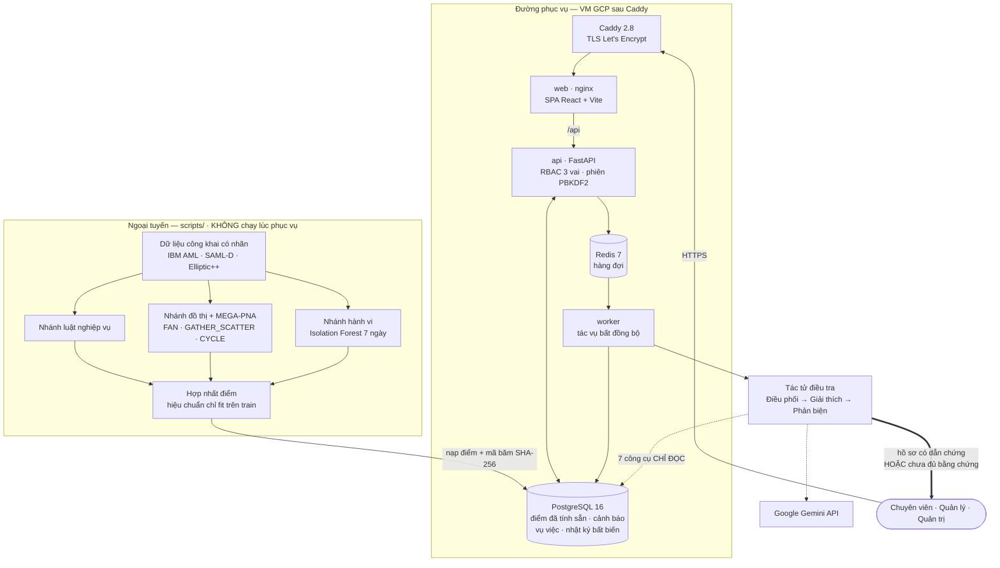
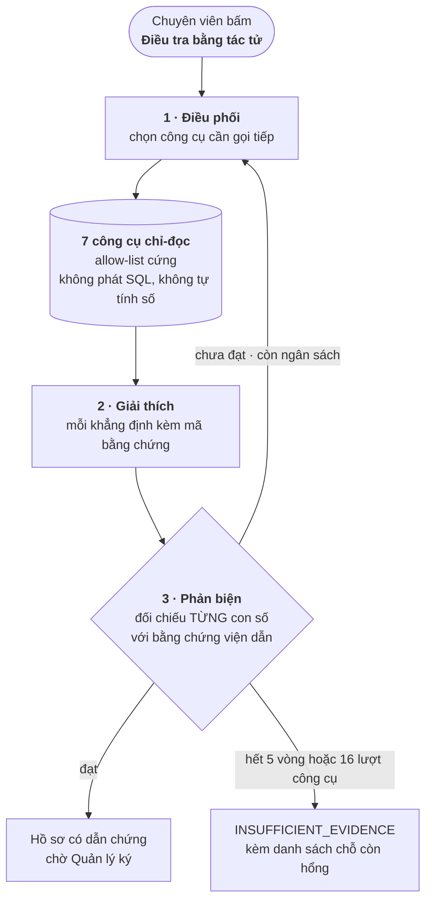
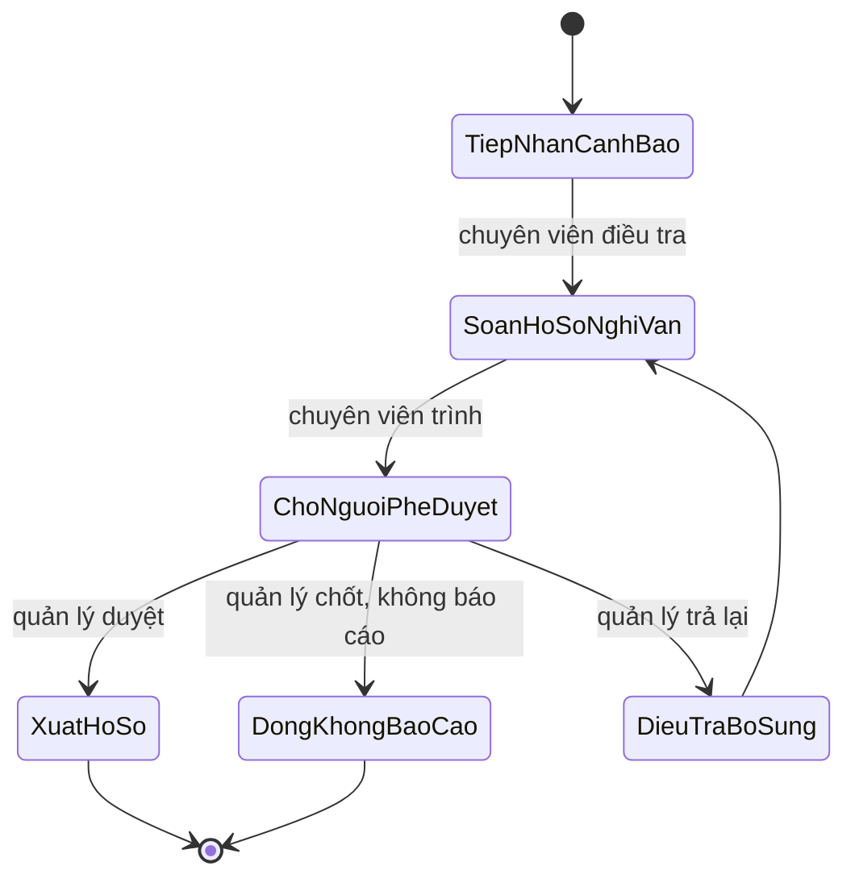

# Sơ đồ kiến trúc — FIN-07 AML Operations Console

Deliverable #3. Sơ đồ hệ thống và mô tả từng thành phần.

Tài liệu kiến trúc đầy đủ (sơ đồ triển khai, luồng request, bảo mật, CI/CD, sức
chứa): [`docs/architecture/architecture.md`](architecture/architecture.md).
Bản ảnh: [`docs/architecture/architecture.svg`](architecture/architecture.svg).

---

## 1. Sơ đồ tổng quan hệ thống

**Ba ranh giới bắt buộc trong sơ đồ trên:**

1. **Mô hình không chạy lúc phục vụ.** API chỉ đọc điểm đã tính sẵn trong
   PostgreSQL. Không có `joblib.load` hay `torch.load` nào trong đường phục vụ.
2. **Tác tử luôn bất đồng bộ và luôn chỉ đọc** — cưỡng chế bằng vai trò
   PostgreSQL chỉ có `SELECT`, không phải bằng quy ước.
3. **Đường ra của tác tử luôn kết thúc ở con người.** Không có nhánh thứ ba.

---

## 2. Luồng điều tra một cảnh báo

---

## 3. Quy trình vụ việc — hai vai, sáu trạng thái

Người **lập** và người **duyệt** khác **vai**, không chỉ khác người: Quản lý cố ý
không có quyền `prepare_sar`.

---

## 4. Mô tả thành phần

| Thành phần | Công nghệ | Vai trò |
|---|---|---|
| **Caddy** | Caddy 2.8-alpine | TLS tự động (Let's Encrypt), HTTP→HTTPS, security headers |
| **web** | nginx + React 18 + TypeScript + Vite | SPA console 3 vai trò; proxy `/api` và `/grafana` |
| **api** | FastAPI 0.141 · uvicorn · Python 3.11 | REST API, phân quyền mặc-định-đóng, phiên PBKDF2 200k vòng |
| **worker** | Python | Chạy phiên điều tra bất đồng bộ qua hàng đợi Redis |
| **PostgreSQL** | PostgreSQL 16 (Cloud SQL) | Giao dịch, cảnh báo, vụ việc, nhật ký kiểm toán bất biến, điểm mô hình đã tính sẵn |
| **Redis** | Redis 7-alpine | Hàng đợi tác vụ giữa api và worker |
| **Tác tử điều tra** | Google Gen AI SDK · Gemini | Ba vai sinh diễn giải có dẫn chứng; chỉ đọc, có trần chi phí |
| **Nhánh phát hiện** | scikit-learn · PyTorch Geometric · NetworkX · DuckDB | Chấm điểm ngoại tuyến, ghi vào CSDL kèm mã băm mô hình |
| **Nạp dữ liệu luồng** | Kafka · Flink (Java) · HDFS | Đã dựng và chạy end-to-end ở local-dev; **chưa triển khai production** |
| **Quan trắc** | OpenTelemetry · Prometheus · Loki · Jaeger · Grafana | Chỉ số, nhật ký, vết phân tán; nhúng trong console |

---

## 5. Tài liệu liên quan

| Tài liệu | Nội dung |
|---|---|
| [Kiến trúc đầy đủ](architecture/architecture.md) | Sơ đồ triển khai, luồng request, bảo mật, CI/CD, sức chứa |
| [Đặc tả hệ thống](specification/system-specification.md) | Phân tích nghiệp vụ, tuyên bố vấn đề, phạm vi |
| [Yêu cầu chức năng](specification/functional-requirements.md) | Vai trò, ma trận quyền, màn hình, quy trình |
| [Thiết kế kỹ thuật](specification/technical-design.md) | Thuật toán phát hiện, tầng tác tử, quyết định thiết kế |
| [Mô hình dữ liệu](specification/data-model.md) | Nguồn dữ liệu, lược đồ CSDL, đặc trưng, hợp đồng, lineage mô hình |
| [Kiểm thử](testing/test-plan.md) | Kế hoạch, ca kiểm thử và báo cáo |
