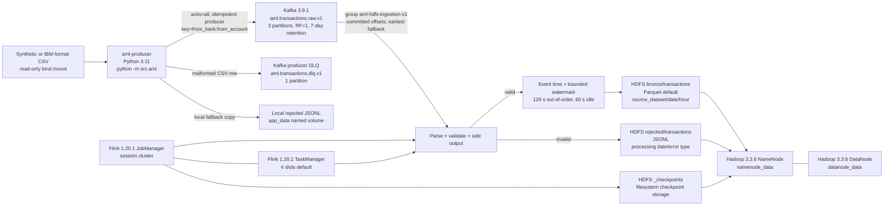

# Current Kafka-Flink-HDFS topology

Status: code-and-configuration topology at commit `c8895e1`

Runtime verification: ordinary application Compose smoke passed; AML-profile runtime verification remains pending

This document describes only components present in the repository. It does not describe a target production architecture.

## Topology map

## Producer

| Item | Actual implementation |
|---|---|
| Source | IBM AML-format CSV, streamed by `src/aml/csvsource.py`; two duplicate `Account` headers are handled by column position |
| Entry point | `python -m src.aml`, wired as the `aml-producer` Compose service |
| Container | Root application image based on Python 3.11; input directory mounted read-only, checkpoints/error log stored in `app_data` |
| Transformation | `src/aml/transform.py` parses timestamps, identifiers, amounts as `Decimal`, and preserves `is_laundering` without routing on it |
| Serialization | Compact UTF-8 JSON matching `contracts/ingestion/aml-transaction-v1.schema.json`, schema version `1.0` |
| Event identifier | Deterministic 32-hex-character `transaction_id`, derived from source-file identity, source line, and selected raw values |
| Kafka key | `from_bank:from_account`, preserving sender-account order within a partition |
| Headers | `schema-version`, `source-dataset`, `source-file`, `content-type` |
| Acknowledgement | `acks=all`; asynchronous delivery callbacks increment acknowledged/failed counters |
| Idempotent retries | `enable.idempotence=true`, retries `10,000,000`, max in-flight requests `5`, message timeout `120000 ms` by default |
| Backpressure | Retries `produce()` after `BufferError` while polling librdkafka |
| Raw topic | `aml.transactions.raw.v1` by default |
| Producer DLQ | `aml.transactions.dlq.v1`; malformed CSV rows are also written to a local JSONL fallback |
| Resume | Local JSON checkpoint advances only to the highest contiguous acknowledged source line; default interval 5 seconds |
| Replay modes | Maximum throughput or event-time pacing; CLI supports line and timestamp bounds |

Producer idempotence prevents duplicate writes caused by librdkafka retrying a send within one producer session. It does not deduplicate a CSV row sent again after process restart or a deliberate replay. The deterministic `transaction_id` makes such duplicates detectable.

## Kafka

| Item | Actual implementation |
|---|---|
| Broker | One `apache/kafka:3.9.1` container in combined KRaft broker/controller mode |
| Listeners | Internal `kafka:9092`, controller `:9093`, host access `localhost:29092`; all use PLAINTEXT |
| Persistent data | `kafka_data:/var/lib/kafka/data` named volume |
| Raw topic | `aml.transactions.raw.v1`, default 3 partitions, replication factor 1 |
| Producer DLQ topic | `aml.transactions.dlq.v1`, 1 partition, replication factor 1 |
| Retention | Topic `retention.ms=604800000` (7 days); broker log retention defaults to 168 hours |
| Topic creation | One-shot `kafka-init` calls `scripts/aml/create_topics.sh --if-not-exists` |
| Flink consumer group | Stable default `aml-hdfs-ingestion-v1` |
| Offset initialization | Committed offsets; if none exist, `earliest` by default (`latest` and `none` are configurable) |
| Partition discovery | Every 60 seconds |

There is no separate non-Flink Kafka consumer in the ingestion path. `scripts/aml/inspect_kafka.sh` is an operational inspection client.

## Flink

| Item | Actual implementation |
|---|---|
| Job name | `FIN-07 AML ingestion (kafka -> hdfs)` (the source uses a Unicode arrow) |
| Entry point | `vn.fin07.aml.ingest.AmlIngestionJob` in `/opt/flink/usrlib/aml-ingestion.jar` |
| Runtime | Flink 1.20.1, Scala 2.12, Java 11; Hadoop 3.3.6 client copied into the image |
| Source | Flink `KafkaSource<IngestedRecord>` reading the configured raw topic |
| Deserialization | Strict JSON parser: null, malformed, non-object, missing, mistyped, and unexpected fields become rejected records rather than task failures |
| Validation | `TransactionValidator` checks schema version, identifier, timestamp, amount, label, and source-reference constraints |
| Branches | Valid transaction main output; invalid data side output `rejected` |
| Event time | `event_time_epoch_ms`, assigned only after validation |
| Watermark | Bounded out-of-orderness 120 seconds; idle partitions after 60 seconds |
| Transformations | Parse -> validate/split -> derive UTC partition fields -> Avro record or JSON line -> file sink |
| Stateful operators | No business keyed state, windows, joins, or aggregation. Kafka source offsets and FileSink writer/committer state are checkpointed operator state |
| Parallelism | Default 2; TaskManager exposes 4 slots |
| Checkpoint interval | 30 seconds (`env.enableCheckpointing`) |
| Minimum pause | 15 seconds (half the interval) |
| Timeout | 120 seconds with defaults (max of 4 x interval and 60 seconds) |
| Concurrent checkpoints | Not explicitly set; Flink default applies (one) |
| Tolerable failures | 3 checkpoint failures |
| State backend | Heap/hash-map backend |
| Checkpoint storage | Filesystem at `hdfs://namenode:8020/data/aml/_checkpoints` |
| Externalized checkpoints | Not enabled in job code; retention-on-cancel is therefore not established |
| Restart strategy | Fixed delay, 10 attempts, 10 seconds by default |
| Savepoints | No savepoint command or restore procedure is provided |

The checkpoint directory is on HDFS backed by named NameNode/DataNode volumes, so state files survive ordinary container replacement as storage. That alone does not make the session JobManager highly available and does not prove automatic job recovery after JobManager loss.

## HDFS sinks

| Output | Path and behavior |
|---|---|
| Valid default | `hdfs://namenode:8020/data/aml/bronze/transactions/source_dataset=<...>/event_date=<UTC date>/event_hour=<UTC hour>/transactions-*.parquet` |
| Valid optional | Same partition layout as JSON Lines when `AML_HDFS_FORMAT=json` |
| Rejected | `hdfs://namenode:8020/data/aml/rejected/transactions/event_date=<processing UTC date>/error_type=<...>/rejected-*.jsonl` |
| Checkpoints | `hdfs://namenode:8020/data/aml/_checkpoints` |
| Reference files | `/data/aml/reference`; copied separately by `copy_patterns_to_hdfs.sh` |
| Parquet rolling | `OnCheckpointRollingPolicy`; bulk files roll on checkpoints |
| JSON rolling | 5-minute rollover, 2-minute inactivity, or 128 MiB by default; finished on a successful checkpoint |
| Commit visibility | Flink FileSink uses in-progress/pending/finished lifecycle; only finished files should be consumed |
| Duplicate handling | No deduplication operator or unique constraint in bronze |

NameNode and DataNode data are persisted in separate Compose named volumes. HDFS is a single NameNode/single DataNode development deployment, replication factor 1, permissions disabled, and the `/data/aml` tree is initialized mode `777`.

## Runtime topology

All services use Compose's implicit project network (`fin07_default` under the default project name). No custom network is declared.

| Service | Port exposed to host | Health/readiness | Dependency |
|---|---:|---|---|
| `kafka` | 29092 | Kafka metadata API command | none |
| `kafka-init` | none | one-shot exit status | healthy Kafka |
| `namenode` | 9870 | NameNode HTTP UI | none |
| `datanode` | none | DataNode HTTP UI inside container | healthy NameNode |
| `hdfs-init` | none | one-shot exit status | healthy DataNode |
| `flink-jobmanager` | 8081 | `/overview` | healthy Kafka and NameNode |
| `flink-taskmanager` | none | no explicit healthcheck | healthy JobManager |
| `aml-producer` | ephemeral | process exit status and reconciliation counters | healthy Kafka |

Named volumes relevant to this path are `kafka_data`, `namenode_data`, `datanode_data`, and `app_data`. `restart: unless-stopped` is set on Kafka, NameNode, DataNode, JobManager, and TaskManager; one-shot initialization and producer services use `restart: no`.

## Observability and operations

- Kafka, Flink, Hadoop, producer, and Compose logs are available through `docker compose --profile aml logs`.
- Producer progress uses aggregate `key=value` counters, including read, valid, invalid, acknowledged, failed, DLQ, latency, and duration data.
- Flink registers counters under metric group `aml`: consumed, valid, invalid, and deserialization failures.
- No metrics reporter/exporter is configured, so Flink metrics are available through Flink runtime surfaces but are not centrally scraped.
- Flink UI is exposed on port 8081; HDFS NameNode UI is exposed on port 9870.
- Kafka has no HTTP endpoint; readiness uses a broker metadata command.
- Operational scripts provide topic/offset/group inspection, HDFS inspection, job list/submit/cancel, logs, and an end-to-end smoke test.
- Logs are mostly human-readable rather than structured JSON. Correlation is available through `transaction_id` and Kafka partition/offset in stored records.

## Startup and shutdown behavior

Supported startup is `make aml-up` followed by `make aml-submit`; producing data is a separate deliberate command. Compose health dependencies establish basic startup order, but the Flink job is not submitted automatically.

`make aml-down` calls Compose down without `-v`, retaining named volumes. `make db-reset` is unrelated to AML but calls root `docker compose down -v` and would remove all project named volumes, including Kafka and HDFS data; this is a destructive cross-profile operational risk and must not be used as AML cleanup.

The current job stop script calls `flink cancel`, not stop-with-savepoint. Re-submission uses committed Kafka group offsets and does not pass a savepoint/checkpoint restore path.
