# FIN-07 — Phương pháp EDA, thiết kế đặc trưng và kiến trúc ML / Agent

| | |
|---|---|
| **Mã tài liệu** | FIN-07-ML-002 |
| **Phiên bản** | 2.0 |
| **Ngày** | 08/08/2026 |
| **Người thực hiện** | Hiển (đồ thị + agent), Hường (đặc trưng bảng + mô hình) |
| **Bộ dữ liệu** | **IBM AML — bản LI-Small** (theo DAT-001 §3.1) |
| **Tài liệu song hành** | FIN-07-ML-001 (quy tắc, chỉ số, cạm bẫy) |
| **Tài liệu gốc** | FIN-07-BUS-001, FIN-07-ARC-001, FIN-07-DAT-001 |

ML-001 nói **được làm gì và không được làm gì**. Tài liệu này nói **làm như thế nào**.

Trọng tâm là Chương 1–3: **cách tiến hành EDA**, không phải bảng kết quả. Kết quả sẽ cũ đi mỗi khi đổi bộ dữ liệu; phương pháp thì không. Hai script kèm theo chạy được trên bất kỳ bản nào của bộ IBM — LI-Small, HI-Medium, HI-Large — nên khi đổi bản chỉ cần chạy lại, không phải nghĩ lại.

### Danh mục hình

**Biểu đồ số liệu** — sinh từ `artifacts/eda/*.json` bằng `scripts/eda/plot_eda.py`, chạy lại được bất cứ lúc nào:

| | Hình | Trả lời câu hỏi |
|---|---|---|
| 1 | Phân bố giao dịch và nhãn dương theo ngày | Chia tập theo thời gian có dùng được không? |
| 2 | So sánh hai cách chia tập | Chia theo lịch để lại bao nhiêu mẫu dương? |
| 3 | Lift theo kênh thanh toán | Kênh nào là chữ ký bộ sinh? |
| 4 | Phân bố giờ trong ngày | Đặc trưng theo giờ là tín hiệu hay nhiễu? |
| 5 | Phân bố số tiền | Chuẩn hoá thế nào, đặt ngưỡng T01 ở đâu? |
| 6 | Phân bố bậc và ngưỡng hub | Loại hub ở đâu, bao nhiêu tài khoản đủ lịch sử? |
| 7 | Typology IBM và ánh xạ T01–T10 | Cam kết nào giữ được? |

**Sơ đồ kiến trúc** — mermaid, nằm trong markdown nên đi qua pull request như mã (RK7):

| | Sơ đồ | Ở đâu |
|---|---|---|
| 8 | Đường ống chuẩn bị dữ liệu, sáu bước | §5b |
| 9 | Bốn nhãn và bốn mẫu số khác nhau | §5c |
| 10 | Chia tập theo thành phần liên thông | §5d |
| — | Kiến trúc lớp ML, phễu hai tầng | Chương 8 |
| — | Máy trạng thái lớp Agent | Chương 9 |
| — | Trình tự luồng demo | Chương 10 |

---

> **Trạng thái dữ liệu (08/08/2026):** đủ ba file LI-Small. **Cả Chương 4 và Chương 5 đã chạy xong**, kết quả ở `artifacts/eda/li_small_patterns.json` và `artifacts/eda/li_small_transactions.json`.

---

## 1. Nguyên tắc EDA cho bộ dữ liệu này

EDA ở đây không phải "vẽ vài biểu đồ xem dữ liệu trông thế nào". Nó là bước **thu thập bằng chứng để quyết định thiết kế**: chia tập kiểu gì, đặc trưng nào dùng được, cam kết nào giữ được. Mỗi phép đo dưới đây tồn tại vì nó chặn một quyết định cụ thể.

### 1.1. Bốn nguyên tắc

**Một lượt streaming, không nạp cả file.** Bản LI-Small nhỏ nhưng cùng script phải chạy được trên HI-Large hàng chục GB. Mọi thứ trong script là generator; bộ nhớ tiến trình không phụ thuộc kích thước file. Đây cũng là lý do dùng `pyarrow.csv.open_csv` theo lô chứ không dùng `pandas.read_csv`.

**Đọc cột theo vị trí, không theo tên.** File có **hai cột đều tên `Account`**:

```
Timestamp,From Bank,Account,To Bank,Account,Amount Received,...
                    ^^^^^^^          ^^^^^^^
```

`pandas` đổi cột thứ hai thành `Account.1`; `csv.DictReader` giữ một cột và **âm thầm vứt cột kia**. Cả hai là hành vi của thư viện, thay đổi giữa các phiên bản, và không phải chỗ dựa được. Vị trí là hợp đồng; tên chỉ dùng để kiểm tra đã đưa đúng file vào.

**Mỗi phép đo phải nối được tới một quyết định.** Nếu không trả lời được câu "đo cái này rồi thì mình quyết định gì khác đi", thì đừng đo. Bảng ở §1.2 là bảng nối đó.

**Kết quả ghi ra JSON có checksum nguồn.** Số liệu EDA sẽ được trích vào báo cáo và slide. Không có checksum thì sáu tuần nữa không ai biết con số đó đo trên bản nào.

### 1.2. Mười phép đo và quyết định chúng chặn

| # | Đo cái gì | Chặn quyết định nào | Ngưỡng hành động |
|---|---|---|---|
| 1 | Quy mô, khoảng thời gian | Độ dài cửa sổ đặc trưng tối đa | Cửa sổ dài nhất ≤ ⅓ khoảng thời gian |
| 2 | Tỉ lệ nhãn mức **giao dịch** | Chọn chỉ số đánh giá | < 1% → cấm accuracy, ROC-AUC chỉ phụ |
| 3 | Tỉ lệ nhãn mức **tài khoản** | Đơn vị dự đoán; mẫu số của precision@k | Nếu cao hơn nhiều lần mức giao dịch → chọn tài khoản làm đơn vị chính |
| 4 | Phân bố bậc | Ngưỡng loại hub; phạm vi nhánh tự-so-sánh | Loại hub ở chỗ phân bố đứt gãy |
| 5 | **Nhãn dương theo ngày** | **Chia tập theo thời gian có dùng được không** | Nếu tập cuối < 5% tổng nhãn dương → **không chia theo thời gian** |
| 6 | Kênh thanh toán × nhãn | Kênh nào phải loại khỏi đặc trưng | lift ≥ 3× → cấm vĩnh viễn; < 1,5× → được dùng |
| 7 | Tiền tệ × nhãn | Đặc trưng số loại tiền tệ có an toàn không | Cùng ngưỡng như trên |
| 8 | Giờ trong ngày | Đặc trưng theo giờ là tín hiệu hay nhiễu | Nếu mọi giờ ≈ 1/24 → loại toàn bộ đặc trưng theo giờ |
| 9 | Số tiền theo từng tiền tệ | Cách chuẩn hoá; đặt ngưỡng T01 ở đâu | Trải > 3 bậc độ lớn → bắt buộc chuẩn hoá trong từng tiền tệ |
| 10 | Cạnh tự trỏ, lệch zero-padding | Hai lỗi im lặng làm hỏng đồ thị | Bất kỳ giá trị nào > 0 → phải xử lý trước khi dựng đồ thị |

**Phép đo số 5 là phép quan trọng nhất và dễ bỏ qua nhất.** Ai cũng giả định nhãn dương phân bố đều theo thời gian. Nếu không, chia 60/20/20 theo thời gian sẽ để lại một tập test gần như không có mẫu dương, và mọi chỉ số trên đó vô nghĩa. Phải đo, không được giả định.

**Phép đo số 3 hay bị bỏ sót vì tưởng suy ra được từ số 2.** Không suy ra được: một giao dịch laundering chạm hai tài khoản, và một tài khoản có thể tham gia nhiều giao dịch. Tỉ số giữa hai tỉ lệ thường lớn hơn 10 lần, và nó quyết định bài toán dễ hay khó.

### 1.3. Bốn câu hỏi cho file pattern

File `*_Patterns.txt` là nguồn của `label_typology`. Bốn câu hỏi:

1. **IBM cung cấp những typology nào?** → Typology nào trong danh mục T01–T10 của BUS-001 có ground truth thật, typology nào phải rút khỏi cam kết hoặc phải tự sinh.
2. **Một instance lớn cỡ nào, trải mấy ngày?** → Bán kính subgraph cần dựng; instance có bị vắt qua mốc cắt không.
3. **Bao nhiêu tài khoản thuộc nhiều instance?** → Nếu > 0 thì gom instance **bắt buộc** là một lượt duyệt thành phần liên thông, không phải vòng lặp theo từng network.
4. **Kênh và tiền tệ bên trong pattern lệch thế nào?** → Kênh nào là chữ ký bộ sinh.

---

## 2. Hai công cụ

Nằm trong repo, chạy lại được, không phụ thuộc ai.

| Script | Đầu vào | Thời gian |
|---|---|---|
| `scripts/eda/profile_patterns.py` | `*_Patterns.txt` | vài giây |
| `scripts/eda/profile_transactions.py` | `*_Trans.csv` | ~50 s cho 3 GB |

Cả hai nhận `--input` và `--output`, in JSON ra màn hình và ghi file. Cả hai chuẩn hoá mã ngân hàng và ghép khoá `bank:account` giống hệt nhau — dùng chung định nghĩa, không có hai cách hiểu về "tài khoản là gì".

`profile_transactions.py` **kiểm tra header trước khi chạy** và dừng ngay nếu file không đúng định dạng IBM 11 cột, thay vì đọc nhầm theo vị trí rồi cho ra số liệu sai một cách im lặng.

---

## 3. Cách chạy

### 3.1. File pattern — đã chạy

```bash
python scripts/eda/profile_patterns.py \
    --input data/raw/ibm-aml/LI-Small-Patterns.txt \
    --output artifacts/eda/li_small_patterns.json
```

### 3.2. File giao dịch — đã chạy, 27,0 giây

```bash
python scripts/eda/profile_transactions.py \
    --input data/raw/ibm-aml/LI-Small_Trans.csv \
    --output artifacts/eda/li_small_transactions.json
```

Chạy xong, đọc kết quả theo đúng thứ tự của bảng §1.2 và điền vào Chương 5. Ba con số phải xem trước tiên:

1. `ti_le_nen.muc_tai_khoan_pct` — quyết định mẫu số của precision@k
2. `nhan_theo_ngay` — quyết định cách chia tập
3. `kenh_thanh_toan[].lift` — quyết định `Payment Format` có bị cấm không

### 3.3. Đọc kết quả — bảng tra ngưỡng

| Trường trong JSON | Đọc thế nào |
|---|---|
| `ti_le_nen.ti_so_giua_hai_muc` | > 10 → chốt đơn vị dự đoán là **tài khoản** |
| `nhan_theo_ngay` | Cộng nhãn dương của 20% ngày cuối. **< 5% tổng → cấm chia theo thời gian** |
| `bac.so_tai_khoan_bac_>=1000` | Số nhỏ (vài chục) → ngưỡng loại hub 1.000 là sạch |
| `bac.so_tai_khoan_bac_>=20` | Chia cho tổng tài khoản → phạm vi nhánh tự-so-sánh |
| `kenh_thanh_toan[].lift` | ≥ 3 → cấm vĩnh viễn. 1,5–3 → PM quyết. < 1,5 → dùng được |
| `gio_trong_ngay.ti_le_min/max` | Chênh nhau < 10% tương đối → **loại toàn bộ đặc trưng theo giờ** |
| `so_tien.theo_tien_te` | So p50 giữa các tiền tệ; chênh > 3 bậc → bắt buộc chuẩn hoá trong từng tiền tệ |
| `loi_im_lang.so_ma_bi_gop_do_zero_padding` | > 0 → **bắt buộc** strip leading zeros trước mọi phép ghép |
| `loi_im_lang.canh_tu_tro` | > 0 → loại trước khi dựng đồ thị |

---

## 4. Kết quả trên LI-Small — file pattern

Nguồn: `LI-Small-Patterns.txt`, 99.155 byte, SHA-256 `f4d24a13…6e1a88`.

### 4.1. Tổng quan

| | |
|---|---:|
| Instance hoàn chỉnh | **117** |
| Khối thiếu dòng `END` | 0 |
| Giao dịch trong pattern | **1.023** |
| Tài khoản trong pattern | **1.168** |
| **Tài khoản thuộc nhiều instance** | **49** |

> 49 tài khoản thuộc nhiều instance ⇒ **gom instance bắt buộc là một lượt duyệt thành phần liên thông.** Vòng lặp theo từng network sẽ tách hai instance dính nhau về hai tập, và model học thuộc mạng lưới thay vì học mẫu hình.

### 4.2. Danh mục typology

| Typology IBM | Instance | Txn/instance (p50) | Tài khoản/instance (p50) | Số ngày trải (p50 / max) |
|---|---:|---:|---:|---:|
| FAN-OUT | 19 | 7 | 8 | 4 / 5 |
| STACK | 18 | 6 | 9 | 3 / 5 |
| BIPARTITE | 16 | 8 | 16 | 2 / 3 |
| RANDOM | 15 | 5 | 6 | 3 / 5 |
| SCATTER-GATHER | 13 | 12 | 8 | 5 / 5 |
| FAN-IN | 12 | 6 | 7 | 4 / 5 |
| GATHER-SCATTER | 12 | 15 | 16 | 7 / 9 |
| CYCLE | 12 | 7 | 7 | 4 / 5 |

Mạng lưới nhỏ: 5–15 giao dịch, 6–16 tài khoản, **không instance nào trải quá 9 ngày**. Đây là quy mô NetworkX xử lý thoải mái trên subgraph — khẳng định lại quyết định QD4.

### 4.3. Kênh thanh toán bên trong pattern

| Kênh | Số dòng | Tỉ lệ |
|---|---:|---:|
| **ACH** | **1.022** | **99,90%** |
| Bitcoin | 1 | 0,10% |

Trong 1.023 giao dịch thuộc 117 kịch bản rửa tiền, **1.022 là ACH**. Đây là chữ ký của bộ sinh dữ liệu ở dạng gần như tinh khiết. Cần chờ phép đo số 6 trên file giao dịch để tính lift chính xác, nhưng kết luận gần như chắc chắn: **`Payment Format` bị cấm làm đặc trưng model**.

Tiền tệ trong pattern: USD 541, Euro 414, Yuan 19, Yen 12, Australian Dollar 11, Canadian Dollar 7, Swiss Franc 4, Brazil Real 3. Đa tiền tệ có thật, phù hợp với typology CYCLE nhảy qua lại giữa các đơn vị.

### 4.4. Hai phát hiện làm thay đổi cam kết

#### 4.4.1. LI-Small **không có** typology chia nhỏ giao dịch

Ánh xạ 8 typology của IBM sang danh mục T01–T10 (BUS-001 §2.3):

| Danh mục FIN-07 | Typology IBM | Instance |
|---|---|---:|
| **T01 — Chia nhỏ giao dịch** | **KHÔNG CÓ** | **0** |
| T02 — Mạng tài khoản trung gian | STACK, BIPARTITE | 34 |
| T03 — Giao dịch vòng | CYCLE | 12 |
| T04 — Gom vào / Toả ra | FAN-IN, FAN-OUT, SCATTER-GATHER, GATHER-SCATTER | 56 |
| **T05 — Luân chuyển tốc độ cao** | Không có typology riêng — dẫn xuất từ thời gian lưu tiền | — |
| T06–T09 | Không có | 0 |
| — | RANDOM (không ánh xạ được) | 15 |

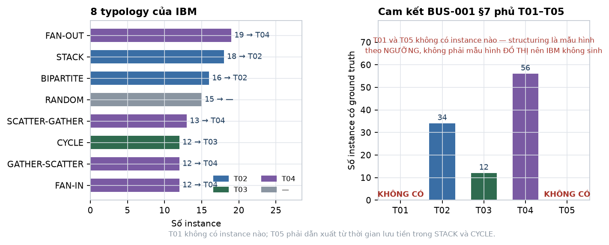

*Hình 7 — Trái: 8 typology của IBM, màu theo danh mục FIN-07 được ánh xạ tới. Phải: số instance có ground truth cho từng mục trong cam kết T01–T05.*

**BUS-001 §7 cam kết độ phủ ≥ 85% với T01–T05. Cam kết này không thực hiện được nguyên trạng.** Structuring là mẫu hình theo *số tiền và ngưỡng*, không phải mẫu hình *đồ thị*, nên bộ mô phỏng của IBM không sinh nó.

Đây là rủi ro RD6 đã hiện thực hoá, và DAT-001 §4.3 đã dự liệu sẵn đường xử lý. **Cần PM chọn:**

| | Nội dung | Chi phí |
|---|---|---|
| **A** | Thu hẹp cam kết còn **T02–T04**, ghi rõ T01 và T05 không có ground truth trong nguồn | 0 — sửa tài liệu |
| **B** | Tự sinh ca structuring: chọn tài khoản sạch, tiêm chuỗi giao dịch sát dưới ngưỡng, gắn nhãn T01 riêng | ~2 SP, và mọi con số T01 là "phát hiện chính phép tiêm của mình" — cùng vấn đề vòng tròn như T10 (ML-001 §9.1) |
| **C** | A cho cam kết đo lường + B cho phần trình diễn, tách bạch trong báo cáo | ~2 SP, trung thực nhất |

Khuyến nghị **C**.

#### 4.4.2. 117 instance là quá ít để đo độ phủ trên tập giữ lại

CYCLE có **12 instance**. FAN-IN 12. GATHER-SCATTER 12. Chia 70/10/10/10 thì tập test nhận **1–2 instance mỗi loại**.

Đo "recall ≥ 85% cho T03" trên 1 instance là vô nghĩa: kết quả chỉ có thể là 0% hoặc 100%.

**Cách xử lý:**

- **Độ phủ typology đo trên toàn bộ 117 instance**, không trên tập giữ lại. Ghi rõ đây là **chỉ số năng lực** (hệ thống có nhận ra mẫu hình này không), không phải **chỉ số tổng quát hoá**.
- **PR-AUC và precision@k vẫn đo trên tập test giữ lại**, vì chúng dùng `label_laundering` với số mẫu lớn hơn nhiều.
- Hai chỉ số này có mẫu số khác nhau và **không được trộn vào cùng một bảng**.

Nếu muốn con số độ phủ có tính tổng quát hoá thì phải dùng **leave-one-instance-out** trên 117 instance — khả thi, tốn khoảng 1 SP, và đáng làm nếu hội đồng hỏi sâu.

---

## 5. Kết quả trên LI-Small — file giao dịch

Nguồn: `LI-Small_Trans.csv`, 650.422.357 byte. Chạy hết **27,0 giây**.

### 5.1. Quy mô — cửa sổ thật chỉ 10 ngày, không phải 28

| | |
|---|---:|
| Giao dịch | **6.924.049** |
| Tài khoản | **705.907** |
| Mốc đầu | 2022/09/01 00:00 |
| Mốc cuối | 2022/09/17 15:28 |
| Số ngày có giao dịch | 17 |

Nhưng số ngày danh nghĩa không phải số ngày dùng được. Khối lượng theo ngày:

| Ngày | Giao dịch | Ngày | Giao dịch |
|---|---:|---|---:|
| 09/01 | 1.524.807 | 09/09 | 891.573 |
| 09/02 | 1.027.758 | 09/10 | 282.877 |
| 09/03 | 283.326 | 09/11 | **77** |
| 09/04 | 282.476 | 09/12 | 48 |
| 09/05 | 657.397 | 09/13 | 48 |
| 09/06 | 657.170 | 09/14 | 31 |
| 09/07 | 658.504 | 09/15 | 9 |
| 09/08 | 657.938 | 09/16 | 7 |
| | | 09/17 | 3 |

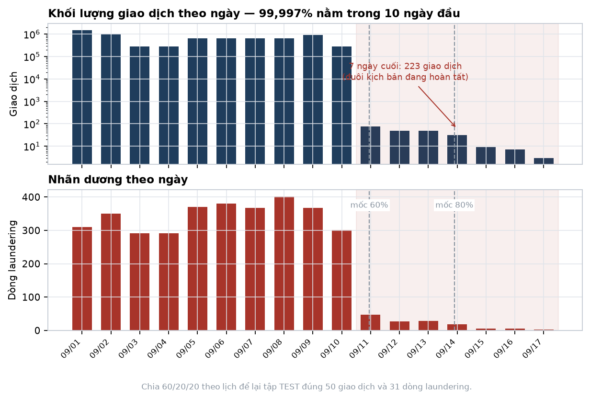

*Hình 1 — Khối lượng theo thang log ở trên, nhãn dương theo thang tuyến tính ở dưới. Vùng hồng là 7 ngày cuối; hai đường đứt là mốc cắt nếu chia 60/20/20 theo lịch.*

**99,997% giao dịch nằm trong 10 ngày 09/01–09/10.** Bảy ngày cuối cộng lại có **223 giao dịch** — đó là đuôi các kịch bản đang hoàn tất, không phải hoạt động của ngân hàng.

Khối lượng còn rất không đều ngay trong 10 ngày đó: 09/01 có 1,52 triệu, 09/03 chỉ 283 nghìn — chênh 5,4 lần.

> **Hệ quả 1 — dữ liệu hiệu dụng quá ngắn cho cửa sổ dài.** Với 10 ngày giao dịch có mật độ đáng kể, cửa sổ 7 ngày chiếm 70% và gần như không trượt được. EDA ban đầu ưu tiên bộ cửa sổ `{1, 2, 3}` ngày; release hợp nhất sau đó khóa scoring unit ở `7d` để đồng bộ Graph.
>
> **Hệ quả 2 — không có mùa vụ, không có nền 30 ngày, không có đại lượng theo tháng.** DAT-001 §5.1 định nghĩa "doanh số trung vị theo tháng" và "tỉ lệ đối tác mới theo tháng" — không tính được, phải đổi sang cửa sổ ngày.

### 5.2. Hai tỉ lệ nền

| | |
|---|---:|
| Dòng laundering | **3.565** |
| **Tỉ lệ nền mức giao dịch** | **0,0515%** |
| Tài khoản chạm ≥ 1 giao dịch laundering | **5.304** |
| **Tỉ lệ nền mức tài khoản** | **0,7514%** |
| Tỉ số giữa hai mức | **14,6 lần** |

Khớp với DAT-001 §3.1 ("khoảng 0,05%"). Tỉ số 14,6 lần vượt ngưỡng hành động ở §1.2 ⇒ **chốt đơn vị dự đoán là tài khoản**, và mẫu số cho mọi phép tính precision@k là **705.907 tài khoản với 5.304 dương**.

> 5.304 tài khoản dương là con số phải nhớ. Chia 70/10/10/10 thì tập test nhận khoảng **530 tài khoản dương** — đủ để đo PR-AUC nhưng **bắt buộc phải kèm khoảng tin cậy bootstrap** (ML-001 §8.1). Hai model lệch nhau dưới vài điểm phần trăm thì không được tuyên bố cái nào hơn.

### 5.3. Phân bố nhãn theo ngày — **cấm chia tập theo thời gian**

| Ngày | Laundering | % tổng | Ngày | Laundering | % tổng |
|---|---:|---:|---|---:|---:|
| 09/01 | 310 | 8,70% | 09/09 | 367 | 10,29% |
| 09/02 | 350 | 9,82% | 09/10 | 301 | 8,44% |
| 09/03 | 292 | 8,19% | 09/11 | 47 | 1,32% |
| 09/04 | 291 | 8,16% | 09/12 | 27 | 0,76% |
| 09/05 | 370 | 10,38% | 09/13 | 29 | 0,81% |
| 09/06 | 380 | 10,66% | 09/14 | 18 | 0,50% |
| 09/07 | 368 | 10,32% | 09/15 | 6 | 0,17% |
| 09/08 | 402 | 11,28% | 09/16 | 5 | 0,14% |
| | | | 09/17 | 2 | 0,06% |

Trong 10 ngày đầu, nhãn dương phân bố khá đều (8,2–11,3% mỗi ngày). Từ 09/11 trở đi thì sụp cùng với toàn bộ khối lượng.

**Chia 60/20/20 theo lịch trên span 16,6 ngày** đặt mốc cắt ở 09/11 và 09/14:

| Tập | Khoảng | Giao dịch | Laundering |
|---|---|---:|---:|
| TRAIN | 09/01 → 09/11 | 6.923.826 | 3.431 |
| VALIDATION | 09/11 → 09/14 | 173 | 103 |
| **TEST** | **09/14 → 09/17** | **50** | **31** |

**Tập test 50 giao dịch.** Không có gì để đánh giá.

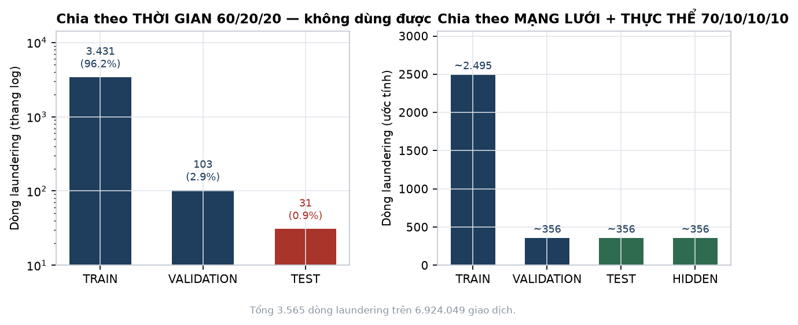

*Hình 2 — Trái: chia theo lịch, tập TEST còn 31 dòng laundering (0,9%). Phải: chia theo mạng lưới, mỗi tập giữ đúng tỉ lệ.*

> **Kết luận, có bằng chứng số: cấm chia tập theo thời gian trên bộ này.**
>
> Chuyển sang **chia theo thành phần liên thông của mạng lưới rồi tới thực thể, tỉ lệ 70/10/10/10**, giữ một cột `time_partition` để ai muốn đánh giá theo thời gian vẫn làm được — nhưng không cắt tập theo nó. 49 tài khoản thuộc nhiều instance (§4.1) nên bước gom **bắt buộc** là một lượt duyệt thành phần liên thông.
>
> Giới hạn "không có holdout theo thời gian đúng nghĩa" phải ghi vào manifest, không giấu. Đây là [LỆCH] so với DAT-001 ND2 và §4.2, và là chỗ cần PM duyệt.

### 5.4. Kênh thanh toán — ACH lift 6,37 lần, cấm dùng

| Kênh | Toàn file | Trong laundering | P(laundering) | **Lift** |
|---|---:|---:|---:|---:|
| **ACH** | 796.581 (11,51%) | **2.611 (73,24%)** | 0,328% | **6,37×** |
| Cheque | 2.503.158 (36,15%) | 459 (12,88%) | 0,018% | 0,36× |
| Cash | 655.688 (9,47%) | 124 (3,48%) | 0,019% | 0,37× |
| Credit Card | 1.780.389 (25,71%) | 261 (7,32%) | 0,015% | 0,28× |
| Bitcoin | 309.208 (4,47%) | 110 (3,09%) | 0,036% | 0,69× |
| **Reinvestment** | 650.458 (9,39%) | **0** | 0% | **0** |
| **Wire** | 228.567 (3,30%) | **0** | 0% | **0** |

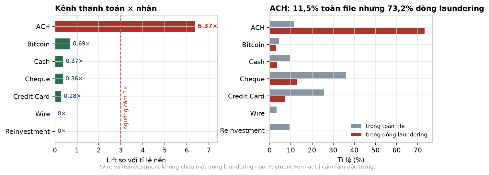

*Hình 3 — Trái: lift so với tỉ lệ nền, đường đứt đỏ là ngưỡng cấm 3×. Phải: tỉ trọng kênh trong toàn file so với trong dòng laundering.*

Lift 6,37× vượt xa ngưỡng cấm 3× ở §1.2. Hai kênh Reinvestment và Wire **không chứa một dòng laundering nào**. Cộng với 99,9% giao dịch trong file pattern là ACH (§4.3):

> **`Payment Format` bị cấm làm đặc trưng model, vĩnh viễn.** Vẫn lưu và hiển thị trong hồ sơ vụ việc theo DAT-001 §4.1, nhưng không vào ma trận đặc trưng.

### 5.5. Tiền tệ — an toàn, được dùng

| Tiền tệ | Toàn file | Trong laundering | Lift |
|---|---:|---:|---:|
| US Dollar | 36,88% | 40,84% | 1,11× |
| Euro | 23,05% | 28,75% | **1,25×** |
| Yuan | 6,98% | 5,30% | 0,76× |
| Rupee | 4,92% | 3,14% | 0,64× |
| Bitcoin | 4,47% | 3,09% | 0,69× |
| Saudi Riyal | 3,73% | 3,23% | 0,87× |

Lift lớn nhất là **1,25×**, dưới ngưỡng an toàn 1,5×. **Đặc trưng số loại tiền tệ và tỉ lệ chéo tiền tệ được phép dùng** — câu hỏi bỏ ngỏ ở ML-001 §9.3 đã có câu trả lời.

Giao dịch chéo tiền tệ: 98.876 dòng = **1,428%**.

### 5.6. Giờ trong ngày — cấm dùng, nhưng vì lý do khác dự đoán

| Giờ | Tỉ lệ |
|---|---:|
| **00** | **12,551%** |
| 01–23 | 3,78% – 3,82% |
| *Kỳ vọng nếu đều* | *4,167%* |

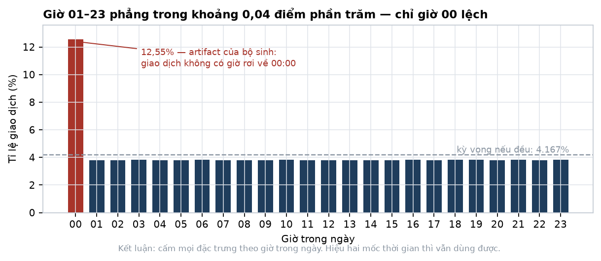

*Hình 4 — Cột đỏ là giờ 00. Đường đứt xám là mức kỳ vọng nếu phân bố đều.*

23 giờ từ 01 đến 23 gần như phẳng tuyệt đối — chênh lệch giữa giờ cao nhất và thấp nhất chỉ **0,04 điểm phần trăm**. Riêng giờ 00 chiếm 12,55%, gấp **3,3 lần** các giờ còn lại.

Đây không phải nhịp sinh hoạt. Đó là **artifact của bộ sinh dữ liệu** — giao dịch không được gán giờ cụ thể thì rơi về 00:00.

> **Cấm toàn bộ đặc trưng theo giờ trong ngày.** Nguy hiểm hơn trường hợp phân bố đều thuần tuý: một đặc trưng kiểu "tỉ lệ giao dịch lúc nửa đêm" sẽ *có* phương sai, *trông như* tín hiệu, mà thực chất chỉ bắt được dấu vết của bộ sinh. Đúng loại đường tắt mà ML-001 §9 cảnh báo.
>
> Vẫn giữ được: `weekend_ratio` (ngày trong tuần là thông tin thật) và mọi đại lượng là **hiệu hai mốc thời gian** — thời gian lưu tiền, độ trễ giữa các bước chu trình. T05 dựa vào loại thứ hai nên không bị ảnh hưởng.

### 5.7. Số tiền — laundering nằm ở khúc giữa

| | p25 | p50 | p75 | p95 |
|---|---:|---:|---:|---:|
| Toàn bộ (mẫu 500K) | 24,69 | 2.266,37 | 39.638,32 | 2.101.476,83 |
| Chỉ dòng laundering | 1.461,77 | **4.295,24** | 13.971,04 | 312.500,45 |

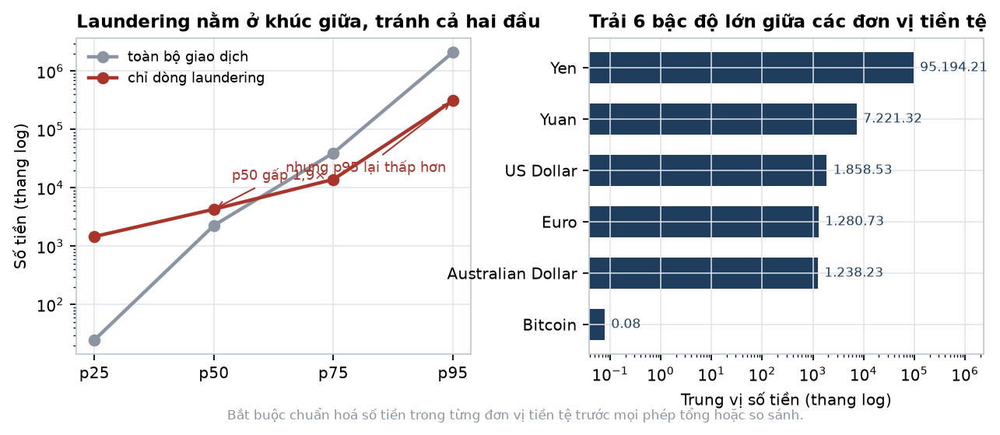

*Hình 5 — Trái: đường phân vị của toàn bộ giao dịch so với chỉ dòng laundering, thang log. Phải: trung vị số tiền theo từng đơn vị tiền tệ.*

Hình dạng đáng chú ý: trung vị laundering **cao gấp 1,9 lần** mặt bằng, nhưng p75 và p95 lại **thấp hơn** mặt bằng. Nghĩa là giao dịch rửa tiền **tránh cả hai đầu** — không quá nhỏ, không quá lớn. Phù hợp với nghiệp vụ: chia nhỏ và phân tán đều dùng khoản cỡ trung.

Đây là tín hiệu thật và dùng được. Nó cũng gợi ý luật T01 nên nhắm dải giữa chứ không chỉ dải sát ngưỡng.

Trải theo tiền tệ, trung vị: Yen 95.194 — Yuan 7.221 — US Dollar 1.859 — Euro 1.281 — Bitcoin **0,078**. **Sáu bậc độ lớn.**

> **Bắt buộc chuẩn hoá trong từng đơn vị tiền tệ** trước mọi phép tổng hoặc so sánh. Mọi thống kê số tiền gộp chung các đơn vị là vô nghĩa.

### 5.8. Hai lỗi im lặng — cả hai đều có

| | |
|---|---:|
| **Cạnh tự trỏ** (nguồn = đích) | **804.477 = 11,62%** |
| Mã ngân hàng thô | 41.866 |
| Mã sau khi strip zero-padding | 41.814 |
| **Mã bị gộp do zero-padding** | **52** |

Cạnh tự trỏ chiếm hơn một phần chín dữ liệu — cao hơn HI-Medium (8,03%). Không loại thì bậc vào và bậc ra bị thổi lên, `out_in_ratio` méo, và mọi đặc trưng đồ thị sai.

52 mã ngân hàng bị gộp: nếu không strip leading zeros thì 52 cặp ngân hàng bị coi là khác nhau, khoá tài khoản ghép sai, và đồ thị sinh ra **cạnh giả cùng chu trình không có thật** — đúng loại chu trình mà T03 đi tìm.

> Cả hai phải xử lý ở bước B4 của đường ống chuẩn bị (§ bên dưới), **trước** khi dựng đồ thị.

### 5.9. Bậc — ngưỡng hub sạch, một phần ba tài khoản đủ lịch sử

| | p25 | p50 | p75 | p95 | p99 | max |
|---|---:|---:|---:|---:|---:|---:|
| Bậc tổng | 2 | **6** | 27 | 70 | 119 | **223.590** |

| | |
|---|---:|
| Tài khoản bậc ≥ 20 | **237.741 = 33,7%** |
| Tài khoản bậc ≥ 100 | 13.266 = 1,88% |
| **Tài khoản bậc ≥ 1.000** | **15** |
| Bậc ra lớn nhất | 222.037 |
| Bậc vào lớn nhất | 1.553 |

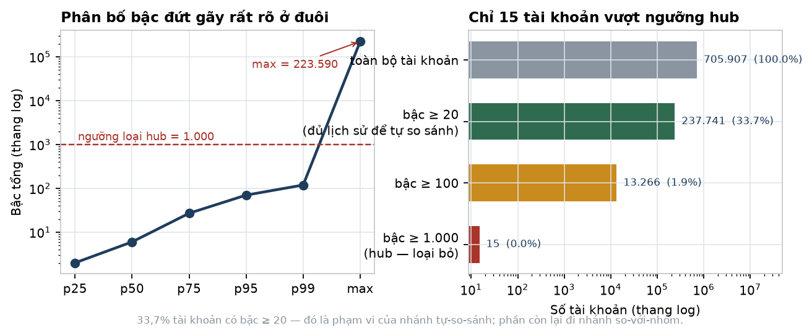

*Hình 6 — Trái: đường phân vị bậc, thang log, kèm ngưỡng loại hub. Phải: số tài khoản trong từng dải bậc.*

**Chỉ 15 tài khoản có bậc ≥ 1.000, trong khi tài khoản lớn nhất có 223.590.** Phân bố đứt gãy rất rõ ⇒ **ngưỡng loại hub đặt ở 1.000**, mất đúng 15 nút mà loại sạch hạ tầng thanh toán.

Tài khoản lớn nhất có bậc ra 222.037 so với bậc vào 1.553 — gần như chỉ phát, không nhận. Đó là điểm phát tiền tập trung, không phải khách hàng.

**33,7% tài khoản có bậc ≥ 20** ⇒ đó là phạm vi áp dụng của nhánh tự-so-sánh (ML-001 §5.7). Hai phần ba còn lại phải đi nhánh so-với-nhóm.

### 5.10. Tổng kết quyết định do EDA chốt

| # | Quyết định | Căn cứ |
|---|---|---|
| 1 | Đơn vị dự đoán là **tài khoản** | Tỉ số hai tỉ lệ nền 14,6× (§5.2) |
| 2 | Bộ cửa sổ **{1, 2, 3} ngày** | 99,997% dữ liệu nằm trong 10 ngày (§5.1) |
| 3 | **Cấm chia tập theo thời gian**, chia theo mạng lưới + thực thể 70/10/10/10 | Test theo lịch còn 50 giao dịch (§5.3) |
| 4 | **Cấm `Payment Format`** làm đặc trưng | Lift 6,37× (§5.4) |
| 5 | **Cho phép** đặc trưng tiền tệ | Lift tối đa 1,25× (§5.5) |
| 6 | **Cấm mọi đặc trưng theo giờ trong ngày** | Giờ 00 là artifact 3,3× (§5.6) |
| 7 | **Chuẩn hoá số tiền trong từng tiền tệ** | Trải 6 bậc độ lớn (§5.7) |
| 8 | Ngưỡng loại hub = **1.000**, loại 15 tài khoản | Phân bố đứt gãy (§5.9) |
| 9 | Loại **804.477 cạnh tự trỏ** và strip zero-padding trước khi dựng đồ thị | §5.8 |
| 10 | Nhánh tự-so-sánh phủ **33,7%** tài khoản | §5.9 |

---

## 5b. Đường ống chuẩn bị dữ liệu

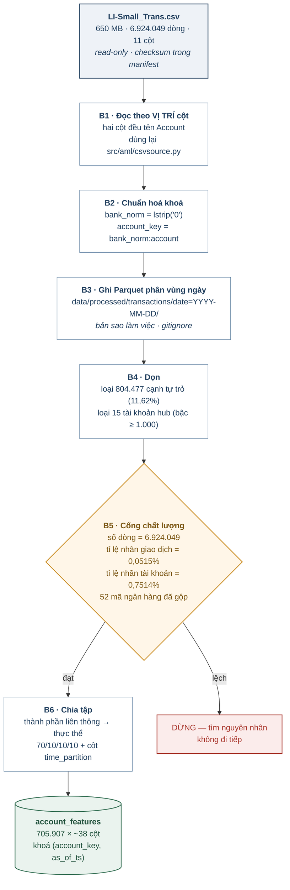

*Hình 8 — Sáu bước. Bước B5 là cổng chặn: lệch một con số thì dừng, không đi tiếp. Bốn con số kiểm tra ở B5 đều lấy từ kết quả EDA §5.*

**Vì sao Parquet.** CSV là nguồn sự thật, giữ nguyên, checksum trong manifest. Parquet ở `data/processed/` là bản sao làm việc — xoá được, dựng lại bằng một lệnh. Đọc hết CSV một lượt mất 27 giây; xây đặc trưng sẽ đọc lại hàng chục lần mỗi ngày, và Parquet cột có kiểu, phân vùng theo ngày, cắt thời gian đó xuống còn vài giây. Đây cũng không phải công nghệ mới với dự án: `AML_HDFS_FORMAT` trong `docker-compose.yml` đã mặc định `parquet`.

---

## 5c. Bốn nhãn — đo bốn thứ khác nhau

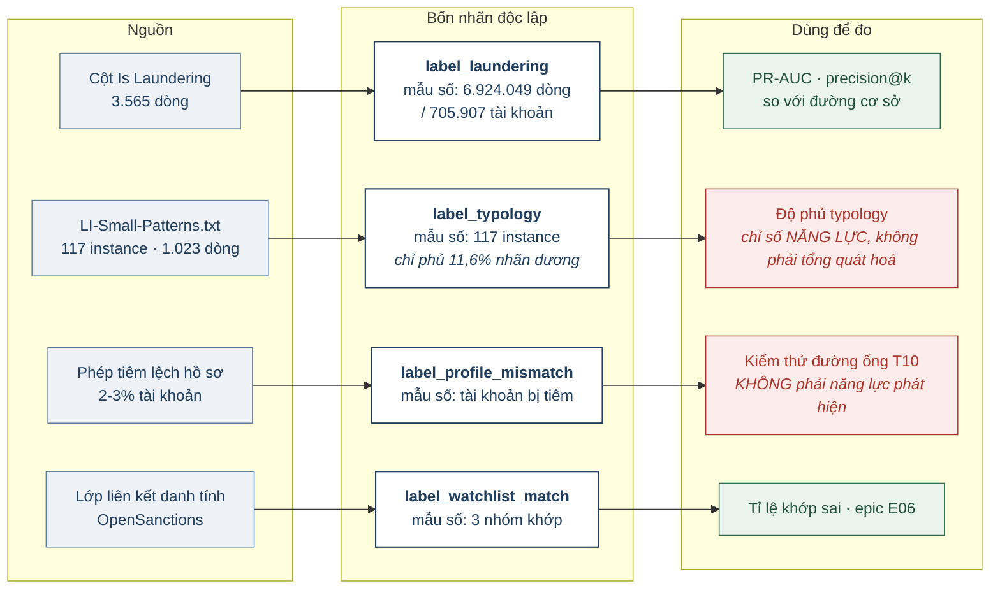

*Hình 9 — Bốn nhãn có bốn mẫu số khác nhau. Trộn mẫu số là nguyên nhân phổ biến nhất khiến kết quả đánh giá sai một bậc. Hai ô đỏ là hai chỉ số phải kèm chú thích khi báo cáo.*

---

## 5d. Chia tập theo thành phần liên thông

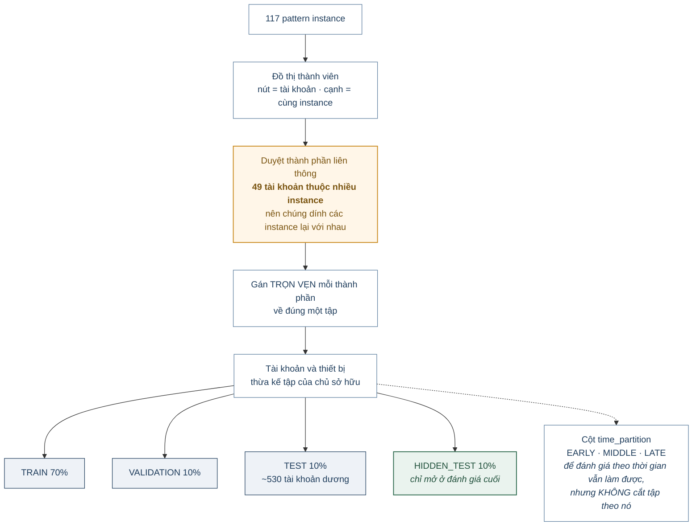

*Hình 10 — Vì sao phải duyệt thành phần liên thông chứ không lặp theo từng network: 49 tài khoản thuộc nhiều instance, nên hai instance dính nhau qua một tài khoản chung phải nằm cùng một tập.*

---

## 6. Thiết kế đặc trưng — phần bảng và hành vi (Hường)

Ký hiệu: `A` là tài khoản, `t` là `as_of_ts`, `w` là cửa sổ ∈ **{1, 2, 3} ngày** (chốt ở §5.1). Mọi đặc trưng chỉ dùng giao dịch có thời điểm **≤ t** (ML-001 §3.3).

### 6.1. Chuẩn hoá số tiền — làm trước mọi thứ khác

```
amt_norm(x, cur) = (log1p(x) - μ_log[cur]) / σ_log[cur]
```

`μ_log[cur]` và `σ_log[cur]` **fit trên tập TRAIN**, lưu thành bảng tra cứu, áp nguyên cho validation và test. Với các luật ngưỡng thì dùng giá trị quy đổi USD, không dùng `amt_norm`.

### 6.2. Cường độ — T01, T10

| Cột | Công thức |
|---|---|
| `amt_out_sum_{w}`, `amt_in_sum_{w}` | Σ `amt_norm` theo chiều, trong `(t−w, t]` |
| `txn_out_cnt_{w}`, `txn_in_cnt_{w}` | Số giao dịch theo chiều |
| `amt_out_med_{w}`, `amt_out_p90_{w}` | Trung vị và phân vị 90 |
| `active_days_{w}` | Số ngày riêng biệt có giao dịch |
| `txn_per_active_day_{w}` | `(out + in) / max(active_days, 1)` |

### 6.3. Cận ngưỡng — T01

Ngưỡng `T` = 10.000 USD quy đổi (ML-001 §4.4), đặt trong cấu hình.

| Cột | Công thức | Vì sao |
|---|---|---|
| `near_thr_ratio_{w}` | #{amt ∈ [0,8·T, T)} / #{tổng} | Dấu hiệu kinh điển của structuring |
| `amt_cv_{w}` | σ(amt) / μ(amt) | **Hệ số biến thiên thấp + lặp nhiều = chia nhỏ có chủ ý** |
| `repeat_amt_ratio_{w}` | #{số tiền xuất hiện ≥ 2 lần} / #{tổng} | Chia đều một khoản lớn để lại dấu số tiền lặp |
| `sum_over_thr_ratio_{w}` | Σ amt / T | Cộng dồn vượt ngưỡng dù từng giao dịch không |
| `round_amt_ratio_{w}` | #{chia hết cho 1.000} / #{tổng} | Số tròn là dấu hiệu chia thủ công |

### 6.4. Luân chuyển — T02, T05

| Cột | Công thức | Vì sao |
|---|---|---|
| `out_in_ratio_{w}` | `amt_out / (amt_in + ε)` | **≈ 1 là chữ ký tài khoản trung chuyển** |
| `dwell_time_med_{w}` | Trung vị `(t_ra − t_vào)` ghép cặp theo FIFO | T05. Là **hiệu hai mốc** — hợp lệ kể cả khi giờ trong ngày là nhiễu |
| `dwell_time_p10_{w}` | Phân vị 10 của cùng đại lượng | Bắt phần tiền chuyển đi tức thì |
| `eod_balance_ratio_{w}` | `(in − out) / (in + ε)` | ≈ 0 nghĩa là không giữ lại gì |
| `flow_through_score_{w}` | `min(in, out) / max(in, out)` | Đối xứng, ổn định hơn khi mẫu số nhỏ |

Ghép cặp vào–ra theo FIFO là xấp xỉ, không phải sự thật về dòng tiền — ghi thành giả định `ASSUME_FIFO_DWELL`.

### 6.5. Đối tác

| Cột | Công thức | Vì sao |
|---|---|---|
| `distinct_cp_out_{w}`, `distinct_cp_in_{w}` | Số đối tác riêng biệt theo chiều | Bậc trong cửa sổ |
| `new_cp_ratio_{w}` | #{đối tác chưa gặp trước `t−w`} / #{đối tác} | **T04.** Mule có đối tác gần như toàn mới |
| `cp_herfindahl_{w}` | Σ (share_i)² trên số tiền theo đối tác | Tập trung hay rải đều |
| `cp_reciprocity_{w}` | #{đối tác hai chiều} / #{tổng đối tác} | Quan hệ hai chiều là dấu hiệu quan hệ thật |

### 6.6. Vòng đời và nhịp

`account_age_days`, `days_since_last_txn`, `lifespan_days`, `burstiness_{w}` = σ(khoảng cách)/μ(khoảng cách), `weekend_ratio_{w}`.

> **Không có đặc trưng nào theo giờ trong ngày** — đã đo, giờ 00 là artifact chiếm 12,55% còn 23 giờ kia phẳng (§5.6). `weekend_ratio` giữ được vì ngày trong tuần là thông tin thật.

### 6.7. Tiền tệ và liên ngân hàng

`distinct_currency_{w}`, `cross_currency_ratio_{w}`, `interbank_ratio_{w}`, `distinct_bank_cp_{w}`. **Đã đo: lift tiền tệ tối đa 1,25×, an toàn, được dùng** (§5.5).

### 6.8. Lệch hồ sơ — T10

`volume_vs_expected_{w}`, `prototype_distance`, `income_band_vs_volume`.

> **Đọc ML-001 §9.1 trước khi báo cáo bất kỳ con số nào của nhóm này.** `expected_weekly_volume` được sinh *quanh* doanh số quan sát được, nên nhóm này dự đoán `label_profile_mismatch` gần như hoàn hảo mà không chứng minh gì. Giá trị thật: **có cải thiện PR-AUC trên `label_laundering` hay không.**

### 6.9. Quy mô ma trận

3 cửa sổ × ~10 cột phụ thuộc cửa sổ + ~8 cột độc lập ≈ **38 cột**. Ở 705.907 tài khoản, ma trận ~706K × 38 float64 ≈ **215 MB** — nhẹ, chạy thoải mái trên máy cá nhân.

---

## 7. Thiết kế đặc trưng — phần đồ thị (Hiển)

### 7.1. Vì sao phải chia hai tầng

Một số đặc trưng đồ thị có chi phí siêu tuyến tính. Ở ~705 nghìn nút của LI-Small chúng còn chạy được, nhưng ở HI-Medium (2,08 triệu nút) thì không — và thiết kế phải sống được cả hai.

| Đặc trưng | Chi phí | Tầng |
|---|---|---|
| Bậc vào, bậc ra, tỉ lệ đối tác mới | Rẻ — `groupby`, không cần dựng đồ thị | 1 |
| PageRank | Ma trận thưa `scipy`, vài phút | 1 |
| Bậc trung bình của hàng xóm | Một phép join | 1 |
| Liệt kê chu trình 2–6 bước | Bùng nổ tổ hợp | 2 |
| Betweenness centrality | Không khả thi ở quy mô triệu nút | 2, hoặc xấp xỉ lấy mẫu `k` |
| Phát hiện cộng đồng | Rất chậm | 2 |

### 7.2. Tầng 1 — toàn bộ tài khoản

| Cột | Cách tính |
|---|---|
| `in_degree`, `out_degree` | `groupby` trên khoá đích / nguồn |
| `degree_ratio` | `out_degree / (in_degree + 1)` |
| `pagerank` | `scipy.sparse` + lặp lũy thừa ~15 vòng |
| `neighbor_degree_mean` | Join bậc của đối tác — **hàng xóm toàn bậc thấp là dấu hiệu mạng mule** |
| `is_hub` | `degree ≥ 1.000` — chốt ở §5.9, loại đúng 15 tài khoản |

### 7.3. Chọn tập ứng viên

```
ứng viên = { A : luật ngưỡng bật }
         ∪ { A : điểm Isolation Forest ∈ top N% }
         ∪ { A : out_in_ratio ∈ [0,9, 1,1] và dwell_time_med < 24h }
         ∪ { A : new_cp_ratio > 0,8 và degree ≥ 5 }

Chỉnh N sao cho |ứng viên| ≈ 1–2% tổng tài khoản
```

**Điểm chặn:** đo **recall tầng 1** — trong số tài khoản có nhãn dương, bao nhiêu phần trăm lọt vào tập ứng viên. Đây là **trần recall của cả hệ thống**; tầng 2 dù hoàn hảo cũng không vượt được. Chỉnh N cho tới khi recall tầng 1 ≥ 95% trên validation, rồi mới tối ưu tầng 2.

### 7.4. Tầng 2 — subgraph quanh ứng viên

Ứng viên + lân cận 2 bước, dựng bằng NetworkX (QD4). Instance thật chỉ 6–16 tài khoản (§4.2), nên lân cận 2 bước đủ rộng để chứa trọn một mạng lưới.

**T03 — chu trình:** `in_cycle`, `cycle_min_len`, `cycle_value`, `cycle_amount_cv` (chu trình rửa tiền có số tiền gần bằng nhau qua các bước), `cycle_max_gap_h`. Dùng `networkx.simple_cycles(G, length_bound=6)` — ràng buộc độ dài là bắt buộc, không có nó thì không kết thúc.

**T02 — trung chuyển:** `passthrough_score` = `min(in,out)/max(in,out) × exp(−dwell_h/24)`, `chain_position`, `chain_length`, `upstream_fan`, `downstream_fan`.

**T04 — gom vào / toả ra:** `fan_in_burst_{w}`, `fan_out_burst_{w}`, `fan_in_amt_concentration`, `scatter_gather_score`.

**Cộng đồng:** `community_id` (Louvain), `community_size`, `community_density`, `betweenness_approx` = `networkx.betweenness_centrality(G, k=500)`.

> **Cảnh báo rò rỉ.** Tuyệt đối **không** tính đặc trưng cộng đồng nào có dùng nhãn — ví dụ "tỉ lệ tài khoản bị gắn cờ trong cộng đồng". Đó là rò rỉ trực tiếp và bài kiểm thử tên cột không bắt được. Chỉ dùng thuộc tính **hình học**: kích thước, mật độ, vị trí của `A`.
>
> Đồ thị dựng từ **file giao dịch**, không bao giờ từ file pattern.

---

## 8. Kiến trúc lớp ML

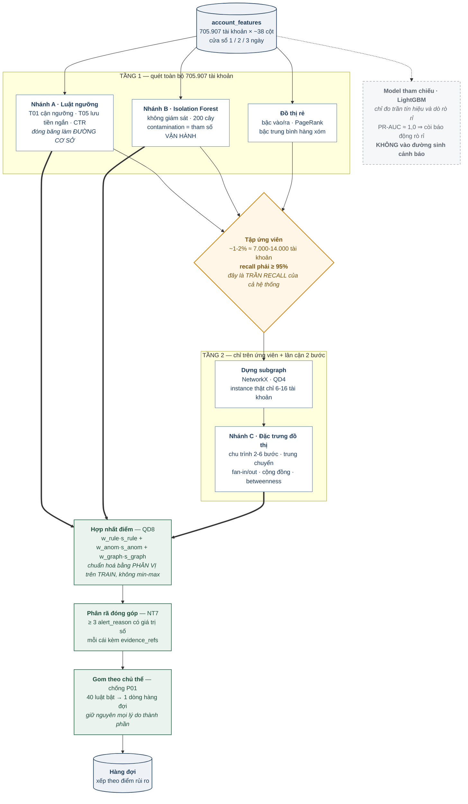

**Ba điểm dễ vẽ sai:**

1. **Luật và Isolation Forest vừa nuôi tập ứng viên vừa nuôi điểm hợp nhất.** Chúng không chỉ là bộ lọc — điểm của chúng đi thẳng vào công thức hợp nhất theo QD8.
2. **Model tham chiếu vẽ nét đứt, không nối vào `FUSE`.** Nó là dụng cụ đo, không phải thành phần sản phẩm.
3. **`DEDUP` nằm sau `REASON`.** Gom để hiển thị nhưng giữ nguyên toàn bộ lý do thành phần — gom trước thì mất bằng chứng.

---

## 9. Kiến trúc lớp Agent

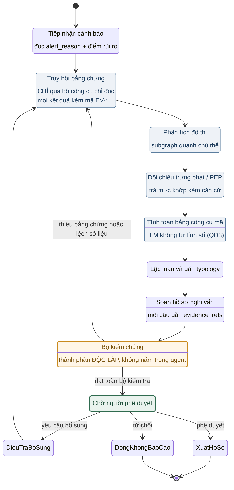

**Hai tính chất phải chứng minh bằng test, không bằng đọc mã:**

- **Không tồn tại cung tắt** từ `SoanHoSo` đi thẳng tới `XuatHoSo`. `XuatHoSo` chỉ có một đường vào, từ `ChoPheDuyet`.
- **Bộ kiểm chứng là thành phần riêng**, không phải hàm bên trong agent (QD2). Tách ra thì kiểm thử độc lập được, và khi thanh tra hỏi thì chỉ được vào một khối cụ thể.

---

## 10. Luồng chạy khi demo

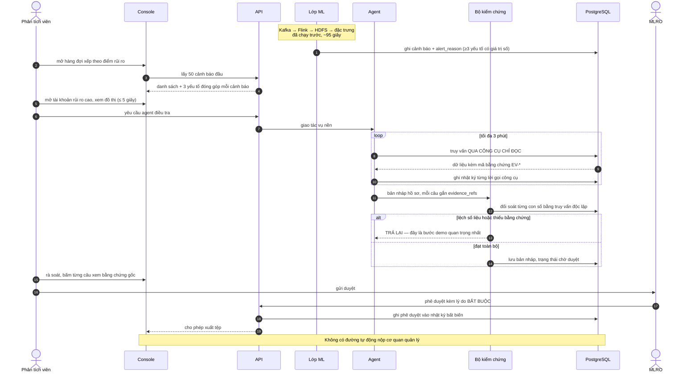

### 10.1. Kịch bản demo, từng bước

| # | Việc | Người xem nhìn thấy | Thời gian |
|---|---|---|---:|
| 1 | Phát lại giao dịch vào Kafka theo thời gian gốc, tăng tốc 100× | Bộ đếm thông lượng; Flink UI xanh | 30 s |
| 2 | Flink ghi bronze Parquet phân vùng ngày/giờ | HDFS UI hiện phân vùng mới | 15 s |
| 3 | Tính đặc trưng tầng 1 | Log tiến độ | 20 s |
| 4 | Lớp ML chấm điểm, chọn ứng viên, chạy tầng 2 | Số ứng viên hiện ra | 30 s |
| 5 | **Hàng đợi hiện tài khoản xếp theo điểm rủi ro** | Màn hình hàng đợi, cột điểm và cột lý do | — |
| 6 | Mở một tài khoản rủi ro cao | **Ba yếu tố đóng góp có giá trị số** — NT7 nhìn thấy được | — |
| 7 | Xem đồ thị tương tác quanh chủ thể | Chu trình hoặc mẫu gom-toả hiện rõ | ≤ 5 s |
| 8 | Bấm "yêu cầu agent điều tra" | Agent chạy nền, trạng thái cập nhật | ≤ 3 phút |
| 9 | Agent trả bản nháp hồ sơ | **Mỗi câu có nút mở bằng chứng gốc** | — |
| 10 | **Cố tình sửa một con số trong bản nháp** | **Bộ kiểm chứng chặn, trả về agent** | — |
| 11 | MLRO phê duyệt kèm lý do bắt buộc | Nhật ký kiểm toán ghi thêm một dòng bất biến | — |
| 12 | Xuất tệp hồ sơ nghi vấn | Tệp theo cấu trúc; **không có đường tự động nộp cơ quan** | — |
| 13 | Mở nhật ký, tái dựng toàn bộ vụ việc | Một dòng thời gian duy nhất, không sót bước | — |

**Bước 10 là bước quan trọng nhất của cả buổi.** Nó trả lời trực tiếp câu hỏi khó nhất — làm sao biết AI không bịa — bằng cách cho người xem thấy hệ thống tự chặn chính nó. Chuẩn bị sẵn một ca hỏng để bấm.

### 10.2. Ba nguyên tắc của dữ liệu demo

1. **Tài khoản đem demo phải thuộc nhánh HIDDEN_TEST.** Model chưa từng thấy, nên cảnh báo là suy luận ngoài mẫu thật.
2. **Console chỉ đọc dữ liệu không nhãn.** Cảnh báo do lớp ML tính tại chỗ, không đọc `Is Laundering`. Kiểm được bằng test quét danh sách cột API trả về.
3. **Nhãn chỉ xác nhận từng vụ, không tính tỉ lệ.** "Cảnh báo này do model tự sinh, đối chiếu ground truth thì trùng một vụ có thật" — được. "Hệ thống bắt được 80% số vụ" trên lát demo — không.

---

## 11. Việc cần làm và cần quyết

### 11.1. Chặn ngay

| # | Việc | Ai |
|---|---|---|
| 1 | **Đưa `LI-Small_Trans.csv` vào `data/raw/ibm-aml/`** | — |
| 2 | Chạy `profile_transactions.py`, điền Chương 5 | Hường |
| 3 | Đọc `nhan_theo_ngay` và chốt cách chia tập | Hường + Bảo |

### 11.2. PM quyết

| # | Việc | Mục | Vì sao gấp |
|---|---|---|---|
| 1 | **Cam kết typology**: chọn phương án A, B hay C | §4.4.1 | LI-Small không có typology structuring; cam kết BUS-001 §7 hiện không thực hiện được |
| 2 | **Độ phủ typology đo trên toàn bộ 117 instance**, không trên tập giữ lại; ghi rõ là chỉ số năng lực | §4.4.2 | CYCLE chỉ có 12 instance — chia tập xong còn 1–2, đo ra 0% hoặc 100% |
| 3 | **Duyệt việc cấm chia tập theo thời gian**, chuyển sang chia theo mạng lưới + thực thể 70/10/10/10 | §5.3 | Đã đo: chia theo lịch để lại tập test 50 giao dịch |
| 4 | Duyệt danh sách đặc trưng Chương 6 và 7 | §6, §7 | Điểm chặn trước khi huấn luyện |
| 5 | Xác nhận recall tầng 1 ≥ 95% là điều kiện đóng | §7.3 | Là trần recall của cả hệ thống |
