# Mô hình — dữ liệu, huấn luyện, kết quả

Toàn bộ hồ sơ mô hình của FIN-07: khảo sát dữ liệu, thiết kế đặc trưng, các lượt huấn luyện, benchmark mức giao dịch và bàn giao MEGA-PNA.

- [FIN-07 — Phương pháp EDA, thiết kế đặc trưng và kiến trúc ML / Agent](#fin-07-phương-pháp-eda-thiết-kế-đặc-trưng-và-kiến-trúc-ml-agent)
- [FIN-07 — Huấn luyện, đặc trưng và đánh giá](#fin-07-huấn-luyện-đặc-trưng-và-đánh-giá)
- [FIN-07 — Huấn luyện và kết quả trên IBM AML HI-Medium](#fin-07-huấn-luyện-và-kết-quả-trên-ibm-aml-hi-medium)
- [FIN-07 Behaviour Isolation Forest 7 ngày](#fin-07-behaviour-isolation-forest-7-ngày)
- [FIN-07-FUSION-001 — Release hợp nhất Isolation Forest và Graph](#fin-07-fusion-001-release-hợp-nhất-isolation-forest-và-graph)
- [Benchmark mức giao dịch (edge-level) cho LI-Small](#benchmark-mức-giao-dịch-edge-level-cho-li-small)
- [FIN-07 — Currency-native policy edge model cho MVP](#fin-07-currency-native-policy-edge-model-cho-mvp)
- [MEGA-PNA — Mô hình phát hiện rửa tiền của FIN-07](#mega-pna-mô-hình-phát-hiện-rửa-tiền-của-fin-07)
- [FIN-07 — Runbook MEGA-PNA](#fin-07-runbook-mega-pna)

## FIN-07 — Phương pháp EDA, thiết kế đặc trưng và kiến trúc ML / Agent

| | |
|---|---|
| **Mã tài liệu** | FIN-07-ML-002 |
| **Phiên bản** | 2.0 |
| **Ngày** | 08/08/2026 |
| **Người thực hiện** | Hiển (đồ thị + agent), Hường (đặc trưng bảng + mô hình) |
| **Bộ dữ liệu** | **IBM AML — bản LI-Small** (theo DAT-001 §3.1) |
| **Tài liệu song hành** | FIN-07-ML-001 (quy tắc, chỉ số, cạm bẫy) |
| **Tài liệu gốc** | FIN-07-BUS-001, FIN-07-ARC-001, FIN-07-DAT-001 |

ML-001 nói **được làm gì và không được làm gì**. Tài liệu này nói **làm như thế nào**.

Trọng tâm là Chương 1–3: **cách tiến hành EDA**, không phải bảng kết quả. Kết quả sẽ cũ đi mỗi khi đổi bộ dữ liệu; phương pháp thì không. Hai script kèm theo chạy được trên bất kỳ bản nào của bộ IBM — LI-Small, HI-Medium, HI-Large — nên khi đổi bản chỉ cần chạy lại, không phải nghĩ lại.

#### Danh mục hình

**Biểu đồ số liệu** — sinh từ `artifacts/eda/*.json` bằng `scripts/eda/plot_eda.py`, chạy lại được bất cứ lúc nào:

| | Hình | Trả lời câu hỏi |
|---|---|---|
| 1 | Phân bố giao dịch và nhãn dương theo ngày | Chia tập theo thời gian có dùng được không? |
| 2 | So sánh hai cách chia tập | Chia theo lịch để lại bao nhiêu mẫu dương? |
| 3 | Lift theo kênh thanh toán | Kênh nào là chữ ký bộ sinh? |
| 4 | Phân bố giờ trong ngày | Đặc trưng theo giờ là tín hiệu hay nhiễu? |
| 5 | Phân bố số tiền | Chuẩn hoá thế nào, đặt ngưỡng T01 ở đâu? |
| 6 | Phân bố bậc và ngưỡng hub | Loại hub ở đâu, bao nhiêu tài khoản đủ lịch sử? |
| 7 | Typology IBM và ánh xạ T01–T10 | Cam kết nào giữ được? |

**Sơ đồ kiến trúc** — mermaid, nằm trong markdown nên đi qua pull request như mã (RK7):

| | Sơ đồ | Ở đâu |
|---|---|---|
| 8 | Đường ống chuẩn bị dữ liệu, sáu bước | §5b |
| 9 | Bốn nhãn và bốn mẫu số khác nhau | §5c |
| 10 | Chia tập theo thành phần liên thông | §5d |
| — | Kiến trúc lớp ML, phễu hai tầng | Chương 8 |
| — | Máy trạng thái lớp Agent | Chương 9 |
| — | Trình tự luồng demo | Chương 10 |

---

> **Trạng thái dữ liệu (08/08/2026):** đủ ba file LI-Small. **Cả Chương 4 và Chương 5 đã chạy xong**, kết quả ở `artifacts/eda/li_small_patterns.json` và `artifacts/eda/li_small_transactions.json`.

---

### 1. Nguyên tắc EDA cho bộ dữ liệu này

EDA ở đây không phải "vẽ vài biểu đồ xem dữ liệu trông thế nào". Nó là bước **thu thập bằng chứng để quyết định thiết kế**: chia tập kiểu gì, đặc trưng nào dùng được, cam kết nào giữ được. Mỗi phép đo dưới đây tồn tại vì nó chặn một quyết định cụ thể.

#### 1.1. Bốn nguyên tắc

**Một lượt streaming, không nạp cả file.** Bản LI-Small nhỏ nhưng cùng script phải chạy được trên HI-Large hàng chục GB. Mọi thứ trong script là generator; bộ nhớ tiến trình không phụ thuộc kích thước file. Đây cũng là lý do dùng `pyarrow.csv.open_csv` theo lô chứ không dùng `pandas.read_csv`.

**Đọc cột theo vị trí, không theo tên.** File có **hai cột đều tên `Account`**:

```
Timestamp,From Bank,Account,To Bank,Account,Amount Received,...
                    ^^^^^^^          ^^^^^^^
```

`pandas` đổi cột thứ hai thành `Account.1`; `csv.DictReader` giữ một cột và **âm thầm vứt cột kia**. Cả hai là hành vi của thư viện, thay đổi giữa các phiên bản, và không phải chỗ dựa được. Vị trí là hợp đồng; tên chỉ dùng để kiểm tra đã đưa đúng file vào.

**Mỗi phép đo phải nối được tới một quyết định.** Nếu không trả lời được câu "đo cái này rồi thì mình quyết định gì khác đi", thì đừng đo. Bảng ở §1.2 là bảng nối đó.

**Kết quả ghi ra JSON có checksum nguồn.** Số liệu EDA sẽ được trích vào báo cáo và slide. Không có checksum thì sáu tuần nữa không ai biết con số đó đo trên bản nào.

#### 1.2. Mười phép đo và quyết định chúng chặn

| # | Đo cái gì | Chặn quyết định nào | Ngưỡng hành động |
|---|---|---|---|
| 1 | Quy mô, khoảng thời gian | Độ dài cửa sổ đặc trưng tối đa | Cửa sổ dài nhất ≤ ⅓ khoảng thời gian |
| 2 | Tỉ lệ nhãn mức **giao dịch** | Chọn chỉ số đánh giá | < 1% → cấm accuracy, ROC-AUC chỉ phụ |
| 3 | Tỉ lệ nhãn mức **tài khoản** | Đơn vị dự đoán; mẫu số của precision@k | Nếu cao hơn nhiều lần mức giao dịch → chọn tài khoản làm đơn vị chính |
| 4 | Phân bố bậc | Ngưỡng loại hub; phạm vi nhánh tự-so-sánh | Loại hub ở chỗ phân bố đứt gãy |
| 5 | **Nhãn dương theo ngày** | **Chia tập theo thời gian có dùng được không** | Nếu tập cuối < 5% tổng nhãn dương → **không chia theo thời gian** |
| 6 | Kênh thanh toán × nhãn | Kênh nào phải loại khỏi đặc trưng | lift ≥ 3× → cấm vĩnh viễn; < 1,5× → được dùng |
| 7 | Tiền tệ × nhãn | Đặc trưng số loại tiền tệ có an toàn không | Cùng ngưỡng như trên |
| 8 | Giờ trong ngày | Đặc trưng theo giờ là tín hiệu hay nhiễu | Nếu mọi giờ ≈ 1/24 → loại toàn bộ đặc trưng theo giờ |
| 9 | Số tiền theo từng tiền tệ | Cách chuẩn hoá; đặt ngưỡng T01 ở đâu | Trải > 3 bậc độ lớn → bắt buộc chuẩn hoá trong từng tiền tệ |
| 10 | Cạnh tự trỏ, lệch zero-padding | Hai lỗi im lặng làm hỏng đồ thị | Bất kỳ giá trị nào > 0 → phải xử lý trước khi dựng đồ thị |

**Phép đo số 5 là phép quan trọng nhất và dễ bỏ qua nhất.** Ai cũng giả định nhãn dương phân bố đều theo thời gian. Nếu không, chia 60/20/20 theo thời gian sẽ để lại một tập test gần như không có mẫu dương, và mọi chỉ số trên đó vô nghĩa. Phải đo, không được giả định.

**Phép đo số 3 hay bị bỏ sót vì tưởng suy ra được từ số 2.** Không suy ra được: một giao dịch laundering chạm hai tài khoản, và một tài khoản có thể tham gia nhiều giao dịch. Tỉ số giữa hai tỉ lệ thường lớn hơn 10 lần, và nó quyết định bài toán dễ hay khó.

#### 1.3. Bốn câu hỏi cho file pattern

File `*_Patterns.txt` là nguồn của `label_typology`. Bốn câu hỏi:

1. **IBM cung cấp những typology nào?** → Typology nào trong danh mục T01–T10 của BUS-001 có ground truth thật, typology nào phải rút khỏi cam kết hoặc phải tự sinh.
2. **Một instance lớn cỡ nào, trải mấy ngày?** → Bán kính subgraph cần dựng; instance có bị vắt qua mốc cắt không.
3. **Bao nhiêu tài khoản thuộc nhiều instance?** → Nếu > 0 thì gom instance **bắt buộc** là một lượt duyệt thành phần liên thông, không phải vòng lặp theo từng network.
4. **Kênh và tiền tệ bên trong pattern lệch thế nào?** → Kênh nào là chữ ký bộ sinh.

---

### 2. Hai công cụ

Nằm trong repo, chạy lại được, không phụ thuộc ai.

| Script | Đầu vào | Thời gian |
|---|---|---|
| `scripts/eda/profile_patterns.py` | `*_Patterns.txt` | vài giây |
| `scripts/eda/profile_transactions.py` | `*_Trans.csv` | ~50 s cho 3 GB |

Cả hai nhận `--input` và `--output`, in JSON ra màn hình và ghi file. Cả hai chuẩn hoá mã ngân hàng và ghép khoá `bank:account` giống hệt nhau — dùng chung định nghĩa, không có hai cách hiểu về "tài khoản là gì".

`profile_transactions.py` **kiểm tra header trước khi chạy** và dừng ngay nếu file không đúng định dạng IBM 11 cột, thay vì đọc nhầm theo vị trí rồi cho ra số liệu sai một cách im lặng.

---

### 3. Cách chạy

#### 3.1. File pattern — đã chạy

```bash
python scripts/eda/profile_patterns.py \
    --input data/raw/ibm-aml/LI-Small-Patterns.txt \
    --output artifacts/eda/li_small_patterns.json
```

#### 3.2. File giao dịch — đã chạy, 27,0 giây

```bash
python scripts/eda/profile_transactions.py \
    --input data/raw/ibm-aml/LI-Small_Trans.csv \
    --output artifacts/eda/li_small_transactions.json
```

Chạy xong, đọc kết quả theo đúng thứ tự của bảng §1.2 và điền vào Chương 5. Ba con số phải xem trước tiên:

1. `ti_le_nen.muc_tai_khoan_pct` — quyết định mẫu số của precision@k
2. `nhan_theo_ngay` — quyết định cách chia tập
3. `kenh_thanh_toan[].lift` — quyết định `Payment Format` có bị cấm không

#### 3.3. Đọc kết quả — bảng tra ngưỡng

| Trường trong JSON | Đọc thế nào |
|---|---|
| `ti_le_nen.ti_so_giua_hai_muc` | > 10 → chốt đơn vị dự đoán là **tài khoản** |
| `nhan_theo_ngay` | Cộng nhãn dương của 20% ngày cuối. **< 5% tổng → cấm chia theo thời gian** |
| `bac.so_tai_khoan_bac_>=1000` | Số nhỏ (vài chục) → ngưỡng loại hub 1.000 là sạch |
| `bac.so_tai_khoan_bac_>=20` | Chia cho tổng tài khoản → phạm vi nhánh tự-so-sánh |
| `kenh_thanh_toan[].lift` | ≥ 3 → cấm vĩnh viễn. 1,5–3 → PM quyết. < 1,5 → dùng được |
| `gio_trong_ngay.ti_le_min/max` | Chênh nhau < 10% tương đối → **loại toàn bộ đặc trưng theo giờ** |
| `so_tien.theo_tien_te` | So p50 giữa các tiền tệ; chênh > 3 bậc → bắt buộc chuẩn hoá trong từng tiền tệ |
| `loi_im_lang.so_ma_bi_gop_do_zero_padding` | > 0 → **bắt buộc** strip leading zeros trước mọi phép ghép |
| `loi_im_lang.canh_tu_tro` | > 0 → loại trước khi dựng đồ thị |

---

### 4. Kết quả trên LI-Small — file pattern

Nguồn: `LI-Small-Patterns.txt`, 99.155 byte, SHA-256 `f4d24a13…6e1a88`.

#### 4.1. Tổng quan

| | |
|---|---:|
| Instance hoàn chỉnh | **117** |
| Khối thiếu dòng `END` | 0 |
| Giao dịch trong pattern | **1.023** |
| Tài khoản trong pattern | **1.168** |
| **Tài khoản thuộc nhiều instance** | **49** |

> 49 tài khoản thuộc nhiều instance ⇒ **gom instance bắt buộc là một lượt duyệt thành phần liên thông.** Vòng lặp theo từng network sẽ tách hai instance dính nhau về hai tập, và model học thuộc mạng lưới thay vì học mẫu hình.

#### 4.2. Danh mục typology

| Typology IBM | Instance | Txn/instance (p50) | Tài khoản/instance (p50) | Số ngày trải (p50 / max) |
|---|---:|---:|---:|---:|
| FAN-OUT | 19 | 7 | 8 | 4 / 5 |
| STACK | 18 | 6 | 9 | 3 / 5 |
| BIPARTITE | 16 | 8 | 16 | 2 / 3 |
| RANDOM | 15 | 5 | 6 | 3 / 5 |
| SCATTER-GATHER | 13 | 12 | 8 | 5 / 5 |
| FAN-IN | 12 | 6 | 7 | 4 / 5 |
| GATHER-SCATTER | 12 | 15 | 16 | 7 / 9 |
| CYCLE | 12 | 7 | 7 | 4 / 5 |

Mạng lưới nhỏ: 5–15 giao dịch, 6–16 tài khoản, **không instance nào trải quá 9 ngày**. Đây là quy mô NetworkX xử lý thoải mái trên subgraph — khẳng định lại quyết định QD4.

#### 4.3. Kênh thanh toán bên trong pattern

| Kênh | Số dòng | Tỉ lệ |
|---|---:|---:|
| **ACH** | **1.022** | **99,90%** |
| Bitcoin | 1 | 0,10% |

Trong 1.023 giao dịch thuộc 117 kịch bản rửa tiền, **1.022 là ACH**. Đây là chữ ký của bộ sinh dữ liệu ở dạng gần như tinh khiết. Cần chờ phép đo số 6 trên file giao dịch để tính lift chính xác, nhưng kết luận gần như chắc chắn: **`Payment Format` bị cấm làm đặc trưng model**.

Tiền tệ trong pattern: USD 541, Euro 414, Yuan 19, Yen 12, Australian Dollar 11, Canadian Dollar 7, Swiss Franc 4, Brazil Real 3. Đa tiền tệ có thật, phù hợp với typology CYCLE nhảy qua lại giữa các đơn vị.

#### 4.4. Hai phát hiện làm thay đổi cam kết

##### 4.4.1. LI-Small **không có** typology chia nhỏ giao dịch

Ánh xạ 8 typology của IBM sang danh mục T01–T10 (BUS-001 §2.3):

| Danh mục FIN-07 | Typology IBM | Instance |
|---|---|---:|
| **T01 — Chia nhỏ giao dịch** | **KHÔNG CÓ** | **0** |
| T02 — Mạng tài khoản trung gian | STACK, BIPARTITE | 34 |
| T03 — Giao dịch vòng | CYCLE | 12 |
| T04 — Gom vào / Toả ra | FAN-IN, FAN-OUT, SCATTER-GATHER, GATHER-SCATTER | 56 |
| **T05 — Luân chuyển tốc độ cao** | Không có typology riêng — dẫn xuất từ thời gian lưu tiền | — |
| T06–T09 | Không có | 0 |
| — | RANDOM (không ánh xạ được) | 15 |

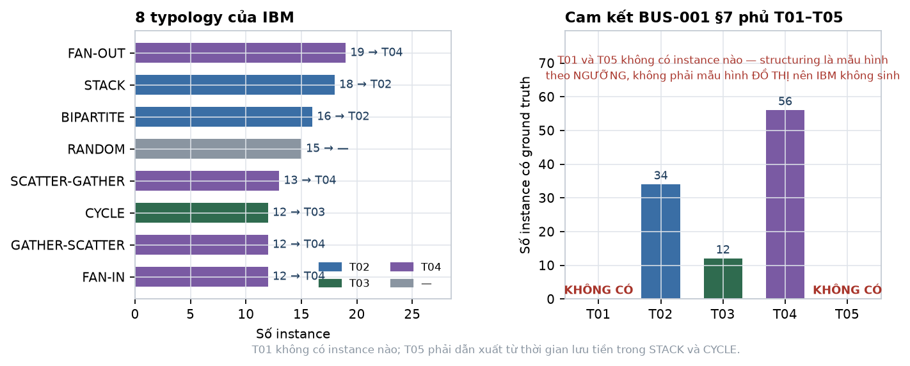

*Hình 7 — Trái: 8 typology của IBM, màu theo danh mục FIN-07 được ánh xạ tới. Phải: số instance có ground truth cho từng mục trong cam kết T01–T05.*

**BUS-001 §7 cam kết độ phủ ≥ 85% với T01–T05. Cam kết này không thực hiện được nguyên trạng.** Structuring là mẫu hình theo *số tiền và ngưỡng*, không phải mẫu hình *đồ thị*, nên bộ mô phỏng của IBM không sinh nó.

Đây là rủi ro RD6 đã hiện thực hoá, và DAT-001 §4.3 đã dự liệu sẵn đường xử lý. **Cần PM chọn:**

| | Nội dung | Chi phí |
|---|---|---|
| **A** | Thu hẹp cam kết còn **T02–T04**, ghi rõ T01 và T05 không có ground truth trong nguồn | 0 — sửa tài liệu |
| **B** | Tự sinh ca structuring: chọn tài khoản sạch, tiêm chuỗi giao dịch sát dưới ngưỡng, gắn nhãn T01 riêng | ~2 SP, và mọi con số T01 là "phát hiện chính phép tiêm của mình" — cùng vấn đề vòng tròn như T10 (ML-001 §9.1) |
| **C** | A cho cam kết đo lường + B cho phần trình diễn, tách bạch trong báo cáo | ~2 SP, trung thực nhất |

Khuyến nghị **C**.

##### 4.4.2. 117 instance là quá ít để đo độ phủ trên tập giữ lại

CYCLE có **12 instance**. FAN-IN 12. GATHER-SCATTER 12. Chia 70/10/10/10 thì tập test nhận **1–2 instance mỗi loại**.

Đo "recall ≥ 85% cho T03" trên 1 instance là vô nghĩa: kết quả chỉ có thể là 0% hoặc 100%.

**Cách xử lý:**

- **Độ phủ typology đo trên toàn bộ 117 instance**, không trên tập giữ lại. Ghi rõ đây là **chỉ số năng lực** (hệ thống có nhận ra mẫu hình này không), không phải **chỉ số tổng quát hoá**.
- **PR-AUC và precision@k vẫn đo trên tập test giữ lại**, vì chúng dùng `label_laundering` với số mẫu lớn hơn nhiều.
- Hai chỉ số này có mẫu số khác nhau và **không được trộn vào cùng một bảng**.

Nếu muốn con số độ phủ có tính tổng quát hoá thì phải dùng **leave-one-instance-out** trên 117 instance — khả thi, tốn khoảng 1 SP, và đáng làm nếu hội đồng hỏi sâu.

---

### 5. Kết quả trên LI-Small — file giao dịch

Nguồn: `LI-Small_Trans.csv`, 650.422.357 byte. Chạy hết **27,0 giây**.

#### 5.1. Quy mô — cửa sổ thật chỉ 10 ngày, không phải 28

| | |
|---|---:|
| Giao dịch | **6.924.049** |
| Tài khoản | **705.907** |
| Mốc đầu | 2022/09/01 00:00 |
| Mốc cuối | 2022/09/17 15:28 |
| Số ngày có giao dịch | 17 |

Nhưng số ngày danh nghĩa không phải số ngày dùng được. Khối lượng theo ngày:

| Ngày | Giao dịch | Ngày | Giao dịch |
|---|---:|---|---:|
| 09/01 | 1.524.807 | 09/09 | 891.573 |
| 09/02 | 1.027.758 | 09/10 | 282.877 |
| 09/03 | 283.326 | 09/11 | **77** |
| 09/04 | 282.476 | 09/12 | 48 |
| 09/05 | 657.397 | 09/13 | 48 |
| 09/06 | 657.170 | 09/14 | 31 |
| 09/07 | 658.504 | 09/15 | 9 |
| 09/08 | 657.938 | 09/16 | 7 |
| | | 09/17 | 3 |

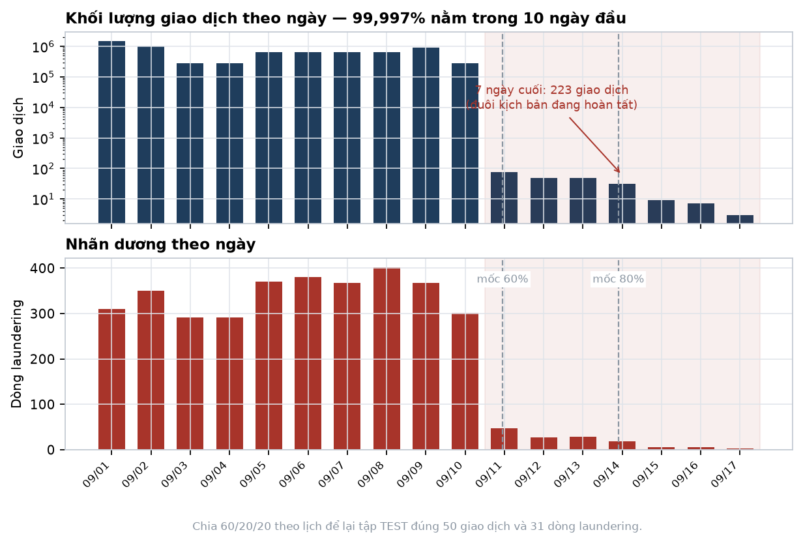

*Hình 1 — Khối lượng theo thang log ở trên, nhãn dương theo thang tuyến tính ở dưới. Vùng hồng là 7 ngày cuối; hai đường đứt là mốc cắt nếu chia 60/20/20 theo lịch.*

**99,997% giao dịch nằm trong 10 ngày 09/01–09/10.** Bảy ngày cuối cộng lại có **223 giao dịch** — đó là đuôi các kịch bản đang hoàn tất, không phải hoạt động của ngân hàng.

Khối lượng còn rất không đều ngay trong 10 ngày đó: 09/01 có 1,52 triệu, 09/03 chỉ 283 nghìn — chênh 5,4 lần.

> **Hệ quả 1 — dữ liệu hiệu dụng quá ngắn cho cửa sổ dài.** Với 10 ngày giao dịch có mật độ đáng kể, cửa sổ 7 ngày chiếm 70% và gần như không trượt được. EDA ban đầu ưu tiên bộ cửa sổ `{1, 2, 3}` ngày; release hợp nhất sau đó khóa scoring unit ở `7d` để đồng bộ Graph.
>
> **Hệ quả 2 — không có mùa vụ, không có nền 30 ngày, không có đại lượng theo tháng.** DAT-001 §5.1 định nghĩa "doanh số trung vị theo tháng" và "tỉ lệ đối tác mới theo tháng" — không tính được, phải đổi sang cửa sổ ngày.

#### 5.2. Hai tỉ lệ nền

| | |
|---|---:|
| Dòng laundering | **3.565** |
| **Tỉ lệ nền mức giao dịch** | **0,0515%** |
| Tài khoản chạm ≥ 1 giao dịch laundering | **5.304** |
| **Tỉ lệ nền mức tài khoản** | **0,7514%** |
| Tỉ số giữa hai mức | **14,6 lần** |

Khớp với DAT-001 §3.1 ("khoảng 0,05%"). Tỉ số 14,6 lần vượt ngưỡng hành động ở §1.2 ⇒ **chốt đơn vị dự đoán là tài khoản**, và mẫu số cho mọi phép tính precision@k là **705.907 tài khoản với 5.304 dương**.

> 5.304 tài khoản dương là con số phải nhớ. Chia 70/10/10/10 thì tập test nhận khoảng **530 tài khoản dương** — đủ để đo PR-AUC nhưng **bắt buộc phải kèm khoảng tin cậy bootstrap** (ML-001 §8.1). Hai model lệch nhau dưới vài điểm phần trăm thì không được tuyên bố cái nào hơn.

#### 5.3. Phân bố nhãn theo ngày — **cấm chia tập theo thời gian**

| Ngày | Laundering | % tổng | Ngày | Laundering | % tổng |
|---|---:|---:|---|---:|---:|
| 09/01 | 310 | 8,70% | 09/09 | 367 | 10,29% |
| 09/02 | 350 | 9,82% | 09/10 | 301 | 8,44% |
| 09/03 | 292 | 8,19% | 09/11 | 47 | 1,32% |
| 09/04 | 291 | 8,16% | 09/12 | 27 | 0,76% |
| 09/05 | 370 | 10,38% | 09/13 | 29 | 0,81% |
| 09/06 | 380 | 10,66% | 09/14 | 18 | 0,50% |
| 09/07 | 368 | 10,32% | 09/15 | 6 | 0,17% |
| 09/08 | 402 | 11,28% | 09/16 | 5 | 0,14% |
| | | | 09/17 | 2 | 0,06% |

Trong 10 ngày đầu, nhãn dương phân bố khá đều (8,2–11,3% mỗi ngày). Từ 09/11 trở đi thì sụp cùng với toàn bộ khối lượng.

**Chia 60/20/20 theo lịch trên span 16,6 ngày** đặt mốc cắt ở 09/11 và 09/14:

| Tập | Khoảng | Giao dịch | Laundering |
|---|---|---:|---:|
| TRAIN | 09/01 → 09/11 | 6.923.826 | 3.431 |
| VALIDATION | 09/11 → 09/14 | 173 | 103 |
| **TEST** | **09/14 → 09/17** | **50** | **31** |

**Tập test 50 giao dịch.** Không có gì để đánh giá.

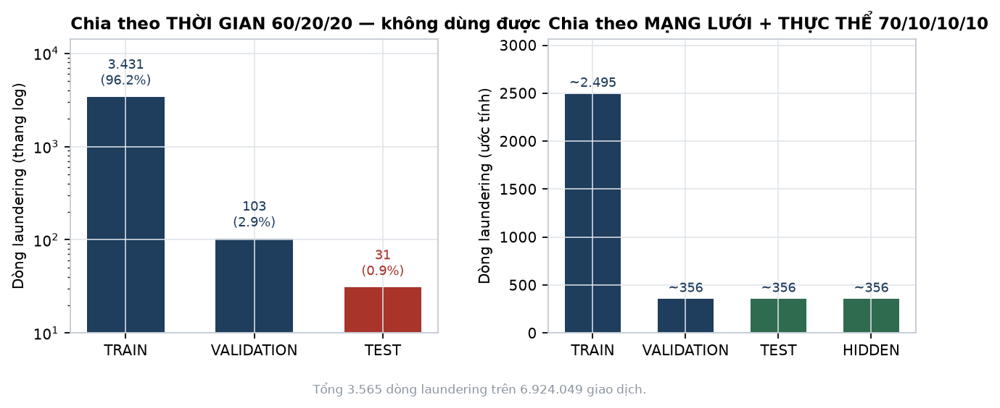

*Hình 2 — Trái: chia theo lịch, tập TEST còn 31 dòng laundering (0,9%). Phải: chia theo mạng lưới, mỗi tập giữ đúng tỉ lệ.*

> **Kết luận, có bằng chứng số: cấm chia tập theo thời gian trên bộ này.**
>
> Chuyển sang **chia theo thành phần liên thông của mạng lưới rồi tới thực thể, tỉ lệ 70/10/10/10**, giữ một cột `time_partition` để ai muốn đánh giá theo thời gian vẫn làm được — nhưng không cắt tập theo nó. 49 tài khoản thuộc nhiều instance (§4.1) nên bước gom **bắt buộc** là một lượt duyệt thành phần liên thông.
>
> Giới hạn "không có holdout theo thời gian đúng nghĩa" phải ghi vào manifest, không giấu. Đây là [LỆCH] so với DAT-001 ND2 và §4.2, và là chỗ cần PM duyệt.

#### 5.4. Kênh thanh toán — ACH lift 6,37 lần, cấm dùng

| Kênh | Toàn file | Trong laundering | P(laundering) | **Lift** |
|---|---:|---:|---:|---:|
| **ACH** | 796.581 (11,51%) | **2.611 (73,24%)** | 0,328% | **6,37×** |
| Cheque | 2.503.158 (36,15%) | 459 (12,88%) | 0,018% | 0,36× |
| Cash | 655.688 (9,47%) | 124 (3,48%) | 0,019% | 0,37× |
| Credit Card | 1.780.389 (25,71%) | 261 (7,32%) | 0,015% | 0,28× |
| Bitcoin | 309.208 (4,47%) | 110 (3,09%) | 0,036% | 0,69× |
| **Reinvestment** | 650.458 (9,39%) | **0** | 0% | **0** |
| **Wire** | 228.567 (3,30%) | **0** | 0% | **0** |

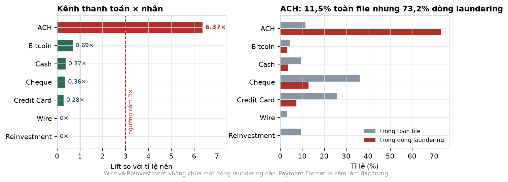

*Hình 3 — Trái: lift so với tỉ lệ nền, đường đứt đỏ là ngưỡng cấm 3×. Phải: tỉ trọng kênh trong toàn file so với trong dòng laundering.*

Lift 6,37× vượt xa ngưỡng cấm 3× ở §1.2. Hai kênh Reinvestment và Wire **không chứa một dòng laundering nào**. Cộng với 99,9% giao dịch trong file pattern là ACH (§4.3):

> **`Payment Format` bị cấm làm đặc trưng model, vĩnh viễn.** Vẫn lưu và hiển thị trong hồ sơ vụ việc theo DAT-001 §4.1, nhưng không vào ma trận đặc trưng.

#### 5.5. Tiền tệ — an toàn, được dùng

| Tiền tệ | Toàn file | Trong laundering | Lift |
|---|---:|---:|---:|
| US Dollar | 36,88% | 40,84% | 1,11× |
| Euro | 23,05% | 28,75% | **1,25×** |
| Yuan | 6,98% | 5,30% | 0,76× |
| Rupee | 4,92% | 3,14% | 0,64× |
| Bitcoin | 4,47% | 3,09% | 0,69× |
| Saudi Riyal | 3,73% | 3,23% | 0,87× |

Lift lớn nhất là **1,25×**, dưới ngưỡng an toàn 1,5×. **Đặc trưng số loại tiền tệ và tỉ lệ chéo tiền tệ được phép dùng** — câu hỏi bỏ ngỏ ở ML-001 §9.3 đã có câu trả lời.

Giao dịch chéo tiền tệ: 98.876 dòng = **1,428%**.

#### 5.6. Giờ trong ngày — cấm dùng, nhưng vì lý do khác dự đoán

| Giờ | Tỉ lệ |
|---|---:|
| **00** | **12,551%** |
| 01–23 | 3,78% – 3,82% |
| *Kỳ vọng nếu đều* | *4,167%* |

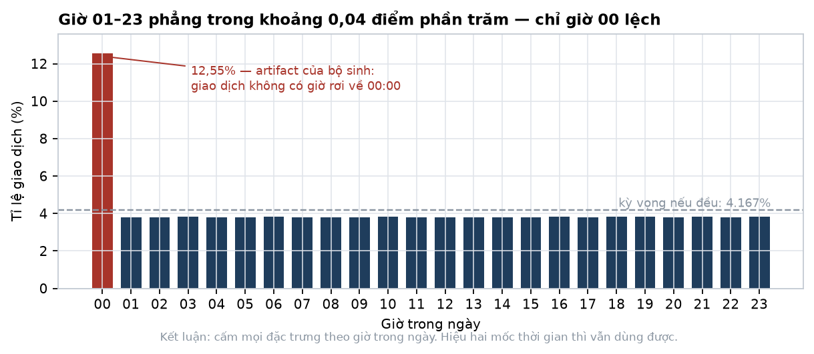

*Hình 4 — Cột đỏ là giờ 00. Đường đứt xám là mức kỳ vọng nếu phân bố đều.*

23 giờ từ 01 đến 23 gần như phẳng tuyệt đối — chênh lệch giữa giờ cao nhất và thấp nhất chỉ **0,04 điểm phần trăm**. Riêng giờ 00 chiếm 12,55%, gấp **3,3 lần** các giờ còn lại.

Đây không phải nhịp sinh hoạt. Đó là **artifact của bộ sinh dữ liệu** — giao dịch không được gán giờ cụ thể thì rơi về 00:00.

> **Cấm toàn bộ đặc trưng theo giờ trong ngày.** Nguy hiểm hơn trường hợp phân bố đều thuần tuý: một đặc trưng kiểu "tỉ lệ giao dịch lúc nửa đêm" sẽ *có* phương sai, *trông như* tín hiệu, mà thực chất chỉ bắt được dấu vết của bộ sinh. Đúng loại đường tắt mà ML-001 §9 cảnh báo.
>
> Vẫn giữ được: `weekend_ratio` (ngày trong tuần là thông tin thật) và mọi đại lượng là **hiệu hai mốc thời gian** — thời gian lưu tiền, độ trễ giữa các bước chu trình. T05 dựa vào loại thứ hai nên không bị ảnh hưởng.

#### 5.7. Số tiền — laundering nằm ở khúc giữa

| | p25 | p50 | p75 | p95 |
|---|---:|---:|---:|---:|
| Toàn bộ (mẫu 500K) | 24,69 | 2.266,37 | 39.638,32 | 2.101.476,83 |
| Chỉ dòng laundering | 1.461,77 | **4.295,24** | 13.971,04 | 312.500,45 |

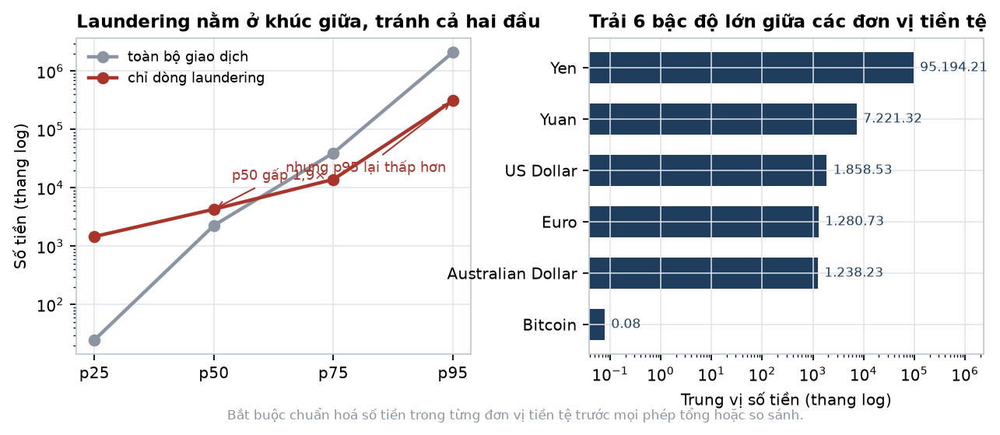

*Hình 5 — Trái: đường phân vị của toàn bộ giao dịch so với chỉ dòng laundering, thang log. Phải: trung vị số tiền theo từng đơn vị tiền tệ.*

Hình dạng đáng chú ý: trung vị laundering **cao gấp 1,9 lần** mặt bằng, nhưng p75 và p95 lại **thấp hơn** mặt bằng. Nghĩa là giao dịch rửa tiền **tránh cả hai đầu** — không quá nhỏ, không quá lớn. Phù hợp với nghiệp vụ: chia nhỏ và phân tán đều dùng khoản cỡ trung.

Đây là tín hiệu thật và dùng được. Nó cũng gợi ý luật T01 nên nhắm dải giữa chứ không chỉ dải sát ngưỡng.

Trải theo tiền tệ, trung vị: Yen 95.194 — Yuan 7.221 — US Dollar 1.859 — Euro 1.281 — Bitcoin **0,078**. **Sáu bậc độ lớn.**

> **Bắt buộc chuẩn hoá trong từng đơn vị tiền tệ** trước mọi phép tổng hoặc so sánh. Mọi thống kê số tiền gộp chung các đơn vị là vô nghĩa.

#### 5.8. Hai lỗi im lặng — cả hai đều có

| | |
|---|---:|
| **Cạnh tự trỏ** (nguồn = đích) | **804.477 = 11,62%** |
| Mã ngân hàng thô | 41.866 |
| Mã sau khi strip zero-padding | 41.814 |
| **Mã bị gộp do zero-padding** | **52** |

Cạnh tự trỏ chiếm hơn một phần chín dữ liệu — cao hơn HI-Medium (8,03%). Không loại thì bậc vào và bậc ra bị thổi lên, `out_in_ratio` méo, và mọi đặc trưng đồ thị sai.

52 mã ngân hàng bị gộp: nếu không strip leading zeros thì 52 cặp ngân hàng bị coi là khác nhau, khoá tài khoản ghép sai, và đồ thị sinh ra **cạnh giả cùng chu trình không có thật** — đúng loại chu trình mà T03 đi tìm.

> Cả hai phải xử lý ở bước B4 của đường ống chuẩn bị (§ bên dưới), **trước** khi dựng đồ thị.

#### 5.9. Bậc — ngưỡng hub sạch, một phần ba tài khoản đủ lịch sử

| | p25 | p50 | p75 | p95 | p99 | max |
|---|---:|---:|---:|---:|---:|---:|
| Bậc tổng | 2 | **6** | 27 | 70 | 119 | **223.590** |

| | |
|---|---:|
| Tài khoản bậc ≥ 20 | **237.741 = 33,7%** |
| Tài khoản bậc ≥ 100 | 13.266 = 1,88% |
| **Tài khoản bậc ≥ 1.000** | **15** |
| Bậc ra lớn nhất | 222.037 |
| Bậc vào lớn nhất | 1.553 |

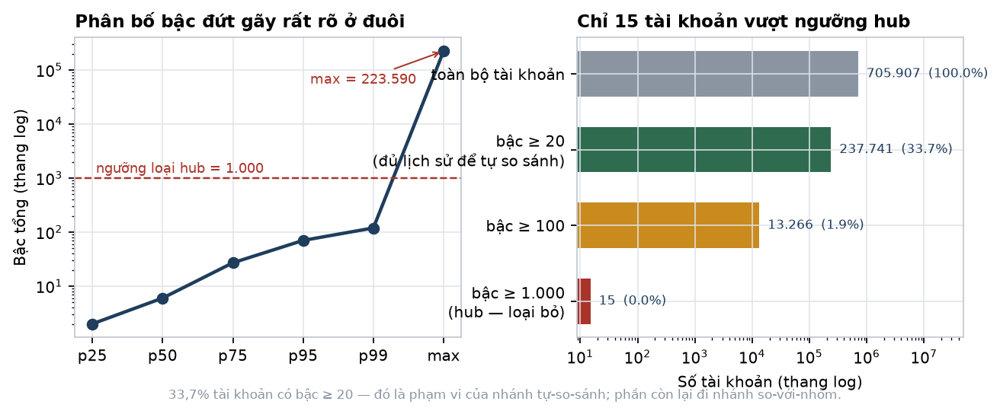

*Hình 6 — Trái: đường phân vị bậc, thang log, kèm ngưỡng loại hub. Phải: số tài khoản trong từng dải bậc.*

**Chỉ 15 tài khoản có bậc ≥ 1.000, trong khi tài khoản lớn nhất có 223.590.** Phân bố đứt gãy rất rõ ⇒ **ngưỡng loại hub đặt ở 1.000**, mất đúng 15 nút mà loại sạch hạ tầng thanh toán.

Tài khoản lớn nhất có bậc ra 222.037 so với bậc vào 1.553 — gần như chỉ phát, không nhận. Đó là điểm phát tiền tập trung, không phải khách hàng.

**33,7% tài khoản có bậc ≥ 20** ⇒ đó là phạm vi áp dụng của nhánh tự-so-sánh (ML-001 §5.7). Hai phần ba còn lại phải đi nhánh so-với-nhóm.

#### 5.10. Tổng kết quyết định do EDA chốt

| # | Quyết định | Căn cứ |
|---|---|---|
| 1 | Đơn vị dự đoán là **tài khoản** | Tỉ số hai tỉ lệ nền 14,6× (§5.2) |
| 2 | Bộ cửa sổ **{1, 2, 3} ngày** | 99,997% dữ liệu nằm trong 10 ngày (§5.1) |
| 3 | **Cấm chia tập theo thời gian**, chia theo mạng lưới + thực thể 70/10/10/10 | Test theo lịch còn 50 giao dịch (§5.3) |
| 4 | **Cấm `Payment Format`** làm đặc trưng | Lift 6,37× (§5.4) |
| 5 | **Cho phép** đặc trưng tiền tệ | Lift tối đa 1,25× (§5.5) |
| 6 | **Cấm mọi đặc trưng theo giờ trong ngày** | Giờ 00 là artifact 3,3× (§5.6) |
| 7 | **Chuẩn hoá số tiền trong từng tiền tệ** | Trải 6 bậc độ lớn (§5.7) |
| 8 | Ngưỡng loại hub = **1.000**, loại 15 tài khoản | Phân bố đứt gãy (§5.9) |
| 9 | Loại **804.477 cạnh tự trỏ** và strip zero-padding trước khi dựng đồ thị | §5.8 |
| 10 | Nhánh tự-so-sánh phủ **33,7%** tài khoản | §5.9 |

---

### 5b. Đường ống chuẩn bị dữ liệu

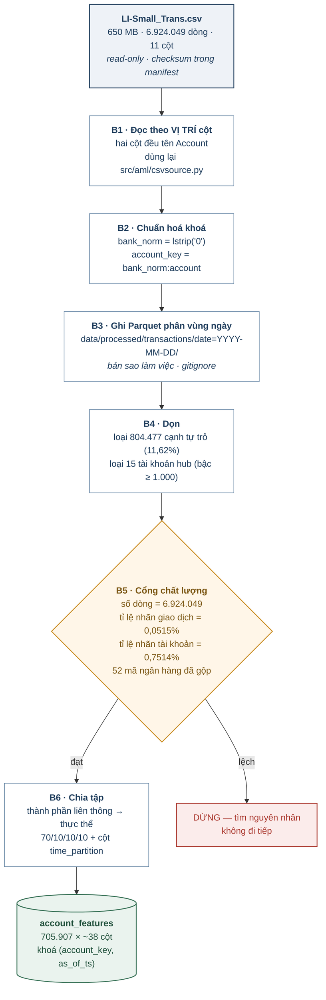

*Hình 8 — Sáu bước. Bước B5 là cổng chặn: lệch một con số thì dừng, không đi tiếp. Bốn con số kiểm tra ở B5 đều lấy từ kết quả EDA §5.*

**Vì sao Parquet.** CSV là nguồn sự thật, giữ nguyên, checksum trong manifest. Parquet ở `data/processed/` là bản sao làm việc — xoá được, dựng lại bằng một lệnh. Đọc hết CSV một lượt mất 27 giây; xây đặc trưng sẽ đọc lại hàng chục lần mỗi ngày, và Parquet cột có kiểu, phân vùng theo ngày, cắt thời gian đó xuống còn vài giây. Đây cũng không phải công nghệ mới với dự án: `AML_HDFS_FORMAT` trong `docker-compose.yml` đã mặc định `parquet`.

---

### 5c. Bốn nhãn — đo bốn thứ khác nhau

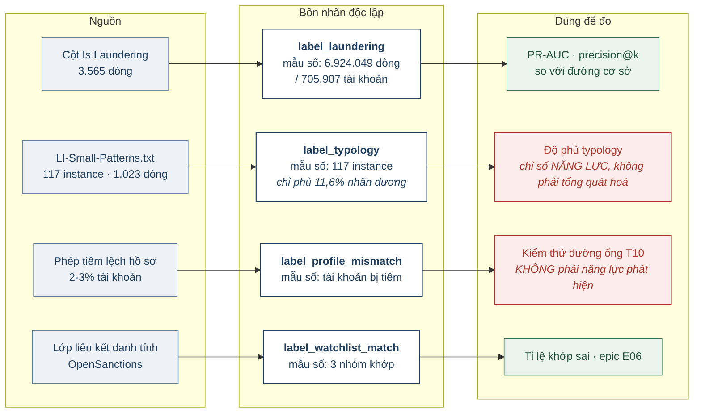

*Hình 9 — Bốn nhãn có bốn mẫu số khác nhau. Trộn mẫu số là nguyên nhân phổ biến nhất khiến kết quả đánh giá sai một bậc. Hai ô đỏ là hai chỉ số phải kèm chú thích khi báo cáo.*

---

### 5d. Chia tập theo thành phần liên thông

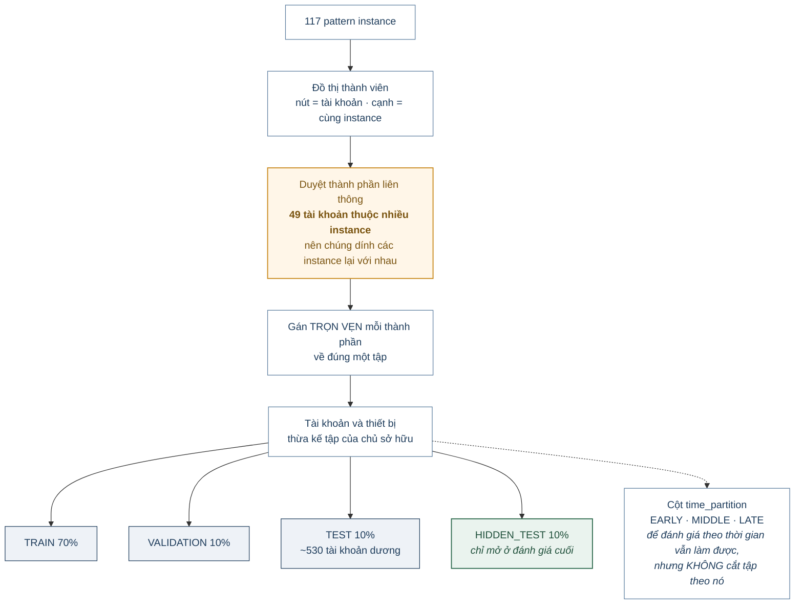

*Hình 10 — Vì sao phải duyệt thành phần liên thông chứ không lặp theo từng network: 49 tài khoản thuộc nhiều instance, nên hai instance dính nhau qua một tài khoản chung phải nằm cùng một tập.*

---

### 6. Thiết kế đặc trưng — phần bảng và hành vi (Hường)

Ký hiệu: `A` là tài khoản, `t` là `as_of_ts`, `w` là cửa sổ ∈ **{1, 2, 3} ngày** (chốt ở §5.1). Mọi đặc trưng chỉ dùng giao dịch có thời điểm **≤ t** (ML-001 §3.3).

#### 6.1. Chuẩn hoá số tiền — làm trước mọi thứ khác

```
amt_norm(x, cur) = (log1p(x) - μ_log[cur]) / σ_log[cur]
```

`μ_log[cur]` và `σ_log[cur]` **fit trên tập TRAIN**, lưu thành bảng tra cứu, áp nguyên cho validation và test. Với các luật ngưỡng thì dùng giá trị quy đổi USD, không dùng `amt_norm`.

#### 6.2. Cường độ — T01, T10

| Cột | Công thức |
|---|---|
| `amt_out_sum_{w}`, `amt_in_sum_{w}` | Σ `amt_norm` theo chiều, trong `(t−w, t]` |
| `txn_out_cnt_{w}`, `txn_in_cnt_{w}` | Số giao dịch theo chiều |
| `amt_out_med_{w}`, `amt_out_p90_{w}` | Trung vị và phân vị 90 |
| `active_days_{w}` | Số ngày riêng biệt có giao dịch |
| `txn_per_active_day_{w}` | `(out + in) / max(active_days, 1)` |

#### 6.3. Cận ngưỡng — T01

Ngưỡng `T` = 10.000 USD quy đổi (ML-001 §4.4), đặt trong cấu hình.

| Cột | Công thức | Vì sao |
|---|---|---|
| `near_thr_ratio_{w}` | #{amt ∈ [0,8·T, T)} / #{tổng} | Dấu hiệu kinh điển của structuring |
| `amt_cv_{w}` | σ(amt) / μ(amt) | **Hệ số biến thiên thấp + lặp nhiều = chia nhỏ có chủ ý** |
| `repeat_amt_ratio_{w}` | #{số tiền xuất hiện ≥ 2 lần} / #{tổng} | Chia đều một khoản lớn để lại dấu số tiền lặp |
| `sum_over_thr_ratio_{w}` | Σ amt / T | Cộng dồn vượt ngưỡng dù từng giao dịch không |
| `round_amt_ratio_{w}` | #{chia hết cho 1.000} / #{tổng} | Số tròn là dấu hiệu chia thủ công |

#### 6.4. Luân chuyển — T02, T05

| Cột | Công thức | Vì sao |
|---|---|---|
| `out_in_ratio_{w}` | `amt_out / (amt_in + ε)` | **≈ 1 là chữ ký tài khoản trung chuyển** |
| `dwell_time_med_{w}` | Trung vị `(t_ra − t_vào)` ghép cặp theo FIFO | T05. Là **hiệu hai mốc** — hợp lệ kể cả khi giờ trong ngày là nhiễu |
| `dwell_time_p10_{w}` | Phân vị 10 của cùng đại lượng | Bắt phần tiền chuyển đi tức thì |
| `eod_balance_ratio_{w}` | `(in − out) / (in + ε)` | ≈ 0 nghĩa là không giữ lại gì |
| `flow_through_score_{w}` | `min(in, out) / max(in, out)` | Đối xứng, ổn định hơn khi mẫu số nhỏ |

Ghép cặp vào–ra theo FIFO là xấp xỉ, không phải sự thật về dòng tiền — ghi thành giả định `ASSUME_FIFO_DWELL`.

#### 6.5. Đối tác

| Cột | Công thức | Vì sao |
|---|---|---|
| `distinct_cp_out_{w}`, `distinct_cp_in_{w}` | Số đối tác riêng biệt theo chiều | Bậc trong cửa sổ |
| `new_cp_ratio_{w}` | #{đối tác chưa gặp trước `t−w`} / #{đối tác} | **T04.** Mule có đối tác gần như toàn mới |
| `cp_herfindahl_{w}` | Σ (share_i)² trên số tiền theo đối tác | Tập trung hay rải đều |
| `cp_reciprocity_{w}` | #{đối tác hai chiều} / #{tổng đối tác} | Quan hệ hai chiều là dấu hiệu quan hệ thật |

#### 6.6. Vòng đời và nhịp

`account_age_days`, `days_since_last_txn`, `lifespan_days`, `burstiness_{w}` = σ(khoảng cách)/μ(khoảng cách), `weekend_ratio_{w}`.

> **Không có đặc trưng nào theo giờ trong ngày** — đã đo, giờ 00 là artifact chiếm 12,55% còn 23 giờ kia phẳng (§5.6). `weekend_ratio` giữ được vì ngày trong tuần là thông tin thật.

#### 6.7. Tiền tệ và liên ngân hàng

`distinct_currency_{w}`, `cross_currency_ratio_{w}`, `interbank_ratio_{w}`, `distinct_bank_cp_{w}`. **Đã đo: lift tiền tệ tối đa 1,25×, an toàn, được dùng** (§5.5).

#### 6.8. Lệch hồ sơ — T10

`volume_vs_expected_{w}`, `prototype_distance`, `income_band_vs_volume`.

> **Đọc ML-001 §9.1 trước khi báo cáo bất kỳ con số nào của nhóm này.** `expected_weekly_volume` được sinh *quanh* doanh số quan sát được, nên nhóm này dự đoán `label_profile_mismatch` gần như hoàn hảo mà không chứng minh gì. Giá trị thật: **có cải thiện PR-AUC trên `label_laundering` hay không.**

#### 6.9. Quy mô ma trận

3 cửa sổ × ~10 cột phụ thuộc cửa sổ + ~8 cột độc lập ≈ **38 cột**. Ở 705.907 tài khoản, ma trận ~706K × 38 float64 ≈ **215 MB** — nhẹ, chạy thoải mái trên máy cá nhân.

---

### 7. Thiết kế đặc trưng — phần đồ thị (Hiển)

#### 7.1. Vì sao phải chia hai tầng

Một số đặc trưng đồ thị có chi phí siêu tuyến tính. Ở ~705 nghìn nút của LI-Small chúng còn chạy được, nhưng ở HI-Medium (2,08 triệu nút) thì không — và thiết kế phải sống được cả hai.

| Đặc trưng | Chi phí | Tầng |
|---|---|---|
| Bậc vào, bậc ra, tỉ lệ đối tác mới | Rẻ — `groupby`, không cần dựng đồ thị | 1 |
| PageRank | Ma trận thưa `scipy`, vài phút | 1 |
| Bậc trung bình của hàng xóm | Một phép join | 1 |
| Liệt kê chu trình 2–6 bước | Bùng nổ tổ hợp | 2 |
| Betweenness centrality | Không khả thi ở quy mô triệu nút | 2, hoặc xấp xỉ lấy mẫu `k` |
| Phát hiện cộng đồng | Rất chậm | 2 |

#### 7.2. Tầng 1 — toàn bộ tài khoản

| Cột | Cách tính |
|---|---|
| `in_degree`, `out_degree` | `groupby` trên khoá đích / nguồn |
| `degree_ratio` | `out_degree / (in_degree + 1)` |
| `pagerank` | `scipy.sparse` + lặp lũy thừa ~15 vòng |
| `neighbor_degree_mean` | Join bậc của đối tác — **hàng xóm toàn bậc thấp là dấu hiệu mạng mule** |
| `is_hub` | `degree ≥ 1.000` — chốt ở §5.9, loại đúng 15 tài khoản |

#### 7.3. Chọn tập ứng viên

```
ứng viên = { A : luật ngưỡng bật }
         ∪ { A : điểm Isolation Forest ∈ top N% }
         ∪ { A : out_in_ratio ∈ [0,9, 1,1] và dwell_time_med < 24h }
         ∪ { A : new_cp_ratio > 0,8 và degree ≥ 5 }

Chỉnh N sao cho |ứng viên| ≈ 1–2% tổng tài khoản
```

**Điểm chặn:** đo **recall tầng 1** — trong số tài khoản có nhãn dương, bao nhiêu phần trăm lọt vào tập ứng viên. Đây là **trần recall của cả hệ thống**; tầng 2 dù hoàn hảo cũng không vượt được. Chỉnh N cho tới khi recall tầng 1 ≥ 95% trên validation, rồi mới tối ưu tầng 2.

#### 7.4. Tầng 2 — subgraph quanh ứng viên

Ứng viên + lân cận 2 bước, dựng bằng NetworkX (QD4). Instance thật chỉ 6–16 tài khoản (§4.2), nên lân cận 2 bước đủ rộng để chứa trọn một mạng lưới.

**T03 — chu trình:** `in_cycle`, `cycle_min_len`, `cycle_value`, `cycle_amount_cv` (chu trình rửa tiền có số tiền gần bằng nhau qua các bước), `cycle_max_gap_h`. Dùng `networkx.simple_cycles(G, length_bound=6)` — ràng buộc độ dài là bắt buộc, không có nó thì không kết thúc.

**T02 — trung chuyển:** `passthrough_score` = `min(in,out)/max(in,out) × exp(−dwell_h/24)`, `chain_position`, `chain_length`, `upstream_fan`, `downstream_fan`.

**T04 — gom vào / toả ra:** `fan_in_burst_{w}`, `fan_out_burst_{w}`, `fan_in_amt_concentration`, `scatter_gather_score`.

**Cộng đồng:** `community_id` (Louvain), `community_size`, `community_density`, `betweenness_approx` = `networkx.betweenness_centrality(G, k=500)`.

> **Cảnh báo rò rỉ.** Tuyệt đối **không** tính đặc trưng cộng đồng nào có dùng nhãn — ví dụ "tỉ lệ tài khoản bị gắn cờ trong cộng đồng". Đó là rò rỉ trực tiếp và bài kiểm thử tên cột không bắt được. Chỉ dùng thuộc tính **hình học**: kích thước, mật độ, vị trí của `A`.
>
> Đồ thị dựng từ **file giao dịch**, không bao giờ từ file pattern.

---

### 8. Kiến trúc lớp ML

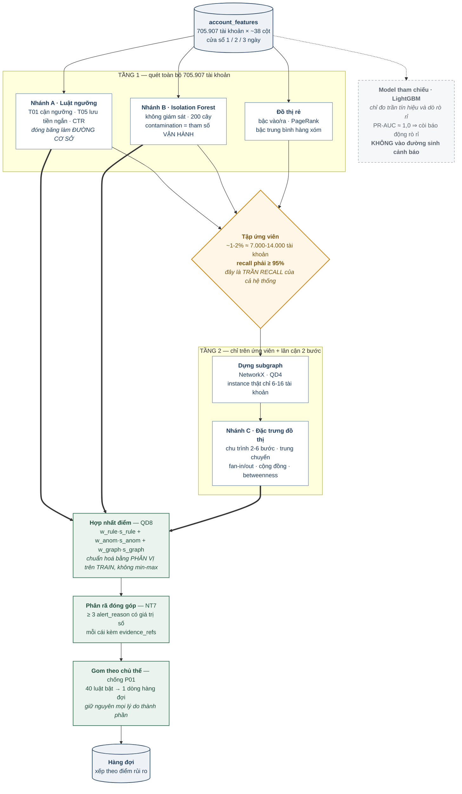

**Ba điểm dễ vẽ sai:**

1. **Luật và Isolation Forest vừa nuôi tập ứng viên vừa nuôi điểm hợp nhất.** Chúng không chỉ là bộ lọc — điểm của chúng đi thẳng vào công thức hợp nhất theo QD8.
2. **Model tham chiếu vẽ nét đứt, không nối vào `FUSE`.** Nó là dụng cụ đo, không phải thành phần sản phẩm.
3. **`DEDUP` nằm sau `REASON`.** Gom để hiển thị nhưng giữ nguyên toàn bộ lý do thành phần — gom trước thì mất bằng chứng.

---

### 9. Kiến trúc lớp Agent

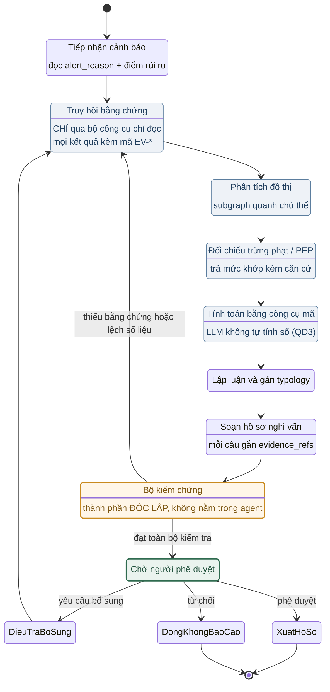

**Hai tính chất phải chứng minh bằng test, không bằng đọc mã:**

- **Không tồn tại cung tắt** từ `SoanHoSo` đi thẳng tới `XuatHoSo`. `XuatHoSo` chỉ có một đường vào, từ `ChoPheDuyet`.
- **Bộ kiểm chứng là thành phần riêng**, không phải hàm bên trong agent (QD2). Tách ra thì kiểm thử độc lập được, và khi thanh tra hỏi thì chỉ được vào một khối cụ thể.

---

### 10. Luồng chạy khi demo

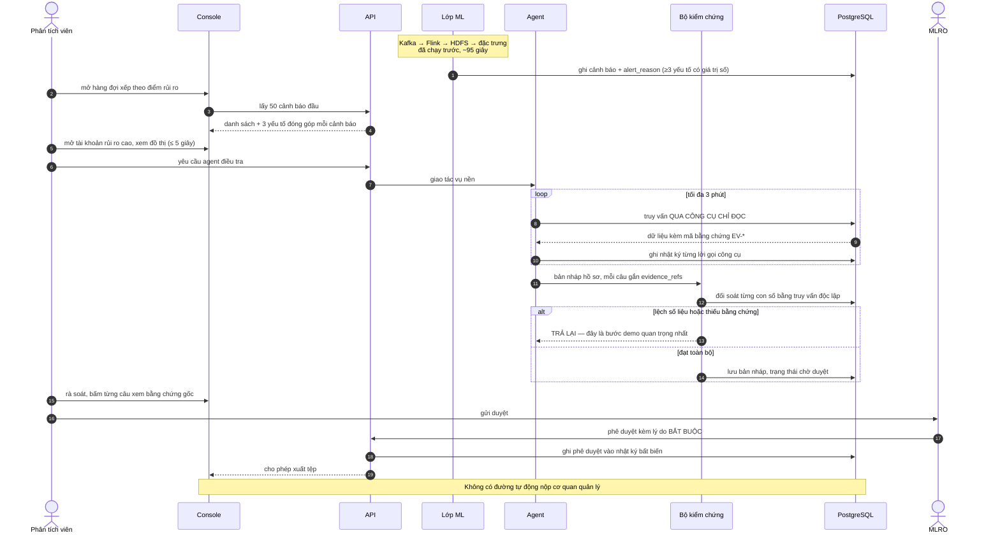

#### 10.1. Kịch bản demo, từng bước

| # | Việc | Người xem nhìn thấy | Thời gian |
|---|---|---|---:|
| 1 | Phát lại giao dịch vào Kafka theo thời gian gốc, tăng tốc 100× | Bộ đếm thông lượng; Flink UI xanh | 30 s |
| 2 | Flink ghi bronze Parquet phân vùng ngày/giờ | HDFS UI hiện phân vùng mới | 15 s |
| 3 | Tính đặc trưng tầng 1 | Log tiến độ | 20 s |
| 4 | Lớp ML chấm điểm, chọn ứng viên, chạy tầng 2 | Số ứng viên hiện ra | 30 s |
| 5 | **Hàng đợi hiện tài khoản xếp theo điểm rủi ro** | Màn hình hàng đợi, cột điểm và cột lý do | — |
| 6 | Mở một tài khoản rủi ro cao | **Ba yếu tố đóng góp có giá trị số** — NT7 nhìn thấy được | — |
| 7 | Xem đồ thị tương tác quanh chủ thể | Chu trình hoặc mẫu gom-toả hiện rõ | ≤ 5 s |
| 8 | Bấm "yêu cầu agent điều tra" | Agent chạy nền, trạng thái cập nhật | ≤ 3 phút |
| 9 | Agent trả bản nháp hồ sơ | **Mỗi câu có nút mở bằng chứng gốc** | — |
| 10 | **Cố tình sửa một con số trong bản nháp** | **Bộ kiểm chứng chặn, trả về agent** | — |
| 11 | MLRO phê duyệt kèm lý do bắt buộc | Nhật ký kiểm toán ghi thêm một dòng bất biến | — |
| 12 | Xuất tệp hồ sơ nghi vấn | Tệp theo cấu trúc; **không có đường tự động nộp cơ quan** | — |
| 13 | Mở nhật ký, tái dựng toàn bộ vụ việc | Một dòng thời gian duy nhất, không sót bước | — |

**Bước 10 là bước quan trọng nhất của cả buổi.** Nó trả lời trực tiếp câu hỏi khó nhất — làm sao biết AI không bịa — bằng cách cho người xem thấy hệ thống tự chặn chính nó. Chuẩn bị sẵn một ca hỏng để bấm.

#### 10.2. Ba nguyên tắc của dữ liệu demo

1. **Tài khoản đem demo phải thuộc nhánh HIDDEN_TEST.** Model chưa từng thấy, nên cảnh báo là suy luận ngoài mẫu thật.
2. **Console chỉ đọc dữ liệu không nhãn.** Cảnh báo do lớp ML tính tại chỗ, không đọc `Is Laundering`. Kiểm được bằng test quét danh sách cột API trả về.
3. **Nhãn chỉ xác nhận từng vụ, không tính tỉ lệ.** "Cảnh báo này do model tự sinh, đối chiếu ground truth thì trùng một vụ có thật" — được. "Hệ thống bắt được 80% số vụ" trên lát demo — không.

---

### 11. Việc cần làm và cần quyết

#### 11.1. Chặn ngay

| # | Việc | Ai |
|---|---|---|
| 1 | **Đưa `LI-Small_Trans.csv` vào `data/raw/ibm-aml/`** | — |
| 2 | Chạy `profile_transactions.py`, điền Chương 5 | Hường |
| 3 | Đọc `nhan_theo_ngay` và chốt cách chia tập | Hường + Bảo |

#### 11.2. PM quyết

| # | Việc | Mục | Vì sao gấp |
|---|---|---|---|
| 1 | **Cam kết typology**: chọn phương án A, B hay C | §4.4.1 | LI-Small không có typology structuring; cam kết BUS-001 §7 hiện không thực hiện được |
| 2 | **Độ phủ typology đo trên toàn bộ 117 instance**, không trên tập giữ lại; ghi rõ là chỉ số năng lực | §4.4.2 | CYCLE chỉ có 12 instance — chia tập xong còn 1–2, đo ra 0% hoặc 100% |
| 3 | **Duyệt việc cấm chia tập theo thời gian**, chuyển sang chia theo mạng lưới + thực thể 70/10/10/10 | §5.3 | Đã đo: chia theo lịch để lại tập test 50 giao dịch |
| 4 | Duyệt danh sách đặc trưng Chương 6 và 7 | §6, §7 | Điểm chặn trước khi huấn luyện |
| 5 | Xác nhận recall tầng 1 ≥ 95% là điều kiện đóng | §7.3 | Là trần recall của cả hệ thống |

---

## FIN-07 — Huấn luyện, đặc trưng và đánh giá

| | |
|---|---|
| **Mã tài liệu** | FIN-07-ML-001 |
| **Phiên bản** | 1.1 |
| **Ngày** | 08/08/2026 |
| **Người lập** | Bảo — PM/DevOps |
| **Người thực hiện** | Hiển (AI Engineer), Hường (ML/Feature) |
| **Tài liệu gốc** | FIN-07-BUS-001 (nghiệp vụ), FIN-07-ARC-001 (kiến trúc), FIN-07-DAT-001 (dữ liệu) |
| **Mức độ mật** | Nội bộ — Hạn chế |

Tài liệu này trả lời bốn câu hỏi cho hai người làm mô hình: **huấn luyện trên cái gì và như thế nào, dùng model và đặc trưng gì, kết quả trả về kèm bằng chứng ra sao, và đo bằng chỉ số nào so với đường cơ sở nào.**

Nó không thay thế FIN-07-DAT-001 mà cụ thể hoá phần mô hình. Chỗ nào khác tài liệu gốc đều đánh dấu **[LỆCH]** kèm lý do — không có thay đổi thầm lặng nào.

> ## ⚠ Cảnh báo phiên bản — đọc trước
>
> **Ngày 08/08/2026 dự án quay lại dùng bản LI-Small** (theo DAT-001 §3.1), và EDA đã chạy xong trên bản đó — kết quả ở **FIN-07-ML-002 Chương 4 và 5**.
>
> Tài liệu này viết ở v1.1 cho bản **HI-Medium**. **Mọi con số trong Chương 1, và các ngưỡng dẫn xuất ở §3, §5, §8, §9, đều là số đo trên HI-Medium** — vẫn đúng, nhưng đúng về HI-Medium. Không trích dẫn như số liệu của bộ đang dùng.
>
> **Số liệu thay thế cho LI-Small, lấy từ ML-002 §5:**
>
> | | HI-Medium (tài liệu này) | **LI-Small (đang dùng)** |
> |---|---:|---:|
> | Giao dịch | 31.898.238 | **6.924.049** |
> | Tài khoản | 2.077.023 | **705.907** |
> | Cửa sổ dùng được | 27,67 ngày | **10 ngày** |
> | Tỉ lệ nền giao dịch | 0,1104% | **0,0515%** |
> | Tỉ lệ nền tài khoản | 2,0152% | **0,7514%** |
> | Tài khoản dương | 41.857 | **5.304** |
> | Lift ACH | 7,2× | **6,37×** |
> | Bộ cửa sổ đặc trưng | 1/3/7 ngày | **1/2/3 ngày** |
> | Tài khoản bậc ≥ 20 | 39,3% | **33,7%** |
> | Cạnh tự trỏ | 8,03% | **11,62%** |
>
> **Phần vẫn đúng nguyên vẹn, không phụ thuộc bản nào:** quy tắc chống rò rỉ (§2), phương pháp chia tập theo mạng lưới (§3.2), chiến lược huấn luyện và phễu hai tầng (§5), lớp bằng chứng (§6), cách so với đường cơ sở (§7), bộ chỉ số (§8), toàn bộ cạm bẫy (§9).

---

### 0. Phân công

Rủi ro RK5 (ARC-001) và RD7 (DAT-001) đều ghi Hiển là nút thắt năng lực. Bản này tách đôi theo đường ranh tự nhiên nhất: **đặc trưng bảng và mô hình hành vi** tách khỏi **đồ thị và agent**.

| Hạng mục | Chủ trì | Ghi chú |
|---|---|---|
| Chuyển CSV sang Parquet, khoá tài khoản, kiểm tra chất lượng | Hường | Chặn mọi việc phía sau |
| Chia tập và bộ kiểm thử chống rò rỉ | Hường | §3 |
| Bảng đặc trưng hành vi cửa sổ trượt | Hường | Đầu ra dùng chung, không phải sản phẩm phụ |
| Sinh hồ sơ khách hàng + nhãn T10 | Hường | Mục 5 DAT-001 |
| Isolation Forest + hiệu chỉnh ngưỡng | Hường | Nhánh B |
| Bộ luật ngưỡng (đường cơ sở) | Hường | **Phải xong và đóng băng trước mọi việc ML** |
| Dựng đồ thị, chu trình, cụm, trung chuyển | Hiển | Nhánh C |
| Đối soát 493 pattern IBM sang T01–T10 | Hiển | Quyết định phạm vi cam kết |
| Lớp hợp nhất điểm và phân rã đóng góp | Hiển | QD8, NT7 |
| Lớp bằng chứng và evidence ledger | Hiển | §6 |
| Agent LangGraph, bộ kiểm chứng | Hiển | ARC-001 Hình 4 |
| Đối chiếu danh sách trừng phạt | Hường (nếu Hiển quá tải) | Hạng mục chuyển giao được, DAT-001 mục 1 |

**Giao diện giữa hai người là một file duy nhất:** bảng đặc trưng mức tài khoản, khoá `(account_key, as_of_ts)`. Hường sinh ra, Hiển tiêu thụ. Chốt schema trong ngày đầu tiên, trước khi ai viết code.

---

### 1. Nguồn dữ liệu

#### 1.1. [LỆCH] Chốt dùng HI-Medium

DAT-001 §3.1 chọn LI-Small với lý do bản HI cho chỉ số "đẹp giả tạo". Quyết định ngày 08/08/2026 đổi sang **HI-Medium**, vì ba lý do đo được:

| | LI-Small | HI-Medium |
|---|---:|---:|
| Giao dịch | ~7 triệu | **31.898.238** |
| Tài khoản | ~705 nghìn | **2.077.023** |
| Dòng nhãn dương | ~3.500 | **35.230** |
| Tỉ lệ nền | ~0,05% | **0,1105%** |

1. **Gấp mười lần số mẫu dương.** Với cách chia ở ML-002 §2.1, tập test giữ được khoảng 3.500 mẫu dương mức giao dịch và ~4.200 tài khoản dương, thay vì vài trăm. Ở cỡ vài trăm, PR-AUC dao động đủ mạnh để hai model khác nhau thật sự vẫn không phân biệt được. Đây là lý do chính.
2. **Chênh lệch tỉ lệ nền chỉ 2,2 lần.** Cả 0,05% lẫn 0,11% đều nằm sâu trong vùng cực kỳ mất cân bằng; không có bản nào biến bài toán thành dễ. Lo ngại của §3.1 là có thật nhưng nhỏ hơn lợi ích thống kê ở điểm 1.
3. **Đã profiling đầy đủ.** Mọi con số ở §1.3 là đo trực tiếp trên file, không phải giả định.

**Cái giá phải trả, ghi rõ để không quên:** mật độ kịch bản rửa tiền trong bản HI cao hơn thực tế, nên mẫu hình dễ tìm hơn. Bù lại bằng hai việc bắt buộc — luôn báo cáo tỉ lệ nền 0,1105% ngay cạnh mọi chỉ số, và thực thi nghiêm §4.2 về `Payment Format`. Khi hội đồng hỏi tỉ lệ nền, câu trả lời là "0,11%, cao hơn khoảng hai lần so với tỉ lệ thường thấy ở một ngân hàng thật, và chúng tôi công bố con số này chứ không giấu".

#### 1.2. Nguồn và checksum

| File | Kích thước | Nội dung |
|---|---:|---|
| `HI-Medium_Trans.csv` | 3.031.783.420 B | 31.898.238 giao dịch, 11 cột |
| `HI-Medium_accounts.csv` | 145.008.642 B | 2.087.786 dòng — tên ngân hàng, mã ngân hàng, số tài khoản, mã pháp nhân, tên pháp nhân |
| `HI-Medium_Patterns.txt` | 407.882 B | 493 instance kịch bản rửa tiền có nhãn |

SHA-256 của file giao dịch: `3126afb8155e7c8815d62bc5370549a7b5ae6bf7dfe872b3cd7813e66a3d7ff5`.

Mọi báo cáo kết quả phải trích checksum này. Ba file nằm ở `data/raw/ibm-aml/`, **không sửa, mở read-only**. Giấy phép CDLA-Sharing-1.0, ghi nguồn trong README (DAT-001 §3.2).

`HI-Medium_accounts.csv` cho mã pháp nhân và tên pháp nhân — đủ để một vụ việc có chủ thể trên console, không chỉ là dãy số tài khoản.

#### 1.3. Số liệu đã đo — dùng trực tiếp, không đo lại

**Lược đồ.** 11 cột, **hai cột đều tên `Account`**. Đọc **theo vị trí**, không theo tên: `pandas` đổi tên thành `Account.1`, `csv.DictReader` âm thầm vứt một cột. `src/aml/csvsource.py` đã đọc theo vị trí và kiểm tra header — dùng lại, đừng viết lại.

**Thời gian.** 2022/09/01 00:00 → 2022/09/28 15:58. **Span 27,67 ngày.** Đây là ràng buộc nặng nhất của cả dự án; xem §3.1 và §4.1.

**Định danh.** 2.076.999 số tài khoản riêng biệt, 2.077.023 khoá `bank:account`, 24 trùng chéo ngân hàng. Mã ngân hàng **lệch zero-padding**: `020` và `0020` là cùng một ngân hàng — trên 3 triệu dòng đầu, 71.822 chuỗi thô rút còn 71.773 sau khi strip. **Mọi phép ghép phải strip leading zeros trước.**

**Hub.** Ngân hàng `070` xuất hiện trên 2.979.311 chân giao dịch, hơn một bậc so với ngân hàng kế tiếp (`012`, 240.541). Tài khoản bận nhất có 1.083.821 giao dịch. Đây là hạ tầng thanh toán, không phải khách hàng.

**Số tiền.** Trải 18 bậc độ lớn: min 0,000001 — trung vị ≈ 1.496 — p99 ≈ 10.592.537 — max 8,16 × 10¹². Phần lớn độ trải là do **trộn 15 đơn vị tiền tệ** (Bitcoin 6 chữ số thập phân, Yen hàng nghìn tỷ), **không có VND**. 485.144 dòng (1,52%) có số tiền trả khác số tiền nhận, gần trùng khớp với số dòng chéo tiền tệ.

> Mọi thống kê số tiền không điều kiện theo `currency` là vô nghĩa. Chuẩn hoá trong từng đơn vị, hoặc dùng tỉ lệ nội bộ tài khoản.

**Phân bố hoạt động mỗi tài khoản.**

| | p25 | trung vị | p75 | p95 | max |
|---|---:|---:|---:|---:|---:|
| Số giao dịch | 3 | **7** | 42 | 114 | 1.083.821 |
| Số ngày hoạt động | 2 | **4** | 16 | 16 | 26 |

**Giờ giao dịch phân bố đều** — mỗi giờ từ 01:00 đến 23:00 chiếm 3,88–3,90%. `night_transaction_share` có trung vị 0,40 với p25 0,286 và p95 1,0; kỳ vọng lý thuyết dưới phân bố đều là 8/24 = 0,333. **Toàn bộ độ tán quanh con số đó là nhiễu nhị thức trên vài giao dịch, không phải hành vi.**

**Cạnh tự trỏ.** 2.561.860 dòng (8,03%) có nguồn = đích.

**Kênh thanh toán và nhãn.**

| Kênh | Toàn file | Dòng laundering |
|---|---:|---:|
| Cheque | 12.280.058 (38,5%) | |
| Credit Card | 8.777.816 (27,5%) | |
| **ACH** | **3.868.410 (12,1%)** | **30.746 — 87,3%** |
| Cash | 3.217.531 (10,1%) | |
| Reinvestment | 1.945.611 (6,1%) | 0 |
| Wire | 1.119.774 (3,5%) | 0 |
| Bitcoin | 689.038 (2,2%) | |

P(laundering \| ACH) = 0,795% so với tỉ lệ nền 0,1105% → **lift 7,2 lần từ một cột hạng mục duy nhất**. Wire và Reinvestment không chứa dòng laundering nào. Đây là chữ ký của bộ sinh dữ liệu, không phải đặc điểm của rửa tiền. Xem §4.2.

**Mạng lưới tội phạm.** 493 pattern instance. **219 tài khoản thuộc nhiều hơn một instance** — nên việc gom instance phải là một lượt duyệt thành phần liên thông, không phải vòng lặp theo từng network.

---

### 2. Bốn nhãn và quy tắc chống rò rỉ

Theo DAT-001 mục 8.

| Nhãn | Nguồn | Đánh giá cái gì |
|---|---|---|
| `label_laundering` | Cột `Is Laundering` | Năng lực phát hiện tổng thể |
| `label_typology` | 493 instance trong file pattern, ánh xạ T01–T10 | Độ phủ theo từng typology |
| `label_profile_mismatch` | Tiêm ở bước 4 mục 5 DAT-001 | Riêng T10 — đọc cảnh báo §9.1 |
| `label_watchlist_match` | Lớp liên kết danh tính | Epic E06, tỉ lệ khớp sai |

#### Ba bài kiểm thử chống rò rỉ, chạy trong CI

1. **Không cột `label_*` nào trong ma trận đặc trưng.** So tập tên cột đặc trưng với tập cột tiền tố `label_`; giao phải rỗng.
2. **Không đặc trưng nào dẫn xuất từ file pattern.** File pattern sinh ra `label_typology`; dùng nó để tính thành viên cụm, độ dài chu trình hay bất cứ gì đưa vào model là rò rỉ gián tiếp mà bài số 1 không bắt được. Mỗi cột đặc trưng phải khai báo nguồn, và không cột nào được ghi nguồn là file pattern.
3. **Không thống kê nào fit trên toàn bộ dữ liệu.** Trung bình, độ lệch chuẩn, phân vị, ngưỡng, tham số scaler — fit trên tập huấn luyện rồi áp cho validation và test. Bao gồm cả bước sinh hồ sơ khách hàng ở mục 5 DAT-001.

Bài số 3 là bài dễ quên nhất và tốn nhất khi phát hiện muộn.

---

### 3. Chia tập

#### 3.1. Cửa sổ 27,67 ngày quyết định mọi thứ

Chia 60/20/20 theo thời gian như DAT-001 §4.2 cho ra:

```
TRAIN        16,6 ngày      2022/09/01 → 2022/09/17
VALIDATION    5,5 ngày      2022/09/17 → 2022/09/23
TEST          5,5 ngày      2022/09/23 → 2022/09/28
```

Hệ quả bắt buộc phải chấp nhận:

- **Không có mùa vụ, không có chu kỳ tháng, không có baseline 90 ngày.**
- Cửa sổ Behaviour dài nhất được giữ trong contract hiện tại là **7 ngày**.
- Trong 5,5 ngày test, đặc trưng vẫn được nhìn lịch sử trước mốc cắt — ngân hàng thật cũng biết quá khứ — nhưng nghĩa là train và test **không độc lập ở mức tài khoản**. Phải đo và báo cáo, không phải giấu.

> **[CẬP NHẬT 08/08/2026 — cách chia này đã bị bác bỏ bằng số liệu.]**
>
> EDA ở FIN-07-ML-002 §2.1 đo phân bố nhãn dương theo ngày và phát hiện nó **sụp đổ ở cuối cửa sổ**: từ đỉnh 2.416 dòng ngày 09/16 xuống còn 3 dòng ngày 09/28. Nguyên nhân là pattern instance trải trung vị 3–7 ngày nên bộ mô phỏng không tiêm được kịch bản mới ở cuối cửa sổ.
>
> Chia 60/20/20 theo thời gian để lại **khoảng 262 mẫu dương** trong tập test, không phải ~7.000 như ước lượng ban đầu ở bản này. Cỡ đó không đánh giá được.
>
> **Cách chia thay thế — chia theo thành phần liên thông của mạng lưới rồi tới thực thể, 70/10/10/10, giữ cột `time_partition` để đánh giá theo thời gian vẫn làm được.** Chi tiết và lý do ở ML-002 §2.1. Mục §3.2 dưới đây vẫn đúng và trở thành cơ chế chia chính thay vì cơ chế bổ sung.

#### 3.2. [LỆCH] Chia theo thời gian một mình không chặn được rò rỉ mạng lưới

Nguyên tắc ND2 giải thích: chia ngẫu nhiên làm rò rỉ tương lai vào quá khứ, **"vì các giao dịch trong cùng một kịch bản rửa tiền nằm rải theo thời gian."**

Chính câu đó chỉ ra vấn đề của cách chia thuần thời gian. Kịch bản nào trải qua mốc cắt sẽ có chân ở cả hai bên: model nhìn thấy nửa đầu mạng lưới khi huấn luyện rồi bị chấm điểm trên nửa sau. Nó học thuộc mạng lưới chứ không học mẫu hình.

Thời gian chặn rò rỉ *thời gian*. Nó không chặn rò rỉ *mạng lưới*. Cần cả hai.

```
Bước 1 — Cắt theo thời gian 60/20/20. Giữ nguyên ND2 và §4.2.

Bước 2 — Với mỗi trong 493 pattern instance, tính khoảng thời gian nó trải qua.
         Instance vắt qua mốc cắt được gán TRỌN VẸN về tập chứa giao dịch
         ĐẦU TIÊN của nó; các giao dịch còn lại bị LOẠI KHỎI TẬP ĐÁNH GIÁ
         ở tập sau. Chúng vẫn dùng làm lịch sử để tính đặc trưng, nhưng
         không xuất hiện như mẫu chấm điểm.

         Vì 219 tài khoản thuộc nhiều instance, bước gom phải là một lượt
         duyệt THÀNH PHẦN LIÊN THÔNG trên đồ thị thành viên, không phải
         vòng lặp theo từng network.

Bước 3 — Báo cáo bắt buộc trong report chia tập:
         · số instance vắt mốc và đã xử lý
         · số tài khoản xuất hiện ở cả train và test
         · số dòng nhãn dương còn lại ở mỗi tập
```

Con số thứ hai không cần bằng không — một tài khoản hoạt động liên tục qua 27 ngày là bình thường. Nhưng phải **biết** nó là bao nhiêu.

#### 3.3. Quy tắc nhân quả

> Đặc trưng tại thời điểm `t` chỉ được dùng giao dịch có thời điểm **≤ t**. (DAT-001 §9)

Cách kiểm thực dụng: với mỗi cột, lấy một tài khoản, tính đặc trưng tại `t`, thêm một giao dịch giả tại `t + 1 ngày`, tính lại. Giá trị phải không đổi. Test này bắt gần hết lỗi cửa sổ trượt.

#### 3.4. Tập test bị niêm phong

Không dùng trong bất kỳ vòng tinh chỉnh nào cho tới đánh giá cuối ở Sprint 5. Chọn ngưỡng, chọn tham số, chọn trọng số hợp nhất — tất cả trên validation.

Thực thi bằng quy ước thư mục: tập test ở đường dẫn riêng, script huấn luyện không nhận đường dẫn đó làm tham số hợp lệ.

---

### 4. Đặc trưng

**Không đặc trưng nào ngoài danh sách này được đưa vào bất kỳ nhánh nào mà không cập nhật tài liệu và được PM duyệt.**

#### 4.1. [LỆCH] Cửa sổ theo tháng phải đổi sang theo tuần

DAT-001 §5.1 định nghĩa "doanh số trung vị **theo tháng**", "phân vị 90 của doanh số **tháng**", "tỉ lệ đối tác mới **theo tháng**". Dữ liệu chỉ có 27,67 ngày — chưa đủ một tháng, và chỉ có đúng một. Ba đại lượng đó không tính được.

Thay bằng cửa sổ tuần, giữ nguyên ý nghĩa nghiệp vụ:

| DAT-001 §5.1 | Thay bằng |
|---|---|
| Doanh số trung vị theo tháng | Doanh số trung vị theo **cửa sổ 7 ngày trượt** |
| Phân vị 90 của doanh số tháng | Phân vị 90 của doanh số **7 ngày** |
| Tỉ lệ đối tác mới theo tháng | Tỉ lệ đối tác mới trong **7 ngày** |
| Cửa sổ 1 / 7 / **30** ngày (§9) | Cửa sổ **1 / 3 / 7 / 14** ngày |

Tương tự, `expected_monthly_volume` ở mục 5.3 DAT-001 đổi thành `expected_weekly_volume`, hoặc giữ tên tháng nhưng ngoại suy từ tuần và ghi rõ là ngoại suy.

#### 4.2. Được phép

| Nhóm | Đặc trưng | Typology | Điều kiện |
|---|---|---|---|
| **Cường độ** | Doanh số cửa sổ 1/3/7 ngày; số giao dịch; trung vị; phân vị 90 | T01, T10 | Chuẩn hoá trong từng `currency` |
| **Cận ngưỡng** | Tỉ lệ giao dịch trong dải sát dưới ngưỡng; độ lệch chuẩn số tiền; số lần lặp trong cửa sổ | T01 | Ngưỡng định nghĩa ở §4.4 |
| **Luân chuyển** | Tỉ lệ tiền ra / tiền vào; thời gian lưu tiền trung vị; số dư cuối ngày | T02, T05 | Thời gian lưu tiền là **hiệu hai mốc** — hợp lệ kể cả khi giờ trong ngày là nhiễu |
| **Mạng lưới** | Bậc vào, bậc ra, tỉ lệ đối tác mới, PageRank, chỉ số cụm | T02, T03, T04 | Trên đồ thị đã loại cạnh tự trỏ và loại hub; xem §5.2 về chi phí |
| **Chu trình** | Thuộc chu trình hay không, độ dài, giá trị, độ trễ giữa các bước | T03 | Phát hiện bằng thuật toán, **tuyệt đối không đọc file pattern** |
| **Lệch hồ sơ** | Doanh số thực tế / doanh số kỳ vọng khai báo; lệch so với nguyên mẫu | T10 | Đọc §9.1 trước khi báo cáo bất kỳ con số nào |
| **Vòng đời** | Số ngày hoạt động, tuổi tài khoản tại thời điểm xét, khoảng cách giao dịch đầu–cuối | T02, T05 | Tối đa 27 ngày, đừng kỳ vọng hơn |
| **Liên ngân hàng** | Tỉ lệ giao dịch có ngân hàng gửi khác ngân hàng nhận | T04, T08 | Sau khi strip zero-padding |
| **Tiền tệ** | Số đơn vị tiền tệ riêng biệt; có giao dịch chéo tiền tệ hay không | T03, T06 | Xem cảnh báo §9.3 |

#### 4.3. Bị loại

| Bị loại | Lý do | Gỡ khi nào |
|---|---|---|
| Mọi cột `label_*` | ND1 | Không bao giờ |
| Bất cứ gì dẫn xuất từ file pattern | Rò rỉ gián tiếp qua `label_typology` | Không bao giờ |
| **`Payment Format` / `channel` làm đặc trưng model** | **Đo được: lift 7,2 lần theo nhãn. 87,3% dòng laundering là ACH trong khi ACH chỉ chiếm 12,1% toàn file; Wire và Reinvestment không có dòng nào** | **Không bao giờ — đã đo, không còn gì để chờ** |
| Đặc trưng theo **giờ trong ngày** (tỉ lệ giao dịch đêm, ngoài giờ) | Đo được: giờ phân bố đều 3,88–3,90%. Độ tán quanh 8/24 là nhiễu nhị thức | Không bao giờ trên bộ này |
| Cửa sổ 30 ngày và mọi đại lượng theo tháng | Bằng gần trọn bộ dữ liệu 27,67 ngày → hằng số | Không |
| Tài khoản và ngân hàng kiểu hub | Bank `070` chiếm 2,98 triệu chân; tài khoản bận nhất 1,08 triệu giao dịch | Không — loại vĩnh viễn, ghi lại số lượng đã loại |
| Số tiền chưa điều kiện theo `currency` | Trải 18 bậc độ lớn do trộn đơn vị | Không |
| Cạnh tự trỏ | 8,03% dòng, làm lệch bậc vào/ra | Không — loại trước khi dựng đồ thị |

**[LỆCH] về `Payment Format`.** DAT-001 §4.1 ánh xạ `Payment Format → transaction.channel` và giữ lại. Việc **lưu** cột này là đúng: cần cho gán nguyên mẫu khách hàng (§5.1 DAT-001) và cần để hiển thị trong hồ sơ vụ việc. Điều tài liệu này cấm hẹp hơn — **không đưa vào ma trận đặc trưng của model phát hiện**. Lưu và hiển thị vẫn giữ nguyên.

Nếu để cột này trong đặc trưng, kết quả sẽ rất đẹp và đo bộ sinh dữ liệu chứ không đo rửa tiền. Tệ hơn con số sai: nó đặt ra một mốc mà các model trung thực về sau không vượt được.

#### 4.4. Ngưỡng báo cáo cho T01

BUS-001 và DAT-001 lấy ngưỡng giao dịch giá trị lớn là **400 triệu VND** (Thông tư 09/2023/TT-NHNN). Dữ liệu IBM có 15 đơn vị tiền tệ và **không có VND**.

**Quy ước:** ngưỡng cận-báo-cáo cho T01 lấy **10.000 USD**, quy đổi tương đương sang từng đơn vị khác, vì bộ mô phỏng IBM mang đặc trưng thị trường Mỹ. Dải "sát dưới ngưỡng" = **[0,80 · ngưỡng, 1,00 · ngưỡng)**.

Ghi thành giả định có tên `ASSUME_CTR_THRESHOLD_USD`, đặt trong file cấu hình **không phải trong mã nguồn**. Khi triển khai tại ngân hàng Việt Nam, đổi sang 400 triệu VND chỉ bằng sửa cấu hình.

---

### 5. Chiến lược huấn luyện

Phần này trả lời câu "huấn luyện như thế nào là tốt nhất cho dự án", với ràng buộc thật: 31,9 triệu dòng, 2,08 triệu tài khoản, 27,67 ngày, 5 tuần làm.

#### 5.1. Đơn vị dự đoán là tài khoản, không phải giao dịch

Nhãn `Is Laundering` gắn với **giao dịch**. Nhưng hàng đợi mà phân tích viên xử lý gắn với **chủ thể** — đó là toàn bộ ý nghĩa của bước gom cảnh báo ở ARC-001 §3.3 và nỗi đau P01.

**Chốt: đơn vị chính là `(account_key, as_of_ts)`.** Nhãn tài khoản = tài khoản có tham gia ít nhất một giao dịch laundering trong cửa sổ đang xét.

- Báo cáo chỉ số ở **cả hai mức**, nhưng mức tài khoản là mức đưa vào cam kết BUS-001 §7.
- **Tỉ lệ nền mức tài khoản đã đo: 2,0152%** — 41.857 tài khoản chạm ít nhất một giao dịch laundering, trên 2.077.023 tài khoản. Gấp 18 lần tỉ lệ mức giao dịch. Đây là con số dùng cho mọi tính toán precision@k. (ML-002 §1.1)

Lợi ích phụ đáng kể: 31,9 triệu dòng rút xuống 2,08 triệu dòng đặc trưng, biến bài toán từ "cần cụm máy" thành "chạy được trên laptop".

#### 5.2. Phễu hai tầng — quyết định kỹ thuật quan trọng nhất

Ở quy mô 2,08 triệu nút và ~31,9 triệu cạnh, một số đặc trưng đồ thị **không tính nổi trên toàn đồ thị**:

| Đặc trưng | Trên toàn đồ thị | Cách xử lý |
|---|---|---|
| Bậc vào, bậc ra, tỉ lệ đối tác mới | Rẻ — `groupby`, không cần dựng đồ thị | Tầng 1 |
| PageRank | Chạy được bằng ma trận thưa scipy, vài phút | Tầng 1 |
| Betweenness centrality | **Bất khả thi** ở 2 triệu nút | Tầng 2, hoặc xấp xỉ có lấy mẫu `k` |
| Liệt kê chu trình 2–6 bước | **Bất khả thi** trên 31,9 triệu cạnh | Tầng 2 |
| Phát hiện cộng đồng | Rất chậm | Tầng 2 |

**Thiết kế phễu:**

```
TẦNG 1 — chạy trên toàn bộ 2,08 triệu tài khoản
  · Đặc trưng bảng: cường độ, cận ngưỡng, luân chuyển, vòng đời, tiền tệ
  · Đặc trưng đồ thị rẻ: bậc vào/ra, tỉ lệ đối tác mới, PageRank
  · Luật ngưỡng (nhánh A)
  · Isolation Forest (nhánh B)
  → Lấy ra tập ứng viên: hợp của (luật bật) ∪ (top N% điểm bất thường)
     N chọn sao cho tập ứng viên khoảng 1–2% tài khoản, tức 20–40 nghìn

TẦNG 2 — chỉ chạy trên tập ứng viên và lân cận 1–2 bước của chúng
  · Dựng subgraph bằng NetworkX (đúng tinh thần QD4)
  · Chu trình, cộng đồng, betweenness, tài khoản trung chuyển
  · Đặc trưng đồ thị đắt tiền
  → Hợp nhất ba nhánh, sinh cảnh báo
```

Phễu này không phải thủ thuật kỹ thuật — nó **là cách một ngân hàng thật vận hành**: luật rẻ quét toàn bộ, điều tra sâu chỉ chạy trên cái đã nổi lên. Nó cũng khớp đúng luồng cảnh báo → điều tra ở ARC-001 Hình 3 và QD4 ("phạm vi điều tra luôn là subgraph quanh một chủ thể").

**Cái giá phải đo và báo cáo:** tài khoản nào tầng 1 bỏ sót thì tầng 2 không có cơ hội cứu. Phải báo cáo **recall của tầng 1** — trong số tài khoản có nhãn dương, bao nhiêu phần trăm lọt vào tập ứng viên. Đây là trần recall của cả hệ thống. Nếu tầng 1 chỉ đạt 70% thì dù tầng 2 hoàn hảo, hệ thống cũng chỉ đạt 70%.

Chỉnh N cho tới khi recall tầng 1 ≥ 95% trên validation, rồi mới tối ưu tầng 2.

#### 5.3. Chuẩn bị dữ liệu

**Chuyển sang Parquet trước tiên.** CSV 3 GB đọc đi đọc lại hàng chục lần trong quá trình phát triển là lãng phí lớn nhất của cả dự án. Một lượt chuyển sang Parquet có phân vùng theo ngày cho file nhỏ hơn 3–4 lần và đọc nhanh gấp nhiều lần, đọc được từng cột.

```
data/processed/transactions/date=2022-09-01/part-*.parquet
```

Dùng `pyarrow`, đọc CSV theo lô, đọc cột theo vị trí. Một lượt, khoảng 40 giây trên máy cá nhân — đợt profiling trước đọc hết file trong 39,6 giây bằng một lượt streaming.

**Thứ tự dọn dữ liệu, không đảo:**

1. Strip zero-padding mã ngân hàng → ghép khoá `bank:account`.
2. Loại 2,56 triệu cạnh tự trỏ, **ghi lại số lượng**.
3. Loại hub theo ngưỡng số giao dịch, ghi lại số lượng và danh sách.
4. Kiểm tra chất lượng theo mục 10 DAT-001 — số dòng khớp tuyệt đối, tổng giá trị khớp, tỉ lệ nhãn ≈ 0,11%.

#### 5.4. Ba nhánh phát hiện

**Nhánh A — Luật ngưỡng.** Chủ trì Hường. Phủ T01 (cận ngưỡng, cộng dồn cửa sổ 24h/7 ngày), T05 (thời gian lưu tiền ngắn, doanh số ngày lớn nhưng số dư nhỏ), lọc CTR. Mỗi luật có mã riêng, ngưỡng trong cấu hình, khi bật ghi lý do kèm giá trị đã vượt.

Nhánh này **đồng thời là đường cơ sở benchmark** (§7). Phải xong và **đóng băng bằng tag git** trước khi bắt đầu bất kỳ việc ML nào — tinh chỉnh nó song song với model thì con số "giảm 50% báo động giả" không còn nghĩa.

**Nhánh B — Isolation Forest.** Chủ trì Hường. `sklearn.ensemble.IsolationForest` trên bảng đặc trưng mức tài khoản.

Chọn không giám sát là có chủ ý: tỉ lệ nhãn dương quá thấp để huấn luyện có giám sát ổn định, và khi triển khai thật thì ngân hàng không có nhãn.

- `n_estimators=200`, `max_samples=256` (mặc định 'auto' — ở 2 triệu dòng nên đặt tường minh), `n_jobs=-1`, `random_state` cố định (ND5).
- **`contamination` không được đặt bằng tỉ lệ nhãn — đó là rò rỉ.** Đặt theo năng lực xử lý của đội, ví dụ 0,5%, và ghi là tham số vận hành chứ không phải tham số học.
- Fit trên train, transform cho validation và test.
- Đóng góp từng đặc trưng: độ dài đường đi trung bình theo từng chiều, hoặc SHAP nếu kịp. Cần cho NT7.

**Nhánh C — Đồ thị.** Chủ trì Hiển. NetworkX trên subgraph tầng 2 (QD4). Phủ T02, T03, T04: chu trình có hướng độ dài 2–6 kèm tổng giá trị và độ trễ; tài khoản trung chuyển (tỉ lệ ra/vào ≈ 1, lưu tiền ngắn, bậc vào và ra đều lớn); gom vào/toả ra (đột biến bậc, tỉ lệ đối tác mới cao); cộng đồng và chỉ số trung tâm.

#### 5.5. Hợp nhất điểm

Theo QD8: tổng có trọng số, trọng số trong cấu hình, kèm phân rã đóng góp.

```
risk_score = w_rule · s_rule + w_anomaly · s_anomaly + w_graph · s_graph
```

Ba điểm thành phần đưa về cùng thang [0, 1] bằng **phân vị trên tập huấn luyện**, không dùng min-max — với đuôi phân bố dài 18 bậc độ lớn, một ngoại lai làm hỏng min-max hoàn toàn.

Trọng số ban đầu bằng nhau (1/3 mỗi nhánh), tinh chỉnh **trên validation**. Mọi lần đổi trọng số kèm báo cáo ảnh hưởng: bao nhiêu ca thật bị mất trên tập có nhãn (BUS-001 §5.3).

#### 5.6. Gom cảnh báo theo chủ thể

Đòn bẩy lớn nhất cho P01 (ARC-001 §3.3). Một tài khoản bật bốn mươi luật phải tạo **một** dòng trong hàng đợi, không phải bốn mươi.

Khoá gom: `account_key` trong một cửa sổ thời gian. Cảnh báo gộp **giữ nguyên toàn bộ danh sách lý do thành phần** — gom để hiển thị, không gom để mất bằng chứng.

Báo cáo riêng **tỉ lệ nén hàng đợi** = số cảnh báo thô / số cảnh báo sau gom.

#### 5.7. Hai năng lực phát hiện, và phạm vi áp dụng của từng cái

Hệ thống phải trả lời hai câu hỏi khác nhau, và chúng có phạm vi khác nhau trên bộ dữ liệu này:

**"Tài khoản này bất thường so với các tài khoản cùng hành vi?"** — áp dụng cho **toàn bộ 2,08 triệu tài khoản**. Đây là việc của Isolation Forest cộng với phân nhóm nguyên mẫu ở mục 5.2 DAT-001. Đây là năng lực chính, dùng được rộng nhất.

**"Tài khoản này bất thường so với chính lịch sử của nó?"** — chỉ áp dụng cho tài khoản **đủ lịch sử**. Trung vị là 7 giao dịch trong 4 ngày hoạt động; không dựng nổi nền hành vi từ đó. Đo được: **815.817 tài khoản (39,3%) có bậc tổng ≥ 20** — đó là phạm vi áp dụng của nhánh này. (ML-002 §1.2)

**Không phải lý do để bỏ, mà là lý do để khai báo phạm vi:** nhánh tự-so-sánh chỉ chạy cho tài khoản đủ lịch sử, phần còn lại đi nhánh so-với-nhóm. Ngân hàng thật cũng làm đúng vậy với khách hàng mới. Báo cáo tỉ lệ bao phủ của từng nhánh.

#### 5.8. Xử lý mất cân bằng

- **Không SMOTE, không oversampling tổng hợp.** Nội suy giữa hai tài khoản trên các đặc trưng đồ thị tạo ra thực thể bất khả thi — một tài khoản có 3,5 chu trình.
- Với model tham chiếu có giám sát: dùng `scale_pos_weight` hoặc `class_weight='balanced'`.
- **Tuyệt đối không resample validation và test.** Chỉ số phải đo trên tỉ lệ nền tự nhiên; resample tập đánh giá là cách nhanh nhất để có một con số đẹp vô nghĩa.
- Undersampling lớp âm ở tập train thì được, nhưng phải hiệu chỉnh lại xác suất đầu ra trước khi so ngưỡng.

#### 5.9. Cross-validation

Với 27,67 ngày, k-fold theo thời gian vẫn mỏng — 5 fold chỉ có khoảng 5,5 ngày mỗi fold, chưa đủ để đánh giá ổn định cửa sổ 7 ngày.

**Chốt:** một lần chia theo thời gian như §3.1, cộng với **bootstrap khoảng tin cậy** trên tập đánh giá, cộng với **lặp lại 5 lần bằng 5 seed khác nhau** để đo phương sai do khởi tạo model. Đừng giả vờ làm 5-fold temporal CV trên 27 ngày.

#### 5.10. Tái lập (ND5)

Một lệnh dựng lại toàn bộ từ đầu; chạy hai lần cùng seed cho kết quả **giống hệt**. Nghĩa là: seed cố định ở mọi nguồn ngẫu nhiên (numpy, sklearn, bước sinh hồ sơ, bước lấy mẫu), thứ tự đọc file tất định, không dùng `set` hay `dict` iteration order làm cơ sở cho bất kỳ phép chọn nào.

Kiểm bằng cách so checksum của bảng đặc trưng và của file điểm số giữa hai lần chạy.

#### 5.11. [BỔ SUNG] Model tham chiếu — chỉ để đo, không triển khai

QD8 đã loại phương án "một mô hình đầu-cuối duy nhất" vì không giải thích được. Tài liệu này không mở lại quyết định đó.

Đề nghị huấn luyện thêm **một mô hình có giám sát (LightGBM) làm dụng cụ đo** — không nằm trong đường sinh cảnh báo, không lên giao diện, không vào hồ sơ nghi vấn. Hai công dụng:

1. **Trần tín hiệu.** Cho biết dữ liệu này tối đa học được đến đâu. Nếu điểm hợp nhất ba nhánh đạt PR-AUC 0,30 mà tham chiếu đạt 0,32, kiến trúc ba nhánh không bỏ sót gì đáng kể. Nếu tham chiếu đạt 0,70, có tín hiệu chưa bắt được và đáng đi tìm.
2. **Máy dò rò rỉ.** PR-AUC gần 1,0 nghĩa là gần như chắc chắn có rò rỉ nhãn ở đâu đó. Đây là cách rẻ nhất phát hiện RM1, và nó bắt được cả loại rò rỉ mà bài kiểm thử tên cột không thấy.

Chi phí: khoảng nửa ngày. Giá trị: một con số để trả lời "sao không dùng deep learning cho mạnh hơn" bằng dữ liệu thay vì bằng quan điểm.

---

### 6. Bằng chứng trả về cùng kết quả

Nối mô hình vào NT1, NT7 và nỗi đau P09, P10.

#### 6.1. Mỗi cảnh báo mang tối thiểu ba yếu tố đóng góp có giá trị số

NT7 quy định mọi cảnh báo trả về **≥ 3 yếu tố đóng góp kèm trọng số**. Cụ thể hoá thành bản ghi `alert_reason`:

| Trường | Nội dung |
|---|---|
| `alert_id` | Cảnh báo nào |
| `factor_code` | `NEAR_THRESHOLD_RATIO`, `CYCLE_LENGTH_4`, `IF_ANOMALY_SCORE`, … |
| `factor_value` | Giá trị số thực tế đã quan sát |
| `factor_weight` | Đóng góp vào điểm hợp nhất |
| `branch` | `RULE` \| `ANOMALY` \| `GRAPH` |
| `evidence_refs` | Danh sách mã bản ghi gốc, **tối thiểu một** |

Cảnh báo có ít hơn ba `alert_reason` không được đẩy lên hàng đợi. Ràng buộc ở tầng dịch vụ, kiểm được bằng test.

#### 6.2. Mã bằng chứng gắn từ tầng công cụ

Theo QD1: agent không truy vấn thẳng cơ sở dữ liệu mà đi qua bộ công cụ chỉ đọc. Đó là nơi **duy nhất** gắn mã bằng chứng, và mã đó là khoá bất biến vào evidence ledger.

Hợp đồng đã có trong repo: `contracts/agent/structured-case-output.v1.schema.json` bắt buộc mỗi `claim` có `evidence_refs` tối thiểu một phần tử và cờ `fact_or_inference`. Model không cần biết schema này, nhưng **mọi con số model sinh ra phải truy được về bản ghi đã tính ra nó**, nếu không bộ kiểm chứng sẽ chặn ở lớp ba.

Thực hiện: mỗi giá trị đặc trưng lưu kèm danh sách `transaction_id` đã tham gia tính. Với cửa sổ trượt thì đó là danh sách giao dịch trong cửa sổ. Đây là chi phí lưu trữ có thật, và là cái giá của NT1.

#### 6.3. Ba lớp bảo vệ, chỉ lớp ba cưỡng chế được

Theo ARC-001 §5.2. Với hai người làm mô hình, phần liên quan là: mọi con số trong hồ sơ phải khớp **tuyệt đối** với truy vấn độc lập — không phải "sai số nhỏ", mà bằng không. Nếu lớp ba báo lệch, lỗi nằm ở phía tính đặc trưng chứ không phải phía agent.

---

### 7. Benchmark — so với cái gì

#### 7.1. Đường cơ sở là bộ luật cứng, bị đóng băng

BUS-001 §7 cam kết "tỉ lệ báo động giả giảm ≥ 50% so với đường cơ sở luật cứng". Muốn có nghĩa thì đường cơ sở phải: xong **trước** khi bắt đầu ML; **đóng băng** bằng tag git; chạy trên **đúng cùng dữ liệu và cùng cách chia**; kết quả lưu artifact có checksum.

Nó mô phỏng đúng thứ một ngân hàng đang chạy hôm nay, nên là mốc so sánh hợp lệ về nghiệp vụ, không chỉ về kỹ thuật.

#### 7.2. So sánh phải cố định một chiều

Điểm phương pháp quan trọng nhất của cả tài liệu.

Câu "giảm 50% báo động giả" **tự nó vô nghĩa**: chỉ cần nâng ngưỡng là giảm bao nhiêu cũng được, đồng thời ca thật cũng biến mất.

| Cách so | Cố định | Báo cáo |
|---|---|---|
| **A — cùng recall** | Chỉnh ngưỡng model cho recall bằng đúng recall đường cơ sở | Báo động giả giảm bao nhiêu phần trăm |
| **B — cùng khối lượng** | Chỉnh ngưỡng cho số cảnh báo/ngày bằng đường cơ sở | Precision và recall tăng bao nhiêu |

Cách A trả lời cam kết BUS-001 §7. Cách B trả lời câu hỏi thực tế của trưởng bộ phận tuân thủ: "cùng chừng đó người, tôi bắt được nhiều hơn bao nhiêu?"

Con số nào báo cáo mà không nói rõ đang cố định chiều nào đều phải bị trả lại.

---

### 8. Bộ chỉ số đánh giá

#### 8.1. Chất lượng phát hiện

| Chỉ số | Mức | Mục tiêu | Ghi chú |
|---|---|---|---|
| **PR-AUC** (average precision) | Tài khoản **và** giao dịch | Báo cáo cả hai | Chỉ số chính. Ở tỉ lệ 0,11% đây là chỉ số duy nhất phản ánh đúng độ khó |
| **Precision@k** | Tài khoản | k = năng lực xử lý thật của đội | Con số ngân hàng thực sự mua |
| **Recall theo typology** | Instance | **≥ 85% cho T01–T05** | Dùng `label_typology`. Cam kết BUS-001 §7 |
| **Recall tầng 1 của phễu** | Tài khoản | **≥ 95%** | Trần recall của cả hệ thống, §5.2 |
| **ROC-AUC** | — | Chỉ báo cáo phụ | Ở mức mất cân bằng này ROC-AUC đẹp một cách vô nghĩa. Không dùng làm chỉ số chính, không đưa lên slide |
| **Accuracy** | — | **Cấm báo cáo** | Đoán toàn âm đã đạt 99,89% |

**Khoảng tin cậy bắt buộc.** Mọi PR-AUC phải kèm **khoảng tin cậy 95% bằng bootstrap 1.000 lần**. Hai model lệch nhau trong khoảng tin cậy thì không được tuyên bố cái nào tốt hơn.

Với cách chia theo mạng lưới (ML-002 §2.1), tập TEST 10% giữ được khoảng 3.500 mẫu dương mức giao dịch và ~4.200 tài khoản dương — đủ cho PR-AUC ổn định. Đây là lợi ích cụ thể của việc chọn HI-Medium: ở LI-Small con số tương ứng chỉ vài trăm.

#### 8.2. So với đường cơ sở

| Chỉ số | Mục tiêu | Điều kiện |
|---|---|---|
| Giảm báo động giả | ≥ 50% | **Ở cùng recall** (§7.2 cách A) |
| Tăng precision | Báo cáo | Ở cùng khối lượng cảnh báo (§7.2 cách B) |
| Tỉ lệ nén hàng đợi | Báo cáo | Cảnh báo thô / cảnh báo sau gom |

#### 8.3. Đối chiếu danh sách (epic E06)

| Chỉ số | Mục tiêu | Nguồn |
|---|---|---|
| Nhận diện đúng trên bộ biến thể tên | ≥ 95% | DAT-001 §7.2 |
| Tỉ lệ khớp sai trên nhóm `near_miss` | Báo cáo, càng thấp càng tốt | DAT-001 mục 6 |
| Nhóm `near_miss` chiếm bao nhiêu | ~2% | Nghiệm thu DAT-001 mục 11 |

Nhóm `near_miss` là nhóm quan trọng nhất — không có nó thì không đo được việc giảm khớp sai, vì không tồn tại khớp sai nào để giảm. Đó chính là P07.

#### 8.4. Trung thực, hiệu năng, tuân thủ

Lấy nguyên từ BUS-001 §7:

| Nhóm | Chỉ số | Mục tiêu |
|---|---|---|
| Trung thực | Câu khẳng định có trích dẫn hợp lệ | 100% |
| Trung thực | Sai lệch số liệu giữa hồ sơ và nguồn | 0 trường hợp |
| Hiệu năng | Agent hoàn tất một vụ điều tra | ≤ 3 phút |
| Hiệu năng | Dựng và hiển thị đồ thị 5.000 nút | ≤ 5 giây |
| Tuân thủ | Hành động nhạy cảm có bản ghi phê duyệt | 100% |
| Tuân thủ | Tái dựng đầy đủ diễn tiến một vụ việc | Đạt |
| Trải nghiệm | Thời gian xử lý một cảnh báo | Giảm ≥ 40% |

---

### 9. Cạm bẫy đo lường

Sáu chỗ đều tạo ra con số đẹp và sai.

#### 9.1. T10 gần như là vòng tròn tự chứng minh

DAT-001 mục 5 sinh `expected_monthly_volume` **quanh doanh số quan sát được**, rồi tiêm lệch 2–3% tài khoản và lấy chính danh sách bị tiêm làm `label_profile_mismatch`.

Hệ quả: đặc trưng "thực tế / kỳ vọng khai báo" ≈ 1 với mọi tài khoản **theo đúng cách nó được sinh ra**, trừ nhóm bị tiêm. Nên nó dự đoán nhãn T10 gần như hoàn hảo — không vì model giỏi, mà vì đặc trưng và nhãn là hai mặt của cùng một phép tiêm.

**Cách báo cáo trung thực:**
- Chỉ số T10 là **kiểm thử đường ống** — xác nhận đặc trưng lệch hồ sơ tính đúng — không phải bằng chứng năng lực phát hiện. Ghi rõ như vậy.
- Phần có giá trị thật: một phần tư số tài khoản bị tiêm được cho trùng với nhãn rửa tiền (DAT-001 §5.4). Đo xem **thêm đặc trưng lệch hồ sơ có cải thiện PR-AUC trên `label_laundering` hay không**. Đó mới là câu hỏi có nghĩa, và câu trả lời có thể là không.
- Không đưa "phát hiện T10 đạt 98%" lên slide mà thiếu đoạn giải thích trên.

#### 9.2. Đường tắt kênh thanh toán

Xem §4.3. Đã đo, không còn gì để bàn: lift 7,2 lần. Cột này ở trong đặc trưng thì mọi con số về sau đều hỏng.

#### 9.3. Số đơn vị tiền tệ mang một phần chữ ký nhãn

Kịch bản CYCLE của IBM nhảy qua lại giữa các đơn vị tiền tệ, nên "số currency riêng biệt" vừa là hành vi thật vừa là dấu vết bộ sinh. Khác `Payment Format` ở chỗ nó **cũng** thực sự là hành vi — rửa tiền qua biên giới có đổi tiền thật.

Giữ lại làm đặc trưng, nhưng đo lift của nó giống cách đo ACH ở §1.3 và **ghi con số đó vào báo cáo**. Nếu lift ≥ 3 lần thì đưa PM quyết. Đây là lựa chọn có ý thức, không phải chuyện hiển nhiên.

#### 9.4. ROC-AUC ở tỉ lệ 0,11%

Model dự đoán gần như toàn âm vẫn cho ROC-AUC trông được. Nếu ai báo ROC-AUC 0,95, câu hỏi tiếp theo là PR-AUC bao nhiêu — và câu trả lời thường khiêm tốn hơn nhiều.

#### 9.5. Khoá tài khoản và zero-padding

Mã tài khoản chỉ duy nhất trong phạm vi một ngân hàng (RD2). Không ghép với mã ngân hàng thì hai tài khoản khác nhau bị coi là một, sinh **cạnh giả và chu trình không có thật** — đúng loại chu trình mà T03 đi tìm. Lỗi im lặng: không có thông báo lỗi, chỉ có kết quả sai và trông rất thuyết phục.

Thêm một tầng: `020` và `0020` là cùng ngân hàng. Strip leading zeros **trước** khi ghép khoá.

#### 9.6. Chạm tập test sớm

Xem §3.4. Chạm một lần là hỏng vĩnh viễn — không có cách nào "quên" nó đi. Nếu lỡ chạm, cách xử lý duy nhất trung thực là ghi vào báo cáo và coi tập đó là validation thứ hai.

---

### 10. Tiêu chí nghiệm thu phần mô hình

Bổ sung cho DAT-001 mục 11.

- [ ] Ba file HI-Medium có checksum ghi trong manifest; nguồn CDLA-Sharing-1.0 ghi trong README.
- [ ] Chuyển Parquet xong, phân vùng theo ngày; kiểm tra chất lượng mục 10 DAT-001 đều đạt.
- [ ] Tỉ lệ nền **mức tài khoản** đã đo và ghi lại (§5.1).
- [ ] Danh sách đặc trưng (§4) được PM duyệt bằng văn bản trước khi huấn luyện.
- [ ] Ba bài kiểm thử chống rò rỉ (§2) chạy trong CI và đều đạt.
- [ ] Báo cáo chia tập có đủ ba con số ở §3.2 bước 3.
- [ ] Test nhân quả cửa sổ trượt (§3.3) phủ toàn bộ cột đặc trưng.
- [ ] Đường cơ sở luật cứng xong, đóng băng bằng tag git, artifact có checksum.
- [ ] Recall tầng 1 của phễu ≥ 95% trên validation.
- [ ] Bảng ánh xạ 493 pattern sang T01–T10 và báo cáo độ phủ hoàn tất.
- [ ] Điểm hợp nhất có phân rã đóng góp; mọi cảnh báo mang ≥ 3 `alert_reason` có giá trị số.
- [ ] Gom cảnh báo theo chủ thể hoạt động; báo cáo tỉ lệ nén hàng đợi.
- [ ] Model tham chiếu chạy xong; PR-AUC ghi trong báo cáo kèm kết luận về rò rỉ.
- [ ] Mọi PR-AUC kèm khoảng tin cậy bootstrap.
- [ ] So sánh đường cơ sở báo cáo đủ cả cách A và cách B (§7.2).
- [ ] Một lệnh dựng lại toàn bộ; hai lần cùng seed cho checksum giống hệt (ND5).

---

### 11. Thứ tự làm việc

Việc sau phụ thuộc việc trước. Không đảo.

```
1. Chuyển Parquet + dọn khoá, cạnh tự trỏ, hub      Hường   ← chặn tất cả
2. Kiểm tra chất lượng + đo tỉ lệ nền mức tài khoản Hường
3. Chốt danh sách đặc trưng (PM duyệt)              Hường + Bảo   ← điểm chặn
4. Chia tập + bộ kiểm thử chống rò rỉ               Hường
5. Đường cơ sở luật cứng → ĐÓNG BĂNG                Hường   ← điểm chặn
6. Đặc trưng tầng 1 + Isolation Forest              Hường
7. Chốt ngưỡng phễu, đo recall tầng 1 ≥ 95%         Hường   ← điểm chặn
   ────────── từ đây hai nhánh chạy song song ──────────
8a. Model tham chiếu (đo trần + dò rò rỉ)           Hường
8b. Đồ thị tầng 2 + ánh xạ typology                 Hiển
9. Hợp nhất điểm + phân rã đóng góp                 Hiển
10. Gom cảnh báo theo chủ thể                       Hiển
11. Đánh giá cuối trên tập test niêm phong          Cả hai
```

Bước 3, 5 và 7 là ba điểm chặn. Bỏ qua bước 3 thì bước 11 phải làm lại. Bỏ qua bước 5 thì cam kết "giảm 50% báo động giả" không có cách nào chứng minh. Bỏ qua bước 7 thì tầng 2 có thể hoàn hảo mà hệ thống vẫn bỏ sót, và không ai biết vì sao.

---

### 12. Rủi ro riêng của phần mô hình

| Mã | Rủi ro | Mức | Biện pháp |
|---|---|---|---|
| RM1 | Rò rỉ nhãn qua đường gián tiếp mà test tên cột không bắt được | Rất cao | Model tham chiếu §5.11 làm máy dò; PR-AUC gần 1,0 là còi báo động |
| RM2 | Báo cáo T10 như năng lực phát hiện | Cao | §9.1; PM rà soát mọi slide có số T10 |
| RM3 | `Payment Format` lọt vào đặc trưng | Cao | Đã đo lift 7,2 lần; cấm vĩnh viễn, kiểm bằng test danh sách cột |
| RM4 | So sánh đường cơ sở không cố định recall | Cao | §7.2 bắt buộc cả hai cách |
| RM5 | Tầng 1 của phễu bỏ sót, tầng 2 không cứu được | Cao | Đo recall tầng 1 trước khi tối ưu tầng 2; là điểm chặn ở bước 7 |
| RM6 | Cửa sổ 27,67 ngày không đủ cho đặc trưng dài | Trung bình | Đổi sang cửa sổ tuần (§4.1); ghi giới hạn vào manifest, không giấu |
| RM7 | Đồ thị 2,08 triệu nút không tính nổi đặc trưng đắt | Trung bình | Phễu hai tầng §5.2; betweenness chỉ chạy trên subgraph |
| RM8 | Mật độ kịch bản của bản HI cao hơn thực tế | Trung bình | Luôn báo cáo tỉ lệ nền 0,1105% cạnh mọi chỉ số; nêu rõ khi trình bày |
| RM9 | Hiển vẫn quá tải dù đã tách việc | Cao | Đối chiếu danh sách trừng phạt chuyển sang Hường trước tiên |
| RM10 | Chạm tập test sớm | Trung bình | Tách đường dẫn; script huấn luyện không nhận đường dẫn test |

---

### Phụ lục — Những chỗ khác tài liệu gốc

| # | Chỗ lệch | Tài liệu gốc | Tài liệu này | Lý do |
|---|---|---|---|---|
| 1 | Bản dataset | DAT-001 §3.1 chốt LI-Small | **HI-Medium** | Gấp 10 lần mẫu dương; tỉ lệ nền chỉ chênh 2,2 lần; đã profiling đầy đủ. §1.1 |
| 2 | Chia tập | §4.2 chia theo thời gian 60/20/20 | **Chia theo thành phần liên thông mạng lưới + thực thể, 70/10/10/10**, giữ `time_partition` để đánh giá theo thời gian | Đo được: chia theo thời gian để lại 262 mẫu dương ở test vì nhãn dương sụp đổ cuối cửa sổ. ML-002 §2.1 |
| 3 | Cửa sổ đặc trưng | §5.1 và §9 dùng cửa sổ tháng và 30 ngày | Cửa sổ **1/3/7 ngày** | Dữ liệu ngắn; cửa sổ tháng không tính được |
| 4 | `Payment Format` | §4.1 ánh xạ và giữ | Giữ để lưu và hiển thị, **cấm** làm đặc trưng model | Đo được lift 7,2 lần theo nhãn |
| 5 | Đặc trưng theo giờ | §9 liệt kê phân bố giờ và tỉ lệ ngoài giờ cho T05, T07 | **Loại**; T05 vẫn phủ được bằng thời gian lưu tiền | Giờ phân bố đều 3,88–3,90%, là nhiễu |
| 6 | Ngưỡng T01 | BUS-001 dùng 400 triệu VND | 10.000 USD quy đổi, giả định có tên, đặt trong cấu hình | Dữ liệu IBM không có VND |
| 7 | Model | ARC-001 QD8 loại mô hình đầu-cuối | Giữ nguyên; thêm model tham chiếu **chỉ để đo** | Không vào đường sinh cảnh báo nên không vi phạm QD8 |
| 8 | Kiến trúc chạy | ARC-001 Hình 3 vẽ ba nhánh song song trên toàn bộ | Ba nhánh, nhưng **phễu hai tầng** | 2,08 triệu nút: betweenness và liệt kê chu trình bất khả thi trên toàn đồ thị. Đúng tinh thần QD4 |
| 9 | Cam kết typology | BUS-001 §7 cam kết độ phủ ≥ 85% cho **T01–T05** | Thu hẹp còn **T02–T04**; T01 và T05 xử lý riêng | Đo được: IBM có 8 typology và **không có cái nào là structuring**. T01 là mẫu hình theo ngưỡng, không phải mẫu hình đồ thị. ML-002 §2.2 |
| 10 | Mẫu số độ phủ | — | Độ phủ typology tính trên **492 instance**, không phải 35.230 dòng nhãn | File pattern chỉ phủ 11,6% số dòng nhãn dương. ML-002 §2.3 |

Mười chỗ này cần PM xác nhận trước khi Hiển và Hường bắt đầu. Chỗ **2, 3, 4, 8 và 9** là năm chỗ nếu bỏ qua thì phải làm lại từ đầu.

---

## FIN-07 — Huấn luyện và kết quả trên IBM AML HI-Medium

Tài liệu này ghi lại toàn bộ cách model được huấn luyện và đánh giá trên bộ
HI-Medium, kèm kết quả đo được. Mọi con số trong đây đến từ một lần chạy thật,
có script và file JSON kèm theo, không có số nào gõ tay.

> **Cảnh báo phạm vi:** nhánh lịch sử tên `policy_compliant` trong tài liệu này
> chỉ bỏ `Payment Format` và giờ trong ngày; nó vẫn dùng các amount đã quy đổi
> bằng bảng FX tĩnh. Vì vậy không dùng artifact/kết quả đó làm currency-policy
> release cho MVP. Release giữ native currency nằm tại
> `#fin-07-currency-native-policy-edge-model-cho-mvp`.

| | |
|---|---|
| Bộ dữ liệu | IBM Transactions for Anti-Money Laundering — HI-Medium |
| Script huấn luyện + đánh giá | `scripts/benchmark_edge_level.py` |
| Script nạp dữ liệu | `scripts/load_ibm_dataset_duckdb.py` |
| Script đánh giá đường dây | `scripts/evaluate_ring_level.py` |
| Báo cáo máy đọc được | `reports/edge-benchmark/hi_medium.json` |

---

### 1. Vì sao không dùng benchmark cũ

Benchmark trước đó của repo (`reports/fusion-v2/benchmark.json`) chấm điểm ở mức
**ảnh chụp tài khoản** — mỗi dòng là một cặp (tài khoản, ngày) với cửa sổ 7 ngày.
Toàn bộ kết quả đã công bố trên bộ IBM AML lại chấm ở mức **giao dịch**. Hai
thang đo khác nhau nên không có cách nào biết model tốt hay dở so với mặt bằng.

Ngoài ra benchmark cũ có một lỗi nghiêm trọng: với LI-Small, dữ liệu giao dịch
thực tế kết thúc ngày 10/09 (từ 11/09 đến 17/09 chỉ còn 148 giao dịch trên tổng
6,1 triệu), nhưng tập validation và test lại được đặt vào khoảng 11–18/09. Cửa
sổ 7 ngày trượt dần ra khỏi dữ liệu; ảnh chụp ngày 18/09 có 164 dòng thì cả 164
đều là dương tính. Mọi con số test cũ đo độ trôi phân phối chứ không đo khả năng
phát hiện.

Benchmark trong tài liệu này chia theo **giao dịch**, nên không dính bẫy đó.

---

### 2. Nạp dữ liệu

ETL gốc của repo (`src/data/etl_transactions.py`) chạy bằng pandas, phù hợp với
LI-Small nhưng cần hàng chục GB RAM cho 31,9 triệu dòng của HI-Medium. Bộ nạp
mới chạy bằng DuckDB, dùng **chung** bảng tỷ giá (`src/data/currency.py`) và
bảng chuẩn hoá kênh (`src/data/schemas.py`) với ETL cũ nên không thể lệch.

Các bước biến đổi:

1. Ghép khoá tài khoản `bank:account`, mã ngân hàng dạng số bị bỏ số 0 đứng đầu
2. Loại giao dịch tự chuyển (người gửi trùng người nhận)
3. Quy đổi mọi loại tiền về USD bằng bảng tỷ giá tĩnh
4. Chuẩn hoá `Payment Format` về 6 giá trị kênh

**Kiểm chứng bộ nạp:** chạy trên LI-Small và đối chiếu với `aml.duckdb` sẵn có.

| | Bộ nạp mới | DuckDB cũ |
|---|---|---|
| Giao dịch | 6.119.572 | 6.119.572 |
| Ca rửa tiền | 3.562 | 3.562 |
| Tài khoản | 576.781 | 576.781 |
| Phân bố 6 kênh | khớp từng con số | — |

Mất 17 giây thay vì chạy ETL đầy đủ.

#### Quy mô HI-Medium sau khi nạp

| | |
|---|---|
| Giao dịch (sau khi loại tự chuyển) | 29.336.378 |
| Giao dịch bị loại (tự chuyển) | 2.561.861 |
| Ca rửa tiền | 35.158 |
| Tỷ lệ | 1 trên 834 |
| Tài khoản | 1.758.597 |
| Cặp tài khoản riêng biệt | 2.998.917 |
| Khoảng thời gian | 01/09 → 28/09/2022 |

---

### 3. Giao thức

Theo đúng hai bài báo gốc để số của mình nằm cùng một trục với họ.

| Hạng mục | Giá trị |
|---|---|
| Đơn vị | một dòng = một giao dịch |
| Chia tập | 60/20/20 theo thời gian |
| Chỉ số so sánh | F1 của lớp thiểu số |
| Ngưỡng | chọn trên validation để F1 cao nhất, áp một lần lên test |
| Siêu tham số | chọn trên validation; test chỉ chạy sau khi đã khoá |
| Sai số | trung bình ± độ lệch chuẩn trên 5 seed |
| Thuật toán | `HistGradientBoostingClassifier` (tương đương LightGBM) |

Nguồn: Altman và cộng sự, NeurIPS 2023 ([arXiv:2306.16424](https://arxiv.org/abs/2306.16424));
Blanuša và cộng sự, ICAIF 2024 ([arXiv:2402.08593](https://arxiv.org/abs/2402.08593)).

#### Mốc cắt

Điểm cắt lấy theo **phân vị của phân bố giao dịch**, không theo khoảng lịch.
Đây là điểm khác biệt quan trọng: chia theo khoảng lịch trên LI-Small làm tập
test còn 50 giao dịch, còn chia theo phân vị cho tập test dùng được.

Cách tính cũng tránh một phép sắp xếp toàn cục: `row_number() OVER (ORDER BY ...)`
trên 29,3 triệu dòng không chạy xong trong 10 phút và làm DuckDB đổ 30 GB ra đĩa.
Thay bằng hai mốc thời gian phân vị rồi so sánh trực tiếp — 3,5 giây, tỷ lệ vẫn
đúng 60/20/20.

| Tập | Giao dịch | Ca rửa tiền | Tỷ lệ |
|---|---|---|---|
| train | 17.602.032 | 16.632 | 1 trên 1.058 |
| val | 5.867.736 | 8.434 | 1 trên 695 |
| test | 5.866.610 | 10.092 | 1 trên 581 |

**Lưu ý khi đọc kết quả:** mật độ ca bẩn **tăng dần theo thời gian**. Vì chia
theo thời gian nên tập test rơi đúng vào đoạn dày ca bẩn nhất, dễ hơn tập train.
Bài báo cũng chia y hệt, nhưng đừng đọc kết quả test là độ chính xác ngoài đời.

---

### 4. Tính nhân quả — không rò rỉ tương lai

Mọi đặc trưng đồ thị của một giao dịch tại thời điểm `t` chỉ tính từ giao dịch
**trước** `t`:

- Cửa sổ trượt 7 ngày và 24 giờ kết thúc **trước `t` một phút**, nên một giao
  dịch không nhìn thấy chính nó hay các giao dịch cùng phút
- Đặc trưng chu trình chỉ đếm cấu trúc mà **mọi cạnh đều đã xuất hiện trước `t`**
  (cột `ready_ts` trong bảng `triangles`)
- Ngưỡng và siêu tham số chọn trên validation, test chạy đúng một lượt
- `label_laundering` không có mặt trong ma trận đặc trưng

Script có chốt chặn: nếu số dòng sau khi dựng đặc trưng khác số giao dịch gốc
thì báo lỗi ngay, vì đó là dấu hiệu một phép join đang nhân hàng. Chốt này đã
bắt được một lỗi thật trong quá trình phát triển.

---

### 5. Đặc trưng

#### Nhóm cơ bản (8)

Số tiền, số tiền nhận, tỷ lệ quy đổi, khác ngân hàng, khác loại tiền, kênh
thanh toán, giờ, thứ trong tuần.

#### Nhóm đồ thị (26)

Dựng lại ý tưởng Graph Feature Preprocessor của IBM bằng DuckDB, vì `snapml`
không có bản cho Python 3.14:

- **Thống kê theo đỉnh:** số lượng, tổng, giá trị lớn nhất của tiền vào/ra cho
  cả bên gửi và bên nhận, trong 7 ngày và 24 giờ
- **Mẫu hình một bước:** fan-in của bên nhận, fan-out của bên gửi, cờ
  `is_new_pair` (cặp đối tác giao dịch lần đầu)
- **Mẫu hình nhiều bước:** số chu trình độ dài 2 và 3, chỉ số gather-scatter
- **Tỷ lệ bảo toàn số tiền:** tiền ra trên tiền vào 24 giờ, tiền chuyển trên
  khoản vào lớn nhất 24 giờ, tỷ lệ vào/ra 7 ngày, kèm hai cờ "mẫu số bằng 0"

Đếm chu trình độ dài 3 bỏ qua đỉnh trung gian có bậc trên 200. 15 tài khoản
trung tâm chiếm phần lớn chi phí duyệt đường đi 2 bước; cắt ở 200 vẫn giữ 99,96%
tài khoản và chỉ loại 29 trên 5.303 tài khoản có dính rửa tiền.

#### Đặc trưng bị EDA của nhóm cấm

`docs/ml/FIN-07-ML-002` cấm hai đặc trưng:

| Đặc trưng | Lý do cấm | Đo lại trên HI-Medium |
|---|---|---|
| `channel_code` (Payment Format) | Lift 6,37× trên LI-Small | **Lift 7,55×**, 87,25% ca rửa tiền qua ACH, kênh WIRE không có ca nào |
| `hour_of_day` | Giờ 00 là artifact bộ sinh, gấp 3,3× | **Không lặp lại** trên HI-Medium: giờ 00 chiếm 3,998%, các giờ khác 4,174% |

Hai đặc trưng này **vẫn nằm trong nhóm cơ bản** để số của mình so được với bài
báo (bài báo có dùng chúng), nhưng có một nhánh `policy_compliant` bỏ chúng để
**đo** chi phí của việc tuân thủ lệnh cấm thay vì giả định.

---

### 6. Cổng kiểm tra chất lượng dữ liệu

Chạy **trước** khi huấn luyện, ném lỗi và dừng nếu phát hiện bất thường, thay vì
âm thầm thay `inf`/`NaN` bằng 0 như bản đầu.

Kiểm tra trên bảng nguồn: giá trị thiếu ở cột thời gian / tài khoản / số tiền,
số tiền ≤ 0, giao dịch tự chuyển còn sót, nhãn ngoài {0,1}, trùng
`transaction_id`. Kiểm tra trên ma trận đặc trưng: đếm ô `NaN` và `inf`, và
liệt kê đặc trưng có giá trị vượt 1e12.

Kết quả trên HI-Medium: **không có giá trị thiếu, không có số tiền ≤ 0, không
trùng khoá, không kênh nào không map được.** Dữ liệu tổng hợp của IBM sạch theo
thiết kế.

#### Ngoại lai là tín hiệu, không phải nhiễu

Phân bố số tiền rất lệch: trung vị 858 USD, phân vị 99,99 là 336 triệu USD, có
742 giao dịch trên 1 tỷ USD, cao nhất 476 tỷ USD. Theo bản năng thì đây là chỗ
phải cắt ngoại lai. Đo trước khi cắt:

| Nhóm | Tỷ lệ rửa tiền |
|---|---|
| Giao dịch > 1 tỷ USD | **3,91%** |
| Toàn bộ dữ liệu | 0,12% |
| Giao dịch < 1 xu USD | **0%** |

Nhóm khổng lồ có tỷ lệ rửa tiền **gấp 32 lần** mặt bằng. Cắt ngoại lai theo quy
trình thông thường sẽ vứt đi đúng nhóm giàu tín hiệu nhất. Những con số khổng lồ
này không do bảng tỷ giá tạo ra — giao dịch USD không qua quy đổi cũng đã lên
tới 97,4 tỷ USD.

---

### 7. Kết quả

*(Phần này điền sau khi lần chạy 3 nhánh hoàn tất.)*

---

### 8. Đo ở ba tầng: giao dịch, tài khoản, đường dây

Mọi kết quả đã công bố trên bộ IBM AML đều ở mức giao dịch, vì nhãn nằm ở mức
giao dịch. Nhưng đội điều tra AML không mở hồ sơ trên một dòng chuyển khoản — họ
mở trên một tài khoản, và điều họ cần biết là **vụ có bị bỏ lọt không**.

Một đường dây có nhiều giao dịch. Bắt được một là mở được hồ sơ, điều tra viên
lần ra phần còn lại. Nên recall mức giao dịch **đánh giá thấp** năng lực vận hành.

File `*_Patterns.txt` của IBM liệt kê chính xác các giao dịch thuộc từng vụ, nên
đo được ở mức đường dây.

#### Kết quả trên LI-Small

Cùng một model, cùng một bộ điểm số, chỉ khác đơn vị đo:

| Cảnh báo | Giao dịch | Tài khoản | **Đường dây** |
|---|---|---|---|
| 100 | 10,1% | 7,2% | **53,6%** |
| 500 | 20,9% | 15,9% | **71,4%** |
| 1.000 | 26,0% | 21,2% | **76,8%** |
| 5.000 | 39,6% | 37,3% | **89,3%** |
| 12.239 | 52,6% | 55,1% | **92,9%** |

Ở mức 1.000 cảnh báo: đo theo giao dịch thì như bắt được một phần tư, đo theo
đường dây thì bắt được **ba phần tư số vụ**.

Giới hạn phải nói kèm: chỉ 56 trên 117 đường dây có mặt trong tập test (mẫu nhỏ),
và file pattern chỉ ghi 28,7% giao dịch rửa tiền của LI-Small. Phép khớp giữa
file pattern và bảng giao dịch đạt 99,7% (318 trên 319 dòng trong khoảng test;
dòng còn lại là giao dịch tự chuyển đã bị ETL loại).

File pattern của HI-Medium **bị cắt cụt** — 493 khối BEGIN nhưng chỉ 492 END,
dòng cuối đứt giữa chừng. Khối hỏng bị bỏ, còn 492 đường dây với 4.084 giao dịch
thành viên, phủ 11,6% hoạt động rửa tiền trong bộ.

---

### 9. Thí nghiệm cửa sổ nhìn tới (đã bác bỏ)

Giả thuyết: ca bị sót nằm trên tài khoản im lặng, và hành vi chuyển tiếp chỉ lộ
ra sau khi tiền đi tiếp, nên cho model nhìn tới 24 giờ sẽ bắt thêm được.

Phần nghiên cứu quy định cho thấy độ trễ là hợp lệ: giám sát theo lô qua đêm là
chuẩn mực ngành, và đồng hồ nộp báo cáo giao dịch đáng ngờ của FinCEN tính **30
ngày từ lúc phát hiện**, không phải từ lúc giao dịch.

Kết quả đo (HI-Medium, mỗi ngày):

| | Chỉ quá khứ | Thêm nhìn tới 24h |
|---|---|---|
| Bắt được | 390 | 398 |
| Bỏ sót | 321 | 312 |
| Báo nhầm | 58 | 63 |

Recall tăng 1,2 điểm, precision giảm 0,6 điểm. Mức tăng chỉ bằng khoảng một độ
lệch chuẩn — chưa đủ để gọi là chắc chắn.

**Kết luận: không đáng đổi.** Trễ 24 giờ mất khả năng chặn tiền để lấy 8 ca mỗi
ngày. Giả thuyết sai vì ca bị sót có `a_mins_since_last_in` trung vị 4.052 phút
(gần 3 ngày) — tiền không vừa vào rồi vội đi ra, nó nằm im rất lâu. Cửa sổ 24
giờ nhìn sai chỗ.

---

### 10. Giới hạn đã biết

1. **Kết quả dao động ±1,4 điểm giữa các lần chạy.** Script đặt
   `preserve_insertion_order=false` để DuckDB không tràn đĩa trên HI-Medium; đánh
   đổi là thứ tự dòng không cố định, làm `HistGradientBoostingClassifier` lấy mẫu
   con khác nhau khi chia bin. Luôn trích trung bình 5 seed, không trích một lần
   chạy đơn lẻ.

2. **So sánh với bài báo chưa hoàn toàn cùng điều kiện.** Đường ống loại giao
   dịch tự chuyển (29,3 trên 31,9 triệu) và cắt tập theo phân vị thời gian thay
   vì chỉ số dòng.

3. **Không có holdout tương lai đúng nghĩa.** EDA của nhóm đã kết luận điều này
   với LI-Small và nó vẫn đúng.

4. **Đây là dữ liệu tổng hợp.** Kết quả trên bộ IBM AML **không** suy ra được
   kết quả trên dữ liệu ngân hàng thật. Nó chỉ cho biết so với các nhóm nghiên
   cứu khác cùng chạy trên bộ này thì model đứng ở đâu.

5. **Đo mức đường dây chỉ phủ một phần.** File pattern ghi 11,6% giao dịch rửa
   tiền của HI-Medium, và file bị cắt cụt mất một khối.

---

### 11. Chạy lại

```bash
# Nạp dữ liệu (~1,5 phút)
python scripts/load_ibm_dataset_duckdb.py \
  --csv data/raw/ibm-aml/HI-Medium_Trans.csv \
  --out data/processed/hi_medium.duckdb

# Huấn luyện + đánh giá (~100 phút)
python scripts/benchmark_edge_level.py \
  --db data/processed/hi_medium.duckdb \
  --report-out reports/edge-benchmark/hi_medium.json \
  --threads 4 --memory-limit 10GB

# Đánh giá ba tầng
python scripts/evaluate_ring_level.py \
  --db data/processed/hi_medium.duckdb \
  --patterns data/raw/ibm-aml/HI-Medium_Patterns.txt \
  --report-out reports/edge-benchmark/hi_medium_ring_level.json
```

---

## FIN-07 Behaviour Isolation Forest 7 ngày

Behaviour dùng duy nhất cửa sổ rolling 7 ngày cho baseline được review. Feature
được tính point-in-time trên lịch sử liên tục; split chỉ được gán sau khi tạo
snapshot. Model fit trên train, threshold chọn trên validation và test chỉ được
đánh giá một lượt sau khi threshold đã cố định.

### Huấn luyện lại từ LI-Small

```bash
python3 -m venv .venv
source .venv/bin/activate
pip install -r requirements.txt

python3 scripts/run_task1_etl.py \
  --raw data/raw/ibm-aml/LI-Small_Trans.csv \
  --db data/processed/aml.duckdb \
  --seed 42 \
  --strict-li-small-stats

make behavior-train
```

Lệnh trực tiếp:

```bash
python3 scripts/train_behavior_7d.py \
  --db data/processed/aml.duckdb \
  --output-dir data/processed/behavior-7d \
  --reports-dir reports/behavior-7d \
  --target-recall 0.80 \
  --precision-at-k 50,100,500,1000 \
  --require-full-li-small
```

Artifact mới nằm trong `data/processed/behavior-7d/` và báo cáo nằm trong
`reports/behavior-7d/`; pipeline không ghi đè handoff gốc. Vì LI-Small có lịch
sử hiệu dụng rất ngắn, manifest sẽ ghi rõ nếu train chưa có snapshot tích lũy
đủ trọn cửa sổ 7 ngày. Đây vẫn là research baseline, không phải model đã được
kiểm định trên dữ liệu ngân hàng thật.

---

## FIN-07-FUSION-001 — Release hợp nhất Isolation Forest và Graph

### Kết quả

Release `if_graph_fusion_v1` nối hai model đã huấn luyện thành một runtime bundle có thể tái lập:

- Isolation Forest 7 ngày của Hường: 20 đặc trưng hành vi.
- HistGradientBoosting Graph của Hiển: 10 đặc trưng graph và 8 tín hiệu detector.
- Điểm cuối vẫn giữ phân rã đóng góp từng nhánh; không huấn luyện model đầu-cuối thứ ba.

Các artifact chuẩn:

| Artifact | Vai trò |
|---|---|
| `models/fin07_if_graph_fusion_v1.joblib` | Hai estimator, calibration, trọng số, threshold và provenance trong một bundle |
| `data/processed/fusion_scores_v1.parquet` | Điểm hợp nhất theo `(account_key, as_of_ts)` |
| `reports/fusion_release_v1.json` | Checksum, coverage, threshold validation và test metrics |
| `configs/fusion/if_graph_v1.json` | Chính sách release có thể review |

### Các lỗi handoff đã được sửa

Không thể nối trực tiếp hai bảng đầu vào:

1. IF dùng mốc cuối ngày `23:59:59`; Graph dùng đầu ngày tiếp theo `00:00:00`.
   Pipeline cộng đúng một giây cho IF để thống nhất cửa sổ canonical
   `[as_of_ts - 7 ngày, as_of_ts)`.
2. IF có 68.143 khóa `(account_key, as_of_ts)` lặp ở ranh giới split, trong đó nhiều dòng có
   score khác nhau. Pipeline đối chiếu lại vector feature nguồn và ưu tiên bản ghi thuộc cùng
   `sample_split` canonical của Graph.
3. Model Graph pickle từ scikit-learn 1.7.1 ghi module Cython `_loss` không còn import được.
   Builder dùng alias tương thích một lần, kiểm tra prediction khớp score bàn giao với sai số
   tối đa `1e-12`, rồi đóng gói lại cho runtime đã pin.

### Chính sách điểm

Mỗi điểm thành phần được đưa về percentile dựa **chỉ trên train**, dùng lưới 4.097 quantile:

Trọng số khởi đầu là `0.5 / 0.5`, sau đó được chọn trên validation theo lưới bước `0.05`, với
mỗi nhánh giữ tối thiểu `0.1` để release thực sự là bản hợp nhất. Với gói hiện tại, validation chọn:

```text
risk_score = 0.1 × IF_percentile + 0.9 × Graph_percentile
```

Nếu một account-snapshot không có IF, trọng số khả dụng được chuẩn hóa lại và dòng được đánh dấu
`fusion_complete=false`; không tự điền score giả. Threshold được chọn trên validation bằng F1 tốt
nhất trong ngân sách alert tối đa 1%, sau đó mới đánh giá test đúng một lượt.

### Lệnh tái lập

```bash
python scripts/build_fusion_release.py
```

Builder dừng ngay khi thiếu payload, checksum sai, schema sai, model không tái tạo được score bàn
giao, còn khóa trùng sau canonicalization hoặc điểm đóng góp không hợp lệ. Các Parquet hàng trăm MB
được giữ local và bỏ khỏi Git; model bundle, cấu hình, manifest và báo cáo nhỏ được review trong
repository.

### Giới hạn sử dụng

Đây là baseline nghiên cứu trên IBM AML, chưa phải model được kiểm định trên dữ liệu ngân hàng thật.
Score chỉ dùng để xếp hàng ưu tiên điều tra. Mọi cảnh báo vẫn phải giữ lý do thành phần, bằng chứng
Graph/transaction và bước phê duyệt của con người.

---

## Benchmark mức giao dịch (edge-level) cho LI-Small

Tài liệu này giải thích `scripts/benchmark_edge_level.py` và cách đọc
`reports/edge-benchmark/benchmark.json`.

### Vì sao cần benchmark này

Benchmark cũ (`reports/fusion-v2/benchmark.json`) chấm điểm **ảnh chụp tài
khoản**: mỗi dòng là một cặp (tài khoản, ngày) với cửa sổ 7 ngày. Toàn bộ kết
quả đã công bố trên bộ dữ liệu IBM AML lại chấm điểm **giao dịch**. Hai thứ
không so sánh được với nhau, nên trước đây không có cách nào biết model của
mình tốt hay dở so với mặt bằng chung.

Ngoài ra benchmark cũ đặt tập val/test lên phần đuôi rỗng của dữ liệu — xem
mục "Bẫy dữ liệu" bên dưới.

### Giao thức

Theo đúng hai bài báo gốc để số của mình nằm cùng một trục với họ:

| Hạng mục | Giá trị |
|---|---|
| Đơn vị | một dòng = một giao dịch |
| Chia tập | 60/20/20 theo thời gian, sắp xếp giao dịch theo timestamp |
| Chỉ số chính | F1 của lớp thiểu số |
| Ngưỡng | chọn trên tập validation để F1 cao nhất, rồi áp một lần duy nhất lên test |
| Siêu tham số | chọn trên validation; test chỉ chạy sau khi đã khoá |
| Sai số | trung bình ± độ lệch chuẩn trên 5 seed |

Nguồn: Altman và cộng sự, NeurIPS 2023 Datasets & Benchmarks
([arXiv:2306.16424](https://arxiv.org/abs/2306.16424)); Blanuša và cộng sự,
ICAIF 2024 ([arXiv:2402.08593](https://arxiv.org/abs/2402.08593)).

### Tính nhân quả

Mọi đặc trưng đồ thị của một giao dịch tại thời điểm `t` chỉ được tính từ các
giao dịch **trước** `t`:

- Cửa sổ trượt 7 ngày và 24 giờ kết thúc **trước `t` một phút**, nên một giao
  dịch không bao giờ nhìn thấy chính nó hay các giao dịch cùng phút.
- Đặc trưng chu trình chỉ đếm cấu trúc mà **mọi cạnh đều đã xuất hiện trước
  `t`** (cột `ready_ts` trong bảng `triangles`).

Script có một chốt chặn: nếu số dòng sau khi dựng đặc trưng khác số giao dịch
gốc thì báo lỗi ngay, vì đó là dấu hiệu một phép join đang nhân hàng.

### Vì sao phải đọc trung bình 5 seed, không đọc một lần chạy

Script đặt `preserve_insertion_order=false` để DuckDB không phải giữ nguyên thứ
tự dòng — nếu không, trên HI-Medium nó đổ hơn 30 GB ra đĩa rồi chết. Đánh đổi là
**thứ tự dòng không cố định giữa các lần chạy**.

Thứ tự dòng thay đổi thì `HistGradientBoostingClassifier` lấy mẫu con khác nhau
khi chia bin cho đặc trưng, dẫn tới cây khác nhau. Đo thực tế trên LI-Small: cùng
một bộ đặc trưng y hệt, hai lần chạy cho F1 trung bình 0,2879 và 0,3022 — lệch
khoảng 1,4 điểm.

Nên khi báo cáo, luôn trích **trung bình ± độ lệch chuẩn trên 5 seed**, đừng trích
con số của một lần chạy đơn lẻ. Chênh lệch dưới khoảng 2 điểm giữa hai lần chạy
không có ý nghĩa.

### Nhóm đặc trưng

**Cơ bản** (8 đặc trưng): số tiền, tỷ lệ quy đổi, khác ngân hàng, khác loại
tiền, kênh thanh toán, giờ, thứ trong tuần.

**Đồ thị** (26 đặc trưng) — dựng lại ý tưởng Graph Feature Preprocessor của IBM
bằng DuckDB, vì `snapml` không có bản cho Python 3.14:

- Thống kê theo đỉnh: số lượng, tổng và giá trị lớn nhất của tiền vào/ra cho cả
  bên gửi và bên nhận, trong 7 ngày và 24 giờ.
- Mẫu hình một bước: fan-in của bên nhận, fan-out của bên gửi, và cờ
  `is_new_pair` (cặp đối tác này giao dịch lần đầu).
- Mẫu hình nhiều bước: số chu trình độ dài 2 và độ dài 3, chỉ số gather-scatter.
- Tỷ lệ bảo toàn số tiền: tiền ra trên tiền vào 24 giờ, tiền chuyển trên khoản
  vào lớn nhất 24 giờ, tỷ lệ vào/ra 7 ngày.

Từng có thêm hai đặc trưng đếm luỹ kế số đối tác riêng biệt, ghép bằng `ASOF
JOIN`. Chúng đã bị bỏ: trên HI-Medium hai phép ghép đó bắt sắp xếp lại toàn bộ
29 triệu dòng và làm hết đĩa tạm, còn trên LI-Small thì bản đếm luỹ kế đo yếu
hơn chính cờ `is_new_pair` thay thế nó.

Đếm chu trình độ dài 3 bỏ qua các đỉnh trung gian có bậc trên 200
(`--degree-cap`). 15 tài khoản trung tâm chiếm phần lớn chi phí duyệt đường đi
2 bước; cắt ở 200 vẫn giữ 99,96% tài khoản và chỉ loại 29 trên 5.303 tài khoản
có dính giao dịch rửa tiền.

### Chạy

```bash
python scripts/benchmark_edge_level.py
```

Khoảng 10 phút. Kết quả ghi vào `reports/edge-benchmark/benchmark.json`.

### Bẫy dữ liệu cần biết

Bảng `transaction` có 6.119.572 giao dịch nhưng **99,998% nằm trong
01/09–10/09/2022**; từ 11/09 đến 17/09 chỉ còn 148 giao dịch. Với cửa sổ 7
ngày, chỉ 3 ảnh chụp (08, 09, 10/09) có cửa sổ đầy đủ.

Benchmark này không dính bẫy đó vì nó chia theo **giao dịch** chứ không theo
ảnh chụp ngày, nên cả ba tập đều nằm gọn trong vùng có dữ liệu thật.

Một điểm nữa cần nhớ khi đọc kết quả: **73% giao dịch rửa tiền đi qua kênh
ACH**, trong khi ACH chỉ chiếm 11% tổng giao dịch. Kênh WIRE không có ca nào.
Đây là đặc tính của bộ sinh dữ liệu, không phải rò rỉ nhãn, nhưng nghĩa là một
phần độ chính xác đến từ kênh thanh toán chứ không phải từ cấu trúc đồ thị.

---

## FIN-07 — Currency-native policy edge model cho MVP

Tài liệu này là hợp đồng huấn luyện và triển khai của
`fin07_currency_native_policy_edge_v1`. Model chạy bằng CPU và được đóng gói
thành một joblib tự chứa. Đây là model mức **giao dịch**, tách biệt với Fusion
v2 mức ảnh chụp tài khoản và MEGA-PNA.

### Quyết định về tiền tệ

Pipeline ML không quy đổi toàn bộ giao dịch sang USD và không import
`src/data/currency.py`.

- Giữ nguyên `amount_paid_orig` cùng `payment_currency`.
- Giữ nguyên `amount_received_orig` cùng `receiving_currency`.
- Áp `log1p`, rồi z-score riêng cho từng currency. Mean/std chỉ fit trên train
  và được đóng băng trong artifact.
- Các tổng/max tiền vào-ra 24 giờ và 7 ngày chỉ cộng những khoản cùng native
  currency với cạnh đang chấm điểm. Không cộng USD, BTC và EUR vào một tổng.
- Giữ hai category `payment_currency`, `receiving_currency` và cờ
  `cross_currency`.
- Tỷ lệ cùng currency chỉ so các khoản cùng đơn vị. Với giao dịch đổi tiền,
  model dùng `log(amount_received) - log(amount_paid)` được z-score **trong từng
  cặp currency** trên train, kèm cờ cặp đó đã xuất hiện ở train. Đây là tín hiệu
  tỷ lệ của giao dịch, không phải bảng tỷ giá USD.
- Currency mới chưa có thống kê train bị từ chối chấm điểm; phải cập nhật dữ
  liệu và phát hành model version mới. Cặp currency mới giữa hai currency đã
  biết dùng cờ cold-start riêng.

`Payment Format` và giờ trong ngày không nằm trong feature contract. Mọi cửa sổ
đồ thị đều kết thúc trước giao dịch đang chấm một phút; threshold và cấu hình
model chỉ được chọn trên validation. Danh sách hub dùng để giới hạn phép đếm
tam giác cũng chỉ fit trên train, không đọc topology validation/test.

### USD chỉ thuộc rule nghiệp vụ

Ngưỡng pháp lý/nghiệp vụ chạy ngoài model. Một phép đổi sang USD chỉ hợp lệ khi
rule nhận đủ:

```text
amount_native, currency_native, as_of_ts,
fx_rate_to_usd, fx_rate_valid_at, fx_rate_source, fx_rate_id
```

Rule phải chọn quote có `fx_rate_valid_at <= as_of_ts` theo chính sách đã phê
duyệt, lưu lại source/rate/id để audit và từ chối nếu thiếu quote. BTC cũng theo
giá lịch sử đúng `as_of_ts`; tuyệt đối không dùng hằng số BTC = 60.000 USD.
Giá trị USD của rule không được nối ngược vào ma trận feature của model này.

### Huấn luyện release chính thức

Không cần GPU. Trên máy hiện tại, chạy:

```bash
.venv/bin/python scripts/train_currency_native_edge.py \
  --db data/processed/hi_medium.duckdb \
  --model-out models/fin07_currency_native_policy_edge_v1.joblib \
  --report-out reports/edge-benchmark/hi_medium_currency_native_policy_v1.json \
  --scores-out data/processed/edge-policy-v1/hi_medium_test_scores.parquet \
  --threads 4 --memory-limit 18GB --seeds 42 1 2 3 4
```

Artifact joblib chứa estimator, thứ tự 37 feature, categorical indices,
threshold chọn trên validation, vocabulary currency, mean/std train-only, thống
kê từng currency pair, protocol, phiên bản thư viện và provenance. Loader từ
chối artifact sai schema, sai feature order, có static FX hoặc khác phiên bản
scikit-learn.

### Chấm điểm batch cho MVP

```bash
.venv/bin/python scripts/score_currency_native_edge.py \
  --db data/processed/hi_medium.duckdb \
  --model models/fin07_currency_native_policy_edge_v1.joblib \
  --split test \
  --output data/processed/edge-policy-v1/mvp_batch_scores.parquet
```

Parquet đầu ra giữ nguyên bốn trường amount/currency để audit, rồi thêm `score`,
`threshold`, `triggered`, `model_version` và thời điểm chấm. File JSON cạnh nó
ghi checksum model/score và kết quả data-quality gate.

`predict_prepared(frame, bundle)` trong `src/models/currency_native_edge.py` là
API inference cho application sau khi tầng feature state đã dựng các rolling
feature causal. Joblib không tự thay thế feature store: bản MVP batch có thể
dùng DuckDB như script trên; nếu chấm real-time, service phải duy trì cùng state
24 giờ/7 ngày và khóa cùng feature contract trước khi gọi model.

### Kết quả và kiểm chứng

- Báo cáo benchmark máy đọc được:
  `reports/edge-benchmark/hi_medium_currency_native_policy_v1.json`.
- Báo cáo khoa học gồm 15 bảng:
  `reports/edge-benchmark/hi_medium_currency_native_policy_v1.md`.
- Điểm từng giao dịch test: `data/processed/edge-policy-v1/hi_medium_test_scores.parquet`.
- Model release: `models/fin07_currency_native_policy_edge_v1.joblib`.
- Test chống static FX và leakage: `tests/test_models/test_currency_native_edge.py`.

Run chính thức trên 29.336.378 giao dịch HI-Medium hoàn tất trong 3.217,5 giây.
Kết quả F1 test trên 5 seed là **0,712902 ± 0,003846** (sample standard
deviation). Primary release seed 42 có:

| Metric | Giá trị |
|---|---:|
| F1 | 0,718812 |
| PR-AUC | 0,712467 |
| Precision | 0,913928 |
| Recall | 0,592350 |
| True positive | 5.978 |
| False positive | 563 |
| False negative | 4.114 |
| True negative | 5.855.955 |
| Alert | 6.541 / 5.866.610 (0,1115%) |

Ở cùng test split, nhánh lịch sử `policy_compliant` dùng static FX đạt mean F1
0,628399 ± 0,012118. Currency-native release tăng mean F1 **0,084503**, đồng
thời độ dao động giữa seed giảm. So sánh này chỉ cho biết hiệu quả của release
trong repo trên dữ liệu tổng hợp IBM; không phải ước lượng hiệu quả production.

Operating points của primary release:

| Alert được review | Bắt đúng | Precision | Recall |
|---:|---:|---:|---:|
| 1.000 | 991 | 0,9910 | 0,0982 |
| 5.000 | 4.813 | 0,9626 | 0,4769 |
| 12.239 | 7.087 | 0,5791 | 0,7022 |

Artifact đã được load lại sau khi ghi và đối chiếu checksum:

- model: `039b4b0fd5fb669a76c59fb822436626e8ca1d880e2876fabbcbad85431c8ca1`;
- test scores: `269609dcbb3f4d252bf8f5eb5d87f3537c26c32b378cdebee920c74a5338999b`.

Chạy kiểm chứng code:

```bash
.venv/bin/python scripts/render_edge_benchmark_report.py --check
.venv/bin/pytest tests/test_models/test_currency_native_edge.py -q
.venv/bin/ruff check src/models/currency_native_edge.py \
  scripts/train_currency_native_edge.py scripts/score_currency_native_edge.py \
  scripts/render_edge_benchmark_report.py \
  tests/test_models/test_currency_native_edge.py
```

### Nạp release vào giao diện

Loader chỉ chấp nhận PostgreSQL không còn business data cũ; nó kiểm checksum
của DuckDB, joblib, score parquet và benchmark trước khi ghi. Release chỉ đổi
sang `active` sau khi counts giao dịch/score/alert/reason khớp tuyệt đối.

```bash
# Lệnh phá huỷ: chỉ chạy khi đã quyết định bỏ business data PostgreSQL cũ.
docker compose stop api worker postgres
docker compose rm -sf postgres
docker volume rm fin07_postgres_data
docker compose up -d --wait postgres

make load-edge-release
docker compose up -d --build --wait api worker web
```

Release hiện tại phục vụ bốn bề mặt chính:

- Dashboard: population và alert counts của active release;
- Alerts: 6.541 giao dịch vượt threshold cùng ba reason có số;
- Transactions: 5.866.610 giao dịch, hai amount/currency gốc và model score;
- Models: benchmark 5 seeds, policy contract, artifact checksum và threshold.

Không có USD amount được tạo trong loader. `Bitcoin` và các currency dạng tên
đầy đủ được lưu bằng `NUMERIC(38,18)` + `TEXT`; ví dụ giá trị nhỏ nhất của
Bitcoin trong release là `0.000001`.

---

## MEGA-PNA — Mô hình phát hiện rửa tiền của FIN-07

Gói bàn giao cho thành viên nhóm. Đọc file này trước, các thư mục còn lại là bằng
chứng cho từng con số ở đây.

* **Bộ dữ liệu:** IBM AML **HI-Medium** — 31.898.238 giao dịch
* **Trọng số:** `model/seed_42.pt` (1,1 MB) · sha256 `9778452b…3ad7480c`
* **Kết quả chính:** F1 = **0,7801** trên tập test, bài báo gốc công bố 0,7826
* **Con số dùng cho vận hành:** F1 = **0,6893** — xem mục 5, phần này quan trọng

---

### 1. Bài toán là gì

Cho một danh sách chuyển tiền giữa các tài khoản. Mỗi dòng là một giao dịch: ai
gửi, ai nhận, bao nhiêu tiền, lúc nào, bằng hình thức gì. Một số ít giao dịch
được gắn nhãn là rửa tiền.

Việc của mô hình: nhìn một giao dịch mới và nói **giao dịch này có nằm trong một
chuỗi rửa tiền không**.

Điều làm bài toán khó nằm ở tỉ lệ:

| | Số lượng | Tỉ lệ |
|---|---:|---:|
| Tổng giao dịch | 31.898.238 | 100% |
| Giao dịch rửa tiền | 35.230 | **0,11%** |
| Giao dịch tự chuyển (cùng một tài khoản gửi và nhận) | 2.561.860 | 8,03% |

Cứ 1.000 giao dịch mới có hơn 1 giao dịch bẩn. Một mô hình đoán bừa "tất cả đều
sạch" đã đúng 99,89% — nên **độ chính xác (accuracy) là chỉ số vô dụng ở đây**.
Ta dùng F1, tức là trung bình điều hoà của:

* **Precision** — trong số bị mô hình gắn cờ, bao nhiêu phần thật sự bẩn (báo động giả thấp)
* **Recall** — trong số thật sự bẩn, mô hình bắt được bao nhiêu (bỏ sót thấp)

---

### 2. Vì sao phải dùng đồ thị, không dùng mô hình bảng thông thường

Rửa tiền **không lộ ra ở một giao dịch đơn lẻ**. Chuyển 9.000 USD là bình thường.
Nhưng 12 người cùng chuyển 9.000 USD vào một tài khoản trong 2 ngày, rồi tài khoản
đó lập tức chia nhỏ chuyển đi 8 nơi khác — đó là khuôn mẫu, và khuôn mẫu chỉ nhìn
thấy khi ta xem **hàng xóm của giao dịch**, không phải bản thân nó.

Một mô hình bảng (XGBoost, Isolation Forest…) chỉ thấy 4 cột của riêng dòng đó.
Mô hình đồ thị thì thấy cả vùng lân cận.

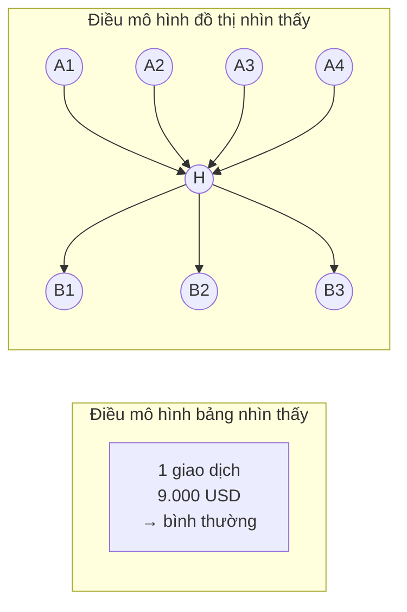

Ở FIN-07, **giao dịch là cạnh** và **tài khoản là đỉnh**. Ta phân loại **cạnh**,
không phân loại đỉnh — vì nhãn của bộ dữ liệu gắn trên từng giao dịch.

---

### 3. Thuật toán MEGA-PNA

Nguồn: *Bilgi et al., "Multigraph Message Passing with Bi-Directional Multi-Edge
Aggregations"*, [arXiv:2412.00241](https://arxiv.org/abs/2412.00241) —
kho mã gốc `github.com/hcagri/MEGA-GNN`.

#### 3.1 Ý tưởng nền: truyền tin trên đồ thị

Mỗi đỉnh giữ một vector mô tả nó. Qua mỗi *lớp*, đỉnh **nhận tin nhắn** từ các
đỉnh kề rồi cập nhật vector của mình. Sau 2 lớp, một đỉnh đã "biết" thông tin của
các đỉnh cách nó 2 bước.

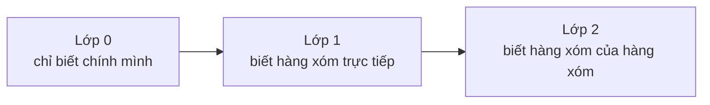

#### 3.2 Bốn thành phần khiến MEGA-PNA khác các GNN thường

**a) PNA — gộp tin nhắn bằng nhiều phép cùng lúc**

GNN thường gộp tin nhắn từ hàng xóm bằng *một* phép, thường là trung bình. Trung
bình xoá mất thông tin: 100 giao dịch nhỏ và 1 giao dịch lớn có thể ra cùng một
số. PNA (Principal Neighbourhood Aggregation) gộp bằng **bốn phép song song** —
trung bình, cực đại, cực tiểu, độ lệch chuẩn — rồi nhân với hệ số theo bậc của
đỉnh. Nhờ vậy "nhiều giao dịch nhỏ" và "một giao dịch lớn" không còn lẫn vào nhau.

**b) Gộp đa cạnh hai chiều — phần đóng góp riêng của bài báo**

Giữa hai tài khoản có thể có **hàng chục giao dịch** (đồ thị đa cạnh). MEGA gộp
riêng nhóm cạnh này trước, và gộp **theo cả hai chiều**: tiền A→B và tiền B→A
được xử lý tách bạch rồi mới hợp lại. Tài khoản trung chuyển chỉ lộ ra khi nhìn
đồng thời tiền vào và tiền ra.

**c) Ego ID — đánh dấu "tôi đang hỏi về ai"**

Khi lấy vùng lân cận để chấm một cạnh, đỉnh trung tâm được gắn thêm một cờ đánh
dấu. Không có cờ này, mô hình không phân biệt được đâu là tâm và đâu là ngoại vi
của vùng.

**d) Cập nhật cạnh**

Vector của **cạnh** cũng được cập nhật qua từng lớp, không chỉ vector đỉnh. Vì
nhãn nằm trên cạnh, đây là chỗ quyết định.

#### 3.3 Toàn cảnh một lần chấm điểm

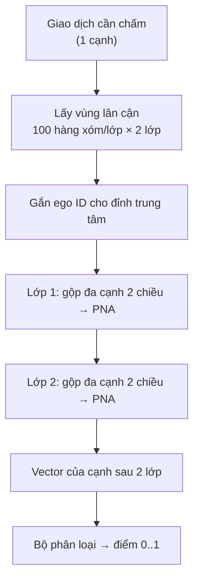

#### 3.4 Siêu tham số đã dùng

Lấy đúng theo bài báo, không tự chỉnh — để con số so sánh được.

| Tham số | Giá trị | Ghi chú |
|---|---|---|
| `hidden_channels` | 20 | chia hết cho 5 tháp PNA |
| `num_layers` | 2 | nhìn xa 2 bước |
| `num_neighbors` | 100, 100 | số hàng xóm lấy mẫu mỗi lớp |
| `batch_size` | 8.192 | |
| `learning_rate` | 0,0008 | |
| `dropout` | 0,28 | |
| trọng số lớp rửa tiền | 7,0 | bù cho việc lớp dương quá hiếm |
| `edge_updates` | bật | |
| `reverse_message_passing` | bật | |
| `ego_ids` | bật | |

**Đặc trưng đầu vào chỉ có 4 cột:** `Timestamp`, `Amount Received`,
`Received Currency`, `Payment Format`. Toàn bộ sức mạnh còn lại đến từ **cấu trúc
đồ thị**, không từ việc chế thêm đặc trưng.

---

### 4. Cách chia dữ liệu

Chia **theo thời gian**, cắt đúng ranh giới ngày. Không chia ngẫu nhiên — chia
ngẫu nhiên sẽ để mô hình nhìn thấy tương lai và cho ra con số đẹp giả tạo.

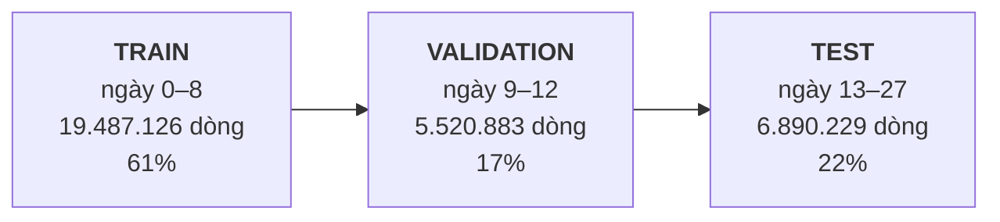

Thời gian chạy từ trái sang phải — mô hình học ở quá khứ và được chấm ở tương lai.

* **Train** dùng để học trọng số
* **Validation** dùng để chọn epoch tốt nhất và chọn ngưỡng quyết định
* **Test** chỉ chạm vào đúng một lần, để báo cáo

---

### 5. Kết quả — và một cảnh báo phải đọc

#### 5.1 Con số so với bài báo

| | F1 | Precision | Recall |
|---|---:|---:|---:|
| Bài báo công bố (trung bình 5 seed) | 0,7826 ± 0,0011 | — | — |
| **FIN-07 đo được (seed 42)** | **0,7801** | 0,8399 | 0,7282 |
| FIN-07, dùng ngưỡng chốt trên validation | 0,7807 | 0,8457 | 0,7249 |

Lệch 0,0025 so với bài báo. **Tái lập thành công.**

> ⚠️ **Chỉ chạy 1 seed, không phải 5.** Bài báo báo cáo trung bình của 5 lần chạy.
> Ta chạy 1 lần vì chi phí GPU. Vì vậy **không được viết con số này dưới dạng
> "trung bình ± độ lệch"** — ta không có ước lượng dao động giữa các lần chạy.
> Điều này đã ghi sẵn trong `bao_cao/benchmark.json`, trường `comparability_note`.

#### 5.2 Cảnh báo: đuôi dữ liệu suy biến

Đây là phần **quan trọng nhất** của tài liệu.

Tập test có 15 ngày. Ba ngày đầu là dữ liệu bình thường. **Từ ngày 16 trở đi, bộ
sinh dữ liệu của IBM cạn giao dịch sạch**, chỉ còn lại phần lớn là giao dịch bẩn:

| Đoạn | Số dòng | Nhãn dương | Tỉ lệ dương |
|---|---:|---:|---:|
| Ngày 13–15 | 6.883.242 | 6.932 | **0,10%** |
| Ngày 16–27 | 6.987 | 4.084 | **58,45%** |

Cái đuôi ấy chỉ chiếm **0,1% số dòng** nhưng chứa **37% toàn bộ nhãn dương**. Bắt
đúng ở đó quá dễ, và nó kéo F1 tổng lên cao.

Tách ra đo riêng, cùng một ngưỡng:

| Đo trên | F1 | Precision | Recall |
|---|---:|---:|---:|
| Toàn bộ test (con số so với bài báo) | 0,7807 | 0,8457 | 0,7249 |
| **Chỉ ngày 13–15, bỏ đuôi** | **0,6893** | 0,8187 | 0,5952 |
| Chỉ đuôi ngày 16–27 | 0,9096 | 0,8767 | 0,9452 |

**Cách dùng hai con số này cho đúng:**

* **0,7807** — dùng khi so với bài báo, vì bài báo cũng đo trên đúng cái đuôi này.
  Bỏ nó đi thì mất cơ sở so sánh.
* **0,6893** — dùng khi nói về năng lực thật trên dữ liệu giống thực tế. Đây là
  con số nên nói với người vận hành.

Nói cách khác: mô hình tái lập đúng bài báo, nhưng **bài báo lạc quan hơn thực tế
vì bộ dữ liệu có khuyết tật ở phần đuôi**. Đây không phải lỗi của ta, và cũng
không phải lý do để giấu. Chi tiết đầy đủ theo từng ngày:
`bao_cao/phan_tich_duoi_suy_bien.json`.

#### 5.3 Ngân sách điều tra — câu hỏi vận hành thật sự

Đội điều tra không rà hết 6,9 triệu giao dịch. Họ rà N vụ mỗi kỳ. Bảng dưới trả
lời: *rà N vụ thì bắt được bao nhiêu?*

| Số cảnh báo rà | Bắt đúng | Precision | Recall |
|---:|---:|---:|---:|
| 100 | 100 | 100,0% | 0,9% |
| 500 | 499 | 99,8% | 4,5% |
| 1.000 | 997 | 99,7% | 9,1% |
| **5.000** | **4.971** | **99,4%** | **45,1%** |
| 10.000 | 8.137 | 81,4% | 73,9% |
| 25.000 | 8.803 | 35,2% | 79,9% |

Hệ thống hiện chốt ở **5.000 cảnh báo**: gần như không có báo động giả, bắt được
45% số vụ. Vượt qua 10.000 thì precision sụp — đó là điểm gãy.

#### 5.4 Huấn luyện tốn bao nhiêu

| | |
|---|---|
| Phần cứng | 1 GPU NVIDIA trên AWS EC2 |
| Thời gian | 74.622 giây ≈ **20,7 giờ** |
| Epoch đã chạy | 28 / 80 (dừng sớm, kiên nhẫn 10) |
| Epoch tốt nhất | **18** |

Dừng sớm ở epoch 28 vì 10 epoch liên tiếp không cải thiện F1 trên validation.

---

### 6. Từ điểm giao dịch đến hồ sơ điều tra

Mô hình chấm **giao dịch**, nhưng chuyên viên điều tra **tài khoản**. Bốn bước
nối hai đầu đó lại:

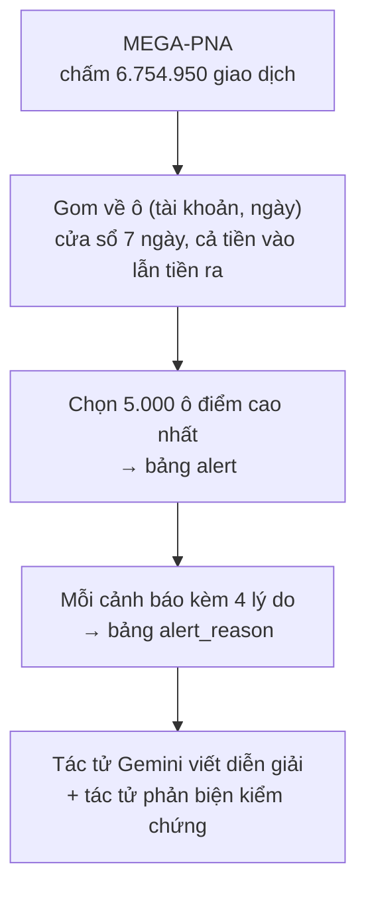

**Bước gom về tài khoản** không lấy một con số mà lấy **bốn**, vì một cạnh 0,99 lẻ
loi khác hẳn mười cạnh 0,75 liên tiếp:

| Mã lý do | Ý nghĩa |
|---|---|
| `MP_SCORE_MAX` | điểm cao nhất trong cửa sổ |
| `MP_SCORE_TOP5` | trung bình 5 điểm cao nhất |
| `MP_EDGES_OVER` | số giao dịch vượt ngưỡng |
| `MP_FLAGGED_AMOUNT` | tổng tiền trên các giao dịch bị gắn cờ |

**Hợp nhất với nhánh rule — đã thử và đã bác bỏ.** Nhóm đã dò lưới trọng số giữa
nhánh luật và nhánh MEGA-PNA. Kết quả (`bao_cao/fusion_account_v1.json`):

| Nhánh | F1 mức tài khoản |
|---|---:|
| Chỉ MEGA-PNA | 0,7807 |
| Chỉ luật | 0,0147 |
| Hợp nhất, trọng số tốt nhất | 0,7807 |

Trọng số tối ưu của nhánh luật là **0,00**. Hợp nhất **không** hơn nhánh đơn, nên
kiến trúc chốt là **một bộ chấm điểm duy nhất** cộng lý do có tên gọi, chứ không
phải tổ hợp nhiều mô hình. Điều này giữ lại vì nó là một kết quả âm có giá trị:
đã đo, không phải đoán.

**Kết quả trên hệ thống đang chạy:**

| | |
|---|---:|
| Giao dịch đã chấm điểm | 6.754.950 |
| Giao dịch vượt ngưỡng 0,56933 | 9.092 |
| Cảnh báo tài khoản đã sinh | 5.000 |
| Dòng lý do kèm theo | 20.000 |

Phân bố nhóm hành vi: **T04** gom-vào-toả-ra 3.149 · **T02** trung chuyển 1.366 ·
**T05** 485.

---

### 7. Nội dung gói

```
fin07-mega-pna-v1/
├── README.md                          ← file bạn đang đọc
├── model/
│   ├── seed_42.pt                     trọng số PyTorch (1,1 MB)
│   └── model_card.json                cấu hình, sha256, kết quả tóm tắt
├── bao_cao/
│   ├── seed_42.json                   báo cáo huấn luyện đầy đủ, có lịch sử từng epoch
│   ├── benchmark.json                 đối chiếu bài báo + ghi chú 1-seed
│   ├── phan_tich_duoi_suy_bien.json   phân tích mục 5.2, số liệu từng ngày
│   ├── fusion_account_v1.json         dò trọng số hợp nhất, mục 6
│   ├── preflight.json                 môi trường và kiểm tra trước khi huấn luyện
│   └── du_lieu_nguon.manifest.json    sha256 file dữ liệu gốc
├── du_lieu_dau_ra/
│   ├── canh_bao.csv                   5.000 cảnh báo
│   ├── ly_do_canh_bao.csv             20.000 dòng lý do
│   ├── giao_dich_vuot_nguong.csv      9.092 giao dịch vượt ngưỡng
│   ├── phan_bo_diem.csv               phân bố điểm trên toàn bộ 6.754.950 giao dịch
│   └── vi_du_dieu_tra_day_du.json     một hồ sơ điều tra hoàn chỉnh
└── ma_nguon/
    ├── src_mega_pna/                  mô hình, dữ liệu, huấn luyện, suy luận
    ├── scripts/                       9 script từ định dạng dữ liệu tới sinh cảnh báo
    └── sql/                           lược đồ bảng cho bộ phát hiện
```

#### Không có trong gói

Hai file dự đoán thô **không** kèm theo vì quá nặng để gửi:

| File | Kích thước | Nội dung |
|---|---:|---|
| `seed_42_test.parquet` | 88 MB | điểm của 6.890.229 giao dịch tập test |
| `seed_42_validation.parquet` | 71 MB | điểm của 5.520.883 giao dịch tập validation |

Chúng nằm ở `models/mega-pna/Medium_HI/paper/` trong repo. Mọi con số ở mục 5 đều
tính ra từ hai file này, và `phan_tich_duoi_suy_bien.json` đã chứa kết quả.

---

### 8. Chạy lại như thế nào

```bash
# 1. Chuẩn hoá dữ liệu gốc của IBM về định dạng đồ thị
python scripts/format_mega_pna.py --dataset Medium_HI

# 2. Huấn luyện (cần GPU NVIDIA, ~21 giờ)
python scripts/train_mega_pna.py --dataset Medium_HI --seed 42 --epochs 80

# 3. Chấm điểm bằng trọng số đã có (không cần huấn luyện lại)
python scripts/infer_mega_pna.py --checkpoint model/seed_42.pt --dataset Medium_HI

# 4. Gom về tài khoản rồi sinh cảnh báo
python scripts/aggregate_mega_pna_accounts.py --split test
python scripts/build_mega_pna_alerts.py --split test --budget 5000
```

Chỉ cần **bước 3 trở đi** nếu dùng lại trọng số trong gói này — không cần GPU.

---

### 9. Hạn chế đã biết

Liệt kê thẳng, để không ai phát hiện lại từ đầu.

1. **Chỉ 1 seed.** Không có ước lượng dao động. Muốn so ngang bài báo cần 4 lần
   chạy nữa, khoảng 83 giờ GPU.

2. **F1 vận hành là 0,6893, không phải 0,78.** Xem mục 5.2. Khi trình bày, nói cả
   hai con số kèm lý do, đừng chỉ nói con số đẹp.

3. **Cả 5.000 cảnh báo đều có `risk_score` = 100.** Hàng đợi không xếp được thứ tự
   ưu tiên — mọi cảnh báo trông khẩn cấp như nhau, và khi cần chọn ra vài vụ thì
   hệ thống rơi về thứ tự bảng chữ cái. Tín hiệu để phân biệt thì đã có sẵn
   (`MP_SCORE_TOP5` dao động, trung bình 62,47) nhưng chưa được đưa vào
   `risk_score`. **Đây là việc nên sửa trước tiên.**

4. **Bảng `alert_typology_match` rỗng.** Mã nhóm hành vi (T02/T04/T05) có được gán
   vào cảnh báo, nhưng lý do vì sao gán thì không được ghi lại. Hệ quả: tác tử
   phản biện coi mã nhóm là "chưa rõ nguồn gốc" và không dùng nó làm dữ kiện.

5. **`alert.transaction_id` rỗng ở cả 5.000 cảnh báo.** Không mở thẳng được từ
   cảnh báo sang giao dịch điểm cao nhất, dù script có mô tả chức năng này.

6. **Mô hình chấm cạnh, chưa chấm đỉnh.** Rủi ro của *tài khoản* đang được suy ra
   bằng cách gom điểm cạnh trong cửa sổ 7 ngày, không phải học trực tiếp.

---

*Nội dung tài liệu này sinh từ dữ liệu thật trong `bao_cao/` và cơ sở dữ liệu
đang chạy. Không có con số nào được ước lượng bằng tay.*

---

## FIN-07 — Runbook MEGA-PNA

Runbook này vận hành phần hiện thực tại `src/mega_pna/` theo giao thức
edge-classification của Bilgi
et al., *Multigraph Message Passing with Bi-Directional Multi-Edge Aggregations*.

### Phạm vi và hợp đồng

Đây là **đường học thuật**, tách khỏi preprocessing sản xuất. Nó cố ý:

- giữ self-transfer và số 0 đầu bank code;
- giữ nguyên amount/currency/payment format thay vì đổi USD;
- dùng đúng 4 edge feature: timestamp, amount received, received currency,
  payment format;
- chia 60/20/20 theo thời gian tại ranh giới ngày như source chính thức;
- sample 2 hop × 100 neighbor quanh seed edge;
- dùng ego-ID, reverse message passing, edge-update MLP;
- PNA ở cả tầng aggregate parallel edge và tầng aggregate distinct neighbor;
- batch 8.192, hidden 20, 2 layer, learning rate 0,0008, dropout 0,28, class
  weights 1:7, 80 epoch;
- báo mean ± sample standard deviation trên đúng 5 seed.

`no_payment_format` là ablation bắt buộc của FIN-07, không phải kết quả tái lập
paper và không được dùng để mở cổng HI-Medium.

### Cài môi trường

Các package ML nằm riêng trong `requirements-mega-pna.txt`, không vào image API.
Trên macOS arm64/Python 3.14, PyG chưa phát hành wheel cho sampler extension;
build hai extension sau khi cài torch:

```bash
.venv/bin/pip install -r requirements-mega-pna.txt
MAX_JOBS=4 .venv/bin/pip install --no-build-isolation \
  -r requirements-mega-pna-sampler.txt
```

Preflight sẽ dừng rõ ràng nếu sampler extension thiếu. PNA forward/backward đã
được kiểm chứng trên MPS; benchmark paper nên chạy CUDA L4 24 GB như kế hoạch
FIN-07 để có thông lượng phù hợp.

Trên L4, ưu tiên image gần runtime chính thức (PyTorch 2.2.2 + CUDA 11.8):

```bash
docker build -f docker/mega-pna/Dockerfile -t fin07-mega-pna:cuda118 .
docker run --rm --gpus all \
  -v "$PWD/data:/workspace/data" \
  -v "$PWD/models:/workspace/models" \
  -v "$PWD/reports:/workspace/reports" \
  fin07-mega-pna:cuda118 --suite gate --device cuda --include-ablation
```

### Format dữ liệu

```bash
.venv/bin/python scripts/format_mega_pna.py --dataset all
```

Output nằm dưới `data/processed/mega-pna/<dataset>/formatted_transactions.csv`.
Mỗi dataset có manifest SHA-256 cạnh file output. Formatter dùng DuckDB vì
`datatable` của source chính thức không build được trên Python 3.14, nhưng giữ
nguyên hợp đồng quan sát của formatter gốc: kiểu chuỗi đầu vào, first-seen IDs,
EdgeID nguồn, mốc thời gian và sort theo timestamp. Unit test khóa các quy tắc
này.

### Cổng tái lập Small

```bash
.venv/bin/python scripts/benchmark_mega_pna.py \
  --suite gate --device cuda --include-ablation
```

Cổng chỉ qua khi mean F1 paper arm của **cả hai** bộ nằm trong một độ lệch chuẩn
đã công bố:

| Dataset | Mục tiêu |
|---|---:|
| Small_HI | 0,7401 ± 0,0155 |
| Small_LI | 0,4507 ± 0,0226 |

Script luôn yêu cầu đúng 5 seed. Nếu thiếu seed hoặc một bộ lệch chuẩn, nó trả
exit code 2 và không cho chạy Medium.

### HI-Medium

Chỉ sau khi cổng Small đã qua:

```bash
.venv/bin/python scripts/benchmark_mega_pna.py \
  --suite medium --device cuda --include-ablation
```

Mục tiêu paper arm là F1 `0,7826 ± 0,0011`. Chạy toàn bộ từ đầu bằng:

```bash
.venv/bin/python scripts/benchmark_mega_pna.py \
  --suite all --device cuda --include-ablation
```

### Artifact

- checkpoint: `models/mega-pna/<dataset>/<arm>/seed_<n>.pt`;
- score test: `models/mega-pna/<dataset>/<arm>/seed_<n>_test.parquet`;
- kết quả từng seed: `reports/mega-pna/<dataset>/<arm>/seed_<n>.json`;
- tổng hợp và trạng thái gate: `reports/mega-pna/benchmark.json`.

Checkpoint chứa model state, optimizer state, epoch, seed, full config, feature
list và split boundaries. Báo cáo có F1/precision/recall/PR-AUC theo ngưỡng
paper 0,5, ngưỡng chọn trên validation, confusion matrix và operating points
theo alert budget.

Tái tạo score từ checkpoint đã khóa:

```bash
.venv/bin/python scripts/infer_mega_pna.py \
  --dataset Small_HI \
  --checkpoint models/mega-pna/Small_HI/paper/seed_42.pt \
  --output models/mega-pna/Small_HI/paper/seed_42_test_reproduced.parquet \
  --device cuda
```

Đo recall giao dịch/đường dây, workload và tỷ lệ alert có evidence:

```bash
.venv/bin/python scripts/evaluate_mega_pna_operations.py \
  --predictions models/mega-pna/Small_LI/paper/seed_42_test.parquet \
  --raw-transactions data/raw/ibm-aml/LI-Small_Trans.csv \
  --patterns data/raw/ibm-aml/LI-Small-Patterns.txt \
  --evidence-jsonl data/processed/graph_evidence_v1.jsonl \
  --report-out reports/mega-pna/Small_LI/paper/operations_seed_42.json
```

Evidence attachment chỉ được tính khi chính transaction được alert xuất hiện
trong hop của evidence có cả `detected_pattern` và `evidence_id`; script không
suy diễn coverage từ việc hai record chỉ cùng account.

### Kiểm thử

```bash
.venv/bin/pytest tests/test_mega_pna -q
.venv/bin/ruff check src/mega_pna tests/test_mega_pna scripts/*mega_pna.py
```

Không công bố một run 1 seed, run giảm neighbor, run giảm epoch, hoặc MPS smoke
test như benchmark paper. Các run đó chỉ xác nhận code path và tài nguyên.
