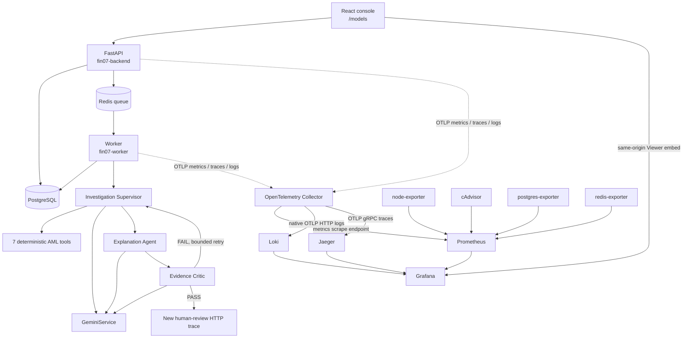

# Quan trắc — FIN-07

Chỉ số, SLO và toàn bộ runbook xử lý cảnh báo. Mỗi cảnh báo trong `monitoring/prometheus/rules/fin07.yml` trỏ tới đúng một mục ở đây.

- [FIN-07 correlated observability](#fin-07-correlated-observability) — gốc: `docs/observability/README.md`
- [FIN-07 SLI and SLO framework](#fin-07-sli-and-slo-framework) — gốc: `docs/observability/slo.md`
- [Scrape target down](#scrape-target-down) — gốc: `docs/observability/runbooks/service-down.md`
- [Infrastructure capacity pressure](#infrastructure-capacity-pressure) — gốc: `docs/observability/runbooks/infrastructure-capacity.md`
- [PostgreSQL saturation](#postgresql-saturation) — gốc: `docs/observability/runbooks/postgres-saturation.md`
- [Redis evictions](#redis-evictions) — gốc: `docs/observability/runbooks/redis-evictions.md`
- [High API error rate](#high-api-error-rate) — gốc: `docs/observability/runbooks/high-api-error-rate.md`
- [High API latency](#high-api-latency) — gốc: `docs/observability/runbooks/high-api-latency.md`
- [Worker queue backlog](#worker-queue-backlog) — gốc: `docs/observability/runbooks/worker-queue-backlog.md`
- [OpenTelemetry export failure](#opentelemetry-export-failure) — gốc: `docs/observability/runbooks/otel-export-failure.md`
- [Gemini rate limit](#gemini-rate-limit) — gốc: `docs/observability/runbooks/gemini-rate-limit.md`
- [Gemini timeout](#gemini-timeout) — gốc: `docs/observability/runbooks/gemini-timeout.md`
- [Agent failure spike](#agent-failure-spike) — gốc: `docs/observability/runbooks/agent-failure-spike.md`
- [Agent loop limit](#agent-loop-limit) — gốc: `docs/observability/runbooks/agent-loop-limit.md`
- [Critic FAIL spike](#critic-fail-spike) — gốc: `docs/observability/runbooks/critic-fail-spike.md`

## FIN-07 correlated observability

This implementation observes the existing topology rather than replacing its business audit trail. `investigation_trace` remains the user-facing evidence/decision record; OpenTelemetry traces are short-lived operational diagnostics. Loki is not an audit store.

### Repository audit and integration map

| Concern | Discovered implementation | Integration |
|---|---|---|
| API | `src.main:app`, FastAPI/Uvicorn | ASGI tracing, RED middleware, request ID |
| DB | SQLAlchemy 2 + psycopg | SQLAlchemy instrumentation; parameter values are not logged |
| Queue | Redis list using `RPUSH`/`BLPOP` | producer/consumer spans and W3C context in job envelope |
| Worker | synchronous single-process dispatcher | heartbeat, queue wait, job RED, investigation root span |
| Agents | explicit bounded Supervisor → Explanation → Critic | one span and RED metrics per logical run |
| Gemini | centralized `GeminiService`, typed Google GenAI SDK | safe GenAI span, retries, errors, schema validity, tokens |
| Tools | seven-name allow-list in `InvestigationTools` | child span and RED metrics; no result payloads |
| Logs | Python standard logging | JSON stdout plus OTLP logs, centralized redaction |
| Health | `/health`, `/health/ready`, worker Redis heartbeat | `/health/live` alias and cached `/health/gemini` diagnostic |
| Existing monitoring | Prometheus, Grafana, node/Redis/Postgres exporters | retained and expanded; no duplicate Alertmanager |

### Implemented architecture



The Collector has separate traces, metrics, and logs pipelines with memory limiting, resource normalization, sensitive-attribute deletion, batching, retry, and bounded sending queues. Collector ingestion ports are internal-only.

### Start locally

Core application only remains unchanged:

```bash
docker compose up -d --build --wait
```

Full observability, with application OTLP enabled:

```bash
OTEL_ENABLED=true docker compose --profile observability up -d --build --wait
# equivalent
make obs-up
```

Useful local UIs are bound to loopback:

- Console: `http://localhost:5173`
- Embedded cockpit: `http://localhost:5173/models`
- Grafana admin/direct access: `http://localhost:3000` (credentials come from environment)
- Prometheus: `http://localhost:9090`
- Jaeger: `http://localhost:16686`
- API metrics diagnostic: `http://localhost:8000/metrics`

Loki and Collector ingestion ports are not published. Do not use the development Grafana password outside a local workstation.

### Correlation model

The API accepts or generates `x-request-id`. W3C `traceparent`/`tracestate` are injected into the Redis job envelope and extracted by the worker. Operational logs contain `trace_id` and `span_id`; investigation, alert, case, job, agent, and tool identifiers remain span/log fields rather than metric labels.

Search flow for one investigation:

1. In Jaeger, filter span tags by `aml.investigation.id=<ID>`.
2. Inspect `fin07.worker` → `investigation.run` → agent → `generate_content` / tool spans.
3. Use the Jaeger-to-Loki link, which filters structured log metadata by `trace_id`.
4. For later human review, search its new HTTP trace by the same `aml.investigation.id`; no span stays open while a person waits.

Prometheus OpenMetrics is enabled on the Collector exporter, allowing histogram exemplars when the SDK/reader supplies them. The local `/metrics` endpoint is diagnostic; Prometheus's primary application target is the Collector.

### One embedded operational cockpit

Provisioning creates Prometheus, Loki, and Jaeger data sources and exactly one dashboard: **FIN-07 — Tổng quan vận hành**. It is embedded directly in the authenticated **Giám sát mô hình** page; the small native strip above it retains model version, drift PSI, model p95, and alert volume.

The observability area has three focused tabs instead of mixing every signal into one canvas:

1. **Tổng quan** — six Prometheus charts only: investigation outcome, p95 latency, failures by layer, AI failure causes, worker load, and resource pressure. It has no dashboard variables.
2. **Nhật ký lỗi** — a separate Loki Explore view filtered to warning/error/critical, with service and optional investigation ID controls.
3. **Traces** — a separate Jaeger Explore view filtered to error traces, with the same two focused controls.

Open a log's `TraceID` derived field to inspect the matching Jaeger waterfall. From a Jaeger span, jump back to Loki logs or Prometheus metrics using the provisioned correlations.

Nginx serves Grafana below `/grafana/` on the console origin. It validates the existing FIN-07 bearer session through `/api/v1/auth/me` before injecting a fixed Grafana Viewer identity. Anonymous Grafana access stays disabled, the iframe never receives an admin password, and logout clears the proxy session cookie. `viewers_can_edit` is enabled only so this Viewer can use Explore for temporary Loki/Jaeger queries; provisioned dashboards remain non-editable and the user cannot save those temporary changes. Override `GRAFANA_ROOT_URL` when the console is not served from `http://localhost:5173`.

### Metric catalogue

All labels are bounded. IDs and text are forbidden as metric dimensions.

| Area | Important series |
|---|---|
| HTTP | `fin07_http_requests_total`, `fin07_http_request_duration_seconds`, `fin07_http_active_requests` |
| Worker | `fin07_worker_jobs_total`, failures, duration, queue wait/depth/oldest age, retries, terminal dead jobs, active jobs, availability |
| Investigation | `fin07_investigations_total`, `fin07_investigation_duration_seconds`, `fin07_investigations_active`, `fin07_investigations_human_review_total`, `fin07_investigations_insufficient_evidence_total` |
| Agents | `fin07_agent_runs_total`, failures, duration, active runs, iterations, Supervisor tool/open-question/account-expansion distributions, limit events |
| Gemini | `fin07_gemini_requests_total`, `fin07_gemini_errors_total`, `fin07_gemini_request_duration_seconds`, input/output token totals, retries |
| Tools | `fin07_agent_tool_calls_total`, `fin07_agent_tool_duration_seconds` |
| Quality | `fin07_critic_validations_total`, bounded issue types, explanation claim/fact/inference/evidence-ref/missing counts, schema failures, security events |

### Privacy and security model

- Raw prompts, completions, transaction payloads, KYC, customer data, credentials, cookies, and authorization headers are not emitted.
- `CAPTURE_GENAI_CONTENT` defaults false and is rejected in production. The implementation currently does not emit raw content even when true; the flag reserves an explicit future debug gate.
- The application redactor recursively removes sensitive keys and bounds values; the Collector repeats deletion for defense in depth.
- Tool arguments/results are represented by tool name, status, count, duration, and a non-reversible fingerprint only for repeated-call detection.
- Loki indexes only `service.name`, `service.namespace`, and `deployment.environment.name`; trace and investigation IDs are structured metadata.
- Hidden reasoning and chain-of-thought are never captured. Short business rationales already persisted by the product remain separate business records.

### Alerts, SLOs, and runbooks

Prometheus evaluates operational and AI-quality rules. No Alertmanager was added because no notification destination exists; this avoids two alerting mechanisms. Rules appear in Prometheus and Grafana. AI-quality thresholds carry `threshold_status=provisional` until baselines are reviewed. See [#fin-07-sli-and-slo-framework](#fin-07-sli-and-slo-framework) and [runbooks](runbooks/).

### Production recommendations

- Keep application instrumentation backend-agnostic and point it at a protected external Collector using TLS/authentication.
- Replace local Jaeger in-memory storage with persistent OpenSearch or another supported backend and configure retention/resource limits.
- Use managed or HA Prometheus/Loki/Grafana as appropriate; define independent configurable retention and backup policies.
- Set a production parent-based sampling ratio from capacity data. Consider Collector tail sampling later for errors, slow investigations, Critic FAIL, security events, and loop-limit traces.
- Run Grafana behind SSO/RBAC with viewer/editor/admin separation and secrets from the platform secret manager.
- Treat observability retention separately from AML/audit regulatory retention.

### Known limitations

- The Redis worker has no native retry/DLQ mechanism. Retry metrics therefore remain zero; terminal failures are counted as dead jobs but are not retained in a replayable DLQ.
- cAdvisor v0.52.1 may expose no container-labelled series on Docker/containerd snapshotter combinations already observed in this repository; node-exporter remains the host source of truth.
- Local Jaeger is intentionally ephemeral and not a production topology.
- Frontend browser telemetry is deferred to avoid collecting AML UI content without a separate privacy review.
- Cost is not estimated because no validated, versioned Gemini pricing table exists.
- Prometheus rules are evaluated but not delivered externally until an approved notification route is supplied.

---

## FIN-07 SLI and SLO framework

No business-approved SLO was found in the repository. Values below are either measured SLIs or explicitly provisional engineering targets; they must not be presented as approved commitments.

| Capability | Measured SLI | Provisional engineering target | Approved SLO |
|---|---|---|---|
| API availability | non-5xx requests / all requests | ≥99% over 30 days | Not defined |
| API latency | share below route latency threshold; p95/p99 | p95 <2s for 10m alert only | Not defined |
| Investigation completion | completed or safe human-review outcomes / started | Establish baseline first | Not defined |
| Investigation latency | `fin07_investigation_duration_seconds` distribution | Alert after baseline | Not defined |
| Worker processing | completed / started jobs; queue wait and duration | queue depth <100 is provisional | Not defined |
| Gemini success | successful Gemini calls / all calls | Establish model/agent baseline | Not defined |
| Tool success | successful allow-listed calls / all calls by tool | Establish per-tool baseline | Not defined |
| Agent completion | successful logical runs / all logical runs by agent | Establish baseline | Not defined |
| Schema-valid output | valid structured responses / all provider responses | Target should be reviewed after baseline | Not defined |
| Critic PASS | PASS validations / all validations | Quality proxy only; no target | Not defined |
| Unsupported claim rate | unsupported issues / validations | Lower is better; baseline required | Not defined |

Critic PASS measures consistency with available evidence and deterministic validation. It is not a truth metric. Human review is a safety outcome, not automatically an operational failure.

Error budgets must not be calculated until owners approve an SLO window, target, eligible traffic, exclusions, and incident policy.

---

## Scrape target down

### Meaning

Prometheus could not scrape a configured target for two minutes.

### Impact

The service may be unavailable, or observability for it may be blind.

### Grafana dashboard

Open **FIN-07 — Tổng quan vận hành**, then select the affected service in **Nhật ký lỗi** or **Traces**.

### How to verify

Check `up{job="$job",instance="$instance"}` and Prometheus **Status → Targets**; test the target's health endpoint from the Prometheus network namespace.

### Useful queries

`up == 0`; `{service_name="$job"} |= "error"`; inspect recent traces for that service in Jaeger.

### Likely causes

Container/process stopped, bad scrape address, failed health dependency, network/DNS failure, or exporter crash.

### Safe remediation

Restore the dependency first, then restart only the affected stateless service if its logs show a clean shutdown/crash loop cause. Never restart PostgreSQL or Redis before checking persistence and clients.

### Escalation

Escalate to the owning service team immediately for a customer-facing target or after five minutes for telemetry-only exporters.

---

## Infrastructure capacity pressure

### Meaning

Host disk free space is below 15%, or memory utilization remains above 90%.

### Impact

Containers can be OOM-killed, writes can fail, and PostgreSQL, Loki, or Docker may become unavailable.

### Grafana dashboard

Open **FIN-07 — Tổng quan vận hành** and correlate **Áp lực tài nguyên** with failure/latency on the same time axis.

### How to verify

Confirm the alert in Prometheus and inspect `node_filesystem_avail_bytes`, `node_memory_MemAvailable_bytes`, and cAdvisor container metrics.

### Useful queries

`100 * node_filesystem_avail_bytes{mountpoint="/"} / node_filesystem_size_bytes{mountpoint="/"}`; `100 * (1 - node_memory_MemAvailable_bytes / node_memory_MemTotal_bytes)`.

### Likely causes

Unbounded Docker layers/logs, telemetry retention, bulk data jobs, memory leaks, or a host sized below current workload.

### Safe remediation

Identify the largest consumer first. Rotate or archive known disposable logs and artifacts under the approved retention policy; throttle batch work; scale the host before restarting stateful services.

### Escalation

Escalate immediately below 8% disk or when OOM kills/write failures begin; include top consumers and growth rate.

---

## PostgreSQL saturation

### Meaning
PostgreSQL is unreachable or connection utilization is high.
### Impact
API, worker, tools, and persistence can fail together.
### Grafana dashboard

Open **FIN-07 — Tổng quan vận hành** and correlate **Áp lực tài nguyên** with failures, then use **Traces**.

### How to verify
Inspect the PostgreSQL exporter metrics, then use a correlated trace to identify slow or blocked DB spans.
### Useful queries
PromQL: `sum(pg_stat_activity_count)/max(pg_settings_max_connections)` and `sum by(mode)(pg_locks_count)`.
### Likely causes
Connection leak, slow/blocked transactions, insufficient pool/DB capacity, or network failure.
### Safe remediation
Identify blocking sessions and application source before cancellation; roll back leaks; adjust limits only with capacity analysis.
### Escalation
Database owner immediately for sustained >85% utilization or lock pile-up.

---

## Redis evictions

### Meaning
Redis removed keys under memory pressure.
### Impact
Cache churn is possible; queue safety must be checked because Redis also carries jobs.
### Grafana dashboard

Open **FIN-07 — Tổng quan vận hành**, inspect **Tải worker**, then switch to the **Traces** tab.

### How to verify
Compare memory/max memory, evictions, keys, clients, and FIN-07 queue depth in Prometheus, then inspect a worker trace.
### Useful queries
PromQL: `increase(redis_evicted_keys_total[10m])` and `redis_memory_used_bytes`.
### Likely causes
Memory ceiling, unexpected key growth, or eviction policy mismatch.
### Safe remediation
Preserve queue data; identify key class/TTL safely, increase capacity or correct retention/policy through configuration.
### Escalation
Platform owner; involve worker owner if queue keys or wait time are affected.

---

## High API error rate

### Meaning
FastAPI 5xx ratio exceeded the engineering threshold.
### Impact
React operations and investigation creation/read paths may fail.
### Grafana dashboard

Open **FIN-07 — Tổng quan vận hành**, then select `fin07-backend` in **Nhật ký lỗi** or **Traces**.

### How to verify
Inspect the 5xx interval, then select a matching Jaeger error trace or click `TraceID` in a failure log.
### Useful queries
PromQL: `sum by (route) (rate(fin07_http_requests_total{status_class="5xx"}[5m]))`. LogQL: `{service_name="fin07-backend"} | level="ERROR"`.
### Likely causes
Database/Redis failure, unhandled code error, resource exhaustion, or bad deployment.
### Safe remediation
Check readiness and dependency dashboards; roll back the suspect release or reduce traffic only through the approved deployment procedure.
### Escalation
Backend owner, then database/platform owner if dependency spans dominate.

---

## High API latency

### Meaning
FastAPI p95 exceeded the provisional engineering threshold.
### Impact
Analyst workflows are slow; queued investigations may begin late.
### Grafana dashboard

Open **FIN-07 — Tổng quan vận hành** and inspect p95 latency, then switch to **Traces** with `fin07-backend`.

### How to verify
Click an exemplar or Jaeger trace and separate DB, Redis, and request time in the span waterfall.
### Useful queries
PromQL: `histogram_quantile(0.95, sum by (route,le) (rate(fin07_http_request_duration_seconds_bucket[5m])))`. Search Jaeger by service and slow duration.
### Likely causes
DB saturation, Redis latency, host pressure, synchronous route regression, or traffic change.
### Safe remediation
Protect capacity, roll back a regression, or tune only after a trace identifies the bottleneck.
### Escalation
API owner; route to DB/platform owner with trace evidence.

---

## Worker queue backlog

### Meaning
Queue depth/wait increased or worker heartbeat disappeared.
### Impact
Investigations remain queued and analyst-visible results are delayed.
### Grafana dashboard

Open **FIN-07 — Tổng quan vận hành**, inspect **Tải worker**, then select `fin07-worker` in **Nhật ký lỗi** or **Traces**.

### How to verify
Compare queue wait, active jobs, job duration, and failures, then open a slow/error trace to find the blocking child span.
### Useful queries
PromQL: `max(fin07_worker_queue_depth)` and `histogram_quantile(0.95,sum by(le)(rate(fin07_worker_queue_wait_seconds_bucket[5m])))`. LogQL: `{service_name="fin07-worker"} | level=~"ERROR|WARNING"`.
### Likely causes
Worker down, slow Gemini/agent/tool path, DB contention, or arrival-rate burst.
### Safe remediation
Restart an unhealthy worker after preserving logs; scale only if job idempotency/capacity is confirmed; do not delete queued jobs.
### Escalation
Worker owner, then AI/provider or dependency owner indicated by traces.

---

## OpenTelemetry export failure

### Meaning
The Collector cannot export one or more telemetry signals or is dropping data.
### Impact
Incident diagnosis becomes incomplete even if AML processing still works.
### Grafana dashboard

Open **FIN-07 — Tổng quan vận hành** and compare metric gaps with the separate **Nhật ký lỗi** and **Traces** views.

### How to verify
Check Prometheus target `otel-collector`, Collector logs, exporter failure, queue, refused, and dropped telemetry metrics; check Loki/Jaeger health.
### Useful queries
PromQL: `{__name__=~"otelcol_exporter_send_failed_.*"}`. LogQL: `{service_name="fin07-otel-collector"} | level="ERROR"`.
### Likely causes
Backend down, invalid OTLP payload/config, queue saturation, network, or Collector memory pressure.
### Safe remediation
Restore the failing backend or last known Collector config; do not make the application depend on Grafana/Jaeger health.
### Escalation
Observability owner; escalate storage/network faults to platform owner.

---

## Gemini rate limit

### Meaning
Gemini calls are receiving bounded `rate_limit` errors. Alert threshold is provisional.
### Impact
Agents retry, investigations slow, and may end in safe human review.
### Grafana dashboard

Open **FIN-07 — Tổng quan vận hành** and inspect **Nguyên nhân failure AI** plus p95 latency.

### How to verify
Filter by agent, select `rate_limit`, then inspect a failed trace without prompt content.
### Useful queries
PromQL: `sum by(agent)(rate(fin07_gemini_errors_total{error_type="rate_limit"}[10m]))`.
### Likely causes
Quota exhaustion, burst concurrency, regional/provider constraint, or retry amplification.
### Safe remediation
Reduce approved concurrency, honor backoff, confirm quota in the provider console; never rotate/expose keys in logs.
### Escalation
AI platform owner and provider/quota administrator.

---

## Gemini timeout

### Meaning
Gemini calls exceeded configured timeout. Alert threshold is provisional.
### Impact
Agent latency/retries rise and investigations may require human review.
### Grafana dashboard

Open **FIN-07 — Tổng quan vận hành** and correlate **Nguyên nhân failure AI** with p95 latency, then use **Traces**.

### How to verify
Compare Gemini p95/p99, retry rate, agent latency, and network/host health; inspect slow Jaeger spans.
### Useful queries
PromQL: `sum by(agent,model)(rate(fin07_gemini_errors_total{error_type="timeout"}[10m]))`.
### Likely causes
Provider latency, network degradation, oversized structured context, or resource contention.
### Safe remediation
Reduce bounded context only through product review; validate connectivity; change timeout/retry budgets only with latency evidence.
### Escalation
AI platform owner; provider support for sustained external degradation.

---

## Agent failure spike

### Meaning
Operational failures increased for one of the three agents. Threshold is provisional.
### Impact
Investigations fail or stop for human review.
### Grafana dashboard

Open **FIN-07 — Tổng quan vận hành** and correlate **Failure theo tầng** with AI failure causes, then inspect **Traces**.

### How to verify
Open an error trace, identify the failing agent span, then drill into Gemini/tool/DB children and its correlated logs.
### Useful queries
PromQL: `sum by(agent,error_type)(rate(fin07_agent_failures_total[10m]))`.
### Likely causes
Gemini failure, schema validation, tool/DB error, deployment regression, or limit exhaustion.
### Safe remediation
Address the failing child dependency; use mock-based rollback validation; do not bypass Critic or safety bounds.
### Escalation
Owning AI engineer plus dependency owner shown by the trace.

---

## Agent loop limit

### Meaning
Investigations reached configured iteration or tool-call bounds. Threshold is provisional.
### Impact
Latency/tokens grow and investigations safely stop as insufficient evidence/human review.
### Grafana dashboard

Open **FIN-07 — Tổng quan vận hành**, inspect **Nguyên nhân failure AI**, then use the separate **Nhật ký lỗi** and **Traces** tabs.

### How to verify
Filter the agent/tool, then inspect a trace for repeated tool fingerprints, Critic issue type, retries, and per-agent duration.
### Useful queries
PromQL: `sum by(limit)(increase(fin07_supervisor_limit_reached_total[15m]))`. LogQL: `{service_name="fin07-worker"} |= "limit"`.
### Likely causes
Repeated identical requests, unavailable evidence, failing tools, Critic feedback not resolved, or prompt regression.
### Safe remediation
Repair evidence/tool behavior; tune limits only after replaying mocked investigations and reviewing token/latency impact.
### Escalation
AI platform and AML investigation workflow owners.

---

## Critic FAIL spike

### Meaning
Evidence Critic rejects more explanations than the provisional baseline.
### Impact
More Supervisor loops, tool calls, latency, and human-review outcomes; this may also reflect correct safety detection.
### Grafana dashboard

Open **FIN-07 — Tổng quan vận hành** and inspect **Nguyên nhân failure AI**.

### How to verify
Identify the Critic issue type, then filter one investigation in **Nhật ký lỗi** and open its trace.
### Useful queries
PromQL: `sum by(issue_type)(rate(fin07_critic_issues_total[30m]))`. LogQL: `{service_name="fin07-worker"} | agent="evidence_critic"`.
### Likely causes
Tool data gaps/failures, prompt/model behavior change, schema regression, or genuinely weak evidence.
### Safe remediation
Restore evidence/tool reliability or roll back a prompt/model change; never weaken validation solely to raise PASS rate.
### Escalation
AI safety/AML product owner; tool/data owner for concentrated missing evidence.
