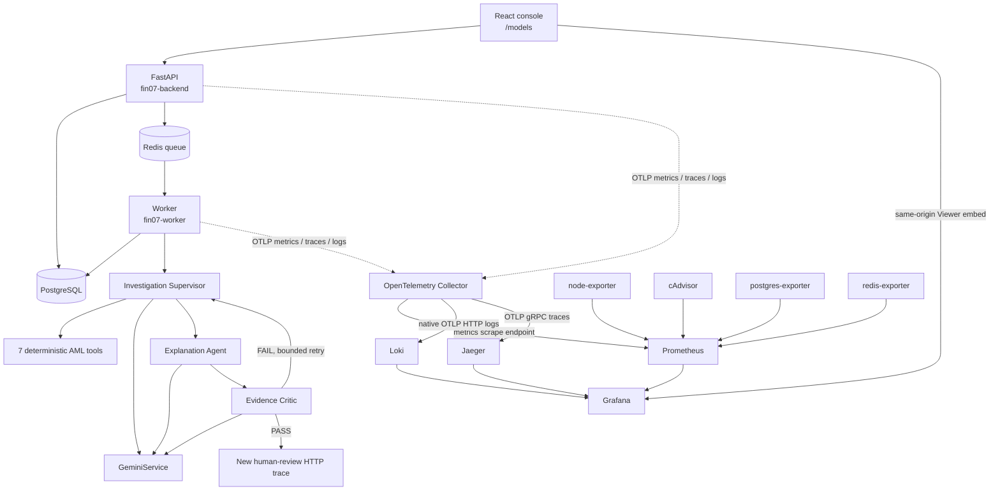

# FIN-07 correlated observability

This implementation observes the existing topology rather than replacing its business audit trail. `investigation_trace` remains the user-facing evidence/decision record; OpenTelemetry traces are short-lived operational diagnostics. Loki is not an audit store.

## Repository audit and integration map

| Concern | Discovered implementation | Integration |
|---|---|---|
| API | `src.main:app`, FastAPI/Uvicorn | ASGI tracing, RED middleware, request ID |
| DB | SQLAlchemy 2 + psycopg | SQLAlchemy instrumentation; parameter values are not logged |
| Queue | Redis list using `RPUSH`/`BLPOP` | producer/consumer spans and W3C context in job envelope |
| Worker | synchronous single-process dispatcher | heartbeat, queue wait, job RED, investigation root span |
| Agents | explicit bounded Supervisor → Explanation → Critic | one span and RED metrics per logical run |
| Gemini | centralized `GeminiService`, typed Google GenAI SDK | safe GenAI span, retries, errors, schema validity, tokens |
| Tools | seven-name allow-list in `InvestigationTools` | child span and RED metrics; no result payloads |
| Logs | Python standard logging | JSON stdout plus OTLP logs, centralized redaction |
| Health | `/health`, `/health/ready`, worker Redis heartbeat | `/health/live` alias and cached `/health/gemini` diagnostic |
| Existing monitoring | Prometheus, Grafana, node/Redis/Postgres exporters | retained and expanded; no duplicate Alertmanager |

## Implemented architecture



The Collector has separate traces, metrics, and logs pipelines with memory limiting, resource normalization, sensitive-attribute deletion, batching, retry, and bounded sending queues. Collector ingestion ports are internal-only.

## Start locally

Core application only remains unchanged:

```bash
docker compose up -d --build --wait
```

Full observability, with application OTLP enabled:

```bash
OTEL_ENABLED=true docker compose --profile observability up -d --build --wait
# equivalent
make obs-up
```

Useful local UIs are bound to loopback:

- Console: `http://localhost:5173`
- Embedded cockpit: `http://localhost:5173/models`
- Grafana admin/direct access: `http://localhost:3000` (credentials come from environment)
- Prometheus: `http://localhost:9090`
- Jaeger: `http://localhost:16686`
- API metrics diagnostic: `http://localhost:8000/metrics`

Loki and Collector ingestion ports are not published. Do not use the development Grafana password outside a local workstation.

## Correlation model

The API accepts or generates `x-request-id`. W3C `traceparent`/`tracestate` are injected into the Redis job envelope and extracted by the worker. Operational logs contain `trace_id` and `span_id`; investigation, alert, case, job, agent, and tool identifiers remain span/log fields rather than metric labels.

Search flow for one investigation:

1. In Jaeger, filter span tags by `aml.investigation.id=<ID>`.
2. Inspect `fin07.worker` → `investigation.run` → agent → `generate_content` / tool spans.
3. Use the Jaeger-to-Loki link, which filters structured log metadata by `trace_id`.
4. For later human review, search its new HTTP trace by the same `aml.investigation.id`; no span stays open while a person waits.

Prometheus OpenMetrics is enabled on the Collector exporter, allowing histogram exemplars when the SDK/reader supplies them. The local `/metrics` endpoint is diagnostic; Prometheus's primary application target is the Collector.

## One embedded operational cockpit

Provisioning creates Prometheus, Loki, and Jaeger data sources and exactly one dashboard: **FIN-07 — Tổng quan vận hành**. It is embedded directly in the authenticated **Giám sát mô hình** page; the small native strip above it retains model version, drift PSI, model p95, and alert volume.

The observability area has three focused tabs instead of mixing every signal into one canvas:

1. **Tổng quan** — six Prometheus charts only: investigation outcome, p95 latency, failures by layer, AI failure causes, worker load, and resource pressure. It has no dashboard variables.
2. **Nhật ký lỗi** — a separate Loki Explore view filtered to warning/error/critical, with service and optional investigation ID controls.
3. **Traces** — a separate Jaeger Explore view filtered to error traces, with the same two focused controls.

Open a log's `TraceID` derived field to inspect the matching Jaeger waterfall. From a Jaeger span, jump back to Loki logs or Prometheus metrics using the provisioned correlations.

Nginx serves Grafana below `/grafana/` on the console origin. It validates the existing FIN-07 bearer session through `/api/v1/auth/me` before injecting a fixed Grafana Viewer identity. Anonymous Grafana access stays disabled, the iframe never receives an admin password, and logout clears the proxy session cookie. `viewers_can_edit` is enabled only so this Viewer can use Explore for temporary Loki/Jaeger queries; provisioned dashboards remain non-editable and the user cannot save those temporary changes. Override `GRAFANA_ROOT_URL` when the console is not served from `http://localhost:5173`.

## Metric catalogue

All labels are bounded. IDs and text are forbidden as metric dimensions.

| Area | Important series |
|---|---|
| HTTP | `fin07_http_requests_total`, `fin07_http_request_duration_seconds`, `fin07_http_active_requests` |
| Worker | `fin07_worker_jobs_total`, failures, duration, queue wait/depth/oldest age, retries, terminal dead jobs, active jobs, availability |
| Investigation | `fin07_investigations_total`, `fin07_investigation_duration_seconds`, `fin07_investigations_active`, `fin07_investigations_human_review_total`, `fin07_investigations_insufficient_evidence_total` |
| Agents | `fin07_agent_runs_total`, failures, duration, active runs, iterations, Supervisor tool/open-question/account-expansion distributions, limit events |
| Gemini | `fin07_gemini_requests_total`, `fin07_gemini_errors_total`, `fin07_gemini_request_duration_seconds`, input/output token totals, retries |
| Tools | `fin07_agent_tool_calls_total`, `fin07_agent_tool_duration_seconds` |
| Quality | `fin07_critic_validations_total`, bounded issue types, explanation claim/fact/inference/evidence-ref/missing counts, schema failures, security events |

## Privacy and security model

- Raw prompts, completions, transaction payloads, KYC, customer data, credentials, cookies, and authorization headers are not emitted.
- `CAPTURE_GENAI_CONTENT` defaults false and is rejected in production. The implementation currently does not emit raw content even when true; the flag reserves an explicit future debug gate.
- The application redactor recursively removes sensitive keys and bounds values; the Collector repeats deletion for defense in depth.
- Tool arguments/results are represented by tool name, status, count, duration, and a non-reversible fingerprint only for repeated-call detection.
- Loki indexes only `service.name`, `service.namespace`, and `deployment.environment.name`; trace and investigation IDs are structured metadata.
- Hidden reasoning and chain-of-thought are never captured. Short business rationales already persisted by the product remain separate business records.

## Alerts, SLOs, and runbooks

Prometheus evaluates operational and AI-quality rules. No Alertmanager was added because no notification destination exists; this avoids two alerting mechanisms. Rules appear in Prometheus and Grafana. AI-quality thresholds carry `threshold_status=provisional` until baselines are reviewed. See [slo.md](slo.md) and [runbooks](runbooks/).

## Production recommendations

- Keep application instrumentation backend-agnostic and point it at a protected external Collector using TLS/authentication.
- Replace local Jaeger in-memory storage with persistent OpenSearch or another supported backend and configure retention/resource limits.
- Use managed or HA Prometheus/Loki/Grafana as appropriate; define independent configurable retention and backup policies.
- Set a production parent-based sampling ratio from capacity data. Consider Collector tail sampling later for errors, slow investigations, Critic FAIL, security events, and loop-limit traces.
- Run Grafana behind SSO/RBAC with viewer/editor/admin separation and secrets from the platform secret manager.
- Treat observability retention separately from AML/audit regulatory retention.

## Known limitations

- The Redis worker has no native retry/DLQ mechanism. Retry metrics therefore remain zero; terminal failures are counted as dead jobs but are not retained in a replayable DLQ.
- cAdvisor v0.52.1 may expose no container-labelled series on Docker/containerd snapshotter combinations already observed in this repository; node-exporter remains the host source of truth.
- Local Jaeger is intentionally ephemeral and not a production topology.
- Frontend browser telemetry is deferred to avoid collecting AML UI content without a separate privacy review.
- Cost is not estimated because no validated, versioned Gemini pricing table exists.
- Prometheus rules are evaluated but not delivered externally until an approved notification route is supplied.
