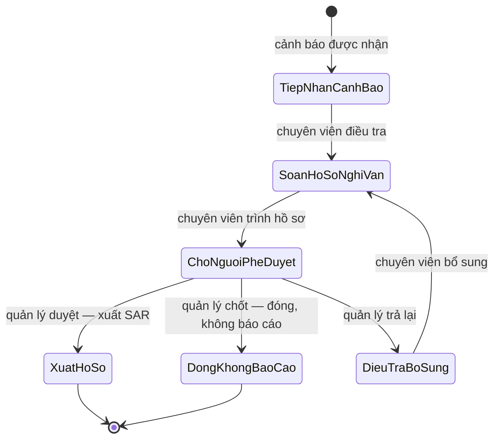

# Yêu cầu chức năng — FIN-07

Tài liệu này định nghĩa **hệ thống làm được gì, cho ai, và ai được phép làm gì**.
Mọi bảng dưới đây đối chiếu trực tiếp với mã nguồn đang chạy; chỗ nào chưa làm
thì ghi là chưa làm.

Tài liệu liên quan: [đặc tả hệ thống](system-specification.md) ·
[thiết kế kỹ thuật](technical-design.md) · [mô hình dữ liệu](data-model.md) ·
[kiến trúc](../architecture/architecture.md) · [kiểm thử](../testing/test-plan.md).

---

## 1. Vai trò người dùng

Ba vai trò, **không chồng lấn**. Năm vai trò cũ (`analyst`, `compliance_officer`,
`mlro`, `auditor`, `admin`) đã gộp còn ba trong migration
[`029_role_consolidation.sql`](../../db/init/029_role_consolidation.sql).

| Mã vai trò | Nhãn hiển thị | Trách nhiệm |
|---|---|---|
| `analyst` | Chuyên viên | Điều tra cảnh báo, dựng hồ sơ nghi vấn, **soạn và trình** SAR |
| `manager` | Quản lý | **Chốt** hồ sơ, phê duyệt/từ chối, điều phối và giao việc cho nhóm |
| `admin` | Quản trị hệ thống | Người dùng, cấu hình, tab kỹ thuật. **Không có thẩm quyền nghiệp vụ AML** |

Nguồn thi hành: `Role` enum trong [`src/api/permissions.py`](../../src/api/permissions.py).

### 1.1 Vì sao Quản lý không được soạn SAR

`ROLE_PERMISSIONS[MANAGER]` **cố ý không chứa** `PREPARE_SAR`. Nếu Quản lý vừa
soạn được vừa duyệt được thì nguyên tắc bốn mắt chỉ còn chặn được đúng *cá nhân*
đó, không chặn được *vai trò*. Việc này đã xảy ra thật trên bản đang phục vụ —
một Quản lý trình hồ sơ rồi thấy chính hồ sơ ấy trong hàng đợi chờ mình duyệt.
Người lập và người duyệt phải khác **vai**, không chỉ khác người.

---

## 2. Ma trận quyền

40 quyền, định nghĩa tập trung ở `Permission` enum trong
[`src/api/permissions.py`](../../src/api/permissions.py) và phản chiếu ở
[`web/src/rbac/permissions.ts`](../../web/src/rbac/permissions.ts). Mỗi quyền gắn
với một năng lực có thật.

| Năng lực | Quyền | Chuyên viên | Quản lý | Quản trị |
|---|---|:--:|:--:|:--:|
| Bảng điều khiển chung | `view_dashboard` | ✓ | ✓ | ✓ |
| Bảng điều khiển điều hành | `view_executive_dashboard` | | ✓ | |
| Bảng điều khiển hệ thống | `view_system_dashboard` | | | ✓ |
| Xem cảnh báo | `view_alerts` | ✓ | ✓ | |
| Giao cảnh báo cho tác tử | `investigate_alert` | ✓ | ✓ | |
| Xem / điều tra vụ việc | `view_cases`, `investigate_case` | ✓ | ✓ | |
| Leo thang vụ việc | `escalate_case` | ✓ | ✓ | |
| Phê duyệt ca rủi ro cao | `approve_case` | | ✓ | |
| **Soạn SAR** | `prepare_sar` | ✓ | | |
| **Quyết định / nộp SAR** | `decide_sar` | | ✓ | |
| Tra cứu giao dịch | `view_transactions` | ✓ | ✓ | |
| Đồ thị thực thể | `view_entity_graph` | ✓ | ✓ | |
| Truy vết tài sản mã hoá | `view_crypto` | ✓ | ✓ | |
| Xem phiên điều tra | `view_investigation` | ✓ | ✓ | |
| Rà soát phiên điều tra | `review_investigation` | | ✓ | |
| Giải thích mô hình (nghiệp vụ) | `view_model_explain` | ✓ | ✓ | |
| **Chất lượng / giám sát mô hình** | `view_model_quality`, `view_model_governance` | | | ✓ |
| Xem báo cáo | `view_reports` | ✓ | ✓ | ✓ |
| Xuất báo cáo | `export_report` | | ✓ | |
| Nhật ký kiểm toán | `view_audit_log` | | ✓ | ✓ |
| Điều phối công việc | `sar.assign`, `sar.reassign`, `task.priority.update`, `task.deadline.update`, `task.remind`, `team.workload.read` | | ✓ | |
| Đọc hàng đợi hồ sơ | `sar.read` | ✓ | ✓ | |
| Quản trị người dùng / vai trò / hệ thống | `manage_users`, `manage_roles`, `manage_system` | | | ✓ |

**Hai ràng buộc đọc ngược từ bảng trên:**

- Quản trị hệ thống **không** có bất kỳ quyền nghiệp vụ AML nào — không cảnh báo,
  không vụ việc, không phê duyệt, không SAR. Quyền kỹ thuật không đi kèm thẩm
  quyền nghiệp vụ.
- Các quyền điều phối được tách nhỏ theo **hành động**, không kiểm bằng chuỗi
  `role == "manager"`. Vai trò là thứ đổi được; danh sách quyền nói rõ ai làm
  được đúng việc gì.

---

## 3. Màn hình và quyền truy cập

Nguồn: [`web/src/config/nav.ts`](../../web/src/config/nav.ts), cưỡng chế phía
máy chủ bởi `authz.POLICY`.

| Nhóm | Màn hình | Đường dẫn | Chuyên viên | Quản lý | Quản trị |
|---|---|---|:--:|:--:|:--:|
| Tổng quan | Bảng điều khiển | `/dashboard` | ✓ | ✓ | ✓ |
| Tổng quan | Giám sát địa lý | `/world` | ✓ | ✓ | ✓ |
| Điều tra | Vụ việc (gồm hàng đợi cảnh báo + đồ thị mạng lưới) | `/cases` | ✓ | ✓ | |
| Điều tra | Báo cáo của tôi | `/my-reports` | ✓ | | |
| Điều tra | Phân công & tải công việc | `/assignments` | việc của mình | toàn nhóm | |
| Điều tra | Tra cứu giao dịch | `/transactions` | ✓ | ✓ | |
| Tài sản mã hoá | Truy vết tài sản mã hoá | `/crypto` | ✓ | ✓ | |
| Kỹ thuật | Lượt chạy tác tử | `/agents` | | | ✓ |
| Kỹ thuật | Đánh giá chuẩn | `/benchmarks` | | | ✓ |
| Kỹ thuật | Giám sát mô hình | `/models` | | | ✓ |
| Kỹ thuật | Chất lượng dữ liệu | `/data-quality` | | | ✓ |
| Quản trị | Phê duyệt SAR | `/approvals` | | ✓ | |
| Quản trị | Nhật ký kiểm toán | `/audit` | | ✓ | ✓ |
| Quản trị | Người dùng | `/users` | | | ✓ |
| Quản trị | Cấu hình | `/settings` | | | ✓ |

> **Nội dung kỹ thuật không lộ ra trang nghiệp vụ.** Bốn màn hình nhóm *Kỹ thuật*
> chỉ dành cho Quản trị hệ thống. Chuyên viên và Quản lý không thấy mã băm mô
> hình, tên bảng, hay thuật ngữ mô hình trên trang nghiệp vụ của họ.

---

## 4. Quy trình vụ việc

Sáu trạng thái, hai vai. Nguồn: [`src/domain.py`](../../src/domain.py) và ràng
buộc `CHECK` trong [`db/init/001_schema.sql`](../../db/init/001_schema.sql).

| Trạng thái | Nhãn | Ai đẩy sang bước này |
|---|---|---|
| `TiepNhanCanhBao` | Tiếp nhận cảnh báo | hệ thống |
| `SoanHoSoNghiVan` | Soạn hồ sơ nghi vấn | Chuyên viên |
| `ChoNguoiPheDuyet` | Chờ người phê duyệt | Chuyên viên (trình) |
| `DieuTraBoSung` | Điều tra bổ sung | Quản lý (trả lại) |
| `XuatHoSo` | Xuất hồ sơ | Quản lý (duyệt) |
| `DongKhongBaoCao` | Đóng, không báo cáo | Quản lý (chốt) |

**Hai loại đề xuất tới hàng đợi phê duyệt** (cột `approval.request_kind`):
`'sar'` — chuyên viên nộp hồ sơ nghi vấn; `'close'` — chuyên viên đề nghị đóng mà
không báo cáo. Hàng đợi của Quản lý cần biết đang duyệt cái gì mà không phải suy
từ `sar_draft_id IS NULL`.

> **Vì sao có lối "đóng, không báo cáo".** Trước migration
> [`042_workflow_roles.sql`](../../db/init/042_workflow_roles.sql), trạng thái này
> **không có lối vào nào** — nó chỉ được đọc để lọc "vụ đang mở". Hệ quả là một vụ
> chỉ kết thúc được bằng cách xuất SAR. Với hàng chục nghìn vụ mà đa số là báo
> động giả, đó là ngõ cụt.

> **Sáu bước trung gian đã gỡ.** `TruyHoiBangChung`, `PhanTichDoThi`,
> `DoiChieuTrungPhatPEP`, `TinhToanBangCongCu`, `LapLuanGanTypology`,
> `KiemChungBangChung` bị gỡ ngày 27/08/2026: lối vào duy nhất là một endpoint
> không giao diện nào gọi, chưa vụ nào đi qua (đo trên bản đang phục vụ: 0 vụ,
> 0 dòng nhật ký), nhưng vẫn hiện trong nhật ký kiểm toán như những giai đoạn đã
> thật sự xảy ra. Mô tả một quy trình không tồn tại thì tệ hơn là không mô tả.

---

## 5. Luồng nghiệp vụ chính — từ cảnh báo tới hồ sơ có dẫn chứng

1. Chuyên viên mở **Vụ việc**, chọn một cảnh báo trong hàng đợi (sắp theo điểm rủi ro).
2. Chuyên viên đọc **lý do cảnh báo** — mỗi cảnh báo kèm **tối thiểu ba yếu tố
   đóng góp**, không phải một con số trần trụi.
3. Chuyên viên bấm **Điều tra bằng tác tử**. Tác tử **không tự khởi động**.
4. Ba tác tử chạy nối tiếp (Điều phối → Giải thích → Phản biện), trần **5 vòng**
   và **16 lượt gọi công cụ**. Xem [thiết kế kỹ thuật](technical-design.md#4-tầng-tác-tử-điều-tra).
5. Kết quả là **hồ sơ có dẫn chứng** *hoặc* trạng thái `INSUFFICIENT_EVIDENCE`
   kèm danh sách chỗ còn hổng. Không có đường thứ ba.
6. Chuyên viên soạn hồ sơ nghi vấn và **trình** lên Quản lý.
7. Quản lý **chốt**: duyệt (xuất SAR), trả lại (điều tra bổ sung), hoặc đóng
   không báo cáo.

**Ràng buộc bắt buộc, cưỡng chế trong mã nguồn:** không có đường nào cho phép tác
tử tự đóng một vụ việc. Kể cả nhánh "đạt" cũng chỉ dừng ở *chờ người ký*.

---

## 6. Trợ lý AI (Copilot)

Có mặt ở mọi màn nghiệp vụ. Nguồn: [`src/api/copilot/`](../../src/api/copilot/).

| | Chuyên viên | Quản lý |
|---|---|---|
| Ngữ cảnh | giới hạn ở hồ sơ của chính họ | toàn nhóm |
| Công cụ điều phối | **không có** | giao việc, chuyển giao, đặt hạn, đổi ưu tiên, nhắc việc |
| Phê duyệt / từ chối hồ sơ | không | **không** — chỉ đi qua màn hình phê duyệt chính thức |

**Mô hình chỉ soạn đề xuất.** Người dùng xác nhận, rồi máy chủ mới thực thi bằng
mã tất định. Mô hình ngôn ngữ không bao giờ là thứ trực tiếp ghi vào cơ sở dữ liệu.

---

## 7. Yêu cầu phi chức năng

| Nhóm | Yêu cầu | Cách cưỡng chế |
|---|---|---|
| Phân quyền | Mặc định **TỪ CHỐI**. Route thiếu khai báo chính sách → 403 | `authz.POLICY` mặc-định-đóng; một bài kiểm thử chứng minh **mọi** route `/api/v1` đều có chính sách khai báo |
| Phân quyền | Máy chủ là nguồn sự thật; giao diện chỉ phản chiếu | Nút ẩn chỉ là tiện dụng — máy chủ luôn kiểm độc lập |
| Phạm vi dữ liệu | Áp ở máy chủ, **không** nhận từ tham số client | `ROLE_DATA_SCOPE`; chi tiết ngoài phạm vi trả **404** (không phải 403) để không lộ sự tồn tại của bản ghi |
| Ghi vết | Mọi thao tác nhạy cảm ghi vào nhật ký **chỉ-ghi-thêm** | Bảng `audit_log`, cưỡng chế bằng trigger bất biến ([`002_audit_immutability.sql`](../../db/init/002_audit_immutability.sql)) |
| Tác tử | Chỉ đọc, luôn bất đồng bộ | Vai trò PostgreSQL riêng chỉ có quyền `SELECT` ([`003_agent_readonly_role.sh`](../../db/init/003_agent_readonly_role.sh)) — cưỡng chế bằng quyền CSDL, không bằng quy ước |
| Tác tử | Trần chi phí một phiên | `AML_AGENT_MAX_ITERATIONS=5`, `AML_AGENT_MAX_TOOL_CALLS=16`. Chạm trần → `INSUFFICIENT_EVIDENCE`, không kết luận bừa |
| Trung thực | Mọi khẳng định phải gắn mã bằng chứng | Nút Phản biện đối chiếu từng con số với bằng chứng được viện dẫn; hồ sơ thiếu bằng chứng bị chặn |
| Xác thực | Mật khẩu băm PBKDF2 200.000 vòng | Băm chạy trong thread riêng để không chặn vòng lặp sự kiện |
| Hiệu năng | Truy vấn nặng không được đóng băng tiến trình | Handler đọc CSDL khai báo là `def` (không `async def`) → FastAPI chạy trong threadpool |
| Cấu hình | Tài liệu biến môi trường không được lạc hậu | `tests/test_config_documented.py` bắt buộc mọi trường `Settings` và mọi `${BIEN}` trong `docker-compose.yml` phải có mặt trong `.env.example` |

### 7.1 Giới hạn đã biết

- **Cảnh báo là hàng đợi dùng chung.** Bảng `alert` chưa có cột người-được-giao,
  nên phạm vi dữ liệu cấp bản ghi chưa áp được cho cảnh báo (vụ việc thì có).
  Bảng điều khiển của Chuyên viên nói đúng điều này thay vì tự nhận là "được giao".
- **Ba bảng định tuyến song song.** `ROUTE_ROLES` và `NAV_PERMISSION` (giao diện)
  cùng `authz.POLICY` (máy chủ) hiện phải chỉnh tay cho khớp. Lệch nhau thì một
  vai trò có thể thấy mục menu dẫn tới trang 403 — đã từng xảy ra. Nợ kỹ thuật:
  dẫn xuất cả ba từ `permissions.py`.

---

## 8. Tài khoản demo

Mật khẩu đều là `demo-password`. Chỉ ba tài khoản dưới đây đang hoạt động; các
tài khoản demo trùng vai trò đã bị vô hiệu hoá trong migration `029` để màn đăng
nhập hiển thị đúng một tài khoản cho mỗi vai.

| Email | Vai trò | Nhãn |
|---|---|---|
| `tuan.la@velrix.vn` | `analyst` | Chuyên viên |
| `hung.nq@velrix.vn` | `manager` | Quản lý |
| `manh.dh@velrix.vn` | `admin` | Quản trị hệ thống |
