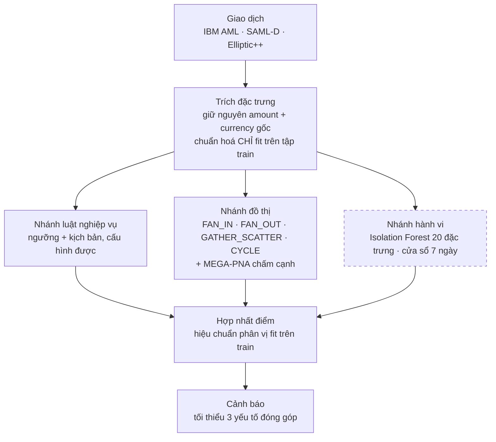
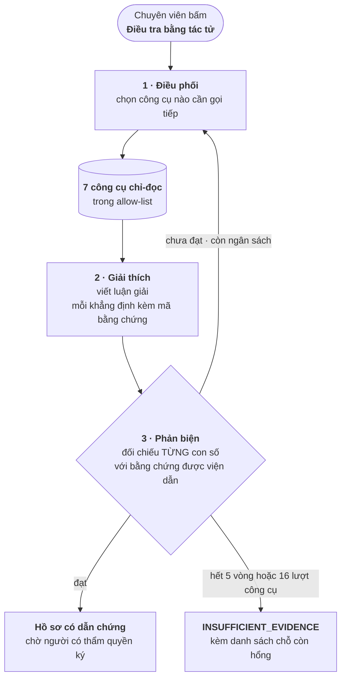

# Thiết kế kỹ thuật — FIN-07

Tài liệu này mô tả **cách hệ thống được xây**: các tầng, thuật toán phát hiện,
tầng tác tử điều tra, và những quyết định thiết kế quan trọng cùng lý do.

Tài liệu liên quan: [đặc tả hệ thống](system-specification.md) ·
[yêu cầu chức năng](functional-requirements.md) · [mô hình dữ liệu](data-model.md) ·
[kiến trúc](../architecture/architecture.md) · [hồ sơ mô hình](../ml/README.md) ·
[vận hành](../operations/README.md).

---

## 1. Tổng quan các tầng

| Tầng | Công nghệ | Mã nguồn |
|---|---|---|
| Giao diện | React 18 + TypeScript (strict) + Vite, MapLibre GL, Cytoscape | [`web/src/`](../../web/src/) |
| API | FastAPI 0.141 · uvicorn · Python 3.11 | [`src/api/`](../../src/api/) |
| Worker nền | Python, hàng đợi Redis | [`src/worker/`](../../src/worker/) |
| Truy cập dữ liệu | SQLAlchemy 2.0 · psycopg 3 | [`src/db/`](../../src/db/) |
| Phát hiện (ngoại tuyến) | scikit-learn, PyTorch Geometric, NetworkX, DuckDB | [`src/detection/`](../../src/detection/), [`src/behavior/`](../../src/behavior/), [`src/mega_pna/`](../../src/mega_pna/), [`src/fusion/`](../../src/fusion/) |
| Tác tử điều tra | Google Gen AI SDK (Gemini) | [`src/investigation/`](../../src/investigation/) |
| Nạp dữ liệu luồng | Kafka · Flink (Java) · HDFS | [`flink/aml-ingestion/`](../../flink/aml-ingestion/), [`src/streaming/`](../../src/streaming/) |
| Quan trắc | OpenTelemetry · Prometheus · Loki · Jaeger · Grafana | [`src/observability/`](../../src/observability/), [`monitoring/`](../../monitoring/) |

### 1.1 Năm file requirements — tách có chủ đích

| File | Dùng cho |
|---|---|
| `requirements.txt` | Chạy production — **Docker chỉ cài đúng file này** |
| `requirements-dev.txt` | Công cụ phát triển và kiểm thử (`-r requirements.txt`) |
| `requirements-mega-pna.txt` | Huấn luyện MEGA-PNA ngoại tuyến (CPU) |
| `requirements-mega-pna-sampler.txt` | `torch-scatter` và phụ thuộc kèm theo, cài sau `mega-pna` |
| `requirements-mega-pna-cuda118.txt` | Bản GPU CUDA 11.8 |

Gộp năm file lại sẽ **hỏng image production** — không thể nhét `torch-scatter` và
CUDA vào runtime của API. Việc tách là có chủ đích, không phải lộn xộn.

### 1.2 Quyết định thiết kế nền tảng: chấm điểm tính sẵn

**Máy chủ production không nạp file mô hình nào lúc chạy.** Không có `joblib.load`
hay `torch.load` trong `src/api/`, `src/detection/` hay `src/investigation/`.

Mô hình chạy **một lần ngoại tuyến** qua các script trong [`scripts/`](../../scripts/);
điểm được ghi vào PostgreSQL (`transaction_model_score`, `bitcoin_scored_tx`,
`edge_model_release`); API chỉ đọc bảng.

Hệ quả:

- Độ trễ API không phụ thuộc thời gian suy luận của mô hình.
- Container API không cần PyTorch, CUDA hay bộ nhớ cho mô hình.
- Điểm đang phục vụ **truy nguyên được**: `edge_model_release.model_sha256` giữ
  mã băm SHA-256 của đúng file mô hình đã sinh ra điểm đó.
- Đổi lại: đổi mô hình là một **quy trình phát hành**, không phải một lần deploy.

---

## 2. Nhánh phát hiện

Ba nhánh chạy độc lập trên cùng bộ đặc trưng, điểm được hợp nhất ở bước cuối.

Nét đứt ở nhánh hành vi là có chủ ý — xem mục 2.3.

### 2.1 Nhánh đồ thị

Đơn vị phát hiện: bộ ba `(account_key, as_of_ts, window="7d")`, cửa sổ nửa mở
`[as_of_ts − 7 ngày, as_of_ts)`. `sample_split` gán theo **thời gian của snapshot**,
không theo nhãn của từng giao dịch.

| Detector | Phiên bản đóng băng | Nội dung |
|---|---|---|
| `FAN_IN` / `FAN_OUT` | `graph_fan_v3_min` | Phân biệt **động lực hoạt động** đáng ngờ với hub bậc cao lành tính |
| `GATHER_SCATTER` | `graph_gather_v1` | Gom vào rồi toả ra trong cùng cửa sổ |
| `CYCLE` | `graph_cycle_v1` | Chu trình có hướng độ dài 2–6, có **nhân chứng nhất quán thời gian** |

**Vì sao FAN v3 không chỉ là đổi ngưỡng.** Backtest theo thời gian trên tập train
cho thấy ngưỡng bậc/hình dạng tuyệt đối của v2B có recall FAN_IN **bằng 0** ở cả
hai nhóm sớm và muộn. Một luật mềm hơn (`degree >= 8` kèm `HHI <= 0.30`) thì ổn
định nhưng chỉ đạt 50% recall. Nới đủ để bắt các mẫu FAN bậc thấp / HHI cao thì
khối lượng account-snapshot vượt mức chấp nhận được. Vì vậy v3 đo **ba nhóm tín
hiệu** thay vì một ngưỡng:

1. **Cường độ cấu trúc** — bậc và số giao dịch theo hướng.
2. **Bùng phát theo thời gian** — `max_tx_count_24h / tx_count_7d`,
   `max_unique_counterparties_24h / degree_7d`, `active_span_hours`.
3. **Thay đổi mạng lưới** — `new_counterparty_count_7d`, gia tốc bậc/số giao dịch
   so với cửa sổ 7 ngày liền trước.

Mỗi phép đo được quy về **phân vị thực nghiệm học trên tập train**, cho ra một
điểm diễn giải được và chịu được giá trị thiếu. Tín hiệu mới lạ **không bao giờ
là điều kiện bắt buộc** khi không có lịch sử (`history_available = 0`).

**Detector CYCLE.** Ba pha, tách bạch có chủ ý: (1) liệt kê SCC và lõi để tìm chu
trình ứng viên; (2) tìm nhân chứng nhất quán thời gian; (3) vật chất hoá giao dịch
**chỉ cho các cặp có hướng thuộc chu trình ứng viên đã liệt kê**. Không cắt tỉa
theo bậc, không giới hạn motif, không phân mảnh — ngữ nghĩa detector không đổi,
chỉ chi phí giảm.

### 2.2 MEGA-PNA — mô hình đồ thị chấm cạnh

Mạng nơ-ron đồ thị chấm điểm **từng cạnh giao dịch** (không phải từng tài khoản),
hiện thực ở [`src/mega_pna/`](../../src/mega_pna/). Đây là nhánh đang phục vụ hàng
đợi chính trên bản triển khai.

Quyết định kiến trúc quan trọng: MEGA-PNA vào hệ **như một nhánh phát hiện**,
không thay cả kiến trúc. Lý do đầy đủ ở
[Kiến trúc hướng B](../architecture/architecture.md#kiến-trúc-hướng-b-mega-pna-làm-một-nhánh-không-thay-cả-hệ).

**Quy tắc tiền tệ.** Giữ nguyên `Amount Paid` / `Amount Received` và
`Payment Currency` / `Receiving Currency` gốc. Chuẩn hoá theo từng loại tiền và
**chỉ fit trên tập train**. Không dùng tỷ giá tĩnh trong mô hình — cộng gộp nhiều
loại tiền bằng một tỷ giá bịa ra là tạo ra tín hiệu không có thật. Chỉ quy đổi USD
cho **luật nghiệp vụ / pháp lý**, và khi đó phải có nguồn tỷ giá kèm `as_of_ts`.

### 2.3 Nhánh hành vi — Isolation Forest

20 đặc trưng hành vi cấp `account_key`, cửa sổ nhìn lùi 7 ngày, học **không giám
sát** (không dùng nhãn khi huấn luyện). Đặc tả đầy đủ ở
[mô hình dữ liệu](data-model.md#4-đặc-trưng-hành-vi-isolation-forest).

Mô hình xếp hạng tài khoản nào **hành vi lệch mặt bằng** — tiền vào rồi rút nhanh,
số đối tác bất thường, số tiền lặp lại, giao dịch dồn sát nhau. Nó **không** gán
nhãn typology.

> **Trọng số hợp nhất bằng 0.** Nhánh này vẫn sinh cảnh báo riêng, nhưng đóng góp
> **0** vào điểm hợp nhất vì trên tập kiểm thử nó không cải thiện được chỉ số so
> với hai nhánh còn lại. Giữ nhánh lại (có giá trị chẩn đoán và giải thích) nhưng
> nói thẳng trọng số thay vì để người đọc tưởng nó đang đóng góp.

### 2.4 Hợp nhất điểm

[`src/fusion/`](../../src/fusion/) đóng gói **các bộ ước lượng đã đóng băng**, các
hiệu chuẩn phân vị **chỉ fit trên train**, và chính sách hợp nhất có trọng số vào
**một artifact phát hành**. Đây có chủ ý **không phải** một mô hình đầu-cuối mờ đục
thay thế cả hai: giữ Isolation Forest và Graph độc lập thì còn giải thích được
từng nhánh đóng góp bao nhiêu, và thay một nhánh không phải huấn luyện lại cả hệ.

### 2.5 Hợp đồng chống rò rỉ nhãn

Áp cho **mọi** nhánh:

- Dữ liệu đặc trưng và hiệu chuẩn: **chỉ tập train**.
- Chọn mô hình / ngưỡng: **tập validation**.
- Tập test: **một lần đánh giá cuối** sau khi detector đã đóng băng, không tinh chỉnh lại.
- Nhãn của bộ dữ liệu là **mục tiêu đánh giá**, không bao giờ là đầu vào detector.
- Chia tập theo **thời gian**, không chia ngẫu nhiên — chia ngẫu nhiên sẽ để mô
  hình nhìn thấy tương lai của chính tài khoản nó đang chấm.
- Tác tử điều tra **không được đọc nhãn ground truth**.

### 2.6 Vì sao không dùng accuracy

Trên IBM AML LI-Small, nhãn dương chiếm **0,068%** tập kiểm thử. Một mô hình trả
lời "không có gì bất thường" cho mọi giao dịch vẫn đúng 99,93%. Bộ chỉ số dùng
trong dự án là **F1, PR-AUC và precision tại từng mức số cảnh báo mà chuyên viên
đủ sức rà**. Quy ước trích dẫn số liệu nằm ở [`reports/README.md`](../../reports/README.md):
chỉ khoá `headline` của báo cáo mang `"schema_version": "fin07.benchmark.v1"` được
đưa vào tài liệu.

---

## 3. Hợp đồng bàn giao giữa các nhánh

Các nhánh phát hiện ghi kết quả vào bảng dùng chung để tầng điều tra dùng được
ngay, không cần sửa mã phía tiêu thụ:

| Bảng | Nhánh ghi | Tầng điều tra đọc để làm gì |
|---|---|---|
| `detection_result` | mọi nhánh | Điểm và nhánh sinh ra nó |
| `alert` + `alert_reason` | mọi nhánh | Cảnh báo và các yếu tố đóng góp |
| `graph_detector_evidence` | nhánh đồ thị | Bằng chứng motif cho công cụ `GetGraphEvidence` |
| `transaction_model_score` | MEGA-PNA / edge model | Điểm mức giao dịch cho console |
| `edge_model_release` | quy trình phát hành | Release nào đang `active`, mã băm mô hình |
| `behavior_feature_snapshot` | nhánh hành vi | Đặc trưng cho công cụ `GetAccountBehavior` |

---

## 4. Tầng tác tử điều tra

Hiện thực ở [`src/investigation/`](../../src/investigation/). Dùng Google Gen AI
SDK chính thức; `LLM_MODE=mock` cho ra một tác tử tất định không gọi mạng, dùng
cho CI và phát triển.

### 4.1 Ba vai

Ba vai gọi **độc lập** cùng một `GeminiService`. Tác tử **không tự khởi động** —
chỉ chạy khi chuyên viên bấm nút.

### 4.2 Cổng công cụ

Bảy công cụ, allow-list cứng trong `InvestigationTools.ALLOWED`:

| Công cụ | Trả về |
|---|---|
| `GetRiskBreakdown` | Điểm rủi ro chính thức và đóng góp của từng nhánh |
| `GetAccountBehavior` | Đặc trưng hành vi tất định trong một cửa sổ có giới hạn |
| `GetTransactions` | Giao dịch nguồn liên quan tài khoản, có giới hạn số dòng |
| `GetGraphEvidence` | Bằng chứng có cấu trúc do detector đồ thị phát ra |
| `GetGraphNeighborhood` | Duyệt lân cận giao dịch, tất định, có giới hạn |
| `GetTypology` | Tra typology qua danh mục có phiên bản |
| `GetAnomalyExplanation` | Quy kết độ lệch đặc trưng cho cảnh báo ML |

**Mọi phép duyệt và mọi phép tính đều xảy ra trong cổng này.** Mô hình chọn được
tên công cụ và tham số **có ràng buộc**, nhưng **không phát được câu SQL nào và
không chạy được mã tuỳ ý**. Tham số được xác thực bằng Pydantic rồi mới qua bước
kiểm quyền; tên công cụ ngoài allow-list bị từ chối và ghi lại.

Đây là hiện thực của nguyên tắc *không tự tính số*: mô hình ngôn ngữ không được
tự cộng trừ, mọi con số trong hồ sơ phải đến từ một lượt gọi công cụ.

### 4.3 Máy trạng thái và ngân sách

`WorkflowState`: `INITIALIZED → COLLECTING_EVIDENCE → EXPLAINING → VALIDATING →
COMPOSING_REPORT → COMPLETED` (hoặc `FAILED`).

`InvestigationStatus`: `QUEUED`, `INVESTIGATING`, `COMPLETED`,
`INSUFFICIENT_EVIDENCE`, `NEEDS_HUMAN_REVIEW`, `FAILED`.

Trần chi phí: `AML_AGENT_MAX_ITERATIONS = 5`, `AML_AGENT_MAX_TOOL_CALLS = 16`. Chạm trần thì phiên
kết thúc ở `INSUFFICIENT_EVIDENCE` **kèm lý do cụ thể** (hết vòng hay hết lượt gọi
công cụ) — không kết luận bừa để lấp chỗ trống.

### 4.4 Kiểu bằng chứng

`EvidenceType`: `RISK_BREAKDOWN`, `RULE_TRIGGER`, `BEHAVIOR_FEATURE`,
`ANOMALY_EXPLANATION`, `TRANSACTION`, `GRAPH_PATTERN`, `GRAPH_NEIGHBORHOOD`,
`TYPOLOGY_MAPPING`.

Mỗi bằng chứng mang `EvidenceIntegrity`: hệ nguồn, danh sách mã bản ghi nguồn, và
`content_hash` SHA-256. Nút Phản biện dùng đúng bộ này để đối chiếu.

### 4.5 Ranh giới bắt buộc

Tác tử **luôn bất đồng bộ và luôn chỉ đọc**. Không có mũi tên nào từ tác tử quay
ngược vào đường quyết định. Ràng buộc này được cưỡng chế bằng **quyền PostgreSQL**
([`db/init/003_agent_readonly_role.sh`](../../db/init/003_agent_readonly_role.sh)),
không phải bằng quy ước trong mã.

---

## 5. Soạn SAR và xuất PDF

- [`src/api/sar_drafter.py`](../../src/api/sar_drafter.py) — soạn bản nháp bằng Gemini từ bằng chứng có cấu trúc.
- [`src/api/sar_graph.py`](../../src/api/sar_graph.py) — dựng đồ thị minh hoạ bằng `fpdf` (không dùng matplotlib, tránh kéo theo phụ thuộc đồ hoạ vào container API).
- [`src/api/sar_pdf.py`](../../src/api/sar_pdf.py) — kết xuất PDF, phông chữ nhúng trong [`src/api/assets/fonts/`](../../src/api/assets/fonts/) để hiển thị đúng tiếng Việt.

Bản nháp và bản chính thức là hai đường xuất khác nhau; bản chính thức chỉ có sau
khi Quản lý duyệt.

---

## 6. Quyết định hiệu năng

| Vấn đề gặp thật | Nguyên nhân | Cách xử lý |
|---|---|---|
| Một truy vấn nặng làm treo cả tiến trình, kể cả trang đăng nhập | Handler khai báo `async def` nhưng gọi CSDL đồng bộ → chặn vòng lặp sự kiện | Handler đọc CSDL khai báo là **`def`** → FastAPI chạy chúng trong threadpool |
| Đăng nhập đồng thời xếp hàng tuyến tính | PBKDF2 200.000 vòng chạy trên vòng lặp sự kiện | Đẩy ra thread bằng `asyncio.to_thread` |
| Tải lại trang chậm | Mỗi lần F5 gọi lại toàn bộ API | Cache SWR phía trình duyệt (`sessionStorage`) — vẽ ngay bản cũ, làm mới nền |
| Truy vấn nặng nghẽn cả instance CSDL | Cloud SQL `db-f1-micro` (~0,6 GB RAM) không đủ cache working set | Nâng lên `db-custom-2-7680` (2 vCPU / 7,5 GB) ngày 22/08/2026 |

---

## 7. Nạp dữ liệu luồng (tuỳ chọn)

Kafka → Flink → HDFS, cộng consumer chấm điểm. Trạng thái: **đã dựng và chạy
end-to-end ở môi trường local-dev; chưa triển khai production** (VM production
nhỏ, cần quyết định hạ tầng streaming trước).

Đặc điểm thiết kế: Random Forest chấm **độc lập từng giao dịch**, nên điểm ở chế
độ luồng **giống hệt** chế độ lô — không trôi theo cửa sổ. Consumer commit offset
**sau khi** ghi CSDL (at-least-once).

Gửi CSV vào Kafka **không** tự tạo cảnh báo trên console: đường nạp luồng và đường
phát hiện theo lô hiện là hai đường riêng.

---

## 8. Nợ kỹ thuật đã biết

- Ba bảng định tuyến song song (`ROUTE_ROLES`, `NAV_PERMISSION`, `authz.POLICY`)
  phải chỉnh tay cho khớp — xem [yêu cầu chức năng §7.1](functional-requirements.md#71-giới-hạn-đã-biết).
- Tầng SILVER (khử trùng lặp theo `transaction_id`) chưa có, nên mọi thành phần
  đọc BRONZE phải tự khử trùng.
- Chưa có runtime phát hiện dạng dịch vụ (feature platform, detection service);
  phát hiện hiện chạy **theo lô** qua `scripts/`, không phải theo luồng.
- Streaming chưa lên production; `OTEL_ENABLED` mặc định tắt trên production.
